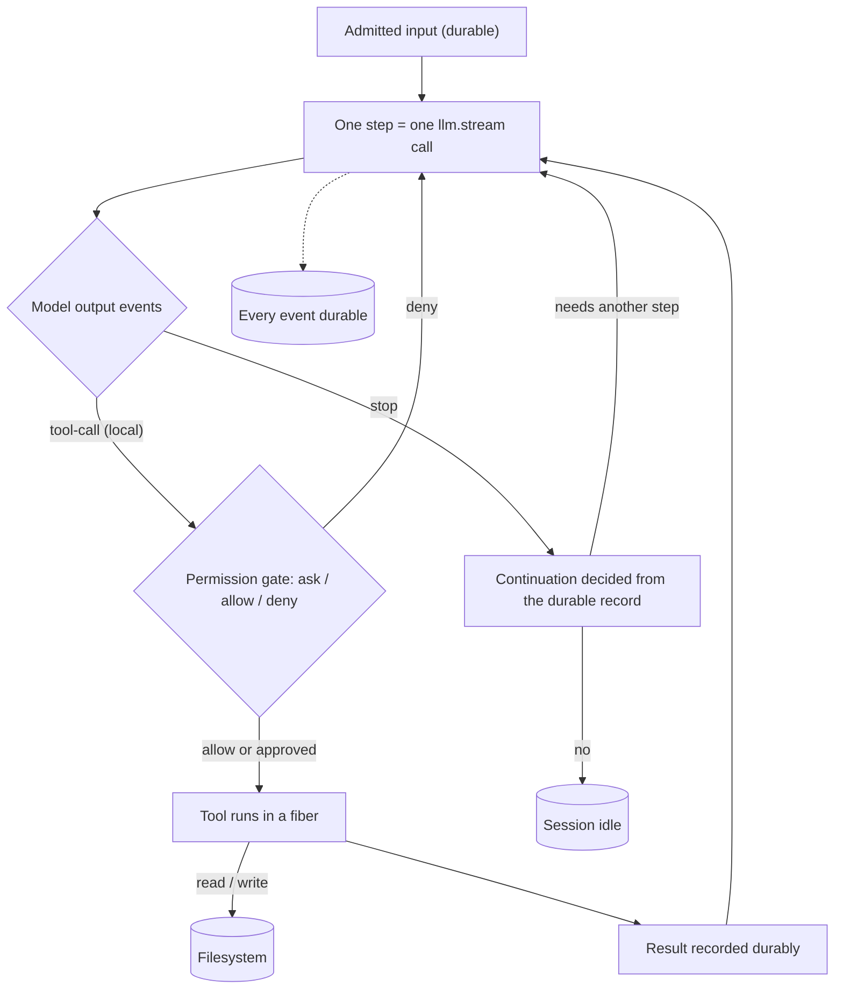
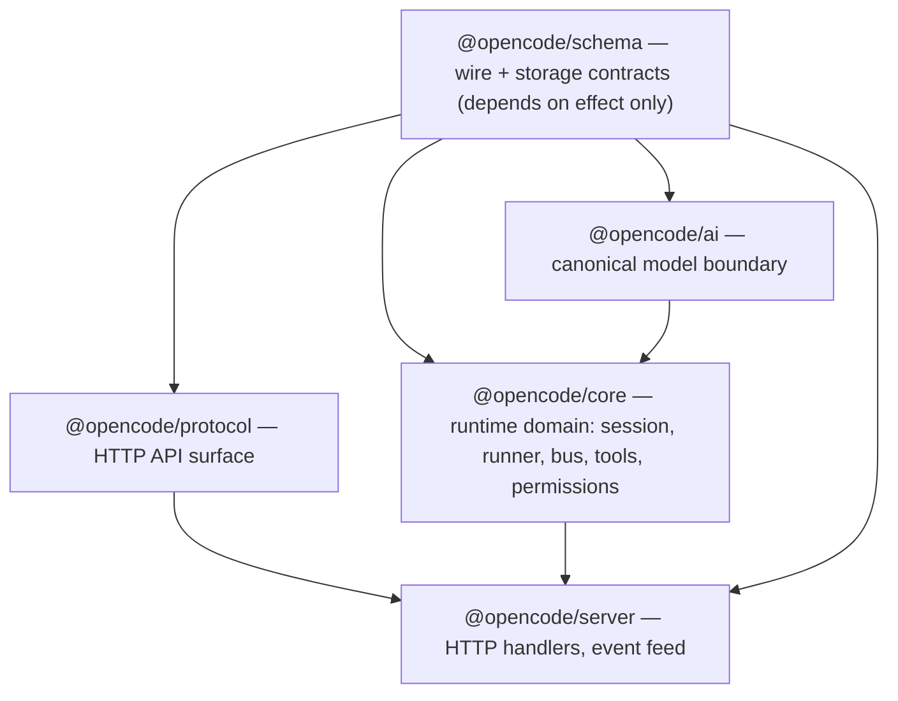

# Part 0 — Orientation

A coding agent is not a chat window with function calls bolted on. It is a small machine:
a loop that makes exactly one model call per step, tools that change the world, a
filesystem it reads and mutates, durable storage that survives a crash, and a permission
gate on every effect. Everything later in this series is a detail of those five parts.
This part establishes what the machine is (0.1) and how opencode's code is laid out to
build it (0.2). Read it once for the shape; the rest of the series fills in the
mechanism.

Topics:

- **0.1 — What a coding agent actually is.** Loop, tools, filesystem, persistence,
  permission, and why the central rule is one LLM call per step with no in-memory tool
  loop.
- **0.2 — The architecture map.** `schema → protocol/core → server` with `ai` beside
  them, Location-scoped versus global services, Effect as dependency injection and
  structured concurrency, and the vocabulary the series uses.

---

## 0.1 What a coding agent actually is

### Thesis

A coding agent is a loop that makes one model call per step over a durable, resumable
record of work, with tools, a filesystem, and a permission gate on the effects — and the
rule that there is no in-memory tool loop is what turns a chat script into a system that
can crash, resume, be steered, and be observed.

### Cold open

You build the obvious thing first: a `while` loop that calls the model, runs whatever
tools it asks for, appends the results to an in-memory array, and calls the model again
until it stops. It works in the demo. Then the process is killed mid-task and the
conversation is gone. A tool asks to delete a directory and there is nowhere to say no.
The context window fills up and the next call is rejected. You have a chat script, not an
agent.

### The concept

Strip away the UI and the provider catalogs and an agentic coding tool is five ingredients
wired together:

- **A loop.** Something repeatedly decides whether to continue and what to send next.
- **Tools.** Callable capabilities the model may invoke: read a file, edit a file, run a
  command, spawn a subagent.
- **A filesystem.** The point of a *coding* agent is that it changes the repository, so
  reads and writes are first-class effects, not a side channel.
- **Persistence.** Every fact that matters is recorded before the next decision, so a
  crash, a restart, or a second process can pick up where the first left off.
- **Permission.** Effects that can harm the user's machine are gated on an explicit
  decision, and that decision must not be something the model can fabricate.

The naive design is a chat-with-tools loop. Its loop body lives in memory: call the model,
branch on its output, execute tools, push results into an array, repeat. It fails for five
structural reasons, and each one maps to one of the ingredients above.

- **The loop has no memory of itself.** The decision to continue lives in a local
  variable. If the process dies, the loop dies with it; there is no record to resume from.
- **Tools run without a gate.** In-memory execution has no seam between "the model asked"
  and "the effect happened." Adding a permission check after the fact means every tool
  path needs one, and a missed path is a silent policy hole.
- **The transcript is unbounded.** Appending results forever means the request eventually
  exceeds the context window, and there is no measured number to budget against.
- **Nothing is observable.** There is no durable event to stream to a client, so the only
  window into the agent is the process itself.
- **Nothing can be steered.** You cannot change the plan of a running loop that keeps its
  state in a closure.

opencode's answer is to make the step the unit. A **step** is one logical LLM call and the
durable record it produces. There is no in-memory loop over tool calls: each tool call is
dispatched, its result is recorded, and continuation is a *decision derived from the
recorded history*, not from the arrival of a tool result inside a loop. The repo states
this as a rule to protect:

```
// AGENTS.md:183
- Each step is one explicit `llm.stream` call that continues from reloaded history. Do not add an in-memory tool loop.
```

The alternatives that were rejected follow from that rule. The obvious alternative — a
provider SDK's built-in "max steps" agent loop, which calls the model and runs tools
internally — is rejected because it hides the seam where permissions, persistence, and
steering live. A second alternative — treating each model call as stateless and keeping
continuation in the caller's stack — is rejected because then the caller, not the durable
record, decides when to stop. opencode keeps the model call stateless *and* keeps the
continuation decision in the record.

Why one call per step, precisely? Because "one step" and "one durable record" being the
same thing means every question the loop asks — did we finish, did a tool fail, did we hit
the output limit, should we compact — is answered by reading rows, not by inspecting a
live closure. That is what makes the machine resumable and observable at the same time.

### Diagram

**D16 — What a coding agent is.** The five ingredients and the one-call-per-step rule.



```text
   admitted input (durable)
            │
            ▼
   ┌────────────────────────┐
   │ one step = one llm call │◀───────────────┐
   └───────────┬────────────┘                │
               ▼                             │
        model output events                  │
         │            │                      │
   tool-call       stop                      │
         │            │                      │
         ▼            ▼                      │
  permission gate  continuation from        │
   │        │       durable record           │
 allow    deny        │        │            │
   │        │      another    idle           │
   ▼        └──────►step ◀────┘              │
 tool runs                     (filesystem) │
   │                                        │
 result recorded durably ──────────────────►┘
```

**Narration.** The picture starts with input that has already been written down, and a
step is a single call to the model. The model streams back events; if it asks for a local
tool, the request goes through a permission gate and, if allowed, the tool runs in its own
fiber and its result is written down before the loop looks again. If the model stops, the
decision to continue is made from what was recorded, not from an in-memory variable. Every
arrow that could be lost in a crash terminates in durable storage.

### The real thing

The whole agent is three nested functions. `drain` decides what work exists and loops;
`advanceToStep` prepares one boundary and either returns loaded context or a move/reload;
`runStep` owns the policy for one logical step; and `attempt` owns the streaming and the
durable settlement of one try at that step.

```
// packages/core/src/session/runner/llm.ts:191
      while (true) {
        const next = yield* advanceToStep()
        if (next._tag !== "Ready") return next
        continuing = yield* runStep(next.context, step)
        step++
        force = false
        entering = false
      }
```

`drain` is the body of that loop; notice the return type, `DrainResult`, whose cases
(`Complete`, `Moved`, `Reloaded`) are the only ways out.

```
// packages/core/src/session/runner/index.ts:30
/** Runs one local continuation from already-recorded Session history. */
export interface Interface {
  /** Drains eligible durable work, returning transient state when execution must continue at a new Location. */
  readonly drain: (input: {
    readonly sessionID: SessionSchema.ID
    readonly force: boolean
    readonly continuation?: Continuation
    /** "steer" settles the active intent without promoting queued next-turn work. */
    readonly promotable?: Promotable
  }) => Effect.Effect<DrainResult, RunError>
}
```

`runStep` builds exactly one request and hands it to exactly one `attempt` per iteration.
The retries and continuations you see are new iterations building a *new* request from
reloaded history, not a tool loop.

```
// packages/core/src/session/runner/llm.ts:227
        const transcript = SessionModelRequest.baseTranscript({
          agent: loaded.agent.info,
          model: loaded.model,
          tools: loaded.tools,
          initial: loaded.initial,
          messages: loaded.messages,
        })
        const prepared = yield* context.request.primary({
          session: loaded.session,
          agent: loaded.agent.id,
          model: loaded.model,
          tools: loaded.tools,
          system: transcript.system,
          messages: stepLimitReached
            ? [...transcript.messages, Message.assistant(MAX_STEPS_PROMPT)]
            : transcript.messages,
          // Keep tool definitions on the final Step to preserve the provider's cached prefix.
          toolChoice: stepLimitReached ? "none" : undefined,
          webSocket: "session",
          inputTokens: SessionCompaction.estimatePrompt(loaded),
        })
        const outcome = yield* steps.attempt({
```

`attempt` makes the single model call and, when a local tool call arrives, starts a fiber
for it. Hosted tools — ones the provider executes — are skipped here, because their result
comes back inside the same stream.

```
// packages/core/src/session/runner/step.ts:107
    const providerStream = llm.stream(input.prepared.request, input.prepared.options).pipe(
      Stream.runForEach((event) =>
        Effect.gen(function* () {
          if (overflowFailure || publisher.hasProviderError()) return
          // Wait here, where cancellation still works, rather than inside the uninterruptible publish.
          if (!publisher.hasStarted()) yield* Fiber.join(pendingStartSnapshot)
          if (
            LLMEvent.is.providerError(event) &&
            isContextOverflowFailure(event) &&
            !publisher.record().outputStarted
          ) {
            overflowFailure = event
            return
          }
          yield* publisher.publish(event)
          if (event.type !== "tool-call" || event.providerExecuted) return
```

What to notice:

- The step's only model call is `llm.stream(...)` at `step.ts:107`. One call, one step.
- `drain`'s exit is a tagged union (`DrainResult`), not a boolean. Continuation is data.
- `runStep`'s `while (true)` exists for retries, compaction, and output-limit continuations
  — each iteration rebuilds the transcript from `loaded.messages`, the durable history.
- The comment "Keep tool definitions on the final Step to preserve the provider's cached
  prefix" shows that even the terminal step is shaped for prompt-cache stability.
- `fibers` appear only after the provider asks for a tool. There is no `while` over tool
  results.

### The prompts

No prompts in this topic — the prompts live in Appendix A under **Loop**.

### Build it

Minimal shape, stack-agnostic. The point is where state lives.

```ts
// durable, resumable, gated agent loop
async function drain(sessionID) {
  while (true) {
    const work = await nextWork(sessionID)        // read the durable inbox
    if (!work) return "complete"
    const context = await loadContext(sessionID)   // read durable history
    const finished = await step(context)           // one step
    if (finished) return "complete"
    // loop again: the decision came from the record, not from this stack
  }
}

async function step(context) {
  const request = buildRequest(context)            // canonical request
  for await (const event of model.stream(request)) {
    await record(event)                            // durable before anyone acts
    if (event.type === "tool-call" && !event.hosted) {
      if (await permission(event) === "deny") continue
      runToolInFiber(event)                        // parallel-safe, non-blocking
    }
  }
  await settleStep()                               // record finish / usage
  return !needsAnotherStep()
}
```

Decisions and trade-offs:

- **Make the step the durable unit.** If a step can be lost, nothing downstream can be
  reasoned about. Record the request, every streamed event, and the finish before deciding
  to continue.
- **Gate tools at the seam, not inside each tool.** A single gate is auditable; per-tool
  checks rot.
- **Do not branch on tool results in the loop.** The tool writes a result; the next step
  reads it from history. This is what lets you crash between the two.
- **Separate admission from execution.** Recording that work exists (admission) is cheap
  and always available; running it is expensive and may be declined or interrupted.

Design note: the temptation is to keep a `toolResults` array and append. Resist it. Every
piece of loop state that lives only in a variable is a piece you cannot recover, steer, or
stream.

### How it fails

- **The in-memory loop loses the run on crash.** Symptom: after a restart the agent has no
  idea what it was doing; the user retries the whole task.
- **A missed permission gate.** Symptom: a destructive tool runs without a prompt because
  one code path bypassed the check.
- **An unbounded transcript.** Symptom: mid-task, the provider returns a context-overflow
  error and the run stalls with a partial result.
- **A phantom continuation.** If continuation is derived from a live variable rather than
  the record, a retry can double-run a tool or skip one. Symptom: duplicate file edits.
- **Hosted-tool confusion.** Treating a provider-executed tool as local means trying to run
  a tool you do not have; symptom: "no tool named …" errors that the model cannot fix.

### How you'd test it

Assert the invariant: **a step is exactly one model call, and continuation is decided from
the durable record alone.** Kill the process after the model stream is recorded but before
the next step, restart, and drive the same session. The resumed run must make the same
continuation decision as the killed run would have, and must not re-issue an already
recorded tool call. Count calls to the model client: one per step, never more.

### Recap

- A coding agent is five ingredients: loop, tools, filesystem, persistence, permission.
- The central rule is one LLM call per step; there is no in-memory tool loop.
- Continuation is a decision derived from the durable record, which is what makes crash,
  resume, steering, and observation possible at all.

Next: how the code is arranged to build this without the pieces collapsing into each
other.

### Podcast notes

- **Hook:** The demo loop that works until you kill the process.
- **Analogy:** A signed ledger versus a whiteboard: the whiteboard is faster until someone
  bumps it.
- **Talking points:** A step is one model call and one durable record. Tools run in fibers,
  not in a loop. Permission, persistence, and steering all need the seam between "asked"
  and "happened" that an in-memory loop erases.
- **Listeners will ask:** "Isn't one model call per step just slower?" (It is the same
  number of calls; the difference is where the decision to make the next one lives.)

---

## 0.2 The architecture map

### Thesis

opencode is layered so that contracts (`schema`), the model boundary (`ai`), the runtime
(`core`), and the HTTP surfaces (`protocol`, `server`) can only depend in one direction,
and within the runtime every service is either Location-scoped (per working directory) or
global, with Effect providing the dependency graph and the concurrency primitives.

### Cold open

You want to add a feature. You open `session/runner/llm.ts` and see `yield* Bus.Service`,
`yield* SessionStore.Service`, and `yield* SessionContext.Service` side by side with no
hint that the first two are process-wide singletons and the third is rebuilt for every
working directory. You cannot tell which layer is allowed to import which. Nothing tells
you where a per-directory cache belongs. The architecture map is the answer to "where does
this go, and what may it depend on."

### The concept

opencode's dependency rule is one line of direction: contracts flow inward, implementations
depend on contracts, and nothing depends on the layers above it.

- `@opencode/schema` owns browser-safe wire and storage contracts. Its only dependencies
  are `effect` and a spec package.
- `@opencode/ai` owns the canonical model boundary: the request/response classes, the
  streaming event union, tool definitions, and the route machinery that turns a canonical
  request into a provider call. It depends only on `schema`.
- `@opencode/protocol` owns the HTTP API surface, depending on `schema`.
- `@opencode/core` owns the runtime: the session, the runner, the bus, tools, permissions,
  the filesystem. It depends on `ai`, `schema`, and supporting packages.
- `@opencode/server` wires core and protocol into HTTP handlers and the event feed. It
  depends on core, protocol, and schema.

The direction is stated in the repo's own guides.

```
// packages/schema/AGENTS.md:7
- Preserve the dependency direction: `@opencode/schema <- @opencode/protocol <- @opencode/server`.
```

```
// AGENTS.md:1
- After changing the public Protocol or Server `HttpApi`, run `bun run generate` from `packages/client`. Do not edit generated client files directly.
- Keep runtime dependencies directed from Schema to Core and Protocol, then from Core and Protocol to Server. Client runtime code may depend on Schema and Protocol but never Core or Server; `sdk` composes Client, Core, and Server.
```

Two consequences matter for reading the code. First, `ai` is *beside* core, not beneath it:
core depends on `ai`, and `ai` never imports core. `LLM.stream`/`LLM.generate` run exactly
one model call and know nothing about sessions. Second, contracts are shared identity: core
re-exports the canonical schema values rather than redefining them, so there is one
`Session.Info` in the process, not a copy per layer.

**Location-scoped versus global.** Within core, a service graph is either built once for
the process or built per working directory.

| Scope | Built for | Examples | Node helper |
|---|---|---|---|
| Global | the process | bus, database, session store, inbox, execution coordinator, LLM transport | `makeGlobalNode` |
| Location | one working directory and its project/workspace identity | runner, context, model request, compaction, tools, permissions, filesystem | `makeLocationNode` |

The scoping is not cosmetic. A Location is "the scoped environment a service graph is
built for: working directory and project/workspace identity" (Appendix D). The runner is
Location-scoped because its tools, permissions, and filesystem are. The execution
coordinator is global because it must route any session to the right Location's instance
when a drain starts.

Effect is the substrate that expresses both ideas. The pieces you will meet, named once:

- **Effect** — a description of a computation with typed success, typed error, and typed
  requirements.
- **Layer / Service** — a dependency graph and a named capability resolved from it. This
  is dependency injection.
- **Fiber** — a lightweight, interruptible concurrency unit.
- **Scope** — a lifetime; resources acquired in a scope are released when it closes.
- **Deferred** — a one-shot, awaitable promise.

opencode wraps Layers into a typed graph (`LayerNode`) tagged `global` or `location`, so a
service declares its scope by how it is constructed and the tag system rejects a location
service that depends on another location service through the wrong edge.

**Vocabulary.** The series uses these terms with fixed meanings (Appendix D). Learn them
now; the code uses them literally.

| Term | Meaning | Where it lives |
|---|---|---|
| Session | durable, resumable unit of agent work | `session/session.ts` |
| Step | one logical LLM call and its durable record | `session/runner/step.ts` |
| Execution | one process-local busy period: one fiber that drains until idle | `session/run-coordinator.ts` |
| Drain | one pass of the runner over eligible durable work | `session/runner/llm.ts` |
| Turn | the conceptual unit from prompt promotion until the session would go idle; a sequence of steps | (conceptual) |
| Inbox | the durable, pending-only queue of admitted-but-undelivered work | `session/inbox.ts` |
| Projection | folding a durable event into a read model inside the event's transaction | `session/projector.ts` |

The distinction between *step* and *turn* is a correctness rule, not a nicety: one step is
one model call, and never call that a turn. The distinction between *admission* and
*execution* is the other rule: recording that work exists is separate from scheduling it.

### Diagram

**D1 — Layering and module dependencies.** Contracts point inward; implementations depend
upward only through contracts.



```text
                 @opencode/server
             (HTTP handlers, event feed)
               ▲            ▲
               │            │
     @opencode/core     @opencode/protocol
   (runtime: session,     (HTTP API surface)
    runner, bus, tools,
    permissions)
        ▲     ▲
        │     └───────────────┐
  @opencode/ai            @opencode/schema
 (canonical model          (wire + storage
  boundary)                 contracts)
        ▲                       ▲
        └───────────────────────┘
              (ai depends on schema)
```

**Narration.** Picture five boxes. Contracts sit at the bottom: `schema` depends on nothing
but the Effect library, and `ai` sits beside the runtime, depending only on `schema`.
`core` builds the agent on top of `ai` and `schema`; `protocol` describes the HTTP surface
over `schema`; and `server` stitches `core` and `protocol` together. Every arrow points
toward the contracts, so no contract needs to know about an implementation.

### The real thing

A node declares its scope by which helper it uses. `app-node.ts` defines the two tags and
the two constructors; everything else is built on them.

```
// packages/util/src/effect/app-node.ts:3
export const tags = LayerNode.tags({
  location: ["global"],
  global: [],
})

export type GlobalGraph<A, E = never> = LayerNode.Graph<A, E, (typeof tags.values)["global"]>
export type LocationGraph<A, E = never> = LayerNode.Graph<A, E, (typeof tags.values)["location"]>

export const makeGlobalNode = tags.make("global")
export const makeLocationNode = tags.make("location")
```

The runner is Location-scoped: its node lists the tools, filesystem, compaction, and model
request services it needs, all of them per-directory.

```
// packages/core/src/session/runner/llm.ts:391
export const node = makeLocationNode({
  service: Service,
  layer,
  deps: [
    Bus.node,
    LocationLifecycle.node,
    llmClient,
    SessionContext.node,
    SessionModelTransport.node,
    SessionStore.node,
    SessionCompaction.node,
    Plugin.node,
    SessionTitle.node,
    Snapshot.node,
    ToolOutput.node,
    Database.node,
  ],
})
```

The execution coordinator is the global service that bridges the two scopes. It is
`makeGlobalNode`, but each drain routes the session to its Location's services through
`Instance.Service.provide`, which is what makes a global coordinator able to run
location-scoped runners.

```
// packages/core/src/session/execution.ts:93
      const session = yield* store.get(sessionID)
      if (!session) return yield* Effect.die(new Error(`Session not found: ${sessionID}`))
      const result = yield* SessionRunner.Service.use((runner) =>
        runner.drain({ sessionID, force, continuation, promotable }),
      ).pipe(
        instances.provide(session),
```

The bus is global and it is where "projection" becomes concrete: when a durable event is
committed, its projectors run inside the same database transaction, after which the event
is notified live.

```
// packages/core/src/bus.ts:395
                        const committed = {
                          ...event,
                          durable: { aggregateID, seq, version: durable.version },
                        } as Event.Payload
                        const route = yield* prepareRoutes([committed])
                        for (const projector of list) {
                          yield* projector(committed)
                        }
                        if (commit) yield* commit(seq)
```

What to notice:

- Scope is declared, not implied: `makeLocationNode` versus `makeGlobalNode` is the only
  difference between a per-directory service and a process-wide one.
- `instances.provide(session)` at `execution.ts:98` is the exact seam where a global
  coordinator reaches a Location-scoped runner. This is the whole Location story in one
  line.
- Projectors run inside the transaction (`bus.ts:400`), so a read model can never observe a
  half-written event.
- The runner's `deps` are almost all Location-scoped. The two global entries (`Bus.node`,
  `Database.node`) are shared substrate, which is why a Location graph may reference them.

### The prompts

No prompts in this topic — the prompts live in Appendix A under **Loop**.

### Build it

A minimal version of the same layering, without Effect.

```ts
// contracts: no imports from runtime
type Session = { id: string; messages: Message[] }
type LLMRequest = { model: string; messages: Message[]; tools: ToolDef[] }

// model boundary: depends on contracts only
function stream(request: LLMRequest): AsyncIterable<LLMEvent> { … }

// runtime: depends on the model boundary
class SessionRuntime {                 // global
  constructor(private bus: Bus, private store: Store) {}
  async drain(sessionID: string) {
    const session = await this.store.get(sessionID)
    const location = this.locations.for(session.directory)   // switch scope here
    return location.runner.drain(sessionID)
  }
}

// http: depends on runtime and protocol
function handler(runtime: SessionRuntime) { … }
```

Decisions and trade-offs:

- **One direction only.** If a contract imports a runtime type, the build breaks the
  layering, and cyclic graphs return. Enforce it with a lint rule or a test, not discipline.
- **Scope by construction.** Do not pass a directory into every call; build a per-directory
  graph once and route to it. Otherwise you re-derive the same state on every request.
- **Put the seam where the two scopes meet.** A global coordinator that routes to
  per-directory runners is easier to reason about than a per-directory coordinator that
  needs global locks.

### How it fails

- **A location service reaches for another location service directly.** Symptom: two
  working directories share one cache, or a runner for one project reads another's files.
- **A contract imports a runtime type.** Symptom: cycles at import time and a schema
  package that cannot run in the browser.
- **The global coordinator holds Location state.** Symptom: stale paths after a directory
  is moved; the fix is to re-resolve placement on each drain.
- **Two identities for one contract.** Symptom: an event that validates at one boundary
  fails at another because there are two `Session` types.

### How you'd test it

Assert two invariants. First, **dependency direction**: a test that walks the import graph
and fails if `ai` or `protocol` imports core, or if a `location` node depends on a
`location` node outside its own graph. Second, **scope**: build two Location graphs for two
directories, run a tool through each, and assert that state written through one is not
visible through the other, while global state (the bus, the store) is shared.

### Recap

- Contracts point inward: `schema`, then `ai` beside the runtime, then `core` and
  `protocol`, then `server`.
- Services are global or Location-scoped by construction; a global coordinator routes a
  session to its Location's instance when a drain starts.
- Effect supplies the dependency graph (Layer/Service) and the concurrency (Fiber, Scope,
  Deferred), and the series uses the glossary's fixed vocabulary.

Next: the model boundary, where the canonical request and response shapes are defined and
where provider quirks first threaten correctness.

### Podcast notes

- **Hook:** Three `yield*` lines in one function, two of them process-wide and one per
  working directory, with nothing in the code to say which is which.
- **Analogy:** A building's wiring diagram: contracts are the code of standards, services
  are the outlets, and scope is which breaker a room is on.
- **Talking points:** `ai` sits beside core, not under it. Location scoping is a real
  correctness boundary, not just caching. One Layer graph per directory, one coordinator
  for the process.
- **Listeners will ask:** "Why not make everything global?" (Because the filesystem,
  permissions, and tools belong to a directory; sharing them would leak state across
  projects.)
