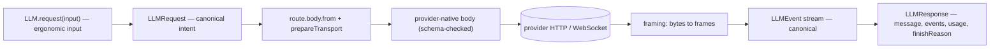
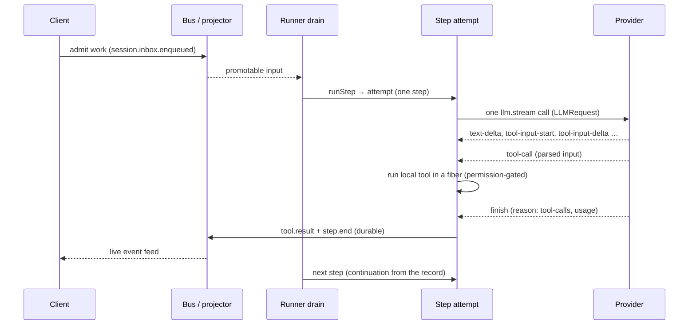
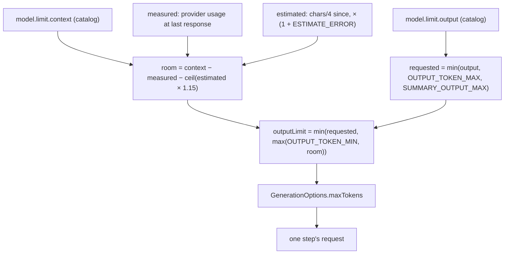
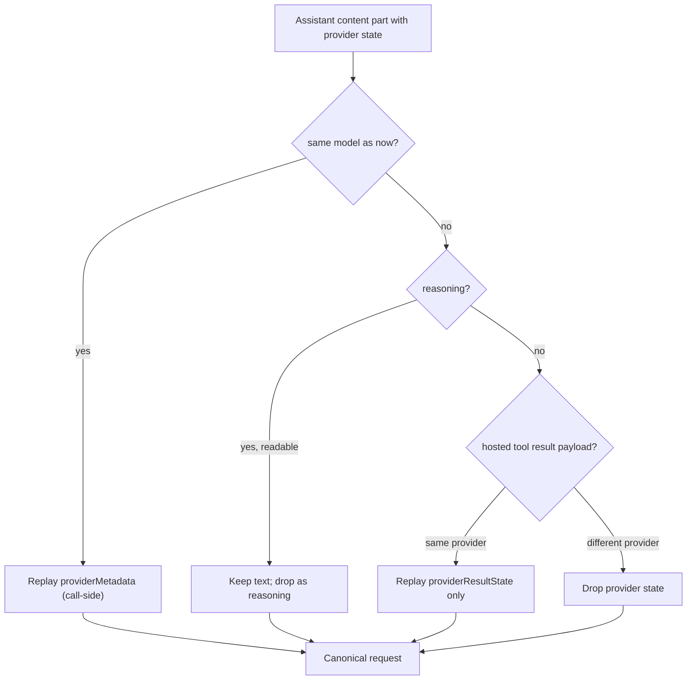

# Part 1 — The model boundary

Every agent lives or dies by its model boundary: the one place where a provider's wire
format is translated into a canonical request and back into a canonical stream of events.
opencode puts that boundary in `@opencode/ai`, which knows nothing about sessions and runs
exactly one model call per invocation. This part defines the canonical request and response
(1.1), the streaming event union and how partial tool input becomes a tool call (1.2), how
the output budget keeps a step inside the context window (1.3), and the provider state that
leaks past the boundary and threatens correctness (1.4). Read it before the loop, because
the loop is written entirely in terms of what this part defines.

Topics:

- **1.1 — Canonical request/response.** `Message`, `SystemPart`, `LLMRequest`, tool
  definitions, and generation options; one shape for every provider.
- **1.2 — Streaming events and finish reasons.** The `LLMEvent` union, partial tool input,
  terminal events, and the finish reasons `stop`, `length`, `tool-calls`, `content-filter`,
  `error`, `unknown`.
- **1.3 — Output-token budgeting.** `outputLimit`, measured versus estimated prompt size,
  and the reserve that keeps input plus output inside the window.
- **1.4 — What leaks into correctness.** Provider metadata replay, reasoning handling, and
  hosted (provider-executed) tools.

---

## 1.1 Canonical request/response

### Thesis

Every provider is spoken to through one canonical request class (`LLMRequest`) and one
canonical response class (`LLMResponse`), so the agent loop never branches on a provider
shape and a new provider is added by writing a translator, not by touching the loop.

### Cold open

You want to add a provider. You start editing the loop to pass its `tools` field instead of
the one you had, and to read `finish_reason` instead of `stop_reason`, and to special-case
its system message. Within a week the loop is a switch statement over provider names and
every bug is provider-specific. The fix is a canonical shape that every provider lowers to
and from, so the loop speaks one language.

### The concept

The boundary has two halves with one rule each.

- **Request side.** The caller builds an `LLMRequest`: a model reference, ordered system
  parts, ordered messages, tool entries, an optional tool choice, generation options,
  provider options, and HTTP options. Every one of these is a canonical type, not a
  provider payload.
- **Response side.** The provider streams a sequence of canonical `LLMEvent`s, which fold
  into an `LLMResponse` carrying the assembled message, the raw events, usage, and a finish
  reason.

The key design decision is that `LLMRequest` is *not* the wire body. It is the canonical
intent. A route compiles it: `route.body.from(request)` produces a provider-native,
schema-checked body, and `route.prepareTransport(...)` turns that into a prepared request.
The alternatives are worse in specific ways:

- **A provider object as the request.** Then every caller is coupled to one provider, and
  cross-provider fallback (rotate the route, replay the same intent) is impossible.
- **The raw wire body as the request.** Then prompt caching, compaction, and tool schema
  sanitisation have nowhere to live, because they are canonical concepts with
  provider-specific encodings.
- **One request type per protocol.** Then the loop has N code paths; opencode keeps the
  loop at one and puts the branching inside the protocol translators.

`LLMRequest` is immutable and updated functionally (`LLMRequest.update`), which is what
lets the model-request layer add session headers, a cache key, and image budgeting without
mutating a shared object. The **system prompt** is a list of `SystemPart`s rather than a
string because providers differ on whether there is a privileged system role and how to
attach cache markers; lowering also needs the non-leading system parts to become
chronological system updates.

### Diagram

**D17 — The canonical model boundary.** One intent in, one event stream out.



```text
 LLM.request(input)          route.body.from           provider
   ergonomic  ───────────▶  ────────────────▶  ───────────────▶
   input           LLMRequest   provider body      HTTP/WebSocket
                   (canonical   (schema-checked)
                    intent)
                                                         │
   LLMResponse      LLMEvent stream     frames           ▼
   ◀──────────────  ◀──────────────  ◀──────────────  bytes
   message, events,   canonical        framing
   usage, finishReason
```

**Narration.** An ergonomic input is normalised into one canonical request. The route turns
that request into the provider's own body and checks it against a schema before sending.
Bytes come back, get cut into frames, decode into canonical events, and fold into a
response. The loop only ever sees the canonical request and the canonical events; the
provider's shape exists only inside the route.

### The real thing

The canonical request is a schema class with exactly the fields the loop reasons about.

```
// packages/ai/src/schema/messages.ts:385
const requestSchema = Schema.Struct({
  id: Schema.optional(Schema.String),
  model: LanguageModelSchema,
  system: Schema.Array(SystemPart),
  messages: Schema.Array(Message),
  tools: Schema.Array(ToolEntry),
  toolChoice: Schema.optional(ToolChoice),
  generation: Schema.optional(GenerationOptions),
  providerOptions: Schema.optional(ProviderOptions),
  http: Schema.optional(HttpOptions),
  cache: Schema.optional(CachePolicy),
  // Stable cache affinity for protocols that support provider-managed prompt caching.
  promptCacheKey: Schema.optional(Schema.String),
  metadata: Schema.optional(Schema.Record(Schema.String, Schema.Unknown)),
})

export class LLMRequest<Model extends LanguageModel = LanguageModel> extends Schema.Class<LLMRequest>("LLM.Request")(
  requestSchema.fields,
) {
  declare readonly model: Model
```

A `Message` is a role plus an array of typed `ContentPart`s. There are seven part types, and
the union is the vocabulary the whole loop uses.

```
// packages/ai/src/schema/messages.ts:226
export const ContentPart = Schema.Union([
  TextPart,
  MediaPart,
  ToolCallPart,
  ToolResultPart,
  ReasoningPart,
  CompactionPart,
  EffortPart,
]).pipe(Schema.toTaggedUnion("type"))
export type ContentPart = Schema.Schema.Type<typeof ContentPart>

export class Message extends Schema.Class<Message>("LLM.Message")({
  id: Schema.optional(Schema.String),
  role: MessageRole,
  content: Schema.Array(ContentPart),
  metadata: Schema.optional(Schema.Record(Schema.String, Schema.Unknown)),
  providerMetadata: Schema.optional(ProviderMetadata),
  native: Schema.optional(Schema.Record(Schema.String, Schema.Unknown)),
}) {}
```

Tool definitions are canonical too: a name, a description, an input JSON Schema, and an
optional output schema. A record of tools becomes the `ToolDefinition[]` the request wants,
with the record key as the model-facing name.

```
// packages/ai/src/tool.ts:223
export const toDefinitions = (tools: Tools): ReadonlyArray<ToolDefinitionClass> =>
  Object.entries(tools).map(
    ([name, item]) =>
      new ToolDefinition({
        name,
        description: item._definition.description,
        inputSchema: item._definition.inputSchema,
        outputSchema: item._definition.outputSchema,
      }),
  )
```

`LLM.request` normalises ergonomic input — a string system prompt, a string prompt, tool
entry inputs — into the canonical class. Note that a `prompt` becomes a user message
appended after `messages`.

```
// packages/ai/src/llm.ts:60
export const request = <const SelectedLanguageModel extends LanguageModel>(
  input: RequestInput<SelectedLanguageModel>,
) => {
  const {
    system: requestSystem,
    prompt,
    messages,
    tools,
    toolChoice: requestToolChoice,
    generation: requestGeneration,
    providerOptions: requestProviderOptions,
    http: requestHttp,
    ...rest
  } = input
  return new LLMRequest({
    ...rest,
    system: SystemPart.content(requestSystem),
    messages: [...(messages?.map(Message.make) ?? []), ...(prompt === undefined ? [] : [Message.user(prompt)])],
    tools: tools?.map(ToolEntry.make) ?? [],
    toolChoice: requestToolChoice ? ToolChoice.make(requestToolChoice) : undefined,
    generation: requestGeneration === undefined ? undefined : GenerationOptions.make(requestGeneration),
    providerOptions: requestProviderOptions,
    http: HttpOptions.make(requestHttp),
  })
}
```

Generation options are the sampler knobs, all optional, so a route can merge defaults
without the loop knowing a provider's preferred field names.

```
// packages/ai/src/schema/options.ts:115
export class GenerationOptions extends Schema.Class<GenerationOptions>("LLM.GenerationOptions")({
  maxTokens: Schema.optional(Schema.Number),
  temperature: Schema.optional(Schema.Number),
  topP: Schema.optional(Schema.Number),
  topK: Schema.optional(Schema.Number),
  frequencyPenalty: Schema.optional(Schema.Number),
  presencePenalty: Schema.optional(Schema.Number),
  seed: Schema.optional(Schema.Number),
  stop: Schema.optional(Schema.Array(Schema.String)),
}) {}
```

The compile step is where the canonical intent becomes a provider body. `compile` resolves
options, restores wire data on errors, and hands the body to the transport.

```
// packages/ai/src/route/client.ts:574
const compile = Effect.fn("LLM.compile")(function* (request: LLMRequest, options?: StreamOptions) {
  const resolved = prepareRequest(request)
  const route = resolved.model.route

  const body = yield* route.body.from(resolved)
  const prepared = yield* route.prepareTransport(body, resolved, options)

  return {
    request: resolved,
    route,
    body,
    prepared,
  }
})
```

What to notice:

- The request carries `system` as `SystemPart[]`, not a string, because lowering must decide
  where system text goes per protocol.
- `ContentPart` is a tagged union; adding a part type is a compile-time-visible change,
  which is what keeps lowering exhaustive.
- `toDefinitions` rebuilds the cached `_definition` with the record key, so the tool name on
  the wire is the registration name.
- `LLM.request` appends `prompt` after `messages`. Order is deliberate: history first, the
  new turn last.
- `compile` separates body construction (`route.body.from`) from transport preparation
  (`prepareTransport`), so the body can be tested without a network.

### The prompts

No prompts in this topic — the prompts live in Appendix A under **Harness**.

### Build it

```ts
type ContentPart =
  | { type: "text"; text: string }
  | { type: "tool-call"; id: string; name: string; input: unknown }
  | { type: "tool-result"; id: string; name: string; result: unknown }
  | { type: "reasoning"; text: string }

interface LLMRequest {
  model: ModelRef
  system: string[]              // canonical, lowered per provider
  messages: { role: "system" | "user" | "assistant" | "tool"; content: ContentPart[] }[]
  tools: ToolDefinition[]
  toolChoice?: "auto" | "none" | "required" | { name: string }
  generation?: { maxTokens?: number; temperature?: number }
}
```

Decisions and trade-offs:

- **Keep the request canonical, not the wire body.** Every feature you will add — cache
  markers, image budgeting, header affinity — is easier against a canonical shape.
- **Make parts a tagged union.** Exhaustiveness is free correctness at compile time.
- **Normalise input or don't accept it.** If `request()` accepts a string prompt, it must
  convert it, so no downstream stage sees two spellings of the same thing.
- **Immutable updates.** `LLMRequest.update` returning a new value avoids aliasing bugs when
  several layers enrich the same request.

### How it fails

- **A provider field leaks into the loop.** Symptom: a `stop_reason` reaches the loop and
  only one provider's value is handled.
- **Two spellings of a request.** Symptom: an enrichment applied via mutation is lost
  because another layer already copied the request.
- **A new part type without a lowering branch.** Symptom: a part silently dropped on the
  way to the provider; the model never sees a tool result.
- **Tool name mismatch.** Symptom: the model calls a tool the registry does not know,
  because the definition name and the registration key diverged.

### How you'd test it

Assert round-trip identity for the canonical layers: build an `LLMRequest` from ergonomic
input, run `LLM.request` twice, and assert the results are equal (normalisation is
idempotent). Then assert that compiling a request never mutates the input and that every
`ContentPart` in the response can be re-encoded and decoded without loss.

### Recap

- `LLMRequest` and `LLMResponse` are the only shapes the loop sees; providers are
  translators.
- A request is canonical intent, compiled by a route into a schema-checked provider body.
- Messages are role plus a tagged union of content parts; tools are name, description, and
  JSON schemas.

Next: the streaming union that carries the model's output, and how a half-written tool call
becomes a whole one.

### Podcast notes

- **Hook:** The loop that turned into a switch statement over provider names.
- **Analogy:** A universal power adapter: one laptop plug, a different physical tip per
  country.
- **Talking points:** The canonical request is intent, not the wire body. Compilation is
  `body.from` plus `prepareTransport`. Content parts are a tagged union for exhaustiveness.
- **Listeners will ask:** "Why not just use the provider SDK's request type?" (Because then
  every caller, and every feature, is coupled to one provider.)

---

## 1.2 Streaming events and finish reasons

### Thesis

A model's output is a stream of canonical events with a mandatory terminal event, partial
tool input arrives as text deltas and is parsed once at the end, and the finish reason is a
closed set — `stop`, `length`, `tool-calls`, `content-filter`, `error`, `unknown` — that the
loop branches on directly.

### Cold open

Everything is fine until the stream just ends. No finish event, no error, half a tool call
in your hands. Your loop treats "the `for await` completed" as success and sends a
malformed tool call to the next step. The model boundary has to make "the stream ended
wrong" a first-class, typed outcome, and it has to give you a tool input that is either
complete JSON or an explicit error.

### The concept

Providers stream structured output as many small chunks that must be reassembled. opencode
defines one canonical union and drives everything off it.

- **Content fragments** come as `text-start` / `text-delta` / `text-end` and
  `reasoning-start` / `reasoning-delta` / `reasoning-end`. Each has a block id; deltas
  concatenate, and an `-end` with a `text` value is authoritative and replaces the
  accumulated deltas.
- **Tool input** comes as `tool-input-start` / `tool-input-delta` / `tool-input-end`, plus
  `tool-input-error` when the final input cannot be decoded. The deltas carry raw JSON text;
  the `ToolInputDelta.input` field is only a *best-effort* parse for progress display.
- **The tool call** is `tool-call`, with the fully parsed `input`. This is the event the
  runner reacts to.
- **The tool result** is `tool-result` (canonical, when a tool ran) or `tool-error`.
- **Terminal events** are `finish` (with a finish reason and usage) and `provider-error`.
- **Other** events: `step-start`, `step-finish`, `media`, and `compaction`.

The rule that matters most is at the route boundary: **a stream must end with a terminal
event**. `requireTerminalEvent` fails the stream if it ends without one, or if the provider
emits more events after one. "The stream ended" is never silently treated as success.

Partial tool input is handled by accumulation plus one parse. Providers occasionally finish a
tool call without ever emitting input deltas (a no-argument tool), so an empty raw string is
treated as `"{}"`. Without that, every zero-argument tool would fail JSON parsing.

Finish reasons are normalized. A `finish` carries `normalized` plus the provider's `raw`
string and, for a content filter, the provider's `category` and `explanation`. The closed set
in the schema is:

```
// packages/schema/src/llm.ts:5
export const FinishReason = Schema.Literals(["stop", "length", "tool-calls", "content-filter", "error", "unknown"])
```

The loop maps each to a decision: `tool-calls` means tools ran and continuation follows from
what they recorded; `length` means the output budget was hit; `content-filter` is a policy
refusal; `stop` means the model finished; `unknown` must be treated as an incomplete stream
rather than as a stop, because a provider that does not tell you why it stopped cannot be
trusted to have stopped cleanly.

### Diagram

**D18 — One streamed model call inside a step.** One streamed model call inside one step, and where
its events land.



```text
 Client        Bus/projector     Runner(drain)   Step(attempt)      Provider
   │ admit work ──▶│                  │                │                │
   │               │ ── promotable ──▶│                │                │
   │               │                  │ runStep ──────▶│                │
   │               │                  │                │ llm.stream ───▶│
   │               │                  │                │     deltas  ◀──│
   │               │                  │                │  tool-call  ◀──│
   │               │                  │  run tool (fiber, gated)       │
   │               │                  │                │    finish   ◀──│
   │               │ ◀── tool.result + step.end ───────│                │
   │ ◀── live feed │                  │                │                │
   │               │                  │ ◀── next step ─│                │
```

**Narration.** A client admits work to the bus, and the runner promotes it. The step makes
one model call and receives a stream of deltas that ends in a parsed tool call and a finish
event. A local tool runs in a fiber, gated by permission, and its result plus the step's end
are written durably and streamed to the client. The runner decides from the record whether
to run another step.

### The real thing

The union is the canonical vocabulary. Every producer and consumer switches on `type`.

```
// packages/ai/src/schema/events.ts:307
const llmEventTagged = Schema.Union([
  CompactionPart,
  StepStart,
  TextStart,
  TextDelta,
  TextEnd,
  ReasoningStart,
  ReasoningDelta,
  ReasoningEnd,
  ToolInputStart,
  ToolInputDelta,
  ToolInputEnd,
  ToolInputError,
  ToolCall,
  ToolResult,
  ToolError,
  MediaEvent,
  StepFinish,
  Finish,
  ProviderErrorEvent,
]).pipe(Schema.toTaggedUnion("type"))
```

The partial-input field is explicitly *best-effort*; the authoritative input is the parsed
`tool-call`.

```
// packages/ai/src/schema/events.ts:200
export const ToolInputDelta = Schema.Struct({
  type: Schema.tag("tool-input-delta"),
  id: ToolCallID,
  name: Schema.String,
  namespace: Schema.optional(Schema.String),
  text: Schema.String,
  /** Best-effort parse of all input fragments received through this delta. */
  input: Schema.optional(Schema.Unknown),
}).annotate({ identifier: "LLM.Event.ToolInputDelta" })
```

The route parses the accumulated string once, and treats empty as an empty object.

```
// packages/ai/src/protocols/shared.ts:184
/**
 * Parse the streamed JSON input of a tool call. Treats an empty string as
 * `"{}"` — providers occasionally finish a tool call without ever emitting
 * input deltas (e.g. zero-arg tools). The error message is uniform across
 * routes: `Invalid JSON input for <route> tool call <name>`.
 */
export const parseToolInput = (route: string, name: string, raw: string) =>
  parseJson(route, raw || "{}", `Invalid JSON input for ${route} tool call ${name}`)
```

A stream is only complete if it ended with a terminal event, and only if nothing followed
that terminal.

```
// packages/ai/src/route/client.ts:341
const requireTerminalEvent = (route: string) => (events: Stream.Stream<LLMEvent, AIError>) =>
  Stream.suspend(() => {
    let terminal = false
    return events.pipe(
      Stream.mapEffect((event) => {
        if (terminal)
          return Effect.fail(
            ProviderShared.eventError(route, `Provider emitted ${event.type} after the terminal event`),
          )
        if (LLMEvent.is.finish(event) || LLMEvent.is.providerError(event)) terminal = true
        return Effect.succeed(event)
      }),
      Stream.onEnd(Effect.suspend(() => (terminal ? Effect.void : Effect.fail(incompleteStreamError(route))))),
    )
  })
```

The finish reason is normalized with the provider's raw value and, for content filters, the
policy detail.

```
// packages/ai/src/schema/events.ts:264
export const FinishReasonDetails = Schema.Struct({
  normalized: FinishReason,
  raw: Schema.optional(Schema.String),
  /** The provider's policy area for a content-filter finish, such as `cyber`. */
  category: Schema.optional(Schema.String),
  /** The provider's human-readable reason for a content-filter finish. */
  explanation: Schema.optional(Schema.String),
}).annotate({ identifier: "LLM.FinishReasonDetails" })
```

What to notice:

- `requireTerminalEvent` turns "the stream ended" into either success or a typed
  `InvalidProviderOutput`; the loop never guesses.
- `ToolInputDelta.input` is for progress only. The authoritative value is on `tool-call`,
  because a partial JSON string is not valid input.
- `parseToolInput`'s `raw || "{}"` is a one-character fix for a whole class of zero-argument
  tool failures.
- `FinishReasonDetails` keeps both `normalized` and `raw`, so a provider-specific value is
  preserved without the loop branching on it.
- `LLMResponse.complete` returns `undefined` until a finish reason exists, so a collected
  event list cannot be mistaken for a finished response.

### The prompts

No prompts in this topic — the prompts live in Appendix A under **Harness**.

### Build it

```ts
type LLMEvent =
  | { type: "text-delta"; id: string; text: string }
  | { type: "tool-input-delta"; id: string; name: string; text: string }
  | { type: "tool-call"; id: string; name: string; input: unknown }
  | { type: "finish"; reason: FinishReason; usage?: Usage }
  | { type: "provider-error"; message: string }

function* assemble(events: Iterable<LLMEvent>) {
  const inputs = new Map<string, string>()
  let terminal = false
  for (const event of events) {
    if (terminal) throw new Error("provider emitted after terminal")
    if (event.type === "tool-input-delta") inputs.set(event.id, (inputs.get(event.id) ?? "") + event.text)
    if (event.type === "tool-call") inputs.delete(event.id)
    if (event.type === "finish" || event.type === "provider-error") terminal = true
    yield event
  }
  if (!terminal) throw new Error("incomplete stream")
}
```

Decisions and trade-offs:

- **Make the terminal event mandatory.** Treating end-of-stream as success is the single most
  common way a half-written response corrupts the next step.
- **Parse tool input once, at the end.** Streaming JSON parse is for UI only. The value you
  execute must come from a full parse.
- **Normalise finish reasons.** Keep the raw string alongside the normalized enum so you
  never lose provider information and never branch on it.
- **Treat `unknown` as incomplete.** A provider that cannot say why it stopped cannot be
  trusted to have stopped.

### How it fails

- **End-of-stream mistaken for success.** Symptom: a tool call with truncated JSON reaches
  the executor.
- **Streaming JSON parse used as the input.** Symptom: intermittent "invalid tool input"
  on tools that worked in testing.
- **Events after terminal ignored.** Symptom: duplicated text or a phantom second finish.
- **`unknown` treated as `stop`.** Symptom: a step silently ends with no continuation when
  the model was mid-thought.
- **Zero-argument tool with no deltas.** Symptom: parse error on a tool that takes no
  arguments, fixed by the empty-string case.

### How you'd test it

Assert the terminus invariant: feed the assembler a stream with no terminal event and assert
it fails with `incomplete-stream`; feed it events after a `finish` and assert it fails. Then
assert tool-input handling: deltas that concatenate to valid JSON produce a `tool-call`;
deltas that concatenate to invalid JSON produce a `tool-input-error`; and zero deltas produce
an empty-object input. Test the real parser, not a mock.

### Recap

- Model output is a canonical event stream that must end in `finish` or `provider-error`.
- Partial tool input accumulates as text and is parsed exactly once; empty means `{}`.
- Finish reasons are a closed set; `length` and `unknown` have specific meanings the loop
  must distinguish.

Next: how the request is capped so the reply has room, and what "measured" versus
"estimated" means.

### Podcast notes

- **Hook:** The stream that just stops, and the tool call that was half a JSON object.
- **Analogy:** A fax that is missing its end-of-page marker: you assume the page ended, but
  it was cut off.
- **Talking points:** A terminal event is mandatory. Partial tool input is text until the
  end. Finish reasons are normalized but the raw value survives; `unknown` is not `stop`.
- **Listeners will ask:** "Why not parse tool JSON as it streams?" (For display, yes; for
  execution, only the final parse is authoritative.)

---

## 1.3 Output-token budgeting

### Thesis

The output limit is a budget computed from the model's catalog limit and the prompt's size —
measured from the last provider report plus an estimate of everything since — leaving a
reserve so that input plus requested output never exceeds the context window.

### Cold open

You ask for a 32,000-token reply on a model with a 32,000-token window that already holds a
30,000-token conversation. The provider rejects the request, or worse, accepts it and
truncates mid-tool-call. The output limit is not a constant you pick; it is the room the
prompt leaves, minus a reserve.

### The concept

Two numbers come from the model catalog: `context` (the window) and `output` (the model's
output cap). Two numbers describe the prompt:

- **Measured.** The provider's own usage from the most recent response: input tokens plus
  cache reads and writes plus output plus reasoning. This is the part we do not have to
  guess.
- **Estimated.** Everything since that response — new user messages, tool results, system
  updates — approximated at roughly four characters per token, plus a margin, because dense
  text such as code underestimates.

The budget is then:

```
requested = min(catalog output, OUTPUT_TOKEN_MAX)
room      = context − measured − ceil(estimated × (1 + ESTIMATE_ERROR))
outputLimit = min(requested, max(OUTPUT_TOKEN_MIN, room))
```

The **reserve** is the point of the exercise: whatever the model is allowed to emit, the
prompt plus that output must fit. For compaction, the ceiling is computed differently — the
largest request the model can take while leaving room for its reply is 10% of the window or
`RESERVE_MIN` (16,000 tokens), whichever is larger — because compaction needs a full window
of old history to summarize.

Two details make this robust. The estimated size counts as *measured* for the purposes of
reserving room, so a summary is not shrunk below its target by a margin meant for estimates.
And an explicit thinking budget is capped at half the output limit, because thinking counts
against the output limit and a budget near it leaves the answer or the tool call no room.

### Diagram

**D13 — The token and context budget.** Catalog limits and prompt measurement combine into
one output limit.



```text
  context window ───────────────────────────────────────────────┐
  │ measured (provider said)  │ estimated (4 chars/token + 15%) │room│
  └───────────────────────────┴─────────────────────────────────┴────┘
                                                                  │
                                        reserved for the reply ───┘
                                        = min(catalog output cap,
                                              OUTPUT_TOKEN_MAX,
                                              room)
```

**Narration.** The window is a fixed size. The prompt takes part of it: the measured part is
what the provider actually counted last time, and the estimated part is the text since, with
a margin. Whatever remains is the room for the reply, and that room — capped by the model's
own output limit — becomes the request's `maxTokens`.

### The real thing

The constants name the policy: a fallback when the catalog has no output limit, a hard
maximum, a summary maximum, the estimation margin, and a floor.

```
// packages/core/src/session/model-request.ts:47
const GENERATION_KEYS = new Set(Object.keys(GenerationOptions.fields))
// Used when the catalog has no output limit for the model.
const OUTPUT_TOKEN_FALLBACK = 32_000
// No reply needs more, however much the model allows.
const OUTPUT_TOKEN_MAX = 256_000
// A summary never needs more, and a request asking for more cannot be shrunk to fit a window the catalog overstates.
const SUMMARY_OUTPUT_MAX = 32_000
// Prompt text is estimated at about 4 characters per token, which can run low on dense text such as code.
const ESTIMATE_ERROR = 0.15
// Never ask for less; only reachable with automatic compaction off, since it keeps the window from filling this far.
const OUTPUT_TOKEN_MIN = 1_024
```

`outputLimit` is the whole computation in one function. When there is no measurement, or the
catalog has no window, it returns the requested cap unchanged.

```
// packages/core/src/session/model-request.ts:87
/** The default output limit: the catalog limit, fitted to the room the prompt leaves in the context window. */
export const outputLimit = (
  limit: Model.Info["limit"],
  kind: "primary" | "compaction",
  inputTokens?: Input["inputTokens"],
) => {
  const model = Math.min(limit.output > 0 ? limit.output : OUTPUT_TOKEN_FALLBACK, OUTPUT_TOKEN_MAX)
  const requested = kind === "compaction" ? Math.min(model, SUMMARY_OUTPUT_MAX) : model
  if (inputTokens === undefined || limit.context <= 0) return requested
  const room = limit.context - inputTokens.measured - Math.ceil(inputTokens.estimated * (1 + ESTIMATE_ERROR))
  return Math.min(requested, Math.max(OUTPUT_TOKEN_MIN, room))
}
```

`estimatePrompt` is where measured and estimated come from. The `measured` anchor is the most
recent assistant message whose provider is the *current* one; another provider's counts
describe a window this model cannot replay, so they are not trusted.

```
// packages/core/src/session/compaction.ts:879
/** The prompt size: `measured` is what the provider reported at the latest response, `estimated` is the text since. */
export const estimatePrompt = (context: SessionContext.Loaded) => {
  const anchorIndex = context.messages.findLastIndex((message) => hasMeasuredPrompt(message, context.model.ref))
  const anchor = context.messages[anchorIndex]
  const base = transcript(context, context.messages.slice(Math.max(0, anchorIndex)))
  …
  const sent = SessionModelRequest.boundImages(
    SessionModelRequest.unsupportedParts(base.messages, context.model.capabilities),
  )
  // The anchor's usage covers its own output, but not its local tool results, which the provider never saw.
  const unmeasured = sent.filter((message) => message.role !== "assistant" || message.id !== anchor?.id)

  if (anchor?.type !== "assistant" || !anchor.tokens)
    return {
      measured: 0,
      estimated: estimateRequest({ system: base.system, tools: context.tools.definitions, messages: unmeasured }),
    }

  const tokens = anchor.tokens
  return {
    measured: tokens.input + tokens.cache.read + tokens.cache.write + tokens.output + tokens.reasoning,
    estimated: unmeasured.reduce((sum, message) => sum + estimateMessage(message), 0),
  }
}
```

The runner threads that estimate into the request as `inputTokens`, which is what `outputLimit`
consumes.

```
// packages/core/src/session/runner/llm.ts:243
          // Keep tool definitions on the final Step to preserve the provider's cached prefix.
          toolChoice: stepLimitReached ? "none" : undefined,
          webSocket: "session",
          inputTokens: SessionCompaction.estimatePrompt(loaded),
        })
```

For compaction, the ceiling keeps a reserve of 10% of the window or `RESERVE_MIN`.

```
// packages/core/src/session/compaction.ts:906
/**
 * The largest request the model takes while leaving room for its reply: 10% of the window, or `RESERVE_MIN` when that
 * is more. The summary request is capped at the same size, so its output limit is whatever the reserve leaves. A window
 * too small to give up `RESERVE_MIN` keeps 10%.
 */
const calculateCeiling = (limit: SessionContext.Loaded["model"]["limit"], buffer: number | undefined) => {
  // Unknown limits are reported as 0. An unknown input limit falls back to the context window; with no window at
  // all, only a provider rejection can limit the request.
  const window = limit.input || limit.context
  if (window <= 0) return Number.POSITIVE_INFINITY
  if (buffer !== undefined) return window - buffer
  return window - Math.max(Math.floor(window * 0.1), window >= 2 * RESERVE_MIN ? RESERVE_MIN : 0)
}
```

Finally, an explicit thinking budget is capped at half the output limit so the answer or a
tool call still has room.

```
// packages/ai/src/protocols/shared.ts:119
/**
 * Caps an explicit thinking budget at half the output limit. Thinking counts against the output limit, so a budget
 * near it leaves the answer, a tool call, or a summary without room. Smaller budgets, special values such as `-1` and
 * `0`, and requests without an output limit pass through unchanged.
 */
export const fitThinkingBudget = (budget: number, maxTokens: number | undefined, minimum = 1) =>
  maxTokens === undefined || budget <= maxTokens / 2 ? budget : Math.max(minimum, Math.floor(maxTokens / 2))
```

What to notice:

- `measured` counts `input + cache.read + cache.write + output + reasoning`, matching the
  inclusive `Usage` contract.
- `estimated` uses characters per token, then `outputLimit` adds the 15% margin on top; the
  two are kept separate so compaction can treat the estimate as measured when it must.
- The `measured` anchor must be from the current provider (`hasMeasuredPrompt`), because
  another provider's count describes a native window this model cannot replay.
- Compaction's ceiling is a separate reserve (`RESERVE_MIN = 16_000`), tuned for
  summarization rather than for a normal reply.
- `OUTPUT_TOKEN_MIN` guarantees a floor even when the estimate says there is no room; only a
  provider rejection can then limit the request.

### The prompts

This topic owns the output-limit continuation. When a step finishes with reason `length` and
the run is not already exhausted, the runner injects this synthetic message so the model
continues instead of restarting.

```
// packages/core/src/session/runner/llm.ts:38
const CONTINUE_AFTER_OUTPUT_LIMIT =
  "Your last response hit the output token limit (stop reason: length). Do not apologize, recap, or repeat yourself. Break the remaining work into smaller pieces."
```

The provenance is `packages/core/src/session/runner/llm.ts:38`, and it is published as a
`SessionEvent.Synthetic` (a durable user-visible message) by the `OutputLimit` outcome
handler at `packages/core/src/session/runner/llm.ts:317`. Design commentary:

- "hit the output token limit (stop reason: length)" tells the model *why* its previous turn
  was cut, so it does not assume the user interrupted.
- "Do not apologize, recap, or repeat yourself" is the load-bearing phrase: without it, models
  tend to restate the truncated content, which wastes the very budget that ran out.
- "Break the remaining work into smaller pieces" gives an action, not just a constraint, so
  the next step is more likely to fit.

The sibling `CONTINUE_AFTER_INCOMPLETE_STREAM` at `packages/core/src/session/runner/llm.ts:35`
belongs to Part 8.3 (incomplete stream handling). The step-limit prompt owned by Part 3.4 is
`MAX_STEPS_PROMPT` at `packages/core/src/session/runner/max-steps.ts:1`.

### Build it

```ts
function outputLimit(limit: { context: number; output: number }, prompt?: { measured: number; estimated: number }) {
  const requested = Math.min(limit.output > 0 ? limit.output : 32_000, 256_000)
  if (!prompt || limit.context <= 0) return requested
  const margin = Math.ceil(prompt.estimated * 1.15)
  const room = limit.context - prompt.measured - margin
  return Math.min(requested, Math.max(1_024, room))
}
```

Decisions and trade-offs:

- **Keep measured and estimated apart.** A single number hides which part is trustworthy and
  how much margin applies.
- **Trust only the current provider's measurement.** A count from a different provider counts
  tokens in a window you cannot replay.
- **Clamp with a floor and a ceiling.** A floor prevents a degenerate zero-token request; the
  ceiling (256k) prevents a provider's overstated catalog from being requested verbatim.
- **Give compaction its own reserve.** Summarization and reply-generation have different
  needs; one constant cannot serve both.

### How it fails

- **No measurement yet.** Symptom: the first request of a session requests the model's full
  output cap and overflows on a short window; the estimate path handles this.
- **Stale measurement across a model switch.** Symptom: the budget is computed from another
  provider's token count and the request is rejected or truncated.
- **Thinking budget eats the answer.** Symptom: only reasoning arrives and the tool call never
  does, because the thinking budget consumed the output limit.
- **Estimate runs low on dense code.** Symptom: an overflow despite the margin; the overflow
  path (compaction) is the backstop.

### How you'd test it

Assert the budget invariant: for a request built with a given `measured`, `estimated`, and
catalog limits, `measured + ceil(estimated × 1.15) + outputLimit` never exceeds
`max(context, …)` when there is room, and the floor of 1,024 is respected otherwise. Assert
that `estimatePrompt` returns `measured: 0` when there is no current-provider anchor, and that
a foreign-provider anchor is ignored.

### Recap

- The output limit is a budget: catalog cap fitted to the room the prompt leaves.
- Measured comes from the provider's last usage; estimated is chars-per-token since, with a
  15% margin.
- Compaction uses a separate reserve, and thinking budgets are capped at half the output
  limit.

Next: the provider state that is not just data — the metadata, reasoning, and hosted-tool
payloads that are only valid against the model that produced them.

### Podcast notes

- **Hook:** Asking for a 32k-token reply on a full 32k window.
- **Analogy:** Packing a suitcase: the clothes you have already packed are the prompt, and the
  space left is the reply.
- **Talking points:** Measured versus estimated is a trust boundary. The margin exists because
  code is denser than four characters per token. Compaction reserves differently from a normal
  reply.
- **Listeners will ask:** "Why a 15% margin?" (Estimating by characters undercounts dense
  text; the margin is a cheap correction with compaction as the backstop.)

---

## 1.4 What leaks into agent correctness

### Thesis

Providers attach opaque, model-scoped state to text, reasoning, and tool calls — Gemini
thought signatures, OpenAI encrypted reasoning, hosted-tool result payloads — and whether
that state may be replayed is a correctness question the lowering step must answer per part,
because replaying the wrong state to the wrong model corrupts the next request.

### Cold open

A session runs for a while on one model, then the user switches models. The next request
carries a thought signature the new model did not produce; the provider rejects it, or worse,
accepts it and behaves oddly. Or a hosted search tool's result is echoed back with the old
model's call-side metadata, which the new model cannot verify. The transcript looked fine;
the provider state inside it did not.

### The concept

Three classes of provider-bound state cross the boundary, and each has a replay rule.

- **Call-side metadata.** A signature attached to generated content that proves *this model*
  generated it. Gemini thought signatures and OpenAI encrypted reasoning are the examples. It
  is model-scoped: only the producing model may replay it.
- **Reasoning content.** Readable reasoning can be sent back to the model that produced it.
  Sent to a different model or provider, it must be dropped or downgraded to ordinary text,
  never presented as the new model's own reasoning.
- **Hosted (provider-executed) tools.** A tool the provider runs itself. Its result payload is
  provider-format data, not model-scoped proof, so it stays replayable across models of the
  *same* provider; its call-side metadata does not.

Two related facts matter for correctness:

- A **hosted tool is not a local tool.** The runner must not try to execute it; the provider
  already did, and the result arrives inside the stream.
- A **content-filter finish** carries a policy category and explanation; a **unknown** finish
  reason must be treated as an incomplete stream, not a clean stop (1.2).

The design decision is to make lowering the single place that decides replay, rather than
scattering `if (sameModel)` checks through the loop. Lowering sees the source message's model
and the target model side by side, so it is the only place that has both facts.

### Diagram

**D19 — Provider-scoped replay.** What may be replayed against which model.



```text
 assistant part ──▶ same model? ──yes──▶ replay call-side metadata
                        │no
                        ▼
                  reasoning? ──yes──▶ keep text, drop reasoning framing
                        │no
                        ▼
              hosted tool result? ──same provider──▶ replay result payload only
                        │different provider
                        ▼
                  drop provider state
```

**Narration.** For each piece of assistant content, lowering asks whether the current model is
the one that produced it. If it is, the call-side metadata is replayed. If it is not,
readable reasoning is kept as text, and a hosted tool's result payload is replayed only when
the provider still matches; a different provider gets none of it. Everything ends in the same
canonical request.

### The real thing

The `assistant` lowering function computes `sameProvider`, `sameModel`, and
`reuseProviderMetadata` once, then applies the rules per part. The text case shows the
model-scoped metadata rule.

```
// packages/core/src/session/runner/to-llm-message.ts:153
const assistant = (message: SessionMessage.Assistant, model: Model.Ref, providerMetadataKey: string) => {
  const sameProvider = String(message.model.providerID) === String(model.providerID)
  const sameModel = sameProvider && String(message.model.id) === String(model.id)
  const reuseProviderMetadata = sameModel && message.error === undefined
  const reasoningInterrupted = message.content.some(
    (item) => item.type === "reasoning" && item.time !== undefined && item.time.completed === undefined,
  )
  const content = message.content.flatMap((item): ContentPart[] => {
    if (item.type === "text")
      return [
        {
          type: "text",
          text: item.text,
          // Text can carry provider-bound state (e.g. Gemini thought signatures),
          // which is only replayable against the model that produced it.
          providerMetadata: reuseProviderMetadata ? providerMetadata(providerMetadataKey, item.state) : undefined,
        },
      ]
    // Let the destination adapter handle readable reasoning after a model/provider switch.
    if (item.type === "reasoning")
      return reuseProviderMetadata && !reasoningInterrupted
        ? [
            {
              type: "reasoning",
              text: item.text,
              providerMetadata: providerMetadata(providerMetadataKey, item.state),
            },
          ]
        : item.text.length > 0
          ? [{ type: message.error === undefined && !reasoningInterrupted ? "reasoning" : "text", text: item.text }]
          : []
```

The tool cases separate call-side metadata from the hosted result payload. The comments state
the invariant directly.

```
// packages/core/src/session/runner/to-llm-message.ts:184
    // Call-side metadata is model-scoped proof of generation (Gemini thought
    // signatures, OpenAI encrypted reasoning): only the producing model may
    // replay it.
    const reuseToolProviderMetadata =
      reuseProviderMetadata ||
      (sameModel && item.executed === true && (item.state.status === "completed" || item.state.status === "error"))
    const call = toolCall(
      item,
      reuseToolProviderMetadata ? providerMetadata(providerMetadataKey, item.providerState) : undefined,
    )
    if (item.executed !== true) return [call]
    // Hosted tools (e.g. google_search) run inside the provider, so their
    // result payload (`providerResultState`) is provider-format data rather
    // than model-scoped proof: it stays replayable across models of the same
    // provider. After a model switch, echo only that payload — never fall
    // back to `providerState`, whose call-side values are bound to the old
    // model.
    const result = toolResult(
      item,
      reuseToolProviderMetadata
        ? providerMetadata(providerMetadataKey, item.providerResultState ?? item.providerState)
        : sameProvider && item.providerResultState !== undefined
          ? providerMetadata(providerMetadataKey, item.providerResultState)
          : undefined,
    )
    return result ? [call, result] : [call]
  })
```

Because a hosted tool already ran inside the provider, the step must not dispatch it locally.

```
// packages/core/src/session/runner/step.ts:121
          yield* publisher.publish(event)
          if (event.type !== "tool-call" || event.providerExecuted) return
```

And the content-filter detail is preserved so a policy refusal is distinguishable from an
ordinary stop.

```
// packages/ai/src/schema/events.ts:264
export const FinishReasonDetails = Schema.Struct({
  normalized: FinishReason,
  raw: Schema.optional(Schema.String),
  /** The provider's policy area for a content-filter finish, such as `cyber`. */
  category: Schema.optional(Schema.String),
  /** The provider's human-readable reason for a content-filter finish. */
  explanation: Schema.optional(Schema.String),
}).annotate({ identifier: "LLM.FinishReasonDetails" })
```

What to notice:

- `reuseProviderMetadata` is the master switch: it requires the *same model*, not just the
  same provider, and no message error.
- An interrupted reasoning block (no completion time) is not replayed as reasoning even to the
  same model; it is downgraded to text.
- Hosted-tool handling has a second rule for a *different* model of the same provider: echo
  only `providerResultState`, never `providerState`.
- The `providerMetadataKey` namespaces the metadata by provider, so two providers cannot
  collide.
- `step.ts:122` is the concrete consequence: `providerExecuted` tool calls are never run by
  the local runner.

### The prompts

No prompts in this topic — the prompts live in Appendix A under **Harness**.

### Build it

```ts
function lowerAssistant(message: AssistantMessage, target: ModelRef): ContentPart[] {
  const sameModel = message.model.providerID === target.providerID && message.model.id === target.id
  return message.content.flatMap((part): ContentPart[] => {
    const metadata = sameModel ? { [target.providerID]: part.state } : undefined
    if (part.type === "text") return [{ type: "text", text: part.text, providerMetadata: metadata }]
    if (part.type === "reasoning")
      return sameModel ? [{ type: "reasoning", text: part.text, providerMetadata: metadata }]
                       : [{ type: "text", text: part.text }]          // downgrade, never fake reasoning
    const call = { type: "tool-call", id: part.id, name: part.name, input: part.input, providerMetadata: metadata }
    if (part.source !== "hosted") return [call]
    const hostedMetadata = sameModel ? metadata
      : message.model.providerID === target.providerID ? { [target.providerID]: part.resultState } : undefined
    return [call, { type: "tool-result", id: part.id, name: part.name, result: part.result, providerMetadata: hostedMetadata }]
  })
}
```

Decisions and trade-offs:

- **Compute the model identity once.** `sameModel` gates every replay decision; recomputing it
  per part invites divergence.
- **Never fake reasoning.** After a model switch, reasoning text becomes ordinary text; the
  new model must not believe it reasoned something it did not.
- **Separate call-side metadata from result payloads.** They have different scopes; conflating
  them means either dropping replayable results or leaking non-replayable signatures.
- **Keep the raw provider value.** Namespaced metadata survives a round trip; a normalized
  field would erase the signature.

### How it fails

- **Replaying a signature to a different model.** Symptom: provider rejects the request or
  returns subtly wrong output after a model switch.
- **Reasoning presented as the new model's own.** Symptom: the model contradicts the reasoning
  it was shown, or refuses it.
- **Hosted tool dispatched locally.** Symptom: "no tool named google_search" from the runner
  when the provider already ran it.
- **Hosted result dropped on same-provider switch.** Symptom: a search result vanishes from
  context after switching model versions.
- **Interrupted reasoning replayed as reasoning.** Symptom: a provider error about an
  incomplete reasoning block.

### How you'd test it

Assert the replay matrix directly: for each part type (text, reasoning, hosted tool, local
tool) and each relationship (same model, same provider different model, different provider),
build the input and assert the exact `providerMetadata` on the lowered output. Assert that a
hosted tool call is never dispatched by the runner. Assert that an interrupted reasoning block
lowers to text, not reasoning, even against the same model.

### Recap

- Provider-bound state is model-scoped proof: replay it only to the model that produced it.
- Reasoning and hosted-tool payloads have their own rules; a model switch downgrades the first
  and narrows the second to the provider.
- Lowering is the single place that decides replay, because it sees both the source and target
  models.

This closes Part 1. Next: durable state, where a session's history, the event bus, the inbox,
and the write-ahead claim make the loop resumable.

### Podcast notes

- **Hook:** A model switch that silently poisoned the transcript with another model's
  signatures.
- **Analogy:** A passport stamp: valid for the country that stamped it, meaningless in another.
- **Talking points:** Call-side metadata is model-scoped; hosted-tool payloads are
  provider-scoped. Reasoning must never be replayed as another model's own. Lowering is the
  only place with both models in view.
- **Listeners will ask:** "Why not just strip all metadata?" (You would lose cache and
  signature benefits for same-model turns, which is most turns.)
