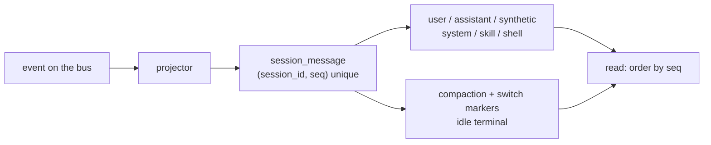
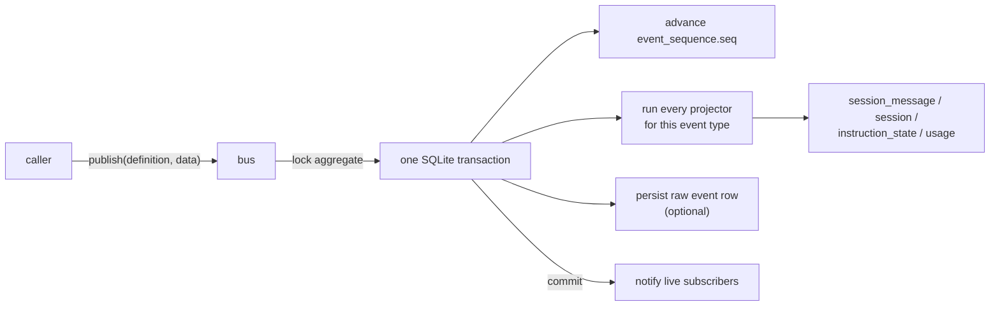
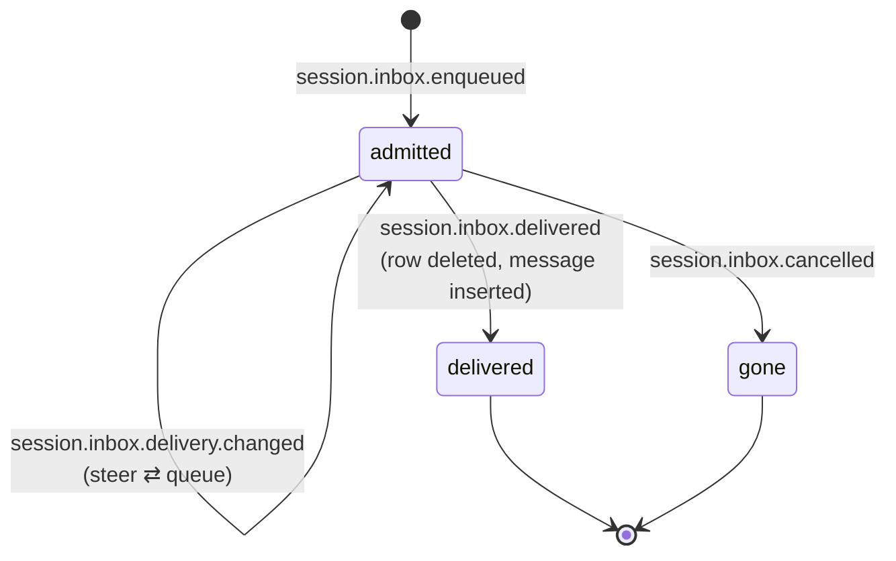
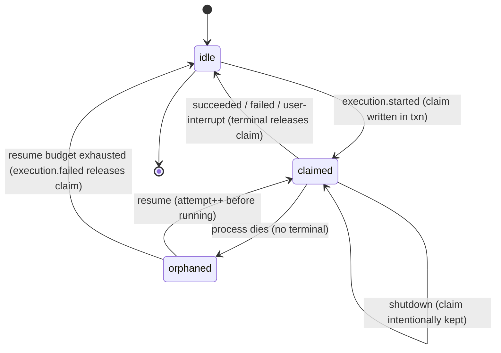
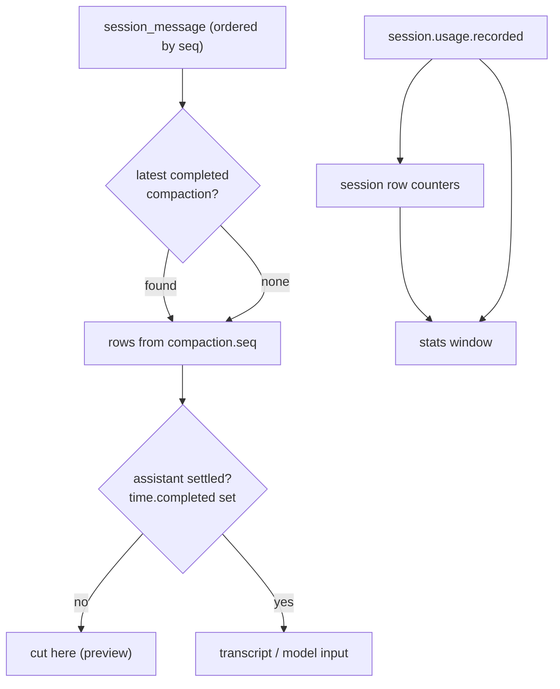

# Part 2 — Durable state

An agent that lives in memory dies with the process. A coding agent has to survive a
restart, a crash, a laptop lid closing mid-turn, and a model call that takes a minute.
Everything the agent will later reason about — what the user asked, what the model said,
which tool ran, what a shell printed, when a compaction happened — has to be a fact on
disk before it is treated as true. opencode records those facts as **events**, folds each
one into queryable **read models** in the same database transaction, and recovers a dead
turn by reading one column that only a terminal event clears. This part is about that
substrate: the Session and its ordered history, the bus and its projectors, the inbox
that separates admitting work from executing it, the write-ahead execution claim, and the
replay paths that rebuild the transcript and the token counters.

The topics:

- **2.1 Sessions, ordered history, and message types** — one durable log per Session, and
  the typed entries that go into it.
- **2.2 Bus → projector → SQLite** — minimal durable events, derived read models, `seq`,
  idempotency, and why enrichment happens in the projection.
- **2.3 The inbox** — admission separate from execution; `steer` versus `queue`; control
  items; the pending-only table.
- **2.4 The write-ahead execution claim** — terminals, restart recovery, and why recovery
  is a property of the database and not of a shutdown hook.
- **2.5 Replay and read models** — the message projection, usage, and stats.

Nothing here is opencode-specific in spirit; it is the persistence contract any resumable
agent needs. opencode's exact choices, and the invariants its own comments insist on, come
after the general idea in each topic.

---

## 2.1 Sessions, ordered history, and message types

### Thesis

A Session is a durable, resumable unit of work backed by one append-only, totally ordered
log of typed **messages**, and the type of each message is what tells the rest of the
system how to lower it to the model and how to display it.

### Cold open

You restart the server. The agent picks up a conversation that was mid-turn when it died.
It has to know, in order, what the user typed, what the model already said, which tool
calls are still outstanding, and what the last turn's outcome was. If that history lived
in a process variable, it is gone. If it lived in a row you kept overwriting with the
latest state, you cannot tell the difference between "the model finished" and "the model
never started." You need an ordered record of everything that happened, and each entry
needs a type.

### The concept

Think of a Session as a log, not a document. A **message** is one durable entry in that
log. This is deliberately *not* the same as one model message: a single assistant entry
carries many content items (text, reasoning, tool calls), and lowering it to the provider
can produce several provider messages. The durable unit is the entry; the provider unit is
something you build later.

Two things make the log useful:

- **Order.** Every entry gets a monotonic sequence number. You never sort history by
  wall-clock time; clocks move backwards, two writes can share a millisecond, and a
  replay must produce byte-identical order. A per-Session counter gives you a total order
  with no clock dependency.
- **Type.** Each entry is tagged. Types fall into a few roles:
  - *Conversation.* `user` (what the human typed, with attached files/agents/skills),
    `assistant` (one model step's output: text, reasoning, and tool calls in progress or
    settled).
  - *Injected context.* `synthetic` (the system speaking as if a user, e.g. "the server
    restarted"), `system` (a model-facing instructions update), `skill` (a skill's text
    activated into context).
  - *Side effects.* `shell` (a command the user or agent ran, with status and output).
  - *Control.* `compaction` (older history replaced by a summary plus a recent window),
    and the switch markers `agent-switched`, `model-switched`, `location-switched` that
    record *when* the active agent, model, or working directory changed.
  - *Terminal.* `idle` marks that a turn ended and why.

The alternatives fail. Storing only the latest state loses history and makes replay
impossible. Storing every provider byte in the log couples your durable format to a
provider and diverges on replay. Storing structured, minimal, typed entries lets you
rebuild the transcript deterministically and lets clients render each entry by type.

One subtlety worth naming early: an `assistant` entry is *mutable while in flight*. Its
text arrives as fragments, its tool calls move from `streaming` to `running` to
`completed` or `error`, and its `time.completed` is unset until the step settles. The log
is ordered and append-only at the message level, but a single assistant message is updated
in place by later events until it is settled.

### Diagram

**D20 — Session history as an ordered, typed log**



```text
  event ──▶ projector ──▶ session_message  (session_id, seq) UNIQUE
                              │
              ┌───────────────┼────────────────────────┐
              ▼               ▼                         ▼
        conversation     control / markers         terminal
     user, assistant,    compaction, agent-,      idle
     synthetic, system,  model-, location-
     skill, shell        switched
                              │
                              ▼
                   read: ORDER BY seq
```

Narration: every event that concerns a Session is folded by a projector into one row of
the `session_message` table, keyed by the Session and stamped with a monotonic `seq`. The
row's type decides whether it is conversation, injected context, a side effect, a control
marker, or the idle terminal. Reading history means selecting rows for the Session ordered
by `seq`, never by time.

### The real thing

The message union is the type vocabulary. Every durable entry is one of these:

```ts
// packages/schema/src/session-message.ts:297
export const Info = Schema.Union([
  AgentSelected,
  ModelSelected,
  LocationSwitched,
  User,
  Synthetic,
  System,
  Skill,
  Shell,
  Assistant,
  Compaction,
  Idle,
]).annotate({ identifier: "Session.Message.Info" })
export type Info =
  | AgentSelected
  …
export type Type = Info["type"]
```

The `Idle` message is the turn boundary, and its comment states the rule precisely:

```ts
// packages/schema/src/session-message.ts:284
/**
 * Marks the Session going idle: every step since the previous marker belongs to
 * one turn, including prompts steered in while it was busy. A shutdown does not
 * record one, since the resumed execution continues the same turn.
 */
export interface Idle extends Schema.Schema.Type<typeof Idle> {}
export const Idle = Schema.Struct({
  ...Base,
  type: Schema.tag("idle"),
  outcome: Schema.Literals(["succeeded", "failed", "interrupted"]),
  error: SessionError.Error.pipe(optional),
}).annotate({ identifier: "Session.Message.Idle" })
```

The storage table shows the order and uniqueness guarantees:

```ts
// packages/core/src/session/sql.ts:79
export const SessionMessageTable = sqliteTable(
  "session_message",
  {
    id: text().$type<SessionMessage.ID>().primaryKey(),
    session_id: text()
      .$type<SessionSchema.ID>()
      .notNull()
      .references(() => SessionTable.id, { onDelete: "cascade" }),
    type: text().$type<SessionMessage.Type>().notNull(),
    seq: integer().notNull(),
    ...Timestamps,
    data: text({ mode: "json" }).notNull().$type<SessionMessageData>(),
  },
  (table) => [
    uniqueIndex("session_message_session_seq_idx").on(table.session_id, table.seq),
    index("session_message_session_type_seq_idx").on(table.session_id, table.type, table.seq),
    index("session_message_session_time_created_id_idx").on(table.session_id, table.time_created, table.id),
    index("session_message_time_created_idx").on(table.time_created),
  ],
)
```

The switch markers are produced by projecting the corresponding events, and each records
the *previous* value so later readers get a self-contained transition:

```ts
// packages/core/src/session/message-updater.ts:119
      "session.moved": (event) =>
        Effect.gen(function* () {
          yield* adapter.appendMessage(
            SessionMessage.LocationSwitched.make({
              id: SessionMessage.ID.fromEvent(event.id),
              type: "location-switched",
              metadata: event.metadata,
              location: event.data.location,
              projectID: event.data.projectID,
              subpath: event.data.subpath,
              previous: yield* adapter.getLocation(),
              time: { created },
            }),
          )
        }),
```

What to notice:

- `Info` is a tagged union; `Type` is derived from it, so the storage `type` column and the
  in-memory union cannot drift.
- The `(session_id, seq)` pair is unique. `seq` is the ordering key; `time_created` exists
  only for range queries and client display.
- `Idle` is not a status field on the Session; it is an entry. A turn is "the span since
  the last idle marker," and a shutdown deliberately writes no marker so the resumed
  execution is still the same turn.
- Switch markers (location shown here; agent and model above it) are *appended*, and each
  carries `previous` so the transition is legible without folding.
- The assistant message is the one entry updated in place; everything else is append-only.

### The prompts

No prompts in this topic — the prompts live in Appendix A under **Harness**.

### Build it

```ts
// pseudocode
type MessageType =
  | "user" | "assistant" | "synthetic" | "system" | "skill" | "shell"
  | "compaction"
  | "agent-switched" | "model-switched" | "location-switched"
  | "idle"

type Message = { id: string; sessionID: string; seq: number; type: MessageType; data: unknown }

// one counter per Session, advanced inside the same write that appends the row
function append(db, sessionID, type, data): Message {
  const seq = nextSeq(db, sessionID)          // monotonic, never from Date.now()
  return db.insert("message", { id: newID(), sessionID, seq, type, data })
}

function history(db, sessionID): Message[] {
  return db.query("SELECT * FROM message WHERE session_id = ? ORDER BY seq", sessionID)
}
```

Decisions and trade-offs:

- **Sequence, not timestamp, is the order.** Model the counter as part of the Session
  aggregate and bump it in the same transaction as the append, or two writers can collide.
- **Type the entries.** The type is what lets lowering, display, and compaction each switch
  on it. A single untyped blob pushes that switch into every consumer.
- **Assistant is the exception.** If you make assistant entries immutable you must split
  streaming fragments into their own messages; that is more rows and a harder lowering
  step. If you make them mutable, you must accept in-place updates gated by status.

### How it fails

- **Ordering by time.** Two writes in the same millisecond reorder on read; a replay after
  a clock change diverges from what the model saw.
- **Reusing the Session ID.** Reusing a Session ID is meant to *adopt* the Session, not
  create a second history; if your append path does not check, you interleave two logs.
- **Unset completion treated as success.** An assistant message with no `time.completed`
  is incomplete. Previewing it can expose an unresolved tool call; the read path must stop
  at the settled prefix (see 2.5).
- **No type on switches.** If a location change is only a field on the Session row, a
  reader cannot reconstruct *when* it changed, and a fork or revert cannot cut at the
  right boundary.

### How you'd test it

Assert the invariants, against real storage:

- Appending messages for one Session yields strictly increasing `seq` values, and
  `history()` returns them in that order regardless of `time_created`. (`seq` is the
  *event's* sequence, so it need not be contiguous: events that produce no message still
  consume a value.)
- Inserting a second row with the same `(session_id, seq)` fails on the unique index.
- An assistant message with multiple content items round-trips through encode/decode with
  the same order and the same per-item status.
- Recording a location switch appends a `location-switched` entry whose `previous` equals
  the Session's location before the change.

### Recap

- A Session is a durable log of typed messages with a monotonic `seq`, read in `seq` order.
- Message types cover conversation, injected context, side effects, control, and the idle
  terminal; the type drives lowering and display.
- Assistant messages are the one entry updated in place until they settle.

Next: how those messages get written in the first place — events on the bus folded into
read models by projectors.

### Podcast notes

- **Hook:** "The agent forgot everything it was doing, and it had done nothing wrong except
  restart."
- **Analogy:** A ship's logbook: numbered entries in order, and each entry is a kind of
  entry — a sighting, an order, a repair — not a snapshot of the whole ship.
- **Talking points:** Why order is a sequence number and never a clock; why the durable
  entry is not the same as a provider message; why one entry (assistant) is mutable while
  the rest are append-only.
- **Listeners will ask:** "Why not just store the whole transcript as one JSON blob?"

---

## 2.2 Bus → projector → SQLite

### Thesis

Durable **events** record only what cannot be derived; **projectors** fold them into
queryable **read models** inside the same database transaction as the event's recording;
and the enrichment a read model needs (previous values, derived counters) is computed
during the projection, not stored in the event.

### Cold open

A user sends a message. One part of the system needs to schedule work; another needs to
insert a row the model transcript can read; a third needs to tell every connected client
that the message exists. If those are three separate writes, a crash between them leaves
the store inconsistent: work admitted but no message, or a message every client missed. The
fix is not "be careful." The fix is one transaction with one ordered sequence of events and
one set of projectors that run inside it.

### The concept

Event sourcing, reduced to what a coding agent needs:

- **Events are facts.** Each event says something happened: a message was enqueued, a step
  ended, a tool failed, a compaction completed. Events are **minimal** — they record what
  cannot be derived by folding history, and they do not record derived state. If a reader
  can compute it from earlier events, it does not belong in the event.
- **Events are ordered per aggregate.** An *aggregate* is the unit a sequence applies to;
  here it is the Session. A monotonically increasing **`seq`** stamps every durable record
  for that Session, so consumers have a total order without trusting the clock.
- **Projectors fold events into read models.** A **projector** is a handler subscribed to
  one event type. It may insert a row, update a row, or compute a derivative. A **read
  model** is a table shaped for querying rather than for recording history: the message
  list, usage counters, instruction state.
- **The projection runs in the same transaction as the recording.** This is the load-bearing
  choice. When the event commits, its read model is already consistent with it. A crash
  cannot leave one without the other.
- **Write-ahead ordering.** The durable event row (or at least the sequence reservation) is
  written before the event is delivered to live subscribers. Subscribers are a volatile
  channel; a client that reconnects replays from the durable log.

The rejected alternatives are the usual ones. Keeping only the current row and updating it
in place gives you no history, no replay, and races between readers and writers. Putting
everything a read model needs *into the event* bloats the log, couples event schemas to
presentation, and forces you to re-emit events whenever a derived shape changes. Keeping
events minimal and letting projectors enrich is what keeps the log small and replayable.

Two consequences are worth stating before the code:

1. **Enrichment belongs in the projection, not the event.** A `model-switched` event carries
   the new model; the projection looks up the *current* model to record `previous`. The
   event stays minimal; the read model is self-contained.
2. **Idempotency is designed, not assumed.** The same event may be delivered twice (a
   reconnect, a retry). Recording it must be a no-op the second time, and a *divergent* copy
   — same sequence, different bytes — must fail loudly rather than silently corrupt.

### Diagram

**D3 — durable event → projection → read model.**



```text
  caller ─ publish ─▶ bus ─ lock(aggregate) ─▶ ┌─ one SQLite transaction ──────────┐
                                                │  read latest seq                 │
                                                │  seq := latest + 1               │
                                                │  for each projector(type):       │
                                                │      projector(event)  ─▶ read   │
                                                │                           model  │
                                                │  commit hook (claim / release)   │
                                                │  upsert event_sequence.seq       │
                                                │  insert raw event row (optional) │
                                                └───────────────┬──────────────────┘
                                                                │ commit
                                                                ▼
                                              notify live subscribers (ephemeral)
```

Narration: a caller publishes an event. The bus takes a per-aggregate lock, opens one
database transaction, computes the next sequence number, runs every projector registered
for that event type inside the transaction, runs any local commit hook, advances the stored
sequence, and — when persistence is on — appends the raw event row. Only after the commit
does it notify live subscribers. The read models and the sequence advance are atomic with
each other.

### The real thing

Every durable event is declared with a type, an aggregate field, and a version:

```ts
// packages/schema/src/session-event.ts:38
const Base = {
  sessionID: SessionID,
}

const options = {
  durable: {
    aggregate: "sessionID",
    version: 1,
  },
} as const
export const Created = Event.durable({
  type: "session.created",
  ...options,
  schema: {
    ...Base,
    projectID: Project.ID,
    location: Location.Ref,
    …
  },
})
```

The `durable` builder wraps a data schema in the envelope that carries `seq` and `version`:

```ts
// packages/schema/src/event.ts:90
export function durable<
  const Type extends string,
  const Fields extends Readonly<Record<PropertyKey, Schema.Codec<unknown, unknown>>>,
>(input: Input<Type, Fields> & { readonly durable: NonNullable<Input<Type, Fields>["durable"]> }) {
  const data = Schema.Struct(input.schema)
  const durable = Schema.Struct({
    aggregateID: DurableEnvelope.fields.aggregateID,
    seq: DurableEnvelope.fields.seq,
    version: Schema.Literal(input.durable.version).pipe(
      …
    ),
  })
  return Schema.Struct({
    id: ID,
    created: Schema.Finite,
    metadata: optional(Schema.Record(Schema.String, Schema.Unknown)),
    type: Schema.Literal(input.type),
    durable,
    location: optional(Location.Ref),
    data,
  })
    …
    satisfies DurableDefinition<Type, typeof data>
}
```

The recording path is where "same transaction" lives. The bus locks the aggregate, computes
the sequence, and runs the projectors inside a transaction:

```ts
// packages/core/src/bus.ts:284
function commitDurableEvent(
  definition: Event.Definition,
  event: Event.Payload,
  input?: {
    readonly seq: number
    readonly aggregateID: string
    readonly ownerID?: string
    readonly strictOwner?: boolean
  },
  commit?: (seq: number) => Effect.Effect<void>,
) {
  return Effect.gen(function* () {
    const durable = definition.durable
    if (!durable) return yield* Effect.void
    const aggregateID = (event.data as Record<string, unknown>)[durable.aggregate]
    …
    const list = projectors.get(versionedType(definition.type, durable.version)) ?? []
    return yield* Effect.uninterruptible(
```

and the transaction body, trimmed to the load-bearing lines:

```ts
// packages/core/src/bus.ts:395
                        const committed = {
                          ...event,
                          durable: { aggregateID, seq, version: durable.version },
                        } as Event.Payload
                        const route = yield* prepareRoutes([committed])
                        for (const projector of list) {
                          yield* projector(committed)
                        }
                        if (commit) yield* commit(seq)
                        yield* db
                          .insert(EventSequenceTable)
                          .values([{ aggregate_id: aggregateID, seq, owner_id: input?.ownerID }])
                          .onConflictDoUpdate({
                            target: EventSequenceTable.aggregate_id,
                            set: {
                              seq: sql`max(${EventSequenceTable.seq}, ${seq})`,
                              …
                            },
                          })
                          .run()
                          .pipe(Effect.orDie)
                        if (persist)
                          yield* db
                            .insert(EventTable)
                            .values([
                              {
                                id: event.id,
                                aggregate_id: aggregateID,
                                seq,
                                created: event.created ?? 0,
                                type: versionedType(definition.type, durable.version),
                                data: encoded,
                              },
                            ])
                            .run()
                            .pipe(Effect.orDie)
                        return { aggregateID, seq, event: committed, route }
```

The projector registry is just a map of event type to handlers; the Session projector
registers one handler per event type. Admission of inbox work is a small, complete example:

```ts
// packages/core/src/session/projector.ts:650
    yield* bus.project(SessionEvent.InboxEnqueued, (event) =>
      Effect.gen(function* () {
        yield* SessionInbox.projectAdmitted(db, {
          enqueuedSeq: event.durable.seq,
          id: event.data.inboxID,
          sessionID: event.data.sessionID,
          item: event.data.item,
          timeCreated: event.created,
        })
        yield* db
          .update(SessionTable)
          .set({ time_updated: event.created })
          .where(eq(SessionTable.id, event.data.sessionID))
          .run()
          .pipe(Effect.orDie)
      }),
    )
```

Enrichment happens here, not in the event. A `model-switched` message records its predecessor
by reading the Session's current model inside the projection:

```ts
// packages/core/src/session/message-updater.ts:105
      "session.model.selected": (event) =>
        Effect.gen(function* () {
          const previous = event.data.previous ?? (yield* adapter.getModel())
          yield* adapter.appendMessage(
            SessionMessage.ModelSelected.make({
              id: SessionMessage.ID.fromEvent(event.id),
              type: "model-switched",
              metadata: event.metadata,
              model: event.data.model,
              previous,
              time: { created },
            }),
          )
        }),
```

That `adapter.getModel()` reads a different table — the Session row — so the projection
crosses read models to produce a self-contained view. The bus supports it by passing the
`db` handle into every projector:

```ts
// packages/core/src/session/projector.ts:257
    const adapter: SessionMessageUpdater.Adapter = {
      getAgent() {
        return db
          .select({ agent: SessionTable.agent })
          .from(SessionTable)
          .where(eq(SessionTable.id, event.data.sessionID))
          .get()
          .pipe(
            Effect.orDie,
            Effect.map((row) => (row?.agent ? Agent.ID.make(row.agent) : undefined)),
          )
      },
      getModel() {
        return db
          .select({ model: SessionTable.model })
          .from(SessionTable)
          .where(eq(SessionTable.id, event.data.sessionID))
          .get()
          .pipe(
            Effect.orDie,
            Effect.map((row) => (row?.model ? Schema.decodeUnknownSync(Model.Ref)(row.model) : undefined)),
          )
      },
```

Idempotency shows up in two places. Recording a replayed event with a sequence at or below
the stored watermark is compared byte-for-byte and either ignored or failed as divergence:

```ts
// packages/core/src/bus.ts:337
                        if (input && input.seq <= latest) {
                          if (!persist) return
                          const stored = yield* db
                            .select()
                            .from(EventTable)
                            .where(and(eq(EventTable.aggregate_id, aggregateID), eq(EventTable.seq, input.seq)))
                            .get()
                            .pipe(Effect.orDie)
                          if (
                            stored?.id === event.id &&
                            stored.type === versionedType(definition.type, durable.version) &&
                            stored.created === (event.created ?? 0) &&
                            isDeepStrictEqual(stored.data, encoded)
                          ) {
                            …
                            return
                          }
                          yield* Effect.die(
                            new InvalidDurableEventError({
                              type: event.type,
                              message: `Replay diverged at aggregate ${aggregateID} sequence ${input.seq}`,
                            }),
                          )
                        }
```

What to notice:

- The projector loop (`for (const projector of list)`) and the sequence advance are inside
  one transaction. There is no window where the event exists but its read model does not.
- The `commit` hook runs inside the transaction too — it is used for the execution claim
  and release (2.4), which must be atomic with the terminal event.
- The raw event row is optional (`persist`). Projections are the source of truth for
  queries; the raw log is for replay and export. Consumers that need reliability combine a
  live subscription with the durable log.
- Enrichment reads other read models inside the transaction (`adapter.getModel`), so the
  projected message captures the previous value without the event having to carry it.
- Replay is idempotent by comparison, not by hoping. A divergent replay is a defect, not a
  silent overwrite.

### The prompts

No prompts in this topic — the prompts live in Appendix A under **Harness**.

### Build it

```ts
// pseudocode
type Definition<D> = { type: string; aggregate: (d: D) => string; version: number }
type Event<D> = { id: string; type: string; created: number; data: D; durable: { aggregateID: string; seq: number; version: number } }

const projectors = new Map<string, ((e: Event<any>, db: DB) => void)[]>()

function project<D>(def: Definition<D>, handler: (e: Event<D>, db: DB) => void) {
  const list = projectors.get(def.type) ?? []
  list.push(handler as any)
  projectors.set(def.type, list)
}

function publish<D>(def: Definition<D>, data: D, db: DB) {
  const aggregateID = def.aggregate(data)
  return withAggregateLock(aggregateID, () =>
    db.transaction(() => {
      const latest = readSeq(db, aggregateID)          // -1 if none
      const seq = latest + 1
      const event = { id: newID(), type: def.type, created: Date.now(), data,
                      durable: { aggregateID, seq, version: def.version } }
      for (const handler of projectors.get(def.type) ?? []) handler(event, db)
      upsertSeq(db, aggregateID, seq)
      appendEventRow(db, event)                        // optional, for replay
      return event
    }),
  )
}
```

Decisions and trade-offs:

- **One transaction, all projectors.** This is what removes the crash window. The cost is
  that a slow projector holds the aggregate's write lock; keep projectors to bounded SQL.
- **Sequence inside the transaction.** Reading `latest` and writing `latest + 1` under the
  same lock is what prevents two writers from claiming the same `seq`.
- **Minimal events.** Resist putting derived data in the event. When a read model needs a
  previous value, look it up in the projection.
- **Optional raw log.** Persisting raw events buys replay, export, and cross-process
  consistency checks. If you keep it, make the replay compare bytes and fail on divergence.

### How it fails

- **Projector outside the transaction.** Work is admitted or a message inserted, then the
  process dies before the other write; the store is inconsistent and no retry can tell
  which half ran.
- **Wall-clock sequence.** Two events in the same millisecond share a `seq`, and replay
  order is nondeterministic.
- **Derived data in the event.** The event carries a `previous` model name that was true
  when emitted but wrong after a concurrent switch; consumers disagree.
- **Silent replay overwrite.** A replayed event with different bytes at the same `seq` is
  accepted, and history quietly changes between restarts.
- **Unbounded projectors.** A projector that does remote I/O holds the aggregate lock and
  stalls every other write for that Session.

### How you'd test it

- Publish an event and assert the read-model row exists immediately after `publish`
  returns, with no separate flush step.
- Force the transaction to fail after the projector runs (inject a fault in the commit
  hook) and assert neither the read model nor the sequence advanced.
- Publish two events concurrently for the same Session and assert the `seq` values are
  `0` and `1` with no duplicates.
- Replay the exact serialized event at the same `seq` and assert it is a no-op; replay one
  with a mutated field and assert a defect.
- Assert that a `model-switched` projection records `previous` equal to the model that
  was current before the event.

### Recap

- Events are minimal durable facts; projectors fold them into queryable read models.
- The projection and the sequence advance run in the same transaction as the recording, so
  the store is never half-updated.
- `seq` gives per-Session total order without a clock; replay is idempotent by byte
  comparison, and divergence is a defect.

Next: the inbox — the durable queue that makes admitting work a different act from running
it.

### Podcast notes

- **Hook:** "The message existed for the client but not for the model, because those were
  two writes and the process died between them."
- **Analogy:** Double-entry bookkeeping: one entry and the event that justifies it are
  written together, so the books never disagree.
- **Talking points:** Minimal events versus derived state; why the projector shares the
  transaction; `seq` as the anti-clock; idempotent replay that fails on divergence.
- **Listeners will ask:** "Why not just use the database's change feed as your event log?"

---

## 2.3 The inbox

### Thesis

Admission — recording that work exists — is deliberately separate from delivery — turning
that work into a visible message — and the inbox that bridges them is **pending-only**,
holding a row only while the work is unconsumed.

### Cold open

The user types while the agent is mid-answer, then types again while a tool is running.
Should the first message interrupt the current answer, or queue behind it? If you decide
only when the message arrives, you cannot also let the user change their mind — "no, make
that a queue" — after sending. And if a crash happens after the message is accepted but
before the model sees it, the message must not vanish. You need a durable place for
accepted-but-not-yet-visible work, with a mode that says how it should be delivered.

### The concept

An **inbox** is the durable queue of work that has been **admitted** but not yet
**delivered** into visible history. Admission and delivery are separated so that:

- Accepting input is fast and durable, and does not depend on the model being free.
- Delivery mode can be *changed* between admission and delivery.
- A crash between admission and delivery loses nothing.

Delivery has two modes:

- **Steer** — input that should influence work already in progress. It is delivered at the
  next safe step boundary. Prompts steer by default.
- **Queue** — input that should start new work. It is delivered only when the Session would
  otherwise go idle.

The unit that consumes inbox rows is **promotion**: pulling pending rows and inserting the
visible messages. Whether a `queue` row may be promoted depends on **scope**. At a step
boundary mid-work, scope is `steer` and queued input is never promoted. At the idle
boundary, scope is `input` and exactly one queued prompt may be promoted. This is the rule
that stops a queue from being delivered while the agent is busy.

**Control items** are inbox entries that are not user text: `compaction` and `move`. They
participate in the same ordered queue but change how promotion proceeds. Controls interrupt
promotion ordering — a `move` changes the working directory, so nothing may be pulled
across it, and a steered compaction is pulled ahead of earlier steers so their text stays
verbatim after the checkpoint rather than being summarized away.

The table is **pending-only**: a row exists only while the work is unconsumed. Delivery
*deletes* the row and inserts the message in the same event's transaction. There is no
"delivered" status to clean up, no join between a queue table and a history table to keep in
sync, and no ambiguity about whether a row still needs handling.

The alternative — accept directly into history — loses the ability to retract or re-mode
input, and either delays acceptance until the model is free or exposes an in-flight message
to readers. A separate mutable "pending" table with a status column would work but leaves
the table growing and forces every reader to filter by status. Pending-only makes the
common read ("what is waiting?") a plain `SELECT`.

### Diagram

**D4 — inbox delivery state machine.**



```text
                    session.inbox.enqueued
                             │
                             ▼
                       ┌───────────┐   InboxDeliveryChanged   ┌───────────┐
                       │  admitted │ ◀──────────────────────▶ │  steer /  │
                       │ (delivery │      steer ⇄ queue        │  queue    │
                       │  = …)     │                            └───────────┘
                       └─────┬─────┘
                 InboxCancelled│        InboxDelivered
                       ┌──────┴──────┐
                       ▼             ▼
                    ┌──────┐    ┌───────────┐
                    │ gone │    │ delivered │  row DELETED, message INSERTED
                    └──────┘    └───────────┘
```

Narration: a row appears when work is admitted and lives with a delivery mode of `steer` or
`queue`. Between admission and delivery the mode can be flipped in either direction, or the
row can be cancelled and disappear. When the runner promotes the row, delivery deletes it
and inserts the visible message in the same transaction — the row is pending-only, so the
table holds nothing that has already been shown.

### The real thing

An inbox item is a tagged union of four kinds:

```ts
// packages/schema/src/session-inbox.ts:37
const UserItem = Schema.Struct({ type: Schema.tag("user"), payload: UserPayload, delivery: Delivery })
const SyntheticItem = Schema.Struct({ type: Schema.tag("synthetic"), payload: SyntheticPayload, delivery: Delivery })
const CompactionItem = Schema.Struct({
  type: Schema.tag("compaction"),
  payload: CompactionPayload,
  delivery: Delivery,
})
const MoveItem = Schema.Struct({ type: Schema.tag("move"), payload: MovePayload, delivery: Delivery })

export const Item = Schema.Union([UserItem, SyntheticItem, CompactionItem, MoveItem]).pipe(
  Schema.toTaggedUnion("type"),
  Schema.annotate({ identifier: "Session.Inbox.Item" }),
)
```

The pending table is `session_inbox`, and its uniqueness is per Session and per admission
sequence:

```ts
// packages/core/src/session/sql.ts:125
export const SessionInboxTable = sqliteTable(
  "session_inbox",
  {
    id: text().$type<SessionMessage.ID>().primaryKey(),
    session_id: text()
      .$type<SessionSchema.ID>()
      .notNull()
      .references(() => SessionTable.id, { onDelete: "cascade" }),
    type: text().$type<SessionInbox.Info["type"]>().notNull(),
    payload: text({ mode: "json" }).$type<UserPayload | SyntheticPayload | CompactionPayload | MovePayload>().notNull(),
    delivery: text().$type<SessionInbox.Delivery>().notNull(),
    enqueued_seq: integer().notNull(),
    time_created: integer()
      .notNull()
      .$default(() => Date.now()),
  },
  (table) => [
    index("session_inbox_session_delivery_seq_idx").on(table.session_id, table.delivery, table.enqueued_seq),
    uniqueIndex("session_inbox_session_enqueued_seq_idx").on(table.session_id, table.enqueued_seq),
  ],
)
```

Delivery deletes the row and returns it so the message can be inserted from the same
content, in the same transaction:

```ts
// packages/core/src/session/inbox.ts:319
/**
 * Consume one pending row at promotion. The row's content feeds the projected
 * message insert inside the same event transaction; the deleted row is what
 * makes the table pending-only.
 */
export const projectDelivered = Effect.fn("SessionInbox.projectDelivered")(function* (
  db: DatabaseService,
  input: PendingRef,
) {
  const deleted = yield* db
    .delete(SessionInboxTable)
    .where(and(eq(SessionInboxTable.id, input.id), eq(SessionInboxTable.session_id, input.sessionID)))
    .returning()
    .get()
    .pipe(Effect.orDie)
  if (!deleted) return yield* Effect.die(new LifecycleConflict({ id: input.id }))
  return fromRow(deleted)
})
```

Promotion is where scope and controls are enforced:

```ts
// packages/core/src/session/inbox.ts:490
/**
 * Promotes pending input into visible messages and returns the promoted count,
 * or undefined when the runner must first handle a pending control.
 * Steered compaction takes priority over pending prompts, without crossing a move.
 * Only the "input" scope may fall through to one queued input.
 */
export const promote = Effect.fn("SessionInbox.promote")(function* (
  db: DatabaseService,
  bus: Bus.Interface,
  sessionID: SessionSchema.ID,
  scope: Promotable,
) {
  return yield* serialized(
    sessionID,
    Effect.gen(function* () {
      const steers = yield* pendingSteers(db, sessionID)
      if (steers.length > 0 || scope === "steer") {
        const control = steers.findIndex((row) => row.type === "compaction" || row.type === "move")
        if (control === 0) return undefined
        return yield* publish(db, bus, sessionID, control === -1 ? steers : steers.slice(0, control))
      }

      const queued = yield* db
        .select()
        .from(SessionInboxTable)
        .where(and(eq(SessionInboxTable.session_id, sessionID), eq(SessionInboxTable.delivery, "queue")))
        .orderBy(asc(SessionInboxTable.enqueued_seq))
        .limit(1)
        .get()
        .pipe(Effect.orDie)
      if (!queued) return 0
      if (queued.type === "compaction" || queued.type === "move") return undefined
      const promoted = yield* publish(db, bus, sessionID, [queued])
      const arrivedSteers = yield* pendingSteers(db, sessionID)
      const control = arrivedSteers.findIndex((row) => row.type === "compaction" || row.type === "move")
      return (
        promoted +
        (yield* publish(db, bus, sessionID, control === -1 ? arrivedSteers : arrivedSteers.slice(0, control)))
      )
    }),
  )
})
```

The ordering rule that keeps a compaction from swallowing steered text is stated in the
steer loader:

```ts
// packages/core/src/session/inbox.ts:533
const pendingSteers = (db: DatabaseService, sessionID: SessionSchema.ID) =>
  db
    .select()
    .from(SessionInboxTable)
    .where(and(eq(SessionInboxTable.session_id, sessionID), eq(SessionInboxTable.delivery, "steer")))
    .orderBy(asc(SessionInboxTable.enqueued_seq))
    .all()
    .pipe(
      Effect.orDie,
      Effect.map((rows) => {
        // A move changes the context's Location: never pull compaction across it.
        // Within that boundary, compact before promoting even earlier steers so
        // their text stays verbatim after the checkpoint, not inside its summary.
        const control = rows.findIndex((row) => row.type === "compaction" || row.type === "move")
        if (control > 0 && rows[control].type === "compaction") rows.unshift(...rows.splice(control, 1))
        return rows
      }),
    )
```

Admission at the API boundary shows the separation: `Session.prompt` reconciles, prepares,
and admits, then wakes execution *unless* the caller passed `resume: false`:

```ts
// packages/core/src/session/session.ts:145
  const prompt = Effect.fn("Session.prompt")((sessionID: SessionSchema.ID, input: PromptRequest) =>
    Effect.uninterruptibleMask((restore) =>
      Effect.gen(function* () {
        const session = yield* get(sessionID)
        const messageID = input.id ?? SessionMessage.ID.create()
        const admitted = yield* Effect.gen(function* () {
          const existing = yield* admission.reconcile({
            id: messageID,
            sessionID: session.id,
            type: "user",
            delivery: input.delivery ?? "steer",
          })
          if (existing) return existing
          const item = yield* restore(
            SessionPrompt.prepare({ session, messageID, input }).pipe(
              Effect.provideService(Instance.Service, instances),
              Effect.provideService(FSUtil.Service, fs),
            ),
          )
          // Commit a staged revert only after preparation succeeds, before admitting new work.
          if (session.revert) yield* SessionRevert.commit(bus, session)
          return yield* admission.admit({
            id: messageID,
            sessionID: session.id,
            item,
          })
        }).pipe(
          Effect.catchTag("SessionInbox.LifecycleConflict", () => new PromptConflictError({ sessionID, messageID })),
        )
        if (input.resume !== false) yield* execution.wake(sessionID)
        return admitted
      }),
    ),
  )
```

What to notice:

- `delivery` defaults to `"steer"` on a prompt; queued input is the opt-in.
- `reconcile` runs before `admit` so re-sending the same `messageID` returns the existing
  item instead of admitting twice (idempotent admission).
- Admission ends with `execution.wake`, a *separate* act from recording. `resume: false`
  admits without scheduling (used by restart notices that must not revive idle owners).
- `promote` returns `undefined` when a control is at the head — the runner must handle the
  control before any prompt is delivered — and otherwise returns a count.
- A steered control takes priority over earlier steers, but never crosses a `move`.

### The prompts

No prompts in this topic — the prompts live in Appendix A under **Harness**.

### Build it

```ts
// pseudocode
type Delivery = "steer" | "queue"
type InboxItem =
  | { type: "user";    payload: { text: string; files: string[] }; delivery: Delivery }
  | { type: "compaction"; payload: {}; delivery: Delivery }
  | { type: "move";    payload: { directory: string }; delivery: Delivery }

function admit(db, sessionID, item): Inbox {
  // idempotent on (sessionID, id): first admission wins
  const existing = reconcile(db, sessionID, item.id)
  if (existing) return existing
  publish("inbox.enqueued", { sessionID, item })   // projection inserts the pending row
  return item
}

function promote(db, sessionID, scope: "input" | "steer"): number | undefined {
  const steers = select(db, sessionID, "steer")           // ordered by admission
  if (steers.length > 0 || scope === "steer") {
    const c = steers.findIndex(isControl)
    if (c === 0) return undefined                         // head is a control: handle first
    return publishDelivery(db, sessionID, c === -1 ? steers : steers.slice(0, c))
  }
  const queued = select(db, sessionID, "queue").slice(0, 1) // exactly one, only in "input" scope
  if (!queued.length) return 0
  if (isControl(queued[0])) return undefined
  return publishDelivery(db, sessionID, queued)
}
```

Decisions and trade-offs:

- **Pending-only table.** Delete the row on delivery; insert the message in the same
  transaction. The alternative (a status column) grows forever and every reader filters.
- **Two delivery modes, changeable.** Store the mode on the row and expose a mutation that
  flips it; do not bake "steer" into the message itself.
- **Scope gates the queue.** A steer-scoped promotion must never promote queued input, or
  a queued message leaks into a busy turn.
- **Controls interrupt ordering.** Model compaction and move as queue entries so they share
  the total order, and define exactly where promotion stops.
- **Admission is idempotent.** Key it on the caller-supplied item ID so a retried submit is
  a no-op. A cross-Session or cross-type reuse is a conflict, not a merge.

### How it fails

- **Delivery mutates the row instead of deleting it.** "Pending" and "delivered" rows
  accumulate; a reader that forgets to filter re-delivers old input.
- **Queue promoted during a busy turn.** The agent's current answer is interleaved with
  unrelated new work; the fix is the scope check, not a retry.
- **Compaction crossing a move.** A steered compaction is applied, then a move delivers,
  and the summary was built for the wrong working directory.
- **Non-idempotent admission.** A client retry after a network blip admits the same message
  twice; the model answers twice.
- **Wake coupled to admission.** If `resume: false` still wakes execution, restart notices
  restart idle Sessions that were never busy.

### How you'd test it

- Admit a `queue` item and assert nothing appears in history until promotion at idle scope.
- Call `promote(..., "steer")` with only a queued item and assert it returns and inserts
  nothing.
- Admit a `move`, then a user steer, then call promotion and assert the `move` is returned
  as a control (`undefined`) before the steer is delivered.
- Deliver an item and assert the `session_inbox` row is gone and the `session_message` row
  exists, both after the same publish returns.
- Admit the same `(sessionID, id)` twice and assert one pending row and the same item back.
- Cancel a pending row and assert delivery for it fails with a lifecycle conflict rather
  than inserting a message.

### Recap

- Admission records pending work durably; delivery consumes it into visible history.
- `steer` influences in-progress work; `queue` starts new work; scope decides which may be
  promoted at a boundary.
- Control items (`compaction`, `move`) share the inbox order and interrupt promotion; the
  table is pending-only, so a delivered row is deleted, not flagged.

Next: how a turn that was in flight when the process died is found and resumed — the
write-ahead execution claim.

### Podcast notes

- **Hook:** "You sent it, the server took it, the power blinked — and it was still there
  when the server came back."
- **Analogy:** A restaurant order pad: the order is written down the moment it is taken
  (admission), and only torn off when the kitchen starts it (delivery); a "hold" vs "fire"
  note can be added in between.
- **Talking points:** Why admission must be durable and cheap; steer versus queue as a
  delivery mode, not a message property; controls as first-class queue entries; pending-only
  as the shape that removes status bookkeeping.
- **Listeners will ask:** "What stops a queued message from interrupting the current
  answer?"

---

## 2.4 The write-ahead execution claim, terminals, and restart recovery

### Thesis

The start of a turn writes a **claim** — a durable marker that a turn is in flight — in the
same transaction as the started event; a **terminal** event releases it, except on shutdown;
and a claim that survives to the next boot is the signature of a process that died, which
recovery detects by reading the database rather than by trusting a shutdown hook.

### Cold open

The server is killed with `SIGKILL` while a model call is streaming. There is no shutdown
hook, no finalizer, no chance to write "I was busy." When the server comes back, how does it
know which of a thousand Sessions had a turn in flight, and how does it resume exactly those
without double-running the ones that finished cleanly? If recovery depends on a graceful
shutdown, a hard crash is unrecoverable.

### The concept

The fix is to make "a turn is in flight" a fact you write *before* the work, not after. This
is a write-ahead marker, and it is called a **claim**. It is set when execution starts, in
the same transaction as the "execution started" event. When the turn ends, a **terminal
event** — succeeded, failed, or interrupted — releases the claim in the same transaction as
that terminal.

Now the asymmetry does the work:

- Graceful end (success, failure, user interrupt): terminal event and release commit
  together, so the claim is gone.
- Graceful shutdown: opencode deliberately *keeps* the claim. The turn was interrupted by
  the server stopping, not by the user, and the resumed execution is a continuation of the
  same turn. So shutdown preserves it.
- Crash / `SIGKILL` / eviction: no terminal runs, so the claim is never released. It simply
  stays set.

At the next boot, recovery sweeps for claims that are still set (and not locally active) and
resumes them. The key insight is that **recovery is a property of the database, not of a
shutdown hook**: a surviving claim with no matching terminal *is* the crash record. You
never need the dying process to cooperate.

Two guardrails make this safe:

- **Attempt accounting.** Each resume durably increments a per-turn counter, written
  *before* the resume runs. If a turn keeps dying, the counter climbs past a budget and the
  turn is terminalized instead of resumed forever. A successful turn's terminal resets the
  counter, so the budget is per-turn, not per-Session.
- **The claim is not ownership.** It is a recovery marker. It is not clustered ownership,
  not fencing, and not an exactly-once guarantee. Recovery is at-least-once; local
  coordination prevents concurrent drains within one process, not repeated external side
  effects after a crash.

### Diagram

**D21 — write-ahead claim and terminal lifecycle**



```text
   ┌──────┐  execution.started ──▶ ┌─────────┐
   │ idle │   (claim in same txn)    │ claimed │
   └──────┘                          └────┬────┘
      ▲                                   │
      │ terminal: succeeded/failed/       │ shutdown: keep claim
      │ user-interrupt  (release in txn)  ▼
      │                              ┌──────────┐
      └──────────────────────────────│ orphaned │  process died, no terminal
                     budget exceeded │ (claim   │
                     → execution.     │  set)    │
                       failed release └────┬─────┘
                                          │ next boot: resume
                                          │ attempt++ (durable, before run)
                                          ▼
                                     back to claimed
```

Narration: a turn begins by writing the claim with the started event. A normal terminal —
success, failure, or a user interrupt — releases it in the same transaction, returning the
Session to idle. A graceful shutdown keeps the claim on purpose, so the resumed execution
continues the same turn. A crash leaves the claim set with no terminal: that is the crash
record. On the next boot, recovery finds the orphaned claims, durably counts an attempt
before each resume, and either resumes the turn or, once the budget is exhausted, emits a
terminal failure that releases the claim for good.

### The real thing

The invariant is stated at the point the claim is written:

```ts
// packages/core/src/session/execution.ts:76
    // Write-ahead claim: starting records the durable intent that a turn is in flight, in the same
    // transaction as the started event. Terminals release it — except shutdown interruption, which
    // preserves the claim so the next server start resumes the turn. A claim that survives with no
    // terminal is the signature of a process that died without teardown (crash, SIGKILL, eviction);
    // recovery is a property of the database, never of a shutdown hook that may not run.
    const claimOnCommit = (sessionID: SessionSchema.ID) => ({
      commit: () => store.claim(sessionID),
    })
    const releaseOnCommit = (sessionID: SessionSchema.ID) => ({
      commit: () => store.release(sessionID),
    })
```

The claim is a column on the Session, and claiming is written so re-claiming a still-claimed
Session is a no-op; `resume_attempts` carries the budget:

```ts
// packages/core/src/session/store.ts:205
      claim: Effect.fn("SessionStore.claim")(function* (sessionID) {
        // The null guard makes re-claiming a still-claimed Session a zero-row
        // no-op (a resumed turn re-claims through the same started hook).
        // Claim bookkeeping never counts as user activity: time_updated is
        // pinned so session ordering only moves on real changes.
        yield* db
          .update(SessionTable)
          .set({ time_suspended: Date.now(), time_updated: sql`${SessionTable.time_updated}` })
          .where(and(eq(SessionTable.id, sessionID), isNull(SessionTable.time_suspended)))
          .run()
          .pipe(Effect.orDie)
      }),
      release: Effect.fn("SessionStore.release")(function* (sessionID) {
        yield* db
          .update(SessionTable)
          .set({ time_suspended: null, resume_attempts: 0, time_updated: sql`${SessionTable.time_updated}` })
          .where(eq(SessionTable.id, sessionID))
          .run()
          .pipe(Effect.orDie)
      }),
```

The terminal hook decides which outcome releases the claim and which keeps it:

```ts
// packages/core/src/session/execution.ts:118
      // One terminal observation per busy period, covering every coalesced drain.
      settled: (sessionID, exit, reason) =>
        reportLifecycle(
          sessionID,
          Effect.gen(function* () {
            const outcome = terminal(exit, reason)
            if (outcome.type === "succeeded") {
              yield* bus.publish(SessionEvent.Execution.Succeeded, { sessionID }, releaseOnCommit(sessionID))
              return
            }
            if (outcome.type === "interrupted") {
              // Deliberate stops release the claim; shutdown keeps it for restart continuity.
              if (outcome.reason !== "shutdown") yield* jobs.cancel(sessionID)
              yield* bus.publish(
                SessionEvent.Execution.Interrupted,
                { sessionID, reason: outcome.reason },
                outcome.reason === "shutdown" ? undefined : releaseOnCommit(sessionID),
              )
              return
            }
            yield* bus.publish(
              SessionEvent.Execution.Failed,
              {
                sessionID,
                error: outcome.error,
              },
              releaseOnCommit(sessionID),
            )
          }),
        ),
```

The recovery sweep is inert until called, and its contract is explicit that the claim is
**never** cleared by recovery — only a terminal clears it:

```ts
// packages/core/src/session/execution/restart.ts:46
/**
 * Recovery for orphaned executions. Claims are written at turn start by
 * SessionExecution, so this sweep needs no cooperation from the previous
 * process: crash, SIGKILL, isolate eviction, and graceful restart all leave
 * the same durable signature.
 *
 * Recovery is at-least-once: local coordination prevents concurrent drains,
 * not repeated external side effects after a crash.
 *
 * The sweep assumes every orphaned claim's owner is dead. …
 */
export class Service extends Context.Service<Service, Interface>()("@opencode/SessionRestart") {}
```

Attempt accounting happens before the resume runs, so a crash inside the resumed turn is
still counted, and exhaustion terminalizes instead of looping:

```ts
// packages/core/src/session/execution/restart.ts:77
      const prepareResume = Effect.fnUntraced(function* (sessionID: SessionSchema.ID) {
        // Durable before the resume runs, so a crash inside the resumed turn is
        // counted by the next sweep and the budget cannot be dodged.
        const attempts = yield* store.countResume(sessionID)
        if (attempts === undefined) return false
        if (attempts > maxAttempts) {
          // Terminalize instead: the release hook clears the claim and resets the
          // counter atomically with the terminal event.
          yield* bus.publish(
            SessionEvent.Execution.Failed,
            { sessionID, error: RESUME_EXHAUSTED },
            { commit: () => store.release(sessionID) },
          )
          return false
        }
        yield* bus.publish(SessionEvent.Synthetic, {
          sessionID,
          text: CONTINUE_AFTER_SERVER_RESTART,
          description: "Continuing after restart",
          metadata: { notice: "restart" },
        })
        return true
      })
```

The sweep itself resumes only claims that are still set and not already active locally:

```ts
// packages/core/src/session/execution/restart.ts:193
        resumeSuspendedSessions: Effect.gen(function* () {
          const active = yield* execution.active
          const pending = yield* jobs.pendingBackground
          …
          // Early notices wait for recovery's accounting, including Sessions that exhaust their budget.
          const suspended = new Set(
            [...(yield* store.listSuspended()), ...children].filter((sessionID) => !active.has(sessionID)),
          )
          yield* store.releaseChildClaims(children)
          yield* Effect.forEach(
            …
            { discard: true },
          )

          // Background completion can wake a parent, so inspect local ownership only after recovery.
          const resumed = yield* execution.active
          yield* Effect.forEach(
            (yield* store.listSuspended()).filter((sessionID) => !resumed.has(sessionID)),
            (sessionID) =>
              execution
                .resume(sessionID)
                .pipe(Effect.ignore, Effect.forkIn(scope), Effect.when(prepareResume(sessionID))),
            { concurrency: "unbounded", discard: true },
          )
          // Async observers consult this set at delivery; later completions wake parents normally.
          suspended.clear()
        }),
```

The claim is not the only durable trace of a crash. A step that was streaming when the
process died left an assistant message with in-flight content, and a compaction left a
`running` row; neither has a terminal. The runner settles those on its next drain, before it
does any new work:

```ts
// packages/core/src/session/runner/llm.ts:362
    const settleStaleToolCalls = Effect.fn("SessionRunner.settleStaleToolCalls")(function* (
      sessionID: SessionSchema.ID,
    ) {
      for (const message of yield* store.context(sessionID)) {
        if (message.type !== "assistant") continue
        for (const tool of message.content) {
          if (tool.type !== "tool" || (tool.state.status !== "streaming" && tool.state.status !== "running")) continue
          const metadata = tool.state.status === "running" ? tool.state.metadata : undefined
          const childID =
            tool.name === "subagent" && typeof metadata?.sessionID === "string" ? metadata.sessionID : undefined
          yield* bus.publish(SessionEvent.Tool.Failed, {
            sessionID,
            assistantMessageID: message.id,
            id: tool.id,
            error: {
              type: "aborted",
              message: `Tool execution interrupted: ${tool.name}${childID ? ` (sessionID: ${childID})` : ""}`,
            },
            …(metadata && Object.keys(metadata).length > 0 ? { metadata } : {}),
            executed: tool.executed === true,
          })
        }
      }
    })
```

What to notice:

- The claim is written via a `commit` hook on the same publish as `Execution.Started`, so it
  is atomic with the started event; release is atomic with the terminal event.
- `Execution.Interrupted` passes `undefined` for the commit hook when `reason === "shutdown"`
  — no release — and `releaseOnCommit` otherwise.
- `listSuspended` selects Sessions where the claim is set and `parent_id` is null: top-level
  Sessions. Child Sessions owned by recoverable background jobs are handled separately
  through durable Job records.
- `countResume` writes before the resume, so an attempt that crashes is still counted.
- Recovery never clears the claim itself; only a terminal event does. A death anywhere in
  the resume path leaves the same orphaned claim for the next boot.
- Stale settlement is the same idea at a finer grain: a crash leaves in-flight tool calls
  and `running` compactions with no terminal, and the next drain settles them with
  `Tool.Failed` / `Compaction.Failed` before any new work (developed in Part 8).

### The prompts

This topic owns two model-visible strings, both in the restart path.

The continuation notice published as a `synthetic` event when a turn resumes (the
projector appends it as a synthetic message):

```ts
// packages/core/src/session/execution/restart.ts:15
const CONTINUE_AFTER_SERVER_RESTART =
  "The server restarted while you were working. Continue from where you left off without repeating completed work."
```

Provenance: `packages/core/src/session/execution/restart.ts:15`. The phrase "without
repeating completed work" is doing specific work: a resumed model sees the full history and
will otherwise redo the last tool call or re-emit the last paragraph, wasting a step and
potentially repeating a side effect. The word "continue" frames the history as its own,
not a fresh task.

The terminal error used when the resume budget is exhausted:

```ts
// packages/core/src/session/execution/restart.ts:18
const RESUME_EXHAUSTED = {
  type: "aborted",
  message: "Execution was interrupted repeatedly and will not be resumed automatically.",
} as const
```

Provenance: `packages/core/src/session/execution/restart.ts:18`. This is a durable terminal,
not model text: it ends the turn with a typed failure so the budget cannot be dodged and the
Session does not crash-loop. The wording states the outcome ("will not be resumed
automatically") so a client can explain why the turn stopped.

### Build it

```ts
// pseudocode
function startTurn(db, sessionID) {
  publish("execution.started", { sessionID },
    { commit: () => claim(db, sessionID) })          // same transaction as the event
}

function claim(db, sessionID) {
  db.run("UPDATE session SET claim = now(), attempts = attempts
          WHERE id = ? AND claim IS NULL", sessionID) // idempotent re-claim
}

function settle(db, sessionID, outcome: "succeeded" | "failed" | "user" | "shutdown") {
  const releases = outcome !== "shutdown"
  publish(`execution.${outcome}`, { sessionID },
    releases ? { commit: () => release(db, sessionID) } : undefined)
}

function release(db, sessionID) {
  db.run("UPDATE session SET claim = NULL, attempts = 0 WHERE id = ?", sessionID)
}

function recover(db, maxAttempts) {
  for (const sessionID of listSuspended(db)) {         // claim set, top-level, not active
    const attempts = countResume(db, sessionID)        // durable, BEFORE the resume
    if (attempts === undefined) continue
    if (attempts > maxAttempts) {
      publish("execution.failed", { sessionID, error: RESUME_EXHAUSTED },
        { commit: () => release(db, sessionID) })
      continue
    }
    admitSynthetic(db, sessionID, "The server restarted while you were working. Continue…")
    resume(sessionID)
  }
}
```

Decisions and trade-offs:

- **Write-ahead, not write-behind.** The claim is set before the work, in the started
  transaction. A write-behind "completed" flag cannot distinguish "crashed mid-turn" from
  "never started."
- **Shutdown keeps the claim.** Distinguish deliberate stops (user, inactivity) from
  shutdown; only the former release. A resumed shutdown is the same turn, so no new idle
  marker is written.
- **Per-turn attempt budget.** Count before resuming and reset on terminal. A per-Session
  counter would punish a Session that simply had many turns.
- **Recovery is at-least-once.** Say so in the contract. Do not claim exactly-once; forbid
  concurrent drains in one process and accept that a crash may repeat external side effects.
- **Assume the owner is dead.** This is safe only under a managed-server protocol that
  confirms the previous process died before starting a successor. If that is not your
  deployment, you need real ownership/fencing, not this marker.

### How it fails

- **Claim written after the work.** A crash before the write looks like "never started," and
  the turn is lost with no recovery signal.
- **Shutdown releases the claim.** The turn looks complete; the user's in-flight request is
  silently dropped.
- **No attempt budget.** A turn that crashes deterministically on startup resumes forever, a
  crash loop across reboots.
- **Recovery trusts local memory.** If the sweep consults only in-memory ownership, a crash
  wipes the only record and nothing resumes.
- **Two processes sweep one database.** Both resume the same claim and the turn runs twice;
  this is why the sweep is documented as safe only under a single managed server.

### How you'd test it

- Start an execution, kill the process without a terminal, restart, and assert the Session
  is resumed and a restart `synthetic` message is admitted before the first model request.
- Assert a graceful shutdown leaves the claim set and the turn resumes as the same turn (no
  new `idle` message).
- Force the resumed turn to fail repeatedly and assert the attempt counter climbs and that,
  past the budget, `execution.failed` with `RESUME_EXHAUSTED` is recorded and the claim is
  released.
- Assert `claim` called twice on a claimed Session changes nothing (the zero-row no-op) and
  does not move `time_updated`.
- Assert `listSuspended` returns only top-level Sessions with the claim set.

### Recap

- The claim is a write-ahead marker set with the started event and released by a terminal,
  except on shutdown.
- A surviving claim with no terminal is the crash signature; recovery is a database
  property, not a shutdown hook.
- Attempts are counted durably before each resume, so a doomed turn terminalizes instead of
  crash-looping.

Next: reading the state back — replay, the message projection, usage, and stats.

### Podcast notes

- **Hook:** "The process was killed without warning, and it came back knowing exactly which
  conversation had been interrupted."
- **Analogy:** A hotel "occupied" sign left on the door: housekeeping does not need to have
  watched you check out; a sign still up after a hard night is the evidence you never left.
- **Talking points:** Write-ahead versus write-behind; why shutdown keeps the claim but a
  user stop releases it; the per-turn attempt budget; recovery as at-least-once.
- **Listeners will ask:** "How do you avoid resuming the same turn twice when two servers
  come up?"

---

## 2.5 Replay and read models

### Thesis

Reading state back is a replay of the ordered log into shaped tables: the message projection
is read through a compaction boundary so a preview never exposes an unsettled step, and usage
and stats are folded from durable records and events rather than recomputed from the
provider.

### Cold open

A client opens a Session and renders the transcript. It must not show a half-streamed
assistant message with an unresolved tool call as if it were final, and after a compaction it
must show the summary plus the recent window — not the pre-compaction history the model no
longer sees. Meanwhile the usage dashboard shows tokens and cost, and those numbers must
match what the sessions actually recorded, across restarts and compactions, without asking a
provider again.

### The concept

Read models come in three flavors here, and each has a different replay rule:

- **Transcript projection.** The visible history is the `session_message` rows for a Session
  ordered by `seq`, read *from a boundary*. The boundary is the latest completed compaction:
  earlier history is no longer what the model sees, so it is not what a reader should show
  either. Some compactions are *native* — they hold the provider's opaque window instead of
  text — and those are replayable only by a compatible model; the read path takes a boundary
  parameter so a model-neutral reader and a specific-model reader can disagree, correctly.
- **Settled prefix.** An active assistant message may contain an unresolved tool call, so a
  preview reads only the settled prefix, up to the first assistant message whose
  `time.completed` is unset. The model itself, by contrast, is given the complete record it
  needs to continue.
- **Accounting.** **Usage** (tokens and cost) is recorded on the event that produced it and
  folded into counters on the Session row. Step usage rides on `Step.Ended` / `Step.Failed`;
  title and compaction usage arrives as a separate durable `UsageRecorded` event (its
  `source` is `"title"` or `"compaction"`). Stats aggregate the projected messages and the
  durable usage events over a time window. Nothing here calls the provider; everything is
  derived from what was recorded.

Replay is what makes all three correct after a crash: because the events are durable and the
projections deterministic, the same log produces the same tables. The one wrinkle is that
some projections are *enriched* with state available at projection time; the read paths must
therefore record the enrichment (the `previous` value, the baseline) rather than hope to
recompute it.

### Diagram

**D22 — replay and read-model materialization**



```text
  session_message ──ordered by seq──▶ find latest completed compaction
        │                                    │
        │                                    ▼
        │                          keep rows with seq >= compaction.seq
        │                                    │
        └──────────────┬─────────────────────┘
                       ▼
        for preview: cut at first unsettled assistant (time.completed unset)

  session.usage.recorded ──▶ session row counters ──▶ stats(window)
        └───────────────────────────────────────────────▶ stats(window)
```

Narration: the transcript is read from `session_message` in `seq` order, starting at the
latest completed compaction boundary if there is one. A preview truncates at the first
assistant message that has not settled, so a client never renders an unresolved tool call as
final. Separately, durable usage records are folded into the Session's token and cost
counters, and the stats read model aggregates those counters and the durable usage events
over a time window — all from recorded data, never from a live provider.

### The real thing

History read is bounded by the latest completed compaction and filtered for replayability:

```ts
// packages/core/src/session/history.ts:78
const messageEntries = Effect.fnUntraced(function* (
  db: DatabaseService,
  sessionID: SessionSchema.ID,
  boundary: Boundary,
) {
  const compaction = yield* latestCompaction(db, sessionID, boundary)
  const rows = yield* db
    .select()
    .from(SessionMessageTable)
    .where(
      and(
        eq(SessionMessageTable.session_id, sessionID),
        compaction ? gte(SessionMessageTable.seq, compaction.seq) : undefined,
      ),
    )
    .orderBy(asc(SessionMessageTable.seq))
    .all()
    .pipe(Effect.orDie)
  const entries = yield* Effect.forEach(rows, (row) =>
    decodeMessageRow(row).pipe(Effect.map((message) => ({ seq: row.seq, message }))),
  )
  …
  return entries.filter(
    (entry) =>
      !(entry.message.type === "system" && native && entry.seq < native.seq) && replayable(entry.message, boundary),
  )
})
```

The preview path cuts at the first unsettled assistant message:

```ts
// packages/core/src/session/history.ts:146
      Effect.gen(function* () {
        const messages = yield* messageEntries(db, sessionID, boundary)
        // An active assistant may contain an unresolved tool call, so only preview the settled prefix.
        const unsettled = messages.findIndex(
          (entry) => entry.message.type === "assistant" && entry.message.time.completed === undefined,
        )
        const settled = unsettled === -1 ? messages : messages.slice(0, unsettled)
        const assembled = yield* InstructionState.preview(db, sessionID, instructions, observed)
        return {
          initial: assembled.initial,
          messages: settled.map((entry) => entry.message),
          instructionUpdate: assembled.update,
        }
      }),
```

Usage is folded into the Session row by a projection and then published live:

```ts
// packages/core/src/session/projector.ts:58
function applyUsage(db: DatabaseService, sessionID: SessionSchema.ID, value: Usage, timeUpdated?: number) {
  return db
    .update(SessionTable)
    .set({
      cost: sql`${SessionTable.cost} + ${value.cost}`,
      tokens_input: sql`${SessionTable.tokens_input} + ${value.tokens.input}`,
      tokens_output: sql`${SessionTable.tokens_output} + ${value.tokens.output}`,
      tokens_reasoning: sql`${SessionTable.tokens_reasoning} + ${value.tokens.reasoning}`,
      tokens_cache_read: sql`${SessionTable.tokens_cache_read} + ${value.tokens.cache.read}`,
      tokens_cache_write: sql`${SessionTable.tokens_cache_write} + ${value.tokens.cache.write}`,
      time_updated: timeUpdated ?? sql`${SessionTable.time_updated}`,
    })
    .where(eq(SessionTable.id, sessionID))
    .run()
    .pipe(Effect.orDie)
}
```

The step-end projection both records the message and applies the step's usage:

```ts
// packages/core/src/session/projector.ts:700
    yield* bus.project(SessionEvent.Step.Ended, (event) =>
      Effect.gen(function* () {
        yield* run(db, event)
        yield* applyUsage(db, event.data.sessionID, event.data, event.created)
      }),
    )
```

After applying usage, the projector republishes a live, ephemeral update so clients see the
new totals without polling:

```ts
// packages/core/src/session/projector.ts:796
    yield* bus.subscribe([SessionEvent.Step.Ended, SessionEvent.Step.Failed, SessionEvent.UsageRecorded]).pipe(
      Stream.runForEach((event) => {
        if (
          event.type === SessionEvent.Step.Failed.type &&
          (event.data.cost === undefined || event.data.tokens === undefined)
        )
          return Effect.void
        return publishSessionUsage(db, bus, event.data.sessionID)
      }),
      Effect.forkScoped({ startImmediately: true }),
    )
```

Stats read the recorded rows and durable events in windows:

```ts
// packages/core/src/session/stats.ts:122
  yield* Effect.forEach(
    ranges,
    (range) =>
      db
        .all<MessageRow>(
          sql`
          SELECT
            message.session_id AS sessionID,
            …
            json_extract(message.data, '$.tokens.input') AS input,
            json_extract(message.data, '$.tokens.output') AS output,
            …
          FROM ${SessionMessageTable} AS message
          JOIN ${SessionTable} AS session ON session.id = message.session_id
          WHERE message.type IN ('user', 'assistant')
            AND message.time_created >= ${range.from}
            AND message.time_created < ${range.to}
            AND (session.fork_session_id IS NULL OR message.time_created >= session.time_created)
            ${project}
        `,
        )
        …
    { concurrency: 1, discard: true },
  )
```

Reading the durable event log directly is what makes a follower current after replay, and it
marks the replay-to-live boundary with a single `Synced` item:

```ts
// packages/core/src/bus.ts:856
              const target = yield* latestSequence(db, input.aggregateID)
              const marker: EventLog.Synced = {
                type: "log.synced",
                aggregateID: input.aggregateID,
                ...(target >= 0 ? { seq: Event.Seq.make(target) } : {}),
              }
              const replay: Stream.Stream<LogItem> = readThrough(target).pipe(Stream.concat(Stream.make(marker)))
```

What to notice:

- The transcript is read `ORDER BY seq`, bounded by the latest completed compaction; a native
  checkpoint is skipped for readers that cannot replay it (`replayable`).
- Preview stops at the first unsettled assistant message ("only preview the settled
  prefix"); the runner's own read (`entriesForRunner`) does not.
- Usage is additive on the Session row, so replaying a step adds exactly once. Step usage
  rides on `Step.Ended` / `Step.Failed`; title and compaction usage arrives as a separate
  durable `UsageRecorded` event. Either way the figure comes from what was recorded, never a
  re-query of the provider.
- Stats read `session_message` (usage embedded in assistant messages) and the raw
  `UsageRecorded` events, so compaction-sourced usage is counted even though it never reaches
  the transcript.
- The log read emits one `Synced` marker carrying the wall-clock-free watermark `seq`, so a
  follower knows exactly where replay ended and live began.

### The prompts

No prompts in this topic — the prompts live in Appendix A under **Harness**.

### Build it

```ts
// pseudocode
function readTranscript(db, sessionID, boundary): Message[] {
  const compaction = latestCompletedCompaction(db, sessionID, boundary)
  const rows = select(db, "message", { sessionID, seq_gte: compaction?.seq ?? -Inf, order: "seq" })
  return rows.filter(isReplayable(boundary))
}

function preview(db, sessionID, boundary): Message[] {
  const rows = readTranscript(db, sessionID, boundary)
  const end = rows.findIndex(m => m.type === "assistant" && m.time.completed === undefined)
  return end === -1 ? rows : rows.slice(0, end)      // settled prefix only
}

function applyUsage(db, sessionID, usage) {          // called inside the event's transaction
  db.run(`UPDATE session SET cost = cost + ?, tokens_input = tokens_input + ? WHERE id = ?`,
         usage.cost, usage.tokens.input, sessionID)
}
```

Decisions and trade-offs:

- **Bound the transcript at compaction.** A reader that ignores compaction shows history the
  model cannot see; a reader that always shows the raw log shows a summary the model is
  acting on.
- **Preview the settled prefix.** Rendering an in-flight assistant as final exposes
  unresolved tool calls. The model still needs the full record; only the *preview* cuts.
- **Fold usage additively from durable records.** Counting tokens at request time is
  non-replayable; counting them in the projection is deterministic and survives restarts.
- **Mark the replay boundary.** A follower that replays then follows needs to know where the
  two meet; a `seq` watermark is the race-free answer (subscribe before the read, then emit
  the marker).

### How it fails

- **Reading the whole log.** After a compaction the preview shows pre-summary history and the
  user sees messages the model is no longer given.
- **Previewing an unsettled step.** A client renders a tool call with no result and a
  message with no completion time; the UI shows a spinner forever.
- **Recomputing usage from the provider.** Token counts drift across restarts and billing
  disagrees with the stored totals.
- **No replay marker.** A follower that reads history before subscribing misses events that
  land in the gap; ordering is nondeterministic.
- **Ignoring native checkpoints.** A reader replays an opaque provider window that a different
  model cannot decode.

### How you'd test it

- Insert a completed compaction and assert the transcript starts at its `seq`, not at the
  beginning.
- Insert an assistant message with `time.completed` unset and assert `preview` stops before
  it while the runner's read includes it.
- Apply a step's usage twice and assert the Session counters equal the sum (additive, exactly
  once per recorded step).
- Read a session's stats over a window and assert the totals equal the sum of the assistant
  messages' usage in range.
- Replay the durable log with `follow: true` and assert a single `Synced` marker carries a
  `seq` that is at or below the first live event's `seq`.

### Recap

- The transcript is the `session_message` projection read by `seq`, bounded by the latest
  completed compaction and filtered for replayability.
- Preview exposes only the settled prefix; usage and stats are folded from durable records
  and durable events, never from a live provider.
- The log read emits a single `Synced` watermark so a follower knows exactly where replay
  ends and live begins.

This closes the durable substrate. With events on disk, an inbox that separates admission
from delivery, and a claim that survives a crash, the next part can walk the loop that turns
that state into model calls: `drain → advanceToStep → runStep → attempt`.

### Podcast notes

- **Hook:** "The dashboard and the transcript disagree, and neither one ever asked the model
  again."
- **Analogy:** A bank statement: opening balance plus recorded transactions equals your
  balance, and you can reconstruct any day from the ledger without re-running the economy.
- **Talking points:** Reading history from a compaction boundary; the settled prefix as a
  preview rule versus the model's full view; additive usage folded from durable records; the
  `Synced` watermark as the replay-to-live handoff.
- **Listeners will ask:** "How do you count tokens after a compaction that the transcript no
  longer contains?"
