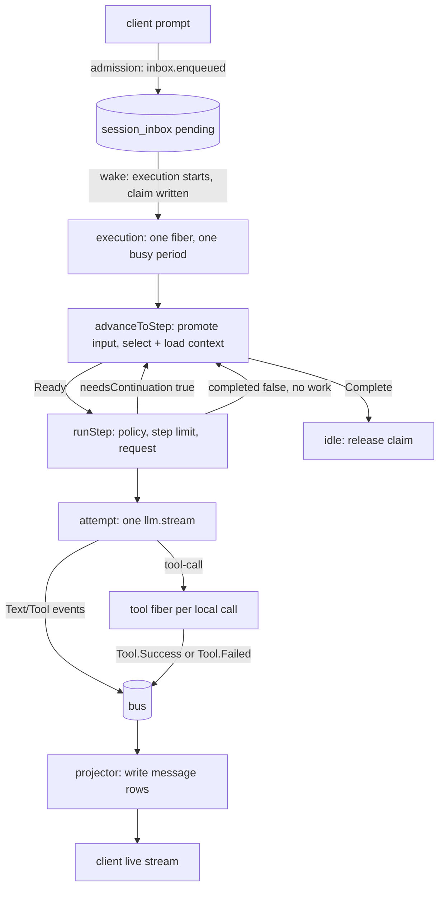
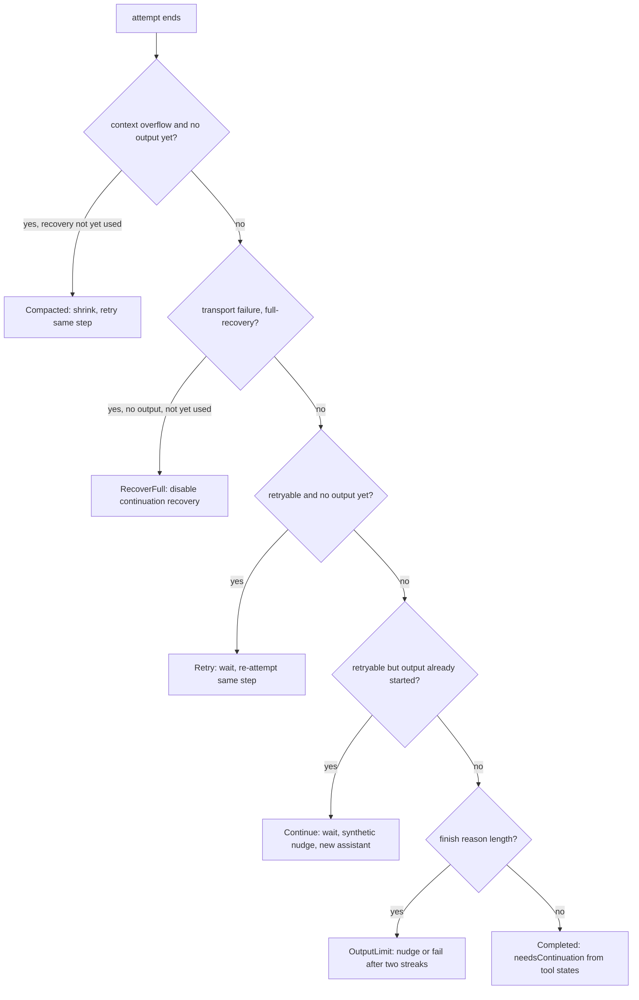
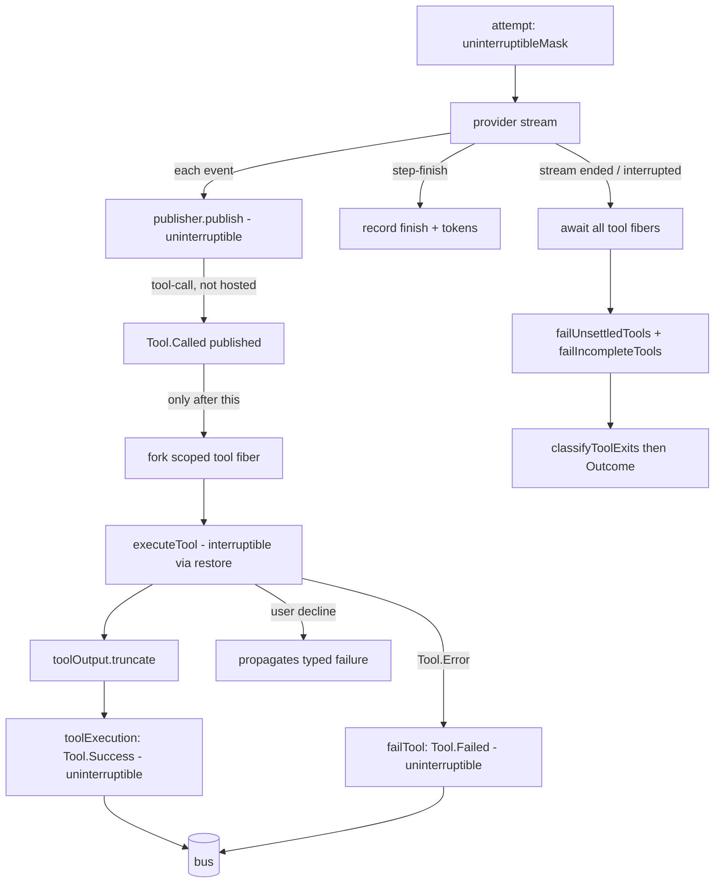
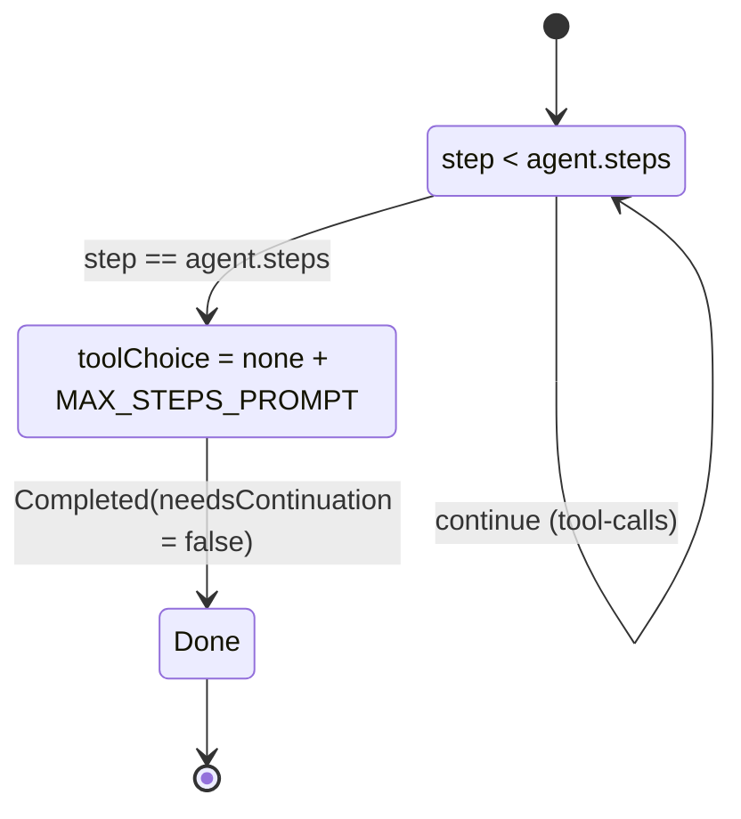
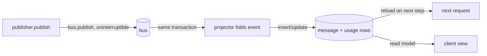

# Part 3 — The agent loop

This is the machine at the center of a coding agent. Everything else — providers, events,
tools, prompts — exists to feed one loop that decides what to do next, asks the model once,
runs whatever tools it asked for, writes down what happened, and then decides again. opencode
splits that loop into four explicitly named phases: `drain` (one pass over eligible durable
work), `advanceToStep` (turn that work into one prepared request), `runStep` (own the policy
of a single step), and `attempt` (one try at one step, with its streaming, tools, and durable
settlement). The recurring theme is that the decision to continue is read back from the
durable record, never held only in memory. Read this part with Part 2 open for the event and
inbox vocabulary, and Part 5 open for the tool contract.

Topics in this part:

- **3.1** `drain → advanceToStep → runStep → attempt` as an explicit state machine.
- **3.2** One step equals one LLM call; continuation comes from the durable record.
- **3.3** Parallel tool fibers, per-source ordering, and uninterruptible settlement.
- **3.4** Step limits and the terminal step.
- **3.5** The publisher and its concurrency invariants.

---

## 3.1 `drain → advanceToStep → runStep → attempt`

### Thesis

The agent loop is an explicit state machine with four named phases, each owning one
decision, so that the next action is always derived from durable state rather than remembered
in memory.

### Cold open

Your agent finishes a step, the model asked for a tool, and then the process is killed. When
it restarts, does it know it was mid-step? And if a second message arrives while a step is
running, does it get lost, delivered twice, or folded into the step at the wrong boundary?
Both questions have the same root: whether the loop's control flow lives in the durable
record or only in the running fiber.

### The concept

A coding agent has to do four things repeatedly, and each one has a different reason to be
separate:

1. Decide whether there is any eligible work at all. Most of the time the session is idle.
2. Turn whatever work exists into exactly one prepared provider request, honoring anything
   that arrived since the last step.
3. Make one model call, run its tools, and write the outcome down.
4. Decide whether to do it again, and if so, from what state.

opencode names these `drain`, `advanceToStep`, `runStep`, and `attempt`. They are separate
functions because collapsing them causes three specific bugs.

**Bug one — losing the difference between a retry and a continuation.** A retry re-runs the
same step; a continuation starts a new step. If one function both retries and loops, it
cannot tell whether it may re-promote new user input. opencode keeps them apart: `runStep`
loops only over attempts of the *same* step, while `drain` loops over steps, and only the
step boundary may promote newly delivered input.

**Bug two — reading stale context.** If you assemble the provider request once and reuse it
across steps, the model never sees a steer that arrived mid-turn, and it never sees the
assistant message it just produced. opencode re-enters `advanceToStep` after every step, and
`advanceToStep` reloads context from durable state each time. The only thing carried forward
in memory is the step counter and the "continuing" flag.

**Bug three — a cancellation landing between a check and an effect.** Delivering a control
item, publishing a delivery event, and starting a step are separate effects. If the process
is interrupted in the middle, the check and the effect disagree. opencode runs
`advanceToStep` under an *uninterruptible mask* so cancellation cannot split a check from its
mark, and it re-enables cancellation (`restore`) only around the pieces that are safe to
interrupt, such as preparing context and closing a transport.

The phases return tagged unions, which is what makes the state machine explicit. The outer
function, `drain`, returns a `DrainResult`: `Complete` (idle), `Moved` (the session changed
Location and work continues elsewhere), or `Reloaded` (the Location closed; reload the
transport). The inner function, `attempt`, returns an `Outcome`: `Completed`, `Retry`,
`Continue`, `RecoverFull`, `Compacted`, or `OutputLimit`. Those six outcomes are the entire
vocabulary of "what just happened," and `runStep` is the only place that translates an
outcome into "do another attempt" or "return a continuation decision."

A note on Effect terms used below, each taught once. An `Effect` is a description of a
computation with typed success, error, and requirements. A `Fiber` is a lightweight
interruptible unit of concurrency. `Effect.uninterruptibleMask((restore) => …)` runs the body
with cancellation disabled; calling `restore(effect)` re-enables cancellation for just that
effect. `Effect.scoped` ties resource lifetimes to a scope. And `Effect.fn("name")` wraps a
generator function as a named, traced effect.

### Diagram

**D2 — end-to-end request lifecycle** (client → inbox → drain → step → tool → projection →
client).



ASCII fallback:

```text
 client ──prompt──▶ [inbox pending] ──wake──▶ (execution fiber)
                                                     │
                     ┌───────────────────────────────┘
                     ▼
              advanceToStep ──Ready──▶ runStep ──▶ attempt ── one llm.stream
                     ▲                    │             │
                     │                    │        tool-call
                     │          needsContinuation       ▼
                     │◀───────────  true ──────── tool fiber
                     │                                  │
                     │                             Tool.Success/Failed
                     │                                  ▼
                     └── Complete ◀── no work      [bus] ─▶ projector ─▶ client
```

Narration: A client prompt is admitted to the durable inbox, which wakes one execution
fiber. That fiber repeatedly advances to the next step — promoting pending input and loading
context from the database — then runs a step, which makes exactly one model call and forks a
fiber per local tool call. Tool results and model output are published to the bus, projected
into message rows, and streamed to the client. When a step reports that continuation is
needed, the fiber loops back to advance to the next step; when there is no work left, it goes
idle and releases the claim.

### The real thing

The outer contract is a three-way result plus a four-input drain call.

```ts
// packages/core/src/session/runner/index.ts:21
export type Continuation = { readonly step: number }

export type DrainResult = Data.TaggedEnum<{
  Complete: {}
  Moved: { readonly continuation?: Continuation }
  Reloaded: { readonly force: boolean; readonly continuation?: Continuation }
}>
export const DrainResult = Data.taggedEnum<DrainResult>()

/** Runs one local continuation from already-recorded Session history. */
export interface Interface {
  /** Drains eligible durable work, returning transient state when execution must continue at a new Location. */
  readonly drain: (input: {
    readonly sessionID: SessionSchema.ID
    readonly force: boolean
    readonly continuation?: Continuation
    /** "steer" settles the active intent without promoting queued next-turn work. */
    readonly promotable?: Promotable
  }) => Effect.Effect<DrainResult, RunError>
}
```

`drain` opens with an eligibility gate, then settles anything a previous process left
unfinished before touching the model.

```ts
// packages/core/src/session/runner/llm.ts:57
const drain = Effect.fn("SessionRunner.drain")(function* (input: Parameters<Interface["drain"]>[0]) {
  const sessionID = input.sessionID
  let force = input.force
  let continuing = input.continuation !== undefined
  let step = input.continuation?.step ?? 1
  let entering = true
  const promotable = input.promotable ?? "input"
  if (!force && !continuing) {
    const pending = yield* SessionInbox.nextPromotable(db, sessionID, "input")
    if (!pending) return DrainResult.Complete()
    const control = pending.type === "compaction" || pending.type === "move"
    if (promotable === "steer" && pending.delivery === "queue" && !control) return DrainResult.Complete()
  }
  yield* plugins.awaitActivation
  yield* settleStaleCompactions(sessionID)
  yield* settleStaleToolCalls(sessionID)
```

`advanceToStep` is the uninterruptible boundary. It serializes inbox access, handles a
pending control (`compaction` or `move`), promotes the items this boundary may consume, and
returns either a terminal result or a loaded context tagged `Ready`.

```ts
// packages/core/src/session/runner/llm.ts:74
const advanceToStep = Effect.fn("SessionRunner.advanceToStep")(() =>
  Effect.uninterruptibleMask((restore) =>
    Effect.gen(function* () {
      while (true) {
        if (lifecycle.isClosed()) {
          yield* restore(modelTransport.close(sessionID))
          return DrainResult.Reloaded({ force, continuation: continuing ? { step } : undefined })
        }
        // Location entry and idle boundaries allow queued controls, not necessarily queued prompts.
        const pending = yield* SessionInbox.serialized(
          sessionID,
          Effect.gen(function* () {
            const next = yield* SessionInbox.nextPromotable(
              db,
              sessionID,
              entering || !continuing ? "input" : "steer",
            )
            …
```

The outer loop of `drain` alternates between advancing and stepping.

```ts
// packages/core/src/session/runner/llm.ts:191
while (true) {
  const next = yield* advanceToStep()
  if (next._tag !== "Ready") return next
  continuing = yield* runStep(next.context, step)
  step++
  force = false
  entering = false
}
```

`runStep` decides the step's policy — auto-compaction, the agent's step limit, request
construction — before it calls `attempt`.

```ts
// packages/core/src/session/runner/llm.ts:209
const runStep = Effect.fn("SessionRunner.runStep")(function* (first: SessionContext.Loaded, step: number) {
  const sessionID = first.session.id
  let assistantMessageID = SessionMessage.ID.create()
  const retry = yield* SessionRunnerRetry.make(bus, sessionID)
  let initial: SessionContext.Loaded | undefined = first
  let recoverOverflow = true
  let recoverContinuation = true
  while (true) {
    // Reuse boundary preparation once; retries refresh context without delivering more input.
    const loaded = initial ?? (yield* prepareContext(sessionID).pipe(Effect.flatMap(context.load)))
    initial = undefined
    const compacted = yield* compaction.compact({ reason: "auto", context: loaded })
    …
```

The six outcomes are declared as a tagged union in `step.ts`.

```ts
// packages/core/src/session/runner/step.ts:32
export type Outcome = Data.TaggedEnum<{
  Completed: { readonly needsContinuation: boolean }
  Retry: { readonly error: SessionError.Error; readonly decision: SessionRunnerRetry.Decision }
  Continue: {
    readonly error: SessionError.Error
    readonly decision: SessionRunnerRetry.Decision
  }
  RecoverFull: {}
  Compacted: {}
  OutputLimit: { readonly needsContinuation: boolean }
}>
export const Outcome = Data.taggedEnum<Outcome>()
```

`SessionExecution` wraps `drain` and turns `Moved`/`Reloaded` into recursion, placing the
work at the new Location.

```ts
// packages/core/src/session/execution.ts:95
const result = yield* SessionRunner.Service.use((runner) =>
  runner.drain({ sessionID, force, continuation, promotable }),
).pipe(
  instances.provide(session),
  …
)
return yield* SessionRunner.DrainResult.$match(result, {
  Complete: () => Effect.void,
  Moved: (result) => drain(sessionID, false, result.continuation, promotable),
  Reloaded: (result) => drain(sessionID, result.force, result.continuation, promotable),
})
```

The step's model is resolved lazily, per selected model, at the point context is prepared.

```ts
// packages/core/src/session/runner/model.ts:75
resolve: Effect.fn("SessionRunnerModel.resolve")(function* (session, available) {
  // Location plugins populate and filter the catalog asynchronously during layer startup.
  if (!session.model) {
    const resolved = yield* resolver.resolve()
    if (resolved) return resolved
    return yield* new ModelNotSelectedError({ sessionID: session.id })
  }
  const selected = (yield* available()).find(
    (model) => model.providerID === session.model?.providerID && model.id === session.model.id,
  )
  if (!selected)
    return yield* new ModelUnavailableError({
      providerID: session.model.providerID,
      modelID: session.model.id,
    })
  return yield* resolver.resolveModel(selected, session.model.variant)
}),
```

What to notice:

- The early gate returns `Complete` without ever calling the model when there is nothing
  eligible, so an idle drain is cheap. It also refuses to promote a *queued* item when the
  drain scope is `steer`.
- `settleStaleCompactions` and `settleStaleToolCalls` run at the top of every drain. They are
  the recovery hooks for work a dead process left `running` or `streaming`; recovery is a
  property of the database, not of a shutdown handler.
- `advanceToStep` is uninterruptible except where it opts back into interruption with
  `restore`. The context preparation and the transport close are the interruptible parts.
- `runStep` takes the `step` number from `drain` and returns a boolean the loop assigns to
  `continuing`. That boolean is the only continuation signal that crosses a step boundary.
- `runStep`'s own `while (true)` loop is about *attempts*, not steps. Compaction, retry, and
  overflow recovery keep the same step number.

### The prompts

No prompts in this topic — the prompts live in Appendix A under **Loop**.

### Build it

The whole machine reduces to two nested loops with an explicit result at each phase. In
TypeScript-flavored pseudocode:

```ts
type DrainResult =
  | { tag: "Complete" }
  | { tag: "Moved"; continuation?: { step: number } }
  | { tag: "Reloaded"; force: boolean; continuation?: { step: number } }

type Outcome =
  | { tag: "Completed"; needsContinuation: boolean }
  | { tag: "Retry" }
  | { tag: "Continue" }
  | { tag: "RecoverFull" }
  | { tag: "Compacted" }
  | { tag: "OutputLimit"; needsContinuation: boolean }

function drain(sessionID, force, continuation, promotable = "input"): DrainResult {
  let continuing = continuation !== undefined
  let step = continuation?.step ?? 1
  let entering = true

  if (!force && !continuing) {
    const pending = nextPromotable(sessionID, "input")
    if (!pending) return { tag: "Complete" }
    if (promotable === "steer" && pending.delivery === "queue" && !isControl(pending))
      return { tag: "Complete" }
  }
  settleStaleWork(sessionID)

  while (true) {
    // advanceToStep: uninterruptible control handling + promotion
    const boundary = advanceToStep(sessionID, { continuous: continuing, entering })
    if (boundary.tag !== "Ready") return boundary   // Complete | Moved | Reloaded
    continuing = runStep(boundary.context, step)
    step += 1
    force = false
    entering = false
  }
}

function runStep(context, step): boolean {
  let recoverOverflow = true
  let recoverContinuation = true
  while (true) {
    context = reloadContextIfNeeded(context)          // after the first attempt
    if (autoCompact(context).status === "completed") continue
    const limitReached = agent.steps !== undefined && step >= agent.steps
    const prepared = buildRequest(context, limitReached)
    const outcome = attempt(context, prepared, { recoverOverflow, recoverContinuation })
    switch (outcome.tag) {
      case "Completed":    return outcome.needsContinuation
      case "OutputLimit":  return handleOutputLimit(outcome, step) // boolean or continue
      case "Retry":
      case "Continue":     waitForRetry(outcome); if (outcome.tag === "Continue") publishSynthetic(); continue
      case "Compacted":    recoverOverflow = false; newAssistantMessageID(); continue
      case "RecoverFull":  recoverContinuation = false; continue
    }
  }
}
```

Decisions and trade-offs:

- Keep the four phases as separate functions even though `drain` is small. The separation is
  what lets `runStep` retry without re-promoting input.
- Make `advanceToStep` uninterruptible around promotion, then restore interruption for the
  expensive context work. If you cannot express an interruptible mask, at minimum make
  delivery and its event one atomic transaction.
- Carry only the step counter and the continuing flag across steps. Reload everything else
  from durable state at the top of each step. The cost is one reload per step; the benefit is
  that a crash between steps needs no special case.

### How it fails

- **The check/effect split.** If promotion and its delivery event are not atomic and the
  process is interrupted between them, a row is consumed but no message appears, or a message
  appears twice. Symptom: a user prompt that the model never sees, or a duplicate.
- **Retry that promotes.** If the retry path also calls the promotion path, a steer delivered
  once gets delivered again, and the model sees the same user text twice. Symptom: repeated
  instructions, doubled context.
- **Cached context.** If the request is built once and reused, steers and the previous
  assistant message are missing from later steps. Symptom: the model "forgets" a correction
  mid-turn.
- **Stale settlement skipped.** If `settleStaleToolCalls` does not run, a session recovered
  from a crash still has a tool call in `running`, and the next request contains an unfinished
  tool. Symptom: a request the provider rejects as malformed, or a hung tool state.

### How you'd test it

Assert the phase boundaries against real durable state, not against spies.

- Start with an empty inbox and a runner that would fail loudly if it called the model; assert
  `drain` returns `Complete` and publishes no `Step.Started`.
- Insert one `queue` item, drain with scope `steer`, and assert it stays pending; drain with
  scope `input` and assert exactly one delivery.
- Insert a `move`, drain, and assert the result is `Moved` and the transport was closed
  before the move event.
- Seed a run with a tool call left in `running`, drain, and assert the runner publishes
  `Tool.Failed` before any model call.
- The invariant to assert: for every step the runner takes, exactly one `Step.Started` is
  published and it precedes any tool event for that step.

### Recap

- The loop is four explicit phases (`drain → advanceToStep → runStep → attempt`) with two
  tagged unions (`DrainResult`, `Outcome`) as the only state transitions.
- `advanceToStep` is uninterruptible around checks and marks, and reloads context from durable
  state every step.
- `runStep` owns retries and compaction internally; only genuine continuations advance the
  step counter.

Next, we look at what one step actually is: a single model call whose continuation is read
back from the durable record.

### Podcast notes

- **Hook:** A process dies mid-step; the agent finishes the job correctly on restart. How does
  it know where it was?
- **Analogy:** A relay race with a baton stamped at every handoff — the runner's memory does
  not matter, the baton's marks do.
- **Talking points:** Four named phases instead of one tangled function; the uninterruptible
  boundary that keeps a check and its durable mark together; the two loops — one over steps,
  one over attempts.
- **Listeners will ask:** Why not just loop in one function and keep the step counter in
  memory?

---

## 3.2 One step = one LLM call; continuation from the durable record

### Thesis

A step makes exactly one streaming model call, and whether to continue is computed from the
durable record that step wrote — never from a flag the loop is holding in memory.

### Cold open

An agent that "keeps calling the model until it stops using tools" is a simple `while` loop
when everything works, and an unrecoverable mess when anything does not. Kill the process
between two iterations and the loop has no idea whether the last step finished, whether a
tool ran, or whether the model stopped on purpose. Here is the rule that fixes it: the
continuation decision is a pure function of recorded facts.

### The concept

The single most violated rule in agent design is the in-memory tool loop. It looks like this:

```text
while (true) {
  response = model(messages)
  if (no tool calls) break
  for (call of response.toolCalls) messages.push(runTool(call))
}
```

It is compact and it is wrong for a durable agent. The loop holds three pieces of state that
are not in the database: that a step is in flight, which tool calls have already run, and
whether the model intended to continue. If the process dies, all three are lost, and the
restart either re-runs side effects or drops them. opencode states the rule directly in its
project guide: each step is one explicit `llm.stream` call that continues from reloaded
history, and no in-memory tool loop is added.

So the design has three parts.

**One step is one streaming call.** `attempt` calls `llm.stream` once. It does not call the
model again when a tool finishes. Retries produce new *attempts* of the same step; a
continuation produces a new *step*, driven by the outer `drain` loop.

**The step writes a record as it goes.** The publisher maintains a small fold of the durable
facts produced so far: `outputStarted`, `providerFailed`, `failure`, `finish` (with the
normalized finish reason), and `needsContinuation`. This fold is not the source of truth; it
is a read model of the events the step has already published.

**The continuation is derived, not remembered.** `needsContinuation` is computed by folding
the tool states: a non-hosted tool was called or settled. The finish reason distinguishes a
normal stop from a length-limited stop. `attempt` maps those facts onto an `Outcome`, and
`runStep` maps the outcome onto "another attempt" or a returned boolean. Nothing in that chain
depends on a variable that only the running fiber can see.

Why this matters beyond crash recovery: a derived decision is *auditable*. You can read a
session's durable history and reconstruct why the agent continued or stopped, without
instrumentation. And it is *bounded*: because continuation is explicit, the runner can impose
policy on it (output-limit streaks, step limits, overflow recovery) at exactly one place.

The finish reasons are a closed set, defined once in the schema:

```ts
// packages/schema/src/llm.ts:5
export const FinishReason = Schema.Literals(["stop", "length", "tool-calls", "content-filter", "error", "unknown"])
```

Alternatives rejected:

- **In-memory tool loop.** Cannot resume; re-runs or drops side effects; no audit trail.
- **Continuation stored as an explicit boolean column.** Redundant with the tool states and
  the finish reason; two sources of truth drift. Deriving it is cheaper and cannot drift.
- **Streaming only up to the finish event.** Leaves the response half-consumed; the next
  request cannot reuse it. opencode reads the stream to the end.

### Diagram

**D10 — retry / continue / recover-full decision tree.** This is the `$match` over the
attempt's outcome, expanded with the conditions that select each branch.



ASCII fallback:

```text
 attempt ends
      │
      ▼ overflow & no output?
      ├─ yes ─▶ Compacted ─▶ same step, retry
      ▼ no
   transport full-recovery & no output?
      ├─ yes ─▶ RecoverFull ─▶ same step, retry
      ▼ no
   retryable & no output?
      ├─ yes ─▶ Retry ─▶ same step, retry
      ▼ no
   retryable & output started?
      ├─ yes ─▶ Continue ─▶ synthetic nudge ─▶ same step, retry
      ▼ no
   finish == "length"?
      ├─ yes ─▶ OutputLimit ─▶ nudge or fail
      ▼ no
   Completed(needsContinuation = some local tool called/settled)
```

Narration: When a single model call ends, the runner walks a decision tree. If the provider
said the request was too long before any output was produced, it compacts and re-attempts. If
the connection failed badly enough to need a full recovery, it disables continuation recovery
and re-attempts. If the failure is retryable and no visible output was produced, it retries
the same step. If visible output was already produced, it cannot transparently retry, so it
continues with a synthetic nudge. If the model simply ran out of output tokens, it nudges the
model to continue, bounded by a streak check. Otherwise the step is complete, and whether to
run another step is decided solely by whether the model made a local tool call.

### The real thing

The project guide states the invariant, and it is worth quoting because it is normative.

```md
// AGENTS.md:183
- Each step is one explicit `llm.stream` call that continues from reloaded history. Do not add an in-memory tool loop.
```

`attempt` makes that one call. Note the comment that the stream is read to the end so the next
request can reuse the response.

```ts
// packages/core/src/session/runner/step.ts:106
// Read to the end, not just the finish event, so the next request can reuse this response.
const providerStream = llm.stream(input.prepared.request, input.prepared.options).pipe(
  Stream.runForEach((event) =>
    Effect.gen(function* () {
      if (overflowFailure || publisher.hasProviderError()) return
      // Wait here, where cancellation still works, rather than inside the uninterruptible publish.
      if (!publisher.hasStarted()) yield* Fiber.join(pendingStartSnapshot)
      …
```

The record is a small immutable fold, defined next to the publisher.

```ts
// packages/core/src/session/runner/publish-llm-event.ts:58
/** Immutable fold of the durable facts a step's writer has recorded so far. */
export interface StepRecord {
  /** The model produced visible output this attempt, which bars transparent retries and overflow recovery. */
  readonly outputStarted: boolean
  readonly providerFailed: boolean
  /** The step's recorded assistant failure, if any. */
  readonly failure?: SessionError.Error
  /** Present once the provider finished the step normally. */
  readonly finish?: {
    readonly finish: Extract<LLMEvent, { type: "step-finish" }>["reason"]["normalized"]
    readonly rawFinish?: string
    readonly providerState?: SessionMessage.ProviderState
    readonly tokens: ReturnType<typeof SessionUsage.tokens>
  }
  readonly needsContinuation: boolean
}
```

`needsContinuation` is derived from the tool states, not stored as a separate intention.

```ts
// packages/core/src/session/runner/publish-llm-event.ts:652
/** Immutable snapshot of everything recorded for this step so far. */
record: (): StepRecord => ({
  outputStarted,
  providerFailed,
  failure: stepFailure,
  finish: stepSettlement,
  needsContinuation: Iterable.some(
    tools.values(),
    (tool) => !tool.providerExecuted && (tool.called || tool.settled),
  ),
}),
```

`attempt` reads the record to choose an outcome. Overflow recovery happens only before any
output exists, and only if the runner has not already spent its recovery.

```ts
// packages/core/src/session/runner/step.ts:155
const overflow = overflowFailure ?? streamFailure
if (
  !publisher.record().outputStarted &&
  isContextOverflowFailure(overflow) &&
  (yield* restore(input.recoverOverflow))
) {
  yield* Effect.logWarning("provider rejected the request as too long; compacting", {
    sessionID: input.sessionID,
    model: input.model.ref,
    message: overflow?.message,
  })
  return Outcome.Compacted()
}
```

The retry-versus-continue split hinges on whether output already started.

```ts
// packages/core/src/session/runner/step.ts:263
if (
  llmFailure &&
  llmError &&
  retry?.retry &&
  record.outputStarted &&
  tools.declines.length === 0 &&
  !tools.interrupted
)
  return Outcome.Continue({ error: llmError, decision: retry })

if (Exit.isFailure(stream)) return yield* Effect.failCause(stream.cause)
…
const needsContinuation = input.prepared.request.toolChoice?.type !== "none" && record.needsContinuation
if (record.finish?.finish === "length") return Outcome.OutputLimit({ needsContinuation })
return Outcome.Completed({ needsContinuation })
```

Finally, `runStep` is the one place that translates an outcome into the next action. It is
also where the output-limit streak guard lives.

```ts
// packages/core/src/session/runner/llm.ts:273
const completed = yield* SessionStep.Outcome.$match(outcome, {
  Completed: (outcome) => Effect.succeed(outcome.needsContinuation),
  Retry: (outcome) =>
    retry.wait({
      decision: outcome.decision,
      error: outcome.error,
      assistantMessageID,
    }),
  Continue: Effect.fnUntraced(function* (outcome) {
    yield* retry.wait({
      decision: outcome.decision,
      error: outcome.error,
      assistantMessageID,
    })
    yield* bus.publish(SessionEvent.Synthetic, { sessionID, text: CONTINUE_AFTER_INCOMPLETE_STREAM })
    assistantMessageID = SessionMessage.ID.create()
  }),
  OutputLimit: Effect.fn("SessionRunner.continueOutputLimit")(function* (outcome) {
    // The current response is included. User input or any other finish breaks the streak.
    const rows = yield* db
      …
      .all()
      .pipe(Effect.orDie)
    const recent = yield* Effect.forEach(rows, SessionHistory.decodeMessageRow)
    const exhausted =
      recent.length === 3 &&
      recent.every((message) => message.type === "assistant" && message.finish === "length")
    if (exhausted)
      return yield* new StepFailedError({
        error: {
          type: "output-limit",
          message: "Response still truncated after two output token limit continuations",
        },
      })
    if (outcome.needsContinuation) return true
    yield* bus.publish(SessionEvent.Synthetic, { sessionID, text: CONTINUE_AFTER_OUTPUT_LIMIT })
    assistantMessageID = SessionMessage.ID.create()
  }),
  Compacted: Effect.fnUntraced(function* () {
    recoverOverflow = false
    assistantMessageID = SessionMessage.ID.create()
  }),
  RecoverFull: Effect.fnUntraced(function* () {
    recoverContinuation = false
  }),
})
if (completed !== undefined) return completed
```

What to notice:

- `Completed` returns `needsContinuation` directly. The other branches return nothing, so
  `runStep` loops for another attempt of the same step.
- `Compacted` and `RecoverFull` each disable their own recovery flag, so the runner spends
  overflow recovery and full recovery at most once per step.
- `continueOutputLimit` counts the newest three `user`/`assistant` rows. Three assistant
  messages all finishing with `length` means the model is stuck, and the step fails with an
  `output-limit` error instead of looping forever.
- The `needsContinuation` read at line 281 is guarded by `toolChoice?.type !== "none"`; that
  guard is what makes the terminal step (3.4) terminal.

### The prompts

This topic owns the two synthetic continuation instructions. They are appended to history as
`synthetic` messages when the runner needs the model to keep going without a new user turn.

```ts
// packages/core/src/session/runner/llm.ts:35
const CONTINUE_AFTER_INCOMPLETE_STREAM =
  "The previous response was interrupted. Continue from where you left off without repeating completed content."

const CONTINUE_AFTER_OUTPUT_LIMIT =
  "Your last response hit the output token limit (stop reason: length). Do not apologize, recap, or repeat yourself. Break the remaining work into smaller pieces."
```

Provenance and design commentary:

- Both are published as `session.synthetic` events (see
  `packages/schema/src/session-event.ts:279`), so they are durable model input, not log text.
- `CONTINUE_AFTER_INCOMPLETE_STREAM` fires after a failure that produced visible output, where
  a transparent retry is no longer possible. The phrase "without repeating completed content"
  exists because models otherwise restate the truncated answer from the top, doubling the
  transcript.
- `CONTINUE_AFTER_OUTPUT_LIMIT` names the literal stop reason (`length`) so the model
  understands why it is being prompted. "Do not apologize, recap, or repeat yourself" removes
  the three most common failure responses; "break the remaining work into smaller pieces"
  gives the model an actionable change, since repeating the same generation will hit the same
  wall.

### Build it

The continuation is a function of the record and the outcome. In pseudocode:

```ts
function attempt(context, prepared, flags): Outcome {
  const record = publisher.newRecord()          // folds durable facts
  const stream = llm.stream(prepared.request, prepared.options)
  // ... publish events, fork tool fibers, await them ...
  const r = publisher.record()

  if (!r.outputStarted && isContextOverflow(failure) && flags.recoverOverflow)
    return { tag: "Compacted" }
  if (flags.recoverContinuation && isFullRecovery(failure) && !r.outputStarted)
    return { tag: "RecoverFull" }
  if (isRetryable(failure) && !r.outputStarted)
    return { tag: "Retry" }
  if (isRetryable(failure) && r.outputStarted && noDeclines())
    return { tag: "Continue" }

  const needsContinuation = prepared.toolChoice !== "none" && r.needsContinuation
  if (r.finish === "length") return { tag: "OutputLimit", needsContinuation }
  return { tag: "Completed", needsContinuation }
}
```

Decisions and trade-offs:

- Derive `needsContinuation` from the tool states rather than a boolean you set when you
  decide to loop. A derived value cannot disagree with the record.
- Treat "output started" as the wall between transparent retry and continue. Once the user has
  seen partial output, re-issuing the request would duplicate it; a synthetic nudge is the
  honest recovery.
- Bound the output-limit loop with a streak count. Any other finish, or any user input, breaks
  the streak, so the guard only fires on a genuinely stuck model.

### How it fails

- **In-memory continuation.** The classic. After a crash the restart cannot tell whether the
  last step continued; it either re-runs tools or stops early.
- **Retrying after output started.** The user sees the first half of the answer twice, and the
  transcript contains duplicated content. The `outputStarted` guard prevents the transparent
  path.
- **Unbounded length continuation.** A model that always stops at `length` loops until it
  floods the context window. The three-row streak check turns this into a typed failure.
- **Trusting `finish` blindly.** A provider that returns no finish reason at all is treated as
  `unknown` and turned into an `incomplete-stream` failure, so it is not mistaken for a clean
  stop.

### How you'd test it

Drive the runner with a scripted provider stream and assert the durable record.

- Feed a stream that ends `stop` with no tool calls; assert one `Step.Started`, one
  `Step.Ended` with finish `stop`, and no further step.
- Feed a stream that ends `tool-calls` with one local tool call; assert the runner runs the
  tool and starts exactly one more step.
- Feed two consecutive `length` finishes; assert the second continuation is attempted, and a
  third `length` produces a `Step.Failed` with type `output-limit`.
- The invariant to assert: a step never issues a second `llm.stream` for the same attempt; a
  continuation is always visible as a new `Step.Started` with an incremented step.

### Recap

- One step is exactly one `llm.stream` call; retries are new attempts, continuations are new
  steps.
- Continuation is derived from the durable record — tool states plus finish reason — not from
  an in-memory intention.
- Overflow recovery, full recovery, and the output-limit streak are each spent at most once
  and are all decided in `runStep`'s outcome match.

Next, we open up one step and look at how it runs several tools at once without racing on the
assistant message.

### Podcast notes

- **Hook:** The agent says it did the work, but it only half-finished and the process died —
  how do you tell the difference on restart?
- **Analogy:** A ledger of decisions, not a memory of them: you re-derive the next move by
  reading the last line.
- **Talking points:** Why "keep calling the model" is the wrong mental model; the difference
  between a retry and a continuation; how a single integer streak guards an infinite length
  loop.
- **Listeners will ask:** If continuation is derived, how do you ever *stop* it cleanly?

---

## 3.3 Parallel tool fibers

### Thesis

Every local tool call runs in its own fiber, so tools overlap the model stream and each other,
while per-source ordering and uninterruptible settlement keep the durable record consistent
without a shared writer.

### Cold open

A model answers in one response with three tool calls: read a file, search the tree, and run a
test. Run them one after another and you pay the sum of their latencies. Run them on three
threads with a shared mutation path and you race on the assistant message. opencode gets both
overlap and consistency — and the trick is a pair of rules, stated in the code, about *what
order you may assume* and *what may be interrupted*.

### The concept

The provider streams events. Some are text, some are reasoning, and some are tool calls. When
a tool call arrives, the step has a choice: run the tool inline and block the stream, or start
it and keep reading. opencode starts it. Each local (non-hosted) tool call is forked into its
own fiber.

That immediately raises the hard questions.

**Who writes the assistant message?** Three tools finishing at different times all want to
append to the same assistant message. Rather than funnel them through one writer fiber with a
queue, opencode lets each fiber publish on its own, and relies on two rules to make that safe.
The code states both rules explicitly, and the first one is authoritative:

- *Rule 1 — commit state marks synchronously before the first await.* Between a check
  (`tool.settled`, `stepStarted`) and the mark that records it, there must be no yield.
  Cooperative scheduling means a fiber only runs other code at a yield, so "check and mark in
  the same synchronous run" is atomic. And the provider's own event publication runs
  uninterruptible through its writes, so a cancellation cannot leave a mark without its
  durable event.
- *Rule 2 — never require a cross-source event order.* Each publishing fiber is sequential, so
  events from one source are in order by construction. Nothing may depend on the order
  *between* sources. Consumers fold by id or ordinal rather than by global position.

**When may a tool run?** Only after its call is durable. The provider loop publishes
`Tool.Called`, and only then forks the fiber that executes it. The code says so directly: a
local execution starts only after its `Tool.Called` publication completes. This is what makes
a crash safe — there is never a side effect without a durable record of the call that caused
it.

**What may be interrupted?** The *work* is interruptible; the *settlement* is not. Each tool
fiber wraps its body in an uninterruptible mask, and inside it restores interruption only
around `executeTool`. So cancelling the step stops the tool, but the code that turns the
result into a durable `Tool.Success` (or `Tool.Failed`) still runs to completion. A cancelled
tool cannot vanish; it gets a terminal event.

**What about tools that never settle?** After the stream ends — normally or by interruption —
the attempt sweeps every tool still unsettled and fails it. `failUnsettledTools` and
`failIncompleteTools` write a `Tool.Failed` for a call that produced no result, so the tool
call is never left dangling in the assistant message.

**What about a user declining a permission?** Declines are handled specially: a `Tool.Error`
settles inside its own fiber as a `Tool.Failed`, but a user decline
(`Permission.DeclinedError`) or a dismissed question (`QuestionTool.CancelledError`) is
allowed to propagate out of the fiber as a typed failure. `classifyToolExits` walks the exits
and separates the two: errors that already settled are ignored, declines become a list, and a
defect becomes a cause that fails the step. This is the mechanism that lets a "no" stop the
step without ever becoming model-visible tool output.

Alternatives rejected:

- **A single writer fiber with a queue.** Centralizes ordering, but then every source must
  coordinate, the queue becomes a bottleneck, and a slow tool blocks all publication. Per-
  source ordering by construction is simpler and needs no coordination.
- **Serial tool execution.** Trivially ordered and trivially slow; wastes the model's own
  parallelism.
- **Interruptible settlement.** Would let a cancellation strand a tool with no terminal,
  which then needs special handling in the next request's history normalization.

### Diagram

**D6 — step internals: stream + tool fibers + settlement.**



ASCII fallback:

```text
 attempt (uninterruptible mask)
    │
    ▼
 provider stream ──event──▶ publisher.publish (uninterruptible)
    │                            │
    │                            └─ tool-call? ─▶ publish Tool.Called
    │                                                   │ (only now)
    │                                                   ▼
    │                                            fork tool fiber
    │                                              │            │
    │                            tool ran ─────────┘            └─ Tool.Error
    │                                │                              │
    │                                ▼                              ▼
    │                        Tool.Success (uninterruptible)   Tool.Failed
    │
    └─ stream ends / interrupts ─▶ await fibers ─▶ sweep unsettled ─▶ Outcome
```

Narration: One attempt reads the provider stream. Each event is published uninterruptibly. A
tool call is published to the bus first, and only after that does the step fork a fiber to run
it. The fiber runs the tool interruptibly, then settles its result uninterruptibly — either
success or failure. When the stream ends or is interrupted, the step waits for all tool
fibers, sweeps any that never settled, classifies the exits, and returns an outcome. Per-source
order is guaranteed because each fiber is sequential; no global order is required because
consumers fold by id.

### The real thing

The attempt declares its tool-fiber bookkeeping and the helper that disables tools when the
step is terminal.

```ts
// packages/core/src/session/runner/step.ts:86
const toolRuns: Array<{
  readonly call: ToolCall
  readonly fiber: Fiber.Fiber<void, Permission.DeclinedError | QuestionTool.CancelledError>
}> = []
const interruptTools = Effect.suspend(() => Fiber.interruptAll(toolRuns.map((run) => run.fiber)))
const executeTool = (call: ToolCall) => {
  if (input.prepared.request.toolChoice?.type === "none")
    return new Tool.Error({ message: "Tools are disabled after the maximum agent steps" })
  return input.prepared.executeTool({
    sessionID: input.sessionID,
    agent: input.agent,
    messageID: input.assistantMessageID,
    call,
    progress: (update) => publisher.progress(call.id, update),
  })
}
```

Here are the two concurrency rules as the code states them, followed by the fork itself. Note
that the fiber's body is masked, and `restore` re-enables interruption only around
`executeTool`; truncation and settlement run uninterruptibly.

```ts
// packages/core/src/session/runner/step.ts:103
// Provider and tool fibers retain per-source order without a shared writer queue.
// A local execution starts only after its Tool.Called publication completes.
let overflowFailure: ProviderErrorEvent | undefined
// Read to the end, not just the finish event, so the next request can reuse this response.
const providerStream = llm.stream(input.prepared.request, input.prepared.options).pipe(
  Stream.runForEach((event) =>
    Effect.gen(function* () {
      …
      yield* publisher.publish(event)
      if (event.type !== "tool-call" || event.providerExecuted) return
      toolRuns.push({
        call: event,
        fiber: yield* Effect.uninterruptibleMask((restore) =>
          restore(executeTool(event)).pipe(
            Effect.flatMap(toolOutput.truncate),
            Effect.flatMap((outcome) => publisher.toolExecution(event.id, event.name, outcome)),
            Effect.catchTag("Tool.Error", (error) =>
              publisher.failTool(event.id, toSessionError(error), error.metadata).pipe(Effect.asVoid),
            ),
          ),
        ).pipe(Effect.forkScoped),
      })
    }),
  ),
  Effect.ensuring(publisher.flush()),
)
```

The settlement half of the attempt runs under a second, outer uninterruptible mask so the final
tool and step events survive cancellation of the work.

```ts
// packages/core/src/session/runner/step.ts:140
// Keep the final tool and Step events uninterruptible, even when the work itself is cancelled.
return yield* Effect.uninterruptibleMask((restore) =>
  Effect.gen(function* () {
    const stream = yield* restore(providerStream).pipe(Effect.exit)
    const streamFailure = Option.getOrUndefined(Exit.findErrorOption(stream))
    const streamInterrupted = Exit.hasInterrupts(stream)
    // Cancelled before the start snapshot existed: record nothing, as when the capture preceded the request.
    if (streamInterrupted && !publisher.hasStarted() && !pendingStartSnapshot.pollUnsafe())
      return yield* Effect.failCause(stream.cause)
    if (!overflowFailure && publisher.hasStarted()) yield* publisher.streamed()
    if (streamInterrupted) yield* interruptTools
    const joined = yield* restore(Fiber.awaitAll(toolRuns.map((run) => run.fiber))).pipe(Effect.exit)
    if (Exit.isFailure(joined)) yield* interruptTools
```

Declines become model-safe failure events, and any tool still unsettled is failed before the
outcome is chosen.

```ts
// packages/core/src/session/runner/step.ts:207
for (const decline of tools.declines)
  yield* publisher.failTool(decline.call.id, {
    type: "aborted",
    message: input.isLocationClosed()
      ? "Interaction cancelled because the location shut down"
      : decline.reason._tag === "QuestionTool.CancelledError"
        ? decline.reason.message
        : "The user declined this tool call",
  })
const interrupted = tools.declines.length > 0 || streamInterrupted || tools.interrupted
…
if (toolFailure) yield* publisher.failUnsettledTools(toolFailure)
if (interrupted) yield* publisher.failAssistant(STEP_INTERRUPTED)

// Parsers may leave unfinished calls without an execution event.
if (llmError || (Exit.isSuccess(stream) && !recorded.providerFailed)) {
  const missing = yield* publisher.failUnsettledTools(RESULT_MISSING, "hosted")
  if (missing && !llmError && !recorded.finish) yield* publisher.failAssistant(RESULT_MISSING)
  yield* publisher.failIncompleteTools()
}
```

`classifyToolExits` is where per-fiber exits become a single decision. Its header states the
echo of the design rule: `Tool.Error` settles in each fiber, so only declines remain typed.

```ts
// packages/core/src/session/runner/step.ts:297
/** Tool.Error settles in each fiber; only user declines remain in the typed error channel. */
const classifyToolExits = (
  settled: Exit.Exit<Array<Exit.Exit<void, Permission.DeclinedError | QuestionTool.CancelledError>>>,
  runs: ReadonlyArray<{ readonly call: ToolCall }>,
) => {
  const exits = Exit.isSuccess(settled) ? settled.value : []
  const declines = exits.flatMap((exit, index) =>
    Exit.isFailure(exit)
      ? exit.cause.reasons.flatMap((reason) =>
          Cause.isFailReason(reason) ? [{ call: runs[index].call, reason: reason.error }] : [],
        )
      : [],
  )
  const causes = Exit.isFailure(settled)
    ? [settled.cause]
    : exits.flatMap((exit) => (Exit.isFailure(exit) ? [exit.cause] : []))
  const failure = causes
    .flatMap((cause) => {
      if (Cause.hasInterrupts(cause)) return []
      const reasons = cause.reasons.filter(Cause.isDieReason)
      return reasons.length > 0 ? [Cause.fromReasons<never>(reasons)] : []
    })
    .at(0)
  return { interrupted: causes.some(Cause.hasInterrupts), declines, failure }
}
```

The publisher's `toolExecution` is the canonical local terminal; `failTool` marks settled
before it publishes, which is rule 1 in action.

```ts
// packages/core/src/session/runner/publish-llm-event.ts:616
/** Publishes one canonical terminal event for a locally executed tool call. */
const toolExecution = Effect.fnUntraced(function* (id: string, name: string, result: Tool.NormalizedResult) {
  const tool = tools.get(id)
  if (!tool?.called) return yield* Effect.die(new Error(`Tool execution before call: ${id}`))
  if (tool.name !== name)
    return yield* Effect.die(new Error(`Tool execution name changed for ${id}: ${tool.name} -> ${name}`))
  if (tool.settled) return yield* Effect.die(new Error(`Duplicate tool execution: ${id}`))
  tool.settled = true
  const content = result.content
  if (!isReadonlyArrayNonEmpty(content)) return yield* Effect.die(new Error(`Tool execution has no content: ${id}`))
  yield* bus.publish(SessionEvent.Tool.Success, {
    sessionID: input.sessionID,
    assistantMessageID,
    id,
    content,
    ...(result.metadata === undefined ? {} : { metadata: result.metadata }),
    executed: tool.providerExecuted,
  })
})
```

What to notice:

- `tool.settled = true` is set on the line before `bus.publish`, with no `yield` between the
  check and the mark. That is rule 1.
- The Tool.Called event (in `publish`, `tool-call` case) sets `tool.called = true` and
  publishes before returning; the fork happens after `publisher.publish(event)` returns, so the
  call is durable before the side effect.
- The outer mask keeps settlement alive across cancellation, and `interruptTools` stops the
  work. Both are needed: stop the work, keep the record.
- `classifyToolExits` treats a death (`Die`) as a step failure but an interrupt as
  "interrupted," and never lets a settled `Tool.Error` back into the typed channel.

### The prompts

This topic owns the model-facing error strings that describe interrupted or missing tool
results. They are designed messages, not log text, because they are published as `Tool.Failed`
events the model later reads.

```ts
// packages/core/src/session/runner/step.ts:62
const TOOLS_INTERRUPTED = { type: "aborted", message: "Tool execution interrupted" } as const
const STEP_INTERRUPTED = { type: "aborted", message: "Step interrupted" } as const
const RESULT_MISSING = { type: "tool.result-missing", message: "Provider did not return a tool result" } as const
```

Provenance and design commentary:

- `RESULT_MISSING` fires for a host tool call whose result the provider never returned. The
  phrase "Provider did not return a tool result" tells the model the call was made but the
  result is absent, which steers it to reissue rather than assume success.
- `TOOLS_INTERRUPTED` fires when the step's tools were cancelled. The companion per-tool
  message in `settleStaleToolCalls` appends the subagent's child session ID when present, so
  the model can reason about which branch was cut off.
- `STEP_INTERRUPTED` is attached to the assistant message, not to a tool. It marks the whole
  step as cut short, distinct from any single tool's failure.

### Build it

The concurrency contract is small enough to state as rules you implement directly.

```ts
function attempt(context, prepared): Outcome {
  const toolRuns = []
  const providerStream = llm.stream(prepared.request, prepared.options).forEach(event => {
    const published = publisher.publish(event)          // uninterruptible internally
    if (event.type !== "tool-call" || event.providerExecuted) return
    // Rule: fork only after Tool.Called is durable.
    toolRuns.push(forkScoped(
      uninterruptibleMask(restore =>
        restore(runTool(event))                          // interruptible work
          .then(truncate)
          .then(result => publisher.toolSuccess(event.id, result))   // uninterruptible settlement
          .catch(ToolError, e => publisher.toolFailed(event.id, e)),
      ),
    ))
  })

  return uninterruptibleMask(restore => {
    const streamExit = restore(providerStream).exit()
    if (streamExit.interrupted) interruptAll(toolRuns)
    const joined = restore(awaitAll(toolRuns)).exit()
    const classified = classifyExits(joined)

    for (const decline of classified.declines) publisher.toolFailed(decline.id, aborted(decline))
    if (classified.interrupted) publisher.failUnsettled("Tool execution interrupted")
    publisher.failIncomplete()                            // any call with no execution event
    return decideOutcome(streamExit, publisher.record())
  })
}
```

Decisions and trade-offs:

- Fork the tool only after the call event is published. If you fork first, a crash can leave a
  side effect with no durable call, and the restart cannot reconcile it.
- Mask settlement, restore only the work. If you settle inside the interruptible region, a
  cancellation can drop a terminal and leave the assistant message with a running tool.
- Do not assume a cross-source order. Make each source sequential and identify events by id or
  ordinal; consumers then tolerate any interleaving.
- Sweep unsettled tools at the end of every attempt. It is cheaper to write a failure event
  than to teach every later reader to tolerate a missing result.

### How it fails

- **Fork before publish.** The classic race: a tool runs, the process dies before the call is
  recorded, and the restart has a side effect it cannot attribute.
- **Interruptible settlement.** Cancellation lands between "tool returned" and "Tool.Success
  published"; the assistant message keeps a tool in `running` forever.
- **Assuming global order.** Two tool fibers interleave, and a consumer that expected a single
  timeline drops or misorders a result.
- **Swallowing a decline into a tool error.** The model reads "declined by user" as a tool
  result and keeps going, when the step should have stopped.
- **Skipping the sweep.** A tool call with no result forces every downstream request path to
  repair the history, and the model sees an incomplete tool exchange.

### How you'd test it

Exercise real fiber scheduling with a scripted stream.

- Emit two tool calls in one stream and assert both fibers run and both publish exactly one
  terminal each.
- Make one tool slow and one fast, and assert per-source order: the slow tool's input events
  are still ordered, and outcomes fold by id, not arrival time.
- Interrupt the step while a tool is running; assert the tool still gets a `Tool.Failed` (or
  `Tool.Success` if it finished), and the assistant gets `STEP_INTERRUPTED`.
- Have a tool decline a permission; assert no `Tool.Success` is published for it and the step
  is interrupted, not continued.
- Emit a tool call whose result never arrives; assert `RESULT_MISSING` is published.
- The invariant: every tool call that gets a `Tool.Called` event eventually gets exactly one of
  `Tool.Success` or `Tool.Failed`, even under interruption.

### Recap

- Each local tool call runs in its own fiber, forked only after its `Tool.Called` event is
  durable.
- Two rules make concurrent writers safe: commit a mark synchronously before the first await,
  and never require a cross-source order.
- Work is interruptible; settlement is not. Every started call is swept to a terminal.

Next, we look at how the loop guarantees it always ends: the step limit and the terminal step.

### Podcast notes

- **Hook:** The agent fires three tools at once and they all finish at different times — who
  writes the answer?
- **Analogy:** Independent court reporters each take their own transcript in order; nobody
  insists the pages be stamped in a single global sequence.
- **Talking points:** Why "fork after you record the call" is non-negotiable; why settlement
  must outlive cancellation; how per-source order removes the need for a writer queue.
- **Listeners will ask:** If there is no shared writer, how do you avoid interleaved garbage?

---

## 3.4 Step limits and the terminal step

### Thesis

The agent's step allowance is enforced by disabling tools on the final step (`toolChoice:
"none"`) and instructing the model with a fixed prompt, so the loop always ends in a text
response rather than an unbounded tool sequence.

### Cold open

An agent given a hard task will happily call tools forever — read, search, read, edit, test,
read again — until something else stops it. And an agent stopped cold mid-task leaves the user
with a half-finished job and no explanation. The terminal step is the designed last word: one
more model call that can only answer in prose.

### The concept

Two different limits get confused. The *context window* is finite and is handled by compaction
(Part 7). The *step allowance* is a policy limit on how many model calls one turn may make,
and it is a property of the agent, not the model. opencode enforces it with a terminal step.

The mechanism has three parts:

1. **A counter, reset at promotion.** `drain` starts `step` at 1 and increments it after each
   completed step. When new input is promoted, the counter resets to 1, so the allowance is
   per turn, not per session. The project guide states this: promoting new user input resets
   the selected agent's step allowance, and a batch of steers resets it once.
2. **A terminal request.** When `step` reaches the agent's `steps` value, `runStep` sets
   `toolChoice: "none"` on the provider request and appends the `MAX_STEPS_PROMPT` text as an
   assistant message. The prompt is the model's instruction to summarize.
3. **A forced no-continuation.** `attempt` computes `needsContinuation` as
   `toolChoice !== "none" && record.needsContinuation`, so the terminal step can never continue.
   Even if the model emits a tool call, `executeTool` refuses it with a typed error.

Why `toolChoice: "none"` instead of removing the tool definitions? Prompt caching. Providers
cache the request prefix, and the tool definitions are part of that prefix. Removing them for
the last step would invalidate the cache and cost a full re-read of the context. The code says
so in a comment: keep tool definitions on the final step to preserve the provider's cached
prefix. So the tools stay advertised, but the provider is told not to choose them, and the
executor refuses to run them if it does.

Why append the prompt as an assistant message rather than a system message? An assistant turn
is the natural place to tell a model "for your next reply, do this," and it sits next to the
history the model is summarizing. It also keeps the system prompt stable, which protects the
cache.

Alternatives rejected:

- **Hard-abort after N steps.** Cheap, but it produces no summary, and the user sees a stopped
  agent with no account of what happened.
- **Remove tools on the final step.** Breaks prompt caching and, for some providers, is
  rejected outright when prior tool calls have no definitions to match.
- **Rely on the model to stop.** It will not, dependably, on a task it believes is unfinished.

### Diagram

**D55 — D2's terminal-step path.** A focused view of how the step counter reaches the
terminal step, where tools are removed from the request.



ASCII fallback:

```text
 step = 1 ──▶ runStep ──▶ step++ ──▶ step < agent.steps ?
                                        ├─ yes ─▶ next step (tools enabled)
                                        ▼ no
                          terminal step: toolChoice=none, + MAX_STEPS_PROMPT
                                        │
                                        ▼
                          needsContinuation forced false ─▶ done
```

Narration: The step counter climbs with each completed step. While it is below the agent's
allowance, tools stay enabled and a tool call continues the turn. The moment it reaches the
allowance, the request switches to `toolChoice: none` and gains the maximum-steps instruction,
and the step is forced to be terminal: whatever the model produces, the turn ends in text.

### The real thing

The decision is one comparison in `runStep`; the request change is two lines.

```ts
// packages/core/src/session/runner/llm.ts:226
const stepLimitReached = loaded.agent.info.steps !== undefined && step >= loaded.agent.info.steps
const transcript = SessionModelRequest.baseTranscript({
  agent: loaded.agent.info,
  model: loaded.model,
  tools: loaded.tools,
  initial: loaded.initial,
  messages: loaded.messages,
})
const prepared = yield* context.request.primary({
  session: loaded.session,
  agent: loaded.agent.id,
  model: loaded.model,
  tools: loaded.tools,
  system: transcript.system,
  messages: stepLimitReached
    ? [...transcript.messages, Message.assistant(MAX_STEPS_PROMPT)]
    : transcript.messages,
  // Keep tool definitions on the final Step to preserve the provider's cached prefix.
  toolChoice: stepLimitReached ? "none" : undefined,
  webSocket: "session",
  inputTokens: SessionCompaction.estimatePrompt(loaded),
})
```

The step counter resets when input is promoted, so the allowance is per turn.

```ts
// packages/core/src/session/runner/llm.ts:177
if (promoted > 0 && !selected.session.parentID && SessionTitle.isUntitled(selected.session))
  yield* FiberMap.run(titles, sessionID, title.generate(sessionID), {
    onlyIfMissing: true,
  })
if (promoted > 0) step = 1
```

The attempt both refuses to run a tool and refuses to continue when tools are disabled.

```ts
// packages/core/src/session/runner/step.ts:91
const executeTool = (call: ToolCall) => {
  if (input.prepared.request.toolChoice?.type === "none")
    return new Tool.Error({ message: "Tools are disabled after the maximum agent steps" })
  return input.prepared.executeTool({
    …
  })
}

// packages/core/src/session/runner/step.ts:281
const needsContinuation = input.prepared.request.toolChoice?.type !== "none" && record.needsContinuation
```

What to notice:

- The check is `step >= loaded.agent.info.steps`, and `steps` is optional. An agent with no
  `steps` value never hits the limit.
- The tool definitions are still passed (`tools: loaded.tools`) even on the terminal step; only
  `toolChoice` changes. That is the cache-preservation choice.
- The executor's refusal is a typed `Tool.Error`, so a stray tool call on the terminal step
  becomes a normal tool failure the model can read, not a crash.
- `promoted > 0` is the reset trigger; a control item that promotes nothing does not reset the
  counter.

### The prompts

This topic owns `MAX_STEPS_PROMPT`.

```ts
// packages/core/src/session/runner/max-steps.ts:1
export const MAX_STEPS_PROMPT = `CRITICAL - MAXIMUM STEPS REACHED

The maximum number of steps allowed for this task has been reached. Tools are disabled until next user input. Respond with text only.

STRICT REQUIREMENTS:
1. Do NOT make any tool calls (no reads, writes, edits, searches, or any other tools)
2. MUST provide a text response summarizing work done so far
3. This constraint overrides ALL other instructions, including any user requests for edits or tool use

Response must include:
- Statement that maximum steps for this agent have been reached
- Summary of what has been accomplished so far
- List of any remaining tasks that were not completed
- Recommendations for what should be done next

Any attempt to use tools is a critical violation. Respond with text ONLY.`
```

Provenance and design commentary:

- It is appended as an assistant message, not a system message, so it sits with the history the
  model is being asked to summarize.
- "Tools are disabled until next user input" tells the model this is not a permanent state,
  which reduces the chance it tries to force progress some other way.
- "This constraint overrides ALL other instructions" exists because the reasoning model's own
  objective ("finish the task") otherwise wins and it emits another tool call, which the
  executor then refuses — a wasted step and a confused transcript.
- The required response shape (statement, summary, remaining tasks, recommendations) is there
  so the terminal step produces something a human can act on, not an apology.
- "Any attempt to use tools is a critical violation. Respond with text ONLY." is the second
  escalation, for models that treat requirement 1 as advice.

### Build it

The terminal step is a request-time policy plus a continuation guard.

```ts
function buildRequest(context, step, agent): Prepared {
  const limitReached = agent.steps !== undefined && step >= agent.steps
  return request({
    messages: limitReached
      ? [...context.messages, assistant(MAX_STEPS_PROMPT)]
      : context.messages,
    tools: context.tools,                       // keep definitions for the cache
    toolChoice: limitReached ? "none" : undefined,
  })
}

function decideContinuation(prepared, record): boolean {
  if (prepared.toolChoice === "none") return false   // terminal step never continues
  return record.needsContinuation
}
```

Decisions and trade-offs:

- Disable tool *choice*, not tool *definitions*. You keep the provider's cached prefix and you
  still get a graceful refusal if the model disobeys.
- Reset the counter only on real promotion, not on every drain. Otherwise a stray wake would
  hand the agent a fresh allowance mid-task.
- Make the guard live in one place (`needsContinuation`) rather than in every outcome branch.

### How it fails

- **Removing tool definitions.** Breaks prompt caching and can make some providers reject a
  history that references tools no longer defined.
- **Forgetting the executor guard.** A model that ignores `toolChoice: none` gets its tool call
  executed anyway, and the turn continues past the limit.
- **Not resetting the counter on promotion.** The user's next message is answered by an agent
  that immediately enters its terminal step and refuses to work.
- **Resetting on every drain.** Wakes and controls silently refill the allowance, defeating the
  limit.

### How you'd test it

Set the agent's `steps` to a small number and drive real requests.

- With `steps: 1`, assert the first request carries `toolChoice: none` and includes the
  maximum-steps text.
- From that terminal step, assert a tool call is refused with the disabled message and the
  resulting outcome has `needsContinuation: false`.
- Promote new user input and assert the next request has tools enabled again and the step
  counter restarts at 1.
- The invariant: no `Step.Started` after a terminal step within the same turn, and tools are
  never executed on a `toolChoice: none` request.

### Recap

- The step allowance is a per-turn, per-agent counter that resets on promotion.
- The terminal step keeps tool definitions for cache stability but sets `toolChoice: "none"`
  and appends `MAX_STEPS_PROMPT`.
- `needsContinuation` is forced false when tools are disabled, so the terminal step always
  ends the turn.

Next, we examine the object that turns the model's streamed response into these durable facts.

### Podcast notes

- **Hook:** The agent is out of steps. Does it just stop, or does it tell you what it did?
- **Analogy:** A time-limited meeting where the last agenda item is always "summarize and state
  next steps."
- **Talking points:** Why you disable tool *choice* instead of tool *definitions*; why the
  prompt is an assistant message; why the counter is per turn, not per session.
- **Listeners will ask:** What stops a model that ignores the instruction and calls a tool
  anyway?

---

## 3.5 The publisher and its concurrency invariants

### Thesis

One object, `createLLMEventPublisher`, converts the provider's ephemeral event stream into
durable Session events, and its two stated concurrency rules make concurrent provider and tool
writers safe without a shared lock or queue.

### Cold open

The model streams text, reasoning, and tool arguments in tiny chunks, while tool fibers finish
on their own schedules and publish results. Out of that blizzard you need an ordered,
replayable assistant message and a set of tool results that makes sense on a cold read. The
publisher is the single place that does it, and its correctness rests on two rules stated in
its own doc comment.

### The concept

Two event vocabularies meet here. `LLMEvent` is the provider's ephemeral streaming union:
`text-start`, `text-delta`, `reasoning-delta`, `tool-input-start`, `tool-call`, `tool-result`,
`step-finish`, and so on. `SessionEvent` is the durable record: `Step.Started`, `Text.Ended`,
`Tool.Called`, `Tool.Success`, `Tool.Failed`, and friends. The publisher is the map from one to
the other, and it is the only code allowed to interpret the provider's raw stream for
persistence.

Design points:

**Deltas are live-only; ended events are the boundary.** Delta events stream to clients for
responsiveness, but they are not the replayable record. `Text.Ended` and `Reasoning.Ended`
carry the full value and are what a later reader folds. The publisher batches deltas (a short
interval) and, crucially, publishes any held deltas before starting a new block, so the
published order matches the model's order even though deltas are batched.

**It executes nothing.** The publisher records; it does not run tools. A locally executed
tool's terminal comes from `toolExecution`, called by the tool fiber. A provider-hosted tool's
terminal comes from the `tool-result` provider event. The publisher owns both paths so there is
one canonical terminal per call.

**It keeps a small fold, not the truth.** The `tools` map, `stepStarted`, `outputStarted`, and
`stepSettlement` are a fold of the events already published. `record()` returns an immutable
snapshot of that fold. This is what `attempt` reads to pick an outcome.

**Two rules make concurrent writers safe.** The doc comment is authoritative, so here it is
verbatim, followed by what each rule buys:

- Rule 1 (atomic check-and-mark): commit a state mark synchronously before the first await;
  never yield between a check and its mark. Under cooperative scheduling, a fiber only runs
  other code at a yield, so a check and its mark in one synchronous run cannot interleave.
  And provider-event publication is uninterruptible through its writes, so a cancellation
  cannot strand a mark without its event.
- Rule 2 (no cross-source order): each publishing fiber is sequential, so per-source order
  holds by construction; nothing may depend on order between sources, and consumers fold by id
  or ordinal, not global position.

**It defends against misordered input.** The switch on `event.type` dies on invariant
violations: a delta before its start, a duplicate start, a name change mid-call, a duplicate
tool result. These are `Effect.die` (defects), because a provider that violates the protocol
is a bug, not a recoverable condition. One deliberate exception: a late *error* result after a
tool is already settled is a benign straggler and is ignored, because an abort sweep may
legitimately race the stream — but a late *success* would mean double execution and dies.

Alternatives rejected:

- **A single mutation queue.** Serializes all writers, adds latency, and makes ordering
  dependent on the queue rather than on each source. The two rules remove the need for it.
- **Durable deltas.** Would bloat the log with every chunk; ended events are enough to
  reconstruct the message.
- **Publishing inside the interruptible region.** Would let cancellation leave a half-written
  event. Publication is masked.

### Diagram

**D3 — durable event → projection → read model**, shown for the publisher's output path.



ASCII fallback:

```text
 provider stream ─▶ publisher.publish ─▶ [bus] ─▶ projector ─▶ message/usage rows
                        (uninterruptible)             │
                                                      ├─▶ next step reloads history
                                                      └─▶ client reads live/loaded view
```

Narration: The publisher maps each provider event to a durable event and publishes it
uninterruptibly. The bus projectors fold those events into message and usage rows in the same
transaction. Those rows are what the next step reloads as context and what clients read. The
publisher never writes the read model directly; it only emits facts.

### The real thing

The doc comment on the factory is the authoritative statement of the invariants.

```ts
// packages/core/src/session/runner/publish-llm-event.ts:92
/**
 * Persist one step without executing tools or starting a continuation step.
 *
 * Concurrency invariant: the provider loop and each owned tool fiber call these methods
 * concurrently without a lock. Two rules keep that safe, and every method must preserve
 * them. (1) Commit state marks synchronously before the first await: never a yield
 * between a check (`tool.settled`, `stepStarted`, ...) and its mark, so check-and-mark
 * stays atomic under cooperative scheduling. Provider-event publication remains
 * uninterruptible through its writes so cancellation cannot strand a mark without
 * its durable event. (2) Never require a cross-source event
 * order: each publishing fiber is sequential, so per-source order holds by construction,
 * and consumers fold by id/ordinal rather than global position.
 */
```

`startAssistant` is rule 1 made concrete: it checks, awaits the start snapshot, re-checks, then
marks and publishes.

```ts
// packages/core/src/session/runner/publish-llm-event.ts:129
const startAssistant = Effect.fnUntraced(function* () {
  if (stepStarted) return assistantMessageID
  const snapshot = input.pendingSnapshot ? yield* input.pendingSnapshot : undefined
  // Check again after the await, so the check and the mark below never straddle a yield.
  if (stepStarted) return assistantMessageID
  stepStarted = true
  yield* bus.publish(SessionEvent.Step.Started, {
    sessionID: input.sessionID,
    agent: input.agent,
    model: input.model,
    assistantMessageID,
    snapshot,
    started: input.started,
  })
  return assistantMessageID
})
```

The provider-event entry point is a switch that ends each case by publishing a durable event.
It is wrapped uninterruptible at the end of the generator.

```ts
// packages/core/src/session/runner/publish-llm-event.ts:443
const publish = Effect.fnUntraced(function* (event: LLMEvent) {
  switch (event.type) {
    case "step-start":
      yield* startAssistant()
      return
    case "text-start":
      outputStarted = true
      const startedTextOrdinal = yield* text.start(event.id, providerState(event.providerMetadata))
      yield* publishPendingDeltas()
      yield* bus.publish(SessionEvent.Text.Started, {
        sessionID: input.sessionID,
        assistantMessageID: yield* startAssistant(),
        ordinal: startedTextOrdinal,
      })
      return
    case "text-delta":
      yield* text.append(event.id, event.text, providerState(event.providerMetadata))
      return
    …
```

The `tool-call` case marks `called` before publishing, and the doc's rule 1 forbids a yield
between check and mark. The `tool-result` case shows the deliberate straggler exception.

```ts
// packages/core/src/session/runner/publish-llm-event.ts:520
case "tool-result": {
  // Provider-hosted results only; local executions publish through `toolExecution`.
  const tool = tools.get(event.id)
  if (!tool?.called) return yield* Effect.die(new Error(`Tool result before call: ${event.id}`))
  if (tool.name !== event.name)
    return yield* Effect.die(new Error(`Tool result name changed for ${event.id}: ${tool.name} -> ${event.name}`))
  if (tool.settled) {
    // A late error result is a benign straggler (e.g. after an abort
    // sweep); a late success would mean double execution, so it dies.
    if (event.result.type === "error") return
    return yield* Effect.die(new Error(`Duplicate tool result: ${event.id}`))
  }
  tool.settled = true
  …
```

The whole `publish` generator is wrapped uninterruptible, which is rule 1's second clause.

```ts
// packages/core/src/session/runner/publish-llm-event.ts:600
}, Effect.uninterruptible)
```

What to notice:

- The doc comment says every method must preserve the rules; it is a contract, not a note.
- `startAssistant`'s double check is the exact shape rule 1 describes: the wait for the
  snapshot happens *between* two synchronous checks, so the mark and the publish cannot
  straddle a cancellation.
- `publish` is uninterruptible through its writes. Cancellation stops the caller, not a
  publication that has begun.
- Deltas are the one case routed through a lighter traced path in the returned object, because
  they are high-frequency and live-only.

### The prompts

This topic owns the model-facing tool-input failure messages. They are published as
`Tool.Failed` events and read by the model on the next request, so they are prompt engineering.

```ts
// packages/core/src/session/runner/publish-llm-event.ts:41
const INPUT_FAILURES = {
  malformed: {
    type: "tool.input-json",
    message:
      "The tool input could not be parsed as JSON, so the call was not executed. Reissue the call with valid JSON arguments.",
  },
  length: {
    type: "tool.input-incomplete",
    message:
      "The tool call was not executed because the output token limit (stop reason: length) was reached before you could complete the arguments. Break large payloads into smaller tool calls and reissue the call with complete arguments.",
  },
  incomplete: {
    type: "tool.input-incomplete",
    message: "Tool call arguments were not completed and were not executed. Reissue the call with complete arguments.",
  },
} satisfies Record<InputFailureReason, SessionError.Error>
```

Provenance and design commentary:

- `malformed` versus `length` distinguishes two causes the model must treat differently: a
  JSON syntax error means reissue validly; a truncation by the output limit means make the
  payload smaller. The finish reason selects between them.
- The `length` message names the stop reason so the model connects the failure to its own
  generation limit, and it gives the concrete remedy ("break large payloads into smaller tool
  calls").
- `incomplete` covers arguments that simply never finished, without a length signal. All three
  end with an explicit "the call was not executed," which stops the model assuming partial
  effects.
- The publisher also appends a bounded input excerpt (`inputExcerpt`, truncated at 2048
  characters) for recovery diagnostics, kept separate from the model-facing message.

### Build it

The publisher is a stateful fold driven by a switch. In pseudocode:

```ts
function createPublisher(bus, input) {
  const tools = new Map()               // id -> { called, settled, providerExecuted, ... }
  let stepStarted = false, outputStarted = false, stepSettlement = undefined, stepFailure = undefined

  function startAssistant() {           // rule 1: check, await, re-check, mark, publish
    if (stepStarted) return input.assistantMessageID
    const snapshot = input.pendingSnapshot ? await input.pendingSnapshot : undefined
    if (stepStarted) return input.assistantMessageID
    stepStarted = true
    bus.publish("Step.Started", { ...input, snapshot })
  }

  function publish(event) {              // wrapped uninterruptible
    switch (event.type) {
      case "text-start":  outputStarted = true; text.start(event.id); flushHeldDeltas(); publish("Text.Started"); break
      case "text-delta":  text.append(event.id, event.text); break   // batched, live-only
      case "text-end":    text.end(event.id); publish("Text.Ended"); break
      case "tool-call":
        const tool = tools.get(event.id) ?? startToolInput(event)
        tool.called = true                  // mark before publish, no await between
        bus.publish("Tool.Called", { id: event.id, input: event.input })
        break
      case "tool-result":
        if (!tools.get(event.id)?.called) die("result before call")
        if (tools.get(event.id).settled) { if (error) return; else die("duplicate result") }
        tools.get(event.id).settled = true
        bus.publish(event.result.type === "error" ? "Tool.Failed" : "Tool.Success", { id: event.id })
        break
      case "step-finish":
        flushAll()
        stepSettlement = { finish: event.reason.normalized, tokens: event.reason.usage }
        break
    }
  }

  return {
    publish: uninterruptible(publish),
    toolExecution: (id, name, result) => {  // canonical local terminal
      const t = tools.get(id)
      if (!t?.called) die("execution before call")
      if (t.settled) die("duplicate execution")
      t.settled = true
      bus.publish("Tool.Success", { id, content: result.content })
    },
    record: () => ({ outputStarted, providerFailed, failure: stepFailure, finish: stepSettlement,
                     needsContinuation: [...tools.values()].some(t => !t.providerExecuted && (t.called || t.settled)) }),
  }
}
```

Decisions and trade-offs:

- Fold state into a tiny mutable object but expose only immutable snapshots (`record()`), so
  decisions never read a moving target.
- Keep the mark before the publish on adjacent lines with no await between. If a language
  cannot express "no await here," do the mark and the enqueue in one synchronous step.
- Reject protocol violations loudly (die), but tolerate the one benign race (a late error
  result after abort). Precision here is what keeps a cold read correct.
- Batch deltas for throughput, but flush before any block boundary so published order matches
  model order.

### How it fails

- **Mark after await.** If `stepStarted` is set after the snapshot await without a re-check,
  two concurrent paths can both start the assistant and publish `Step.Started` twice.
- **Interruptible publish.** A cancellation mid-write can leave a mark with no event, or a
  partial event; the next reader then sees an inconsistent step.
- **Cross-source ordering.** A consumer that folds tool events by arrival order will reorder
  them under concurrency; folding by id avoids it.
- **Treating a duplicate tool result as success.** Double execution is silently accepted, and
  the model acts on a stale result.
- **Forgetting to flush fragments.** A stream that ends without a `text-end` leaves the
  assistant message truncated; the ensuring-flush at the end of the stream prevents it.

### How you'd test it

Drive the publisher with a recorded provider event sequence and assert durable events.

- Feed `step-start`, `text-start`, several deltas, `text-end`, `step-finish`; assert a single
  `Step.Started`, one `Text.Ended` carrying the concatenated text, and no delta out of order.
- Feed a `tool-call` and, later, a `tool-result`; assert exactly one `Tool.Called` and one
  `Tool.Success`, in that order.
- Interleave a local `toolExecution` with the provider stream; assert both terminate and
  neither is duplicated.
- Feed a late error `tool-result` after settlement; assert it is ignored, and assert a late
  success *dies*.
- Cancel mid-stream; assert every started block got a terminal event and the stream flush ran.
- The invariant: for each tool id, exactly one `Tool.Called` precedes exactly one terminal; for
  each block, deltas precede the ended event.

### Recap

- The publisher is the only bridge from provider events to durable Session events, and it
  records rather than executes.
- Two rules make concurrent writers safe: commit marks synchronously before the first await,
  and never require a cross-source order.
- Protocol violations die; one benign straggler (a late error result) is tolerated; fragments
  are always flushed.

That closes the loop: `drain` decides there is work, `advanceToStep` prepares a step from
durable state, `runStep` owns the step's policy and its outcome, `attempt` runs exactly one
model call with parallel tool fibers, and the publisher turns the result into the durable facts
the next step will read back.

### Podcast notes

- **Hook:** A stream of tiny chunks and tools finishing on other threads, and yet the transcript
  is perfectly ordered on a cold read — how?
- **Analogy:** A newsroom where each reporter files in order, and the editor assembles by
  story ID rather than by who filed first.
- **Talking points:** The difference between live deltas and replayable ended events; why the
  mark always comes before the await; why "no global order" is a feature, not a limitation.
- **Listeners will ask:** If there is no lock, what stops two fibers from writing the same
  tool's result twice?
