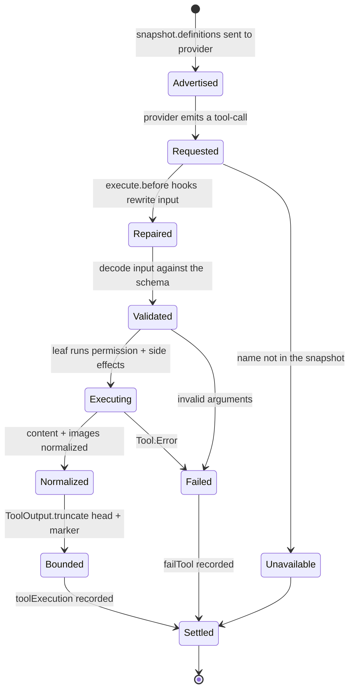
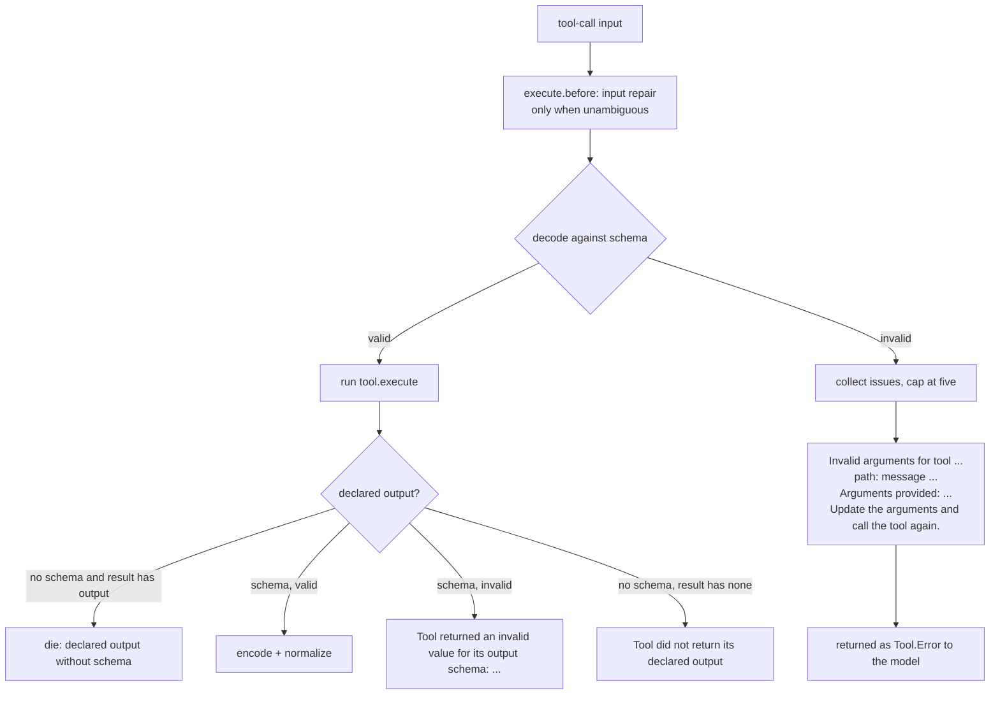
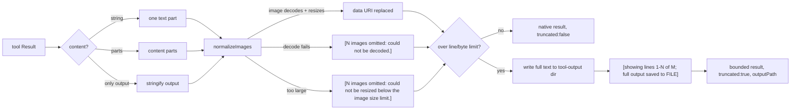
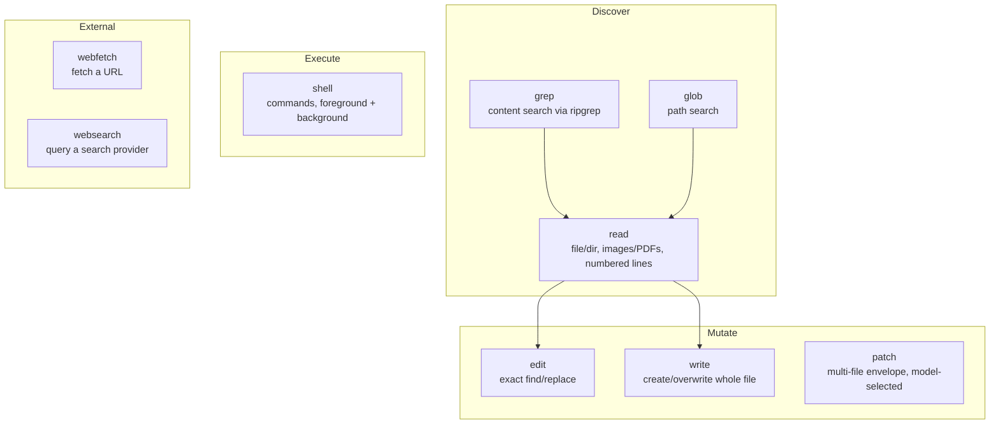
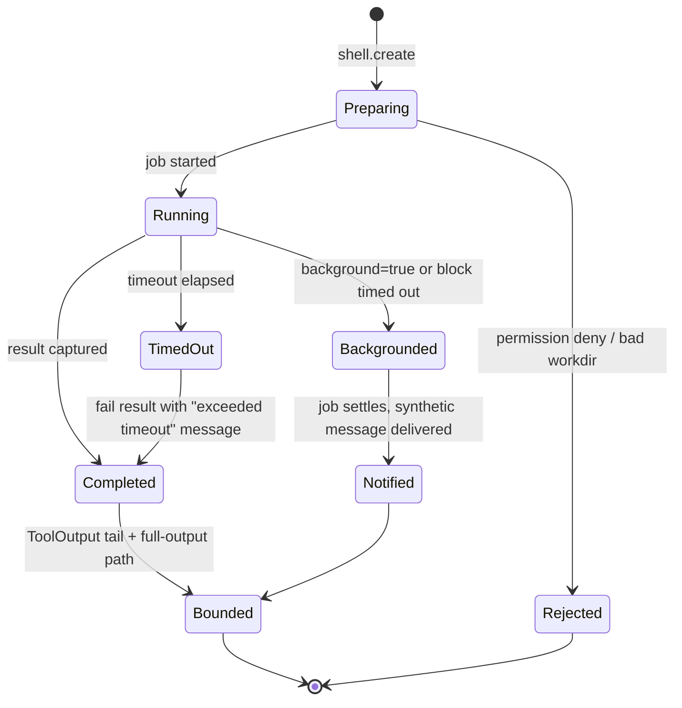

# Part 5 — Tools

A coding agent is a loop that calls a model, and the only way that loop changes the world
is through tools. Everything else — the request shape, the durable history, the step
machine — exists to make tool calls safely and observably. This part covers how a tool is
declared, how a set of tools is captured for one request, how the model's arguments are
validated and its results normalized, and how the built-in toolkit is written as prompt
engineering. It ends with the two ways tools arrive from outside the core: CodeMode (many
tools behind one `execute`) and plugins (dynamic tool sources and per-call hooks).

The topics:

- 5.1 The tool contract and registration
- 5.2 The snapshot: definitions and the captured executor
- 5.3 Runtime validation and model-facing error formatting
- 5.4 Output normalization: content, images, and bounding to disk
- 5.5 The built-in toolkit as prompt design
- 5.6 The dangerous tools: patch, shell, and background shells
- 5.7 CodeMode: one `execute` tool plus a catalog
- 5.8 Plugins as tool sources

At the time of writing, all anchors point into `opencode-dev` at version 2.0.31.

---

## 5.1 The tool contract and registration

### Thesis
A tool is one object that carries its name, its schemas, its description, and its
executor, and the registry is a replayed list of transforms rather than a mutable map.

### Cold open
You add a tool called `my.tool`, the model calls `my_tool`, and the executor throws
because it never expected to be found under that name. Or you register the same name
twice and get whichever one happened to run last. Registration looks trivial until a name
is normalised, a namespace is flattened, and a plugin re-registers over a built-in.

### The concept
A tool has six moving parts: a `name`, `options` (namespace, permission action, and the
CodeMode/pinned flags), a `description`, an `input` schema, an optional `output` schema,
and an `execute` function. The contract is deliberately uniform so the registry can treat
every tool identically after registration. Executors return both a machine-checked
`output` and the `content` the model actually sees; the two are not the same thing. The
model reads prose; the harness reads `output`.

Registration is a **transform**: a synchronous function that receives a fresh editor and
adds, updates, removes, or declares a namespace. The registry never mutates a live map.
Each read rebuilds the state by replaying every registered transform, in registration
order, against a new empty editor. This buys three properties at once:

- **Deterministic precedence.** The last valid registration for an effective name wins,
  because it runs last in the replay and overwrites the earlier entry.
- **Real undo.** A transform's `dispose` removes just that transform, then rebuilds; any
  earlier definition it had overridden reappears. Closing the owning scope does the same.
- **Cheap plugin reload.** A producer that discovers tools later (MCP) can invalidate and
  reload rather than re-registering at the end of the list, which would corrupt order.

The alternatives were rejected for concrete reasons. A mutable registry with `add`/`remove`
makes precedence depend on call order across plugins and has no undo: removing one
registration cannot reveal the one underneath because it was overwritten, not stacked. A
process-global registry would break Location scoping, so a tool set would leak across
working directories. Carrying each producer's schema generics through storage would force
the registry to be generic in a type it cannot name; the contract instead erases to one
shape and validates at runtime.

One rule shapes all of this: **one step is one LLM call.** There is no in-memory tool loop
that could register a tool mid-conversation and use it later in the same call. Tools are
fixed before the request is sent; anything that changes them takes effect on the next
snapshot.

### Diagram
`D7` — the tool-call lifecycle. D7 is seeded for this topic.



```text
                         snapshot.definitions
                                 |
                                 v
 [*] ---> Advertised ---> Requested ---> Repaired ---> Validated
                              |                           |
                    name not in snapshot            invalid arguments
                              |                           |
                              v                           v
                          Unavailable                   Failed
                              |                           |
                              +----------> Settled <------+
                                             ^
                              Executing -----+----> Normalized ---> Bounded
                                 |                                    |
                             Tool.Error -----------------------------> Settled
```

Narration: A tool call begins as a definition the model was shown and becomes a
`tool-call` event. Before anything runs, hooks may rewrite the arguments; then the input is
decoded against the tool's schema, which is the one place a malformed call becomes a
model-readable failure rather than a crash. A valid call runs the leaf — which does its own
permission check and side effects — and its result is normalized into content and images,
then bounded to disk if it is too large. Both success and failure end in a settlement
event, because the only thing that makes a step resumable is a recorded outcome.

### The real thing
The contract itself is a small interface in the schema package.

```ts
// packages/schema/src/tool.ts:92
export type Info<
  Input extends ValueSchema<any> = ValueSchema<any>,
  Output extends ValueSchema<any> | undefined = ValueSchema<any> | undefined,
> = {
  readonly name: string
  readonly input: Input
  readonly description: string
  readonly execute: (input: InputValue<Input>, context: Context) => Effect.Effect<Result<Output>, Error>
  readonly output?: Output
  readonly options?: Options
}
```

The `Context` passed to every executor is the same shape regardless of source.

```ts
// packages/schema/src/tool.ts:14
export interface Context {
  readonly sessionID: Session.ID
  readonly agent: Agent.ID
  readonly messageID: SessionMessage.ID
  readonly id: CallID
  readonly progress: (update: Metadata) => Effect.Effect<void>
}
```

Options carry the namespace, the permission action used only for definition filtering, and
the CodeMode flags.

```ts
// packages/schema/src/tool.ts:27
interface BaseOptions {
  readonly namespace?: string
  readonly permission?: string
}

export type Options = BaseOptions &
  (
    | {
        readonly codemode?: true
        readonly pinned?: boolean
      }
    | {
        readonly codemode: boolean
        readonly pinned?: never
      }
  )
```

The editor is the write surface a transform sees. Built-ins call `editor.add`, plugins call
`editor.add`/`update`/`remove`, and a namespace is declared separately from the tools that
use it.

```ts
// packages/core/src/tool.ts:26
export interface Editor {
  readonly list: () => readonly (Tool.Info & { readonly id: string })[]
  readonly get: (id: string) => (Tool.Info & { readonly id: string }) | undefined
  readonly namespace: (namespace: Tool.Namespace) => void
  readonly add: (tool: Tool.Info) => void
  readonly update: (id: string, update: (tool: Types.Mutable<Tool.Info>) => void) => void
  readonly remove: (id: string) => void
}
```

`add` computes the effective name as the storage key and validates the tool before storing
it. `update` re-locks the name and namespace so an update cannot rename a tool, and an
invalid update leaves the previous definition in place. `remove` deletes by effective name.

```ts
// packages/core/src/tool.ts:177
        add: (tool) => {
          const error = registrationError(tool)
          if (error) {
            editor.errors.push({ kind: "tool", name: tool.name, namespace: tool.options?.namespace, error })
            return
          }
          const id = effectiveName(tool)
          editor.tools.set(id, { ...tool, id, options: tool.options && { ...tool.options } })
        },
```

Registration errors are collected, not thrown. The registry logs each one and skips the
tool, so one bad plugin cannot take down the whole catalog. `registrationError` checks the
namespace, the normalised name, the reserved `execute` name, and, by constructing a
`ToolDefinition`, that the schemas convert to JSON Schema.

```ts
// packages/core/src/tool.ts:304
function registrationError(tool: Tool.Info) {
  const namespace = tool.options?.namespace
  if (namespace !== undefined) {
    const error = namespaceError(namespace)
    if (error) return error
  }
  const name = normalizedName(tool)
  if (!/^[A-Za-z0-9_-]+$/.test(name)) return new RegistrationError({ name, message: `Invalid tool name: ${name}` })
  const id = effectiveName(tool)
  if (tool.options?.codemode === false && id === "execute")
    return new RegistrationError({ name: id, message: 'Tool name "execute" is reserved for CodeMode' })
  const result = Result.try({
    try: () => ToolDefinition.make(definition(tool)),
    catch: (error) =>
      new RegistrationError({ name: id, message: `Invalid tool definition ${id}: ${schemaMakeError(error)}` }),
  })
  return Result.isFailure(result) ? result.failure : undefined
}
```

The replay and dispose semantics are not in `tool.ts`; they are in the shared `State`
helper. `get()` replays every transform against a fresh editor whenever the state is dirty,
and `transform` returns a `dispose` that deletes only this transform and then rebuilds.

```ts
// packages/core/src/state.ts:224
    transform: Effect.fn("State.transform")(function* (update) {
      yield* Effect.annotateCurrentSpan("state", options.name ?? "anonymous")
      const scope = yield* Scope.Scope
      const group = yield* CurrentGroup
      if (group?.failed) return { dispose: Effect.void }
      return yield* Effect.uninterruptible(
        Effect.gen(function* () {
          const transform = { run: update, group }
          const registration: GroupedRegistration = {
            remove: () => {
              if (!transforms.delete(transform)) return false
              group?.registrations.delete(registration)
              invalidate()
              return true
            },
            notify: changed,
          }
          const dispose = Effect.uninterruptible(Effect.suspend(() => (registration.remove() ? changed : Effect.void)))
          transforms.add(transform)
          group?.registrations.add(registration)
          yield* Scope.addFinalizer(scope, dispose)
          yield* changed
          return { dispose }
        }),
      )
    }),
```

**What to notice**

- Registration is list replay, not map mutation. Precedence and undo both fall out of it.
- The registry erases to `Tool.Info` on purpose. Executors return the same shape whether
  they came from a built-in, a plugin, or MCP.
- Failures are data: a bad tool is logged and skipped, never thrown.
- `dispose` is idempotent — removing an already-removed transform is a no-op — and is also
  installed as a scope finalizer, so both explicit and scope-close removal rebuild.
- `execute.before` is the only hook that may fail; that rule is stated where the hook
  failure channel is declared. The full hook surface is 5.8.

### The prompts
No prompts in this topic — the prompts live in Appendix A under **Tools**.

### Build it
```text
type Tool = { name, options, description, input, output?, execute }

registry = {
  transforms: ordered list of { run(editor), removed: bool },
  get():
    if not dirty: return cached
    loop:
      editor = fresh()
      for t in transforms: if not t.removed: t.run(editor)
      if invalidated during replay: retry        # a nested read may have disposed a group
      cached = editor.tools; dirty = false; return cached
  transform(run):
    t = { run, removed: false }
    transforms.push(t)
    dirty = true
    return dispose = () => { if t.removed return; t.removed = true; dirty = true }
}

editor.add(tool):
  error = validate(tool)          # namespace, name charset, reserved "execute", JSON-Schema conversion
  if error: log + skip
  else: tools[effectiveName(tool)] = tool
```

The decisions that matter:

- **Replay, not mutate.** You pay a rebuild on every read after a change, but you get undo
  and deterministic order for free. Rebuilds are cheap because transforms only build maps.
- **Validate at `add`.** Rejecting a tool at registration keeps the runtime decode path
  simple and keeps one bad plugin from poisoning execution.
- **Erase at the boundary.** Do not try to keep producer generics; validate input and
  output at runtime instead.
- **Reserve the `execute` name.** CodeMode needs it; a direct tool that claims it must pass
  `codemode: false` or be rejected. Design note: reserve any name you plan to synthesise.

### How it fails
- **Order-dependent shadowing.** Two plugins register the same effective name; only the
  later one is visible, and it is not obvious which ran last. Adding a diagnostic that
  records the winning registration's plugin id prevents silent duplicates.
- **Names that normalise to a collision.** `foo.bar` and `foo_bar` both normalise under the
  same namespace; the second silently overwrites the first.
- **`dispose` that is not hooked to a scope.** If a plugin forgets the registration's
  scope, its tools persist after the plugin is disabled.
- **Validating too late.** If a malformed schema only fails when a call arrives, the tool
  is advertised to the model and then dies on first use.
- **Holding a reference to the state map.** Because every rebuild creates a new value, a
  caller that cached `state.tools` across a reload sees a stale catalog. Capture through a
  snapshot instead (5.2).

### How you'd test it
Assert the invariants directly against the real service. Register two tools with the same
effective name and assert the second wins. Dispose the second and assert the first is
visible again, then dispose the first and assert the name is absent. Register an invalid
name and assert the service lists the valid tools and drops the invalid one. Assert that
`update` cannot change a tool's name or namespace and that an invalid update leaves the
prior definition intact. Do not mock the editor; drive the real `State` replay, because
that is where the behaviour lives.

### Recap
- A tool is one object: name, options, description, schemas, executor.
- Registration is an ordered list of transforms replayed against a fresh editor, which
  gives deterministic precedence and real undo.
- Invalid registrations are logged and skipped; the registry erases to one shape and
  validates at runtime.

Next: with registration understood, 5.2 turns the catalog into the fixed snapshot one
request actually sees.

### Podcast notes
- **Hook:** You renamed a tool in the registry and the model kept calling the old name —
  registration is list-replay, and the winner is the last one to run.
- **Analogy:** Registration is a git-style rebase onto an empty tree: every plugin replays
  its edits in order, and popping one edit reveals the one it was covering.
- **Talking points:** A tool is a uniform six-field object; registration is a replayable
  transform, which yields precedence and undo; errors are data and the registry erases
  producer types on purpose.
- **Listeners will ask:** Why not just keep a mutable map and insert/delete tools?

---

## 5.2 The snapshot: definitions and the captured executor

### Thesis
Each model request captures a permission-filtered set of definitions together with the
executor that can run exactly those tools, so later registry changes cannot alter an issued
request.

### Cold open
A request is in flight when a plugin finishes loading and registers a new tool. The model
is shown a catalog without it, but the executor happily runs it when the model guesses the
name — or worse, the model is shown a tool whose executor has already been disposed. The
fix is to make the request own an immutable view.

### The concept
A **snapshot** is two things that must agree: the list of `ToolDefinition`s the provider
will show the model, and an `execute` function that resolves a returned `tool-call` to a
running tool. They are captured together, for one request, from the current registry.

Three ideas shape it:

- **Visibility filtering.** The snapshot drops any tool whose permission action is wholly
  denied by resource `*`, so a `deny` rule removes a tool from the catalog entirely rather
  than letting the model call it and be refused. This is catalog visibility, not execution
  authorization: the leaf still checks its own policy when a call arrives.
- **Effective names.** A tool in namespace `foo.bar` named `baz` becomes `foo_bar_baz`.
  Dots become underscores in the namespace, and any other non-alphanumeric character in the
  tool name becomes `_`. Namespaces exist so many tools (MCP) share one description without
  repeating it.
- **Type safety ends at registration.** The snapshot is a flat list of provider-facing
  definitions plus a function that takes an unknown `input`. Whatever schema the producer
  declared is re-validated at runtime.

The executor is a closure over the snapshot's own maps. It does not consult the live
registry, so a reload or a disposal after the request was built affects only later
snapshots. Design note: this is the boundary that makes "one step = one LLM call" safe —
the tools a step offers are the tools that step can run.

### Diagram
`D29` — snapshot assembly.

```mermaid
flowchart LR
    reg[Registry state<br/>tools + namespaces] --> filter{wholly denied?}
    filter -- deny * --> drop[dropped from catalog]
    filter -- allow/ask --> split{codemode?}
    split -- "codemode:false" --> direct[direct definitions<br/>sorted by name]
    split -- default --> cm[CodeMode inventory]
    cm --> cat[rendered catalog<br/>cached per revision]
    cm --> exec[one execute tool definition]
    direct --> defs[snapshot.definitions]
    exec --> defs
    defs --> provider[provider request]
    reg --> captured[snapshot.execute closure]
    provider --> call[tool-call]
    call --> captured
    captured --> run[run captured tool]
```

```text
 registry state (tools + namespaces)
        |
        v
   wholly denied? --yes--> dropped
        | no
        v
   codemode? --false--> direct definitions (sorted)
        | default
        v
   CodeMode inventory --> cached catalog + one "execute" definition
        |                         |
        +----------> snapshot.definitions ---> provider request
        |
        +----------> snapshot.execute closure <--- tool-call
                              |
                              v
                       run captured tool
```

Narration: The snapshot is the seam between the mutable registry and the immutable request.
Permission rules first remove tools that are denied outright. The survivors are split: tools
that opt out of CodeMode become direct provider definitions, and the rest go into a CodeMode
inventory that renders a catalog and a single `execute` definition. The definitions go to
the provider; the executor closure stays behind, ready to resolve whatever name comes back
against the very tools that were advertised.

### The real thing
The snapshot function is where filtering, namespacing, and capture all happen.

```ts
// packages/core/src/tool.ts:225
      snapshot: Effect.fn("Tool.snapshot")((permissions) =>
        Effect.sync(() => {
          const data = state.get()
          const active = new Map<string, Tool.Info>()
          const rules = permissions ?? []
          for (const [name, tool] of data.tools) {
            if (whollyDisabled(tool.options?.permission ?? name, rules)) continue
            active.set(name, tool)
          }
          const direct = new Map(Array.from(active).filter(([, tool]) => tool.options?.codemode === false))
          const codeModeTools = new Map(Array.from(active).filter(([, tool]) => tool.options?.codemode !== false))
          const namespaces = data.namespaces
          const codeModeInventory = { tools: codeModeTools, namespaces }
          const codeModeEnabled = !whollyDisabled("execute", rules)
          const codeModeTool = codeModeEnabled
            ? CodeModeTool.create(codeModeInventory, (name, tool, input, context) =>
                beforeExecute(name, input, context).pipe(
                  Effect.flatMap((event) => executeTool(tool, name, event.input, context)),
                ),
              )
            : undefined
          const names = Array.from(codeModeTools.keys()).join("\0")
          // Discovery is immutable for a registry revision and visible tool set. Keep request
          // definitions/executors fresh, but share the much larger rendered catalog across steps.
          const codeModeCatalog = !codeModeEnabled
            ? undefined
            : catalog?.data === data && catalog.names === names
              ? catalog.value
              : CodeModeTool.catalog(codeModeInventory)
          if (codeModeCatalog) catalog = { data, names, value: codeModeCatalog }
```

The "wholly disabled" test is narrow on purpose: only a deny whose resource is `*` removes
the tool from the catalog.

```ts
// packages/core/src/tool.ts:292
const whollyDisabled = (action: string, rules: Permission.Ruleset) => {
  const rule = rules.findLast((rule) => Wildcard.match(action, rule.action))
  return rule?.resource === "*" && rule.effect === "deny"
}
```

Names are built from the effective name. The namespace keeps its dots when it labels the
catalog but flattens to underscores in the model-facing name.

```ts
// packages/core/src/tool/runtime.ts:276
export const normalizedName = (tool: Tool.Info) => tool.name.replace(/[^a-zA-Z0-9_-]/g, "_")

export const effectiveName = (tool: Tool.Info) =>
  tool.options?.namespace === undefined
    ? normalizedName(tool)
    : `${tool.options.namespace.replaceAll(".", "_")}_${normalizedName(tool)}`
```

Each definition is the provider-facing projection: effective name, description, and JSON
Schemas.

```ts
// packages/core/src/tool/runtime.ts:21
export const definition = (tool: Tool.Info<any, any>): ToolDefinition => ({
  type: "tool",
  name: effectiveName(tool),
  description: tool.description,
  inputSchema: inputJsonSchema(tool.input),
  ...(tool.output === undefined ? {} : { outputSchema: outputJsonSchema(tool.output) }),
})
```

The captured executor resolves the returned name back to a tool and runs it, or fails with a
model-readable message if the name was never advertised.

```ts
// packages/core/src/tool.ts:263
            execute: Effect.fnUntraced(function* (input: Parameters<Snapshot["execute"]>[0]) {
              const context: Tool.Context = {
                sessionID: input.sessionID,
                agent: input.agent,
                messageID: input.messageID,
                id: Tool.CallID.make(input.call.id),
                progress: input.progress ?? (() => Effect.void),
              }
              const event = yield* beforeExecute(input.call.name, input.call.input, context)
              const requested = input.definitions?.get(event.tool)
              // Preserve session context removal and alias resolution, now after the repair hook.
              if (!requested && input.definitions && (direct.has(event.tool) || codeModeTool?.name === event.tool))
                return yield* new Tool.Error({ message: `Tool is not available for this request: ${event.tool}` })
              const name = requested?.name ?? event.tool
              if (name === "execute" && codeModeTool)
                return yield* executeTool(codeModeTool, name, event.input, context)
              const tool = direct.get(name)
              if (tool) return yield* executeTool(tool, name, event.input, context)
              return yield* new Tool.Error({
                message: `No tool named "${name}" is currently available. Please use a tool from the available tool list.`,
              })
            }),
```

The snapshot is created during context selection, and the resulting definitions are fed into
the system prompt and the request.

```ts
// packages/core/src/session/context.ts:130
      // Session permissions narrow discovery the same way they narrow the tool snapshot.
      const permissions = Permission.merge(agent.info.permissions, session.permissions ?? [])
      const loaded = yield* Effect.all(
        {
          tools: registry.snapshot(permissions),
          builtins: builtins.load(),
          …
```

After the session hook runs — which can rename, drop, or add definitions — the request
matches definitions back to the snapshot tools by object identity, so a rename still maps to
the right executor.

```ts
// packages/core/src/session/model-request.ts:246
      // Remember which tool each definition object came from. Hooks rename a tool by moving
      // its definition to a new key, so after the hook we find the tool by object identity.
      const given = new Map(
        tools.definitions.map((t) => [{ description: t.description, input: { ...t.inputSchema } }, t] as const),
      )
      …
      const byName = new Map(tools.definitions.map((t) => [t.name, t]))
      const hooked = new Map(
        Object.entries(shaped.tools ?? {}).flatMap(([name, d]) => {
          const t = given.get(d) ?? byName.get(name)
          return t ? [[name, { ...t, description: d.description, inputSchema: d.input }] as const] : []
        }),
      )
```

**What to notice**

- Only a `deny *` rule removes a definition; anything else stays visible but is still
  checked at execution.
- The catalog render is cached per registry revision and visible name set, but definitions
  and the executor are rebuilt every snapshot, so request-specific renames are fresh.
- The executor consults `input.definitions` (the post-hook definitions), not the registry,
  to decide whether a name is available.
- Hooks that rename a tool move the definition object; identity matching is what keeps the
  rename wired to the original executor.
- The two error strings — "not available for this request" and "no tool named" — are
  deliberately distinct: one means removed by context, the other means never existed.

### The prompts
No prompts in this topic — the prompts live in Appendix A under **Tools**.

### Build it
```text
snapshot(permissions):
  active = registry.get().tools.filter(t => !whollyDenied(t.options.permission ?? t.name, permissions))
  direct = active.filter(codemode === false)         # sorted by name
  cm     = active.filter(codemode !== false)
  defs   = direct.map(definition) ++ [executeDefinition(cm)]
  execute(call):
    before = run execute.before hooks (may rewrite call.input)
    if call.name not among defs and defs is known:
        fail "Tool is not available for this request: <name>"
    tool = lookup(call.name)
    if not tool: fail "No tool named \"<name>\" is currently available..."
    return run(tool, before.input)
  return { definitions: defs, execute }
```

Trade-offs and decisions:

- **Filter at snapshot, authorise at leaf.** Hiding a tool is not the same as permitting it.
  Doing both is deliberate redundancy: the catalog stays honest and the execution stays safe.
- **Closure over the snapshot.** The executor must not read the live registry, or a
  concurrent reload could make it run a tool that was never advertised.
- **Identity mapping through hooks.** If you let hooks edit a plain map of names, a rename
  breaks execution. Match by object identity instead, with the name as a fallback.
- **Cache the expensive part only.** Catalog rendering is large and stable; definitions and
  executors are small and request-specific. Cache the former, rebuild the latter.

### How it fails
- **Stale executor.** If the snapshot executor closes over the live registry, a request can
  run a tool added after it was sent, or a tool that has since been disposed.
- **Rename without identity.** Hooks that rename a definition but lose the link to the tool
  produce the "not available for this request" error for a tool the model can still see.
- **Namespace collisions.** Two namespaces flatten to the same prefix and one silently
  shadows the other in the catalog.
- **Filtering mistaken for authorization.** Treating a hidden tool as safe lets a guessed
  name through if the executor does not re-check at the leaf.
- **Caching the catalog across a change.** Sharing the rendered catalog past a registry
  revision shows the model tools that exist only in the old revision.

### How you'd test it
Build a registry, take a snapshot, then mutate the registry and assert the snapshot's
definitions and executor are unchanged. Assert that a `deny *` rule removes exactly the
matching tools and nothing else. Assert that a namespace flattens to
`<namespace>_<tool>` in the definitions. Assert that a name absent from the snapshot's
definitions fails with the "not available for this request" error while an entirely unknown
name fails with the "no tool named" error. Drive the real snapshot; do not stub the maps.

### Recap
- A snapshot captures, for one request, the definitions the model sees and the executor
  that runs them.
- Permission filtering removes wholly denied tools; effective names flatten namespaces.
- Type safety ends at registration; the executor validates at runtime and refuses names it
  did not advertise.

Next: 5.3 examines how that runtime validation turns a malformed call into a message the
model can act on.

### Podcast notes
- **Hook:** The model called a tool that was in the prompt a second ago and the harness
  said "not available for this request."
- **Analogy:** A snapshot is a printed menu plus the one kitchen that can cook that exact
  menu — a later menu change does not change what the printer already sent.
- **Talking points:** Definitions and executor are captured together; filtering is catalog
  visibility, not authorization; names flatten namespaces and identity survives hook
  renames.
- **Listeners will ask:** Why does the model still see a permission-denied tool sometimes?

---

## 5.3 Runtime validation and model-facing error formatting

### Thesis
The registry is an untrusted boundary: it decodes the model's input against the declared
schema once, and when that fails it returns a message written for the model, not for a
developer.

### Cold open
The model is usually right about its own tool schema and occasionally wrong in a specific
way: it sends `{"limit": "20"}` where the schema wants a number, or wraps the whole argument
object in a string. A raw schema error like `Expected number, got "20"` is technically true
and nearly useless — the model needs to know which field, what it sent, and to try again.

### The concept
Two things happen around execution: the input is **decoded** before the tool runs, and the
declared output is **encoded** after. Decoding is the boundary that owns the model's output;
it is the one place where a bad call becomes a typed `Tool.Error` instead of a crash or a
silently-passed string.

Validation has to accept three kinds of schema, because producers declare them
differently: Effect `Schema`, the Standard Schema interface, and raw JSON Schema. The
registry normalises all three to a single pass/fail result with a list of issues. When there
are issues, it formats them for the model.

A separate, earlier pass — **input repair** — rewrites the arguments *before* validation
when the schema provably supports it: a stringified root object, a numeric string for a
numeric field, an empty object or `null` for an optional field. Repair exists because
models often emit the right value in the wrong JSON type, and a repair that only fires when
the schema is unambiguous turns a retry into a success. It never guesses: if a branch is
ambiguous, it leaves the value alone for validation to reject.

One more validation sits above this: after the maximum number of steps the step runs with
`toolChoice: none`, and any late local call is rejected with a specific message.

### Diagram
`D30` — input validation and repair.



```text
 tool-call input
      |
      v
 [execute.before: repair when unambiguous]
      |
      v
 decode against schema --valid--> run tool.execute --> encode output --> ok
      | invalid                                      | invalid
      v                                              v
 "Invalid arguments for tool ..."           "Tool returned an invalid value..."
 "path: message ..."
 "Arguments provided: ..."
 "Update the arguments and call the tool again."
      |
      v
 returned to model as Tool.Error
```

Narration: The model's arguments first pass through a conservative repair pass that fixes
exactly the mistakes the schema proves are type errors, then through the schema decode. A
failure becomes a structured message naming the field, showing the JSON the model sent, and
telling it to try again. On the way out, a tool's declared output is checked too, because a
tool that returns the wrong shape is a bug the model should not inherit.

### The real thing
The decode path first attempts repair-compatible decoding, then formats the issues.

```ts
// packages/core/src/tool/runtime.ts:63
const decodeInput = (tool: Tool.Info<any, any>, value: unknown) =>
  Effect.gen(function* () {
    const result = yield* validateInput(tool.input, value)
    if (result.issues)
      return yield* new Tool.Error({ message: formatInputIssues(effectiveName(tool), result.issues, value) })
    return result.value
  })
```

This is the exact string the model sees when its arguments are wrong. It names the tool,
lists up to five issues with dotted or indexed paths, echoes the JSON it received, and ends
with an instruction.

```ts
// packages/core/src/tool/runtime.ts:88
const formatInputIssues = (tool: string, issues: ReadonlyArray<StandardSchemaV1.Issue>, value: unknown) => {
  const details = issues.slice(0, 5).map((issue) => {
    const path =
      issue.path?.reduce<string>((path, segment) => {
        const key = typeof segment === "object" ? segment.key : segment
        if (typeof key === "number") return `${path}[${key}]`
        return path === "" ? String(key) : `${path}.${String(key)}`
      }, "") || "root"
    return `- ${path}: ${issue.message}`
  })
  if (issues.length > 5) details.push(`- ...and ${issues.length - 5} more ${issues.length === 6 ? "issue" : "issues"}`)
  return `Invalid arguments for tool "${tool}":\n${details.join("\n")}\n\nArguments provided:\n${JSON.stringify(value, null, 2)}\n\nUpdate the arguments and call the tool again.`
}
```

Validation accepts three schema kinds but answers with one shape.

```ts
// packages/core/src/tool/runtime.ts:71
const validateInput = (
  schema: Tool.ValueSchema<any>,
  value: unknown,
): Effect.Effect<StandardSchemaV1.Result<unknown>> => {
  if (isStandardSchema(schema)) return validateStandard(schema, value)
  return Effect.gen(function* () {
    const codec = Schema.isSchema(schema) ? schema : yield* Cache.get(jsonSchemas, schema)
    if (codec === undefined) return { value }
    return yield* Schema.decodeUnknownEffect(codec)(value, { errors: "all" }).pipe(
      Effect.match({
        onFailure: (error) => formatEffectIssues(error.issue),
        onSuccess: (value) => ({ value }),
      }),
    )
  })
}
```

On the way out, the declared output is encoded or validated, with its own messages.

```ts
// packages/core/src/tool/runtime.ts:110
const encodeOutput = (schema: Tool.ValueSchema<any>, value: unknown) => {
  if (Schema.isSchema(schema))
    return Schema.encodeEffect(schema)(value).pipe(
      Effect.mapError(
        (error) =>
          new Tool.Error({ message: `Tool returned an invalid value for its output schema: ${error.message}` }),
      ),
    )
  if (isStandardSchema(schema))
    return validateStandard(schema, value).pipe(
      Effect.flatMap((result) =>
        result.issues
          ? new Tool.Error({
              message: `Tool returned an invalid value for its output schema: ${result.issues.map((issue) => issue.message).join(", ")}`,
            })
          : Effect.succeed(result.value),
      ),
    )
  return Schema.decodeUnknownEffect(Schema.Json)(value).pipe(
    Effect.mapError(
      (error) => new Tool.Error({ message: `Tool returned a non-JSON value for its output schema: ${error.message}` }),
    ),
  )
}
```

The registry also normalises any foreign runtime failure into a `Tool.Error` at the
boundary, because a plugin can fail with anything and a non-`Tool.Error` would slip past
every downstream `catchTag("Tool.Error")`.

```ts
// packages/core/src/tool/runtime.ts:29
export const execute = (tool: Tool.Info<any, any>, input: unknown, context: Tool.Context) =>
  Effect.gen(function* () {
    const decoded = yield* decodeInput(tool, input)
    // Tool implementations declare `Tool.Error` but plugins can fail with anything at
    // runtime. A foreign typed failure would slip past every `catchTag("Tool.Error")`
    // downstream and leave its call permanently unsettled, so the declared contract is
    // enforced here at the untrusted boundary. Declines tunnel through as defects and
    // interrupts are not errors; neither is touched.
    const result = yield* tool.execute(decoded, context).pipe(
      Effect.mapError((error: unknown) =>
        error instanceof Tool.Error
          ? error
          : new Tool.Error({
              message: error instanceof globalThis.Error ? error.message : String(error),
            }),
      ),
    )
```

The repair pass runs as an `execute.before` hook and only touches tools whose schema is a
closed object.

```ts
// packages/core/src/plugin/tool-input-repair.ts:21
export const Plugin = define({
  id: "opencode.tool.input.repair",
  effect: (ctx) =>
    ctx.tool.hook("execute.before", (event) =>
      Effect.gen(function* () {
        // The outer Code Mode tool is built per snapshot rather than registered, so it cannot be
        // looked up here. Its `{ code }` input is trivial; the tools it calls are repaired normally.
        if (event.tool === "execute") return
        const tool = (yield* ctx.tool.list()).find((tool) => tool.id === event.tool)
        if (!tool) return
        const schema = definition(tool).inputSchema
        if (schema.type !== "object") return
        event.input = repair(event.input, schema, schema, 0)
      }),
    ),
})
```

Finally, the terminal step rejects any late local call with a message that says why.

```ts
// packages/core/src/session/runner/step.ts:91
    const executeTool = (call: ToolCall) => {
      if (input.prepared.request.toolChoice?.type === "none")
        return new Tool.Error({ message: "Tools are disabled after the maximum agent steps" })
      return input.prepared.executeTool({
```

**What to notice**

- The formatted error names the tool, the field path, the message, and the JSON, then
  instructs the model to retry. Each of those four parts exists because models otherwise
  resend the same wrong shape.
- Issue lists are capped at five with a "and N more" tail; a giant error dump costs tokens
  and rarely helps.
- Repair runs before validation and refuses to guess on ambiguous schemas.
- The declared output is checked on the way out, so the model never receives a
  schema-violating result as if it were valid.
- A foreign typed failure is wrapped so it cannot escape every `catchTag("Tool.Error")`.

### The prompts
This topic owns one designed, model-facing string: the invalid-arguments message. Provenance:
`packages/core/src/tool/runtime.ts:88`.

```text
Invalid arguments for tool "${tool}":
- ${path}: ${issue.message}
- ...and ${n} more issues

Arguments provided:
${JSON.stringify(value, null, 2)}

Update the arguments and call the tool again.
```

What each part buys:

- `Invalid arguments for tool "<name>"` tells the model *which* call failed when it emitted
  several.
- The `- <path>: <message>` lines are actionable: a model that has the path can repair just
  that field. Paths use `a.b` and `a[0]` so they match the JSON it wrote.
- `Arguments provided:` re-displays the exact JSON. Without it, the model often cannot tell
  which of several similar values was wrong.
- `Update the arguments and call the tool again.` is the instruction that converts an error
  into a retry. Without an explicit retry instruction, models sometimes explain the error to
  the user instead of fixing it.

The output-side strings are also model-facing, though rarer:
`Tool returned an invalid value for its output schema: …`,
`Tool returned a non-JSON value for its output schema: …`,
`Tool did not return its declared output`, and the defect
`Tool result declared output without an output schema`. And the terminal-step message
`Tools are disabled after the maximum agent steps` tells the model the loop is ending, not
that it made a mistake.

### Build it
```text
decode(tool, value):
  if standardSchema(tool.input): result = tool.input["~standard"].validate(value)
  else if effectSchema(tool.input): result = Schema.decodeUnknown(tool.input, value)
  else: result = { value }                    # raw JSON Schema template: accept as-is
  if result.issues:
    fail ToolError(formatIssues(tool.name, result.issues.slice(0,5), value))
  return result.value

formatIssues(name, issues, value):
  lines = issues.map(i => `- ${pathOf(i)}: ${i.message}`)
  if more: lines.push(`- ...and ${n} more issues`)
  return `Invalid arguments for tool "${name}":\n${lines}\n\n` +
         `Arguments provided:\n${JSON.stringify(value, null, 2)}\n\n` +
         `Update the arguments and call the tool again.`

execute(tool, value, ctx):
  value = repair(value, schemaOf(tool))          # only when schema is unambiguous
  decoded = decode(tool, value)
  result = enforce ToolError(tool.execute(decoded, ctx))   # wrap foreign failures
  if tool.output declared:
    if no output in result: fail "Tool did not return its declared output"
    result.output = encode(tool.output, result.output)
  return result
```

The trade-offs:

- **Format for the consumer.** A developer error and a model error have different readers.
  Write the model's version; keep the developer's in logs.
- **Cap and summarise.** Five issues with a count beats a wall of text.
- **Repair conservatively.** Fix only what the schema proves; anything ambiguous goes to the
  real error path so the model learns the actual constraint.
- **Enforce the error contract at the boundary.** Wrapping foreign failures keeps settlement
  working for every downstream `catchTag`. Design note: do this once, at the untrusted edge.

### How it fails
- **Over-eager repair.** Repairing a value the schema did not clearly demand (for example,
  coercing a string into a union) can silently change meaning. The code only repairs when it
  is unambiguous for exactly this reason.
- **Uncapped errors.** A schema with many failures produces an enormous message that costs
  context and buries the first real problem.
- **Silent output drift.** A tool that returns a slightly wrong shape and is not checked
  leaks a schema violation into durable history, where every later step inherits it.
- **Foreign errors escaping.** A plugin that throws a non-`Tool.Error` and is not wrapped
  leaves its tool call permanently unsettled, which is a recovery problem, not just a UI one.
- **Retry loops.** If the message does not tell the model to retry, it stops and reports.

### How you'd test it
Send an intentionally malformed argument object to a real registered tool and assert the
resulting `Tool.Error.message` contains the tool name, the correct path, the provided JSON,
and the retry instruction. Send a schema-valid but wrong output from a test tool and assert
the output-schema error. Feed a foreign thrown error through `execute` and assert it arrives
as a `Tool.Error`. Exercise the repair hook with each supported case from its comment block
and assert ambiguous cases are left untouched. Assert the terminal-step message appears when
`toolChoice` is `none`.

### Recap
- Validation is the untrusted boundary: decode once, fail with a message written for the
  model, and wrap foreign failures into `Tool.Error`.
- Repair runs before validation and only when the schema proves a type error.
- Output schemas are enforced on the way out, so schema violations never become history.

Next: 5.4 follows a valid result into normalization, where images and oversized text are
made safe to send.

### Podcast notes
- **Hook:** The model sent a number as a string and the tool said "invalid" — three words
  later it knew exactly which field to fix.
- **Analogy:** Validation is a customs desk: it stamps most parcels through, and for the
  rest it hands back a form naming the exact field, what you sent, and a line that says "try
  again."
- **Talking points:** One decode point owns the model's arguments; error text is written for
  the model with path, payload, and a retry instruction; repair fixes only provable type
  mistakes.
- **Listeners will ask:** Why not just coerce whatever the model sends into the right type?

---

## 5.4 Output normalization: content, images, and bounding to disk

### Thesis
A tool result is normalized into model content, images are resized to a budget, and any
oversized text is replaced by a bounded head plus a marker naming a file that holds the
full output.

### Cold open
A tool runs a command that prints two megabytes. It returns that as one text part; the next
request is enormous, the context window fills, and the model loses the middle of its own
work. The result was correct and the system was still unusable.

### The concept
Normalization has three jobs.

1. **Turn a result into content.** An executor may return a plain string, an array of
   content parts (`text` or `file`), or just a structured `output`. The registry normalizes
   all of these into a content array the model can read.
2. **Make images safe.** A `file` part whose MIME is an image is decoded, checked against
   the configured size limits, and resized. If a resize is impossible or the image cannot be
   decoded, the image is *omitted* and a short text note says so, so the model knows
   something was dropped instead of inventing its contents.
3. **Bound text to disk.** If the combined text exceeds the line or byte limit, the full
   output is written to a file under a managed directory and the model gets a bounded head
   plus a marker naming the file. The marker is not decoration; it is the only signal that
   the model may be looking at a partial result.

Bounding happens in two layers. The generic, session-wide truncation runs after execution,
on the result as a whole. Producers (shell) also bound their own output, because a shell
command can produce far more than a shared limit should hold in memory, and a tail is more
useful than a head for build logs.

Design note: choose head versus tail deliberately. Read and grep keep the head because the
model asked for a specific region; shell keeps a tail because the interesting part of a
build is usually at the end.

### Diagram
`D31` — output normalization and bounding.



```text
 tool Result
      |
      +-- string ---------> [text]
      +-- parts[] --------> content parts
      +-- output only ----> [JSON.stringify(output)]
                |
                v
        normalizeImages: image/file parts
          decode + resize --> replace data URI
          decode fails ------> "[N images omitted: could not be decoded.]"
          too large --------> "[N images omitted: could not be resized below the image size limit.]"
                |
                v
        over line/byte limit? --no--> native result (truncated:false)
                | yes
                v
        write full text to tool-output/<name>
        return head + "[showing lines 1-N of M; full output saved to FILE]"
        metadata.truncated = true, metadata.outputPath = FILE
```

Narration: A result is first folded into content the model can read. File parts that are
images are resized or, if that fails, replaced by a note saying the image was omitted. Then
the text is measured; if it is over budget, the whole thing is written to a managed file and
the model gets the head plus a marker naming the file. The marker and the `truncated`
metadata are what turn a silent loss of information into a recoverable one.

### The real thing
Content has exactly two shapes: text and file.

```ts
// packages/schema/src/tool.ts:67
export interface TextContent extends Schema.Schema.Type<typeof TextContent> {}
export const TextContent = Schema.Struct({
  type: Schema.Literal("text"),
  text: Schema.String,
}).annotate({ identifier: "Tool.TextContent" })

export interface FileContent extends Schema.Schema.Type<typeof FileContent> {}
export const FileContent = Schema.Struct({
  type: Schema.Literal("file"),
  uri: Schema.String,
  mime: Schema.String,
  name: Schema.optional(Schema.String),
}).annotate({ identifier: "Tool.FileContent" })

export const Content = Schema.Union([TextContent, FileContent])
  .pipe(Schema.toTaggedUnion("type"))
  .annotate({ identifier: "Tool.Content" })
```

Normalization folds every input shape into content, falling back to a stringified `output`.

```ts
// packages/core/src/tool/runtime.ts:261
export const normalizeContent = (value: string | ReadonlyArray<Tool.Content> | undefined, output?: unknown) => {
  if (typeof value === "string") return [{ type: "text" as const, text: value }]
  if (value !== undefined && value.length > 0) return [...value]
  return [{ type: "text" as const, text: stringify(output) }]
}
```

Images are normalized by decoding the data URI, resizing, and rewriting it; failures are
converted into omission notes rather than errors.

```ts
// packages/core/src/tool.ts:74
    const normalizeImages = Effect.fnUntraced(function* (content: ReadonlyArray<Tool.Content>) {
      const normalized = yield* Effect.forEach(content, (item): Effect.Effect<NormalizedItem> => {
        if (item.type !== "file" || !item.mime.startsWith("image/")) return Effect.succeed(item)
        const base64 = /^data:[^,]*;base64,(.*)$/s.exec(item.uri)?.[1]
        if (base64 === undefined) return Effect.succeed(item)
        const resource = item.name ?? `${item.mime} tool output`
        return image.normalize(resource, { uri: resource, content: base64, encoding: "base64", mime: item.mime }).pipe(
          Effect.map((result) => ({
            ...item,
            uri: `data:${result.mime};base64,${result.content}`,
            mime: result.mime,
          })),
          Effect.catchTag("Image.ResizerUnavailableError", () => Effect.succeed(item)),
          Effect.catchTag("Image.DecodeError", () => Effect.succeed("decode" as const)),
          Effect.catchTag("Image.SizeError", () => Effect.succeed("size" as const)),
        )
      })
      const note = (reason: "decode" | "size", text: string) => {
        const count = normalized.filter((item) => item === reason).length
        if (count === 0) return []
        return [{ type: "text" as const, text: `[${count} image${count === 1 ? "" : "s"} omitted: ${text}]` }]
      }
      return [
        ...normalized.filter((item) => typeof item !== "string"),
        ...note("decode", "could not be decoded."),
        ...note("size", "could not be resized below the image size limit."),
      ]
    })
```

The bounding limits are constants, and the full text is written to a managed directory with
a retention policy.

```ts
// packages/core/src/tool-output.ts:13
export const MAX_LINES = 2_000
export const MAX_BYTES = 50 * 1024 // 50 KiB
export const RETENTION = Duration.days(7)
export const DIRECTORY = "tool-output"
```

The truncate function keeps a head of up to `maxLines` lines and `maxBytes` bytes, writes
the whole text to disk, and inserts the marker once.

```ts
// packages/core/src/tool-output.ts:67
    const truncate = Effect.fnUntraced(function* (result: Result) {
      if (result.metadata?.truncated !== undefined) return result
      const content = result.content
      const text = content.flatMap((item) => (item.type === "text" ? [item.text] : [])).join("\n")
      const limits = state.get()
      const lines = text.split("\n")
      if (text.endsWith("\n")) lines.pop()
      const totalBytes = Buffer.byteLength(text, "utf-8")
      if (lines.length <= limits.maxLines && totalBytes <= limits.maxBytes)
        return { ...result, metadata: { ...result.metadata, truncated: false } }
      …
      const file = path.join(directory, fileName())
      yield* fs.ensureDir(directory).pipe(Effect.orDie)
      yield* fs.writeFileString(file, text).pipe(Effect.orDie)
      const shown = kept.length > 0 ? `lines 1-${kept.length}` : "0 lines"
      const marker = `[showing ${shown} of ${lines.length}; full output saved to ${file}]`
```

Truncation is applied by the step, after the tool finishes and before the result is
published, and it is inside the uninterruptible settlement so a truncated result cannot be
lost to an interrupt.

```ts
// packages/core/src/session/runner/step.ts:123
          toolRuns.push({
            call: event,
            fiber: yield* Effect.uninterruptibleMask((restore) =>
              restore(executeTool(event)).pipe(
                Effect.flatMap(toolOutput.truncate),
                Effect.flatMap((outcome) => publisher.toolExecution(event.id, event.name, outcome)),
                Effect.catchTag("Tool.Error", (error) =>
                  publisher.failTool(event.id, toSessionError(error), error.metadata).pipe(Effect.asVoid),
                ),
              ),
            ).pipe(Effect.forkScoped),
          })
```

**What to notice**

- `metadata.truncated` is set to `false` as well as `true`; the key being present is the "I
  already measured this" guard at the top of `truncate`.
- The marker is inserted once, after the last retained text, even when the content is split
  across several parts.
- Image failures degrade to notes; only a resizer being unavailable leaves the original
  image in place.
- The full output path is recorded in `metadata.outputPath`, so a client can offer "read the
  rest" without the model guessing a path.
- Producers may bound their own output first; shell does, which is why its result carries a
  tail rather than a head.

### The prompts
This topic owns two model-facing strings. Provenance: `packages/core/src/tool-output.ts:90`
and `packages/core/src/tool.ts:94`.

The truncation marker:

```text
[showing ${shown} of ${lines.length}; full output saved to ${file}]
```

And the image omission notes:

```text
[${count} image${count === 1 ? "" : "s"} omitted: could not be decoded.]
[${count} image${count === 1 ? "" : "s"} omitted: could not be resized below the image size limit.]
```

What each buys:

- `showing lines 1-N of M` tells the model the result is partial and where the cut is. A
  model that knows it has a head will not claim to have seen the whole file.
- `full output saved to <file>` is actionable. The model can open the file with `read`
  instead of re-running the command or giving up.
- The pluralised omission note exists because "1 image" and "2 images" are both common and
  neither should look broken. The reason ("could not be decoded" versus "could not be
  resized") tells the model whether retrying with a smaller image would help.

### Build it
```text
normalize(result):
  content = result.content is string ? [text(result.content)]
          : result.content non-empty ? result.content
          : [text(stringify(result.output))]
  content = for each part:
              if part is image file with a base64 data URI:
                try resize(part) -> replace uri+mime
                on decode error -> record "decode"
                on size error   -> record "size"
                on no resizer   -> keep part
              else keep part
          ++ plural note for each recorded reason
  return { ...result, content }

truncate(result):
  if result.metadata.truncated is set: return result        # already measured
  text = join(all text parts with \n)
  if lines <= maxLines and bytes <= maxBytes:
    return { ...result, metadata: { truncated: false } }
  file = dataDir/tool-output/tool_<id>
  write(text, file)
  kept = first lines fitting both limits
  insert marker once after the retained text
  return { ...result, content: bounded, metadata: { truncated: true, outputPath: file } }
```

Decisions and trade-offs:

- **Marker, not silence.** Any loss of information must be visible to the model. A silent
  truncation is worse than no truncation because the model reasons confidently over a
  partial view.
- **Head versus tail is per tool.** The generic bound keeps the head; tools that know their
  useful end (shell) keep a tail.
- **Degrade images, never fail.** An omitted image with a note keeps the step alive; a
  failed step loses more.
- **Bound before publishing.** Truncation runs inside settlement so the recorded result and
  the model-visible result are the same bytes.

### How it fails
- **Silent truncation.** Bounding that drops text without a marker teaches the model to
  hallucinate the missing region.
- **Marker placed wrong.** If the marker lands before retained text, the model misreads the
  boundary; if it is emitted per part, the model sees it several times.
- **Unbounded producer output.** A producer that returns megabytes before the generic bound
  can exhaust memory before truncation ever runs; shell bounds its own output first.
- **Losing the full output.** If the write fails and is treated as non-fatal without a
  marker, the model gets a head that claims completeness.
- **Image notes without reasons.** A bare "image omitted" leaves the model unable to decide
  whether to retry.

### How you'd test it
Feed a tool result just over the byte limit and assert the content contains the marker, the
metadata is `truncated: true`, and the file at `outputPath` contains the full text. Feed one
just under both limits and assert `truncated: false` and no marker. Feed a non-image file
part and assert it is untouched. Feed an image data URI and assert it is replaced by a
resized data URI, and that a deliberately undecodable one becomes an omission note. Assert
truncation is idempotent by truncating a truncated result. Test with real file system
writes; do not stub the marker.

### Recap
- Content has two kinds, text and file, and every result shape normalizes into them.
- Images are resized or omitted with a reason note; oversized text is written to disk with a
  marker naming the file.
- Bounding runs inside settlement, so the model-visible result and the durable result match.

Next: 5.5 steps back from the machinery to read the tool descriptions themselves as prompt
engineering.

### Podcast notes
- **Hook:** The command printed two megabytes, and the model quietly assumed it had read all
  of it.
- **Analogy:** Bounding is a document with a bookmark: you keep the first pages and a slip
  that says where the rest is.
- **Talking points:** Normalization folds every result into text or file content; oversized
  output is retained on disk behind a marker; omitted images become notes with reasons.
- **Listeners will ask:** Why keep the head instead of the tail for most tools?

---

## 5.5 The built-in toolkit as prompt design

### Thesis
Each built-in tool description is a compressed policy document that steers the model toward
the intended workflow and away from the failure modes the harness cannot otherwise prevent.

### Cold open
The model has `read`. It has `shell`. It uses `shell` with `cat` and `head` and `find`,
because those are the tools it saw most in training, and each one spends tokens and produces
output the harness cannot bound as cleanly. You cannot delete `shell`; you can tell the model
when not to reach for it.

### The concept
A tool description is the model's only documentation for that tool. It is cheap — it ships
in every request — and it is the only lever that shapes behaviour before a call is even
made. OpenCode's descriptions consistently do four jobs:

- **State what the tool returns and in what shape**, so the model can plan the next step.
  `read` says lines are prefixed with `<line>: <content>` and that the prefix is not part of
  the file, because the model must not copy the prefix back into an edit.
- **Name the preferred alternative.** `shell` says "Prefer dedicated tools over shell
  commands when possible"; `read` says "use grep to find specific content in large files."
  This is how the toolkit defends itself against the model defaulting to shell.
- **State a constraint the harness cannot enforce.** `edit` says the prefix must be omitted
  from `oldString`; the edit itself cannot detect a copied prefix, only fail to match.
- **Describe the failure the phrase prevents.** `edit` warns that multiple matches fail and
  how to disambiguate — the exact error the model would otherwise hit and re-hit.

Nine built-ins carry the core workflow: read, grep, glob, edit, write, patch, shell,
webfetch, websearch. Others (skill, question, subagent, the `opencode` management tools, MCP
resource tools) are covered where their topic lives.

### Diagram
`D32` — the built-in toolkit and what each tool is for.



```text
 DISCOVER                 MUTATE                    EXECUTE        EXTERNAL
 read  (file/dir)         edit  (exact replace)     shell          webfetch
 grep  (contents)   --->  write (whole file)   --->  commands       websearch
 glob  (paths)            patch (multi-file)        fg / bg
   |                        ^
   +--- read feeds edits ---+
```

Narration: The toolkit is four families. Discovery tools find files and content. Mutation
tools change them, with `edit` for surgical changes, `write` for whole files, and `patch`
for multi-file operations on models that do better with it. `shell` is the escape hatch that
runs anything, and webfetch and websearch reach outside the repository. The descriptions are
what keep the model in the intended family — they teach the numbered-line format, the exact
match contract of `edit`, and when to prefer a dedicated tool over shell.

### The real thing
`read` is the anchor of the discovery family. Its description teaches the output format and
the paging contract.

```ts
// packages/core/src/tool/plugin/read.ts:43
          description:
            "Read the contents of a file or directory. Supports text files, images, and PDFs. Images and PDFs are presented directly to the model. Each text line is prefixed by its 1-based line number as <line>: <content>. The prefix is for reference and is not part of the file content. Directory entries are returned one per line. Use offset and limit to read large files or directories in sections. Prefer one larger read over many small slices, and use grep to find specific content in large files.",
```

`grep` and `glob` cover content and path search and name their narrowing arguments.

```ts
// packages/core/src/tool/plugin/grep.ts:78
          description:
            "Search file contents using ripgrep's regular expression syntax or literal text matching. Use it to locate specific code, symbols, or text patterns, and narrow searches with `path` or `include`. Returns matching file paths, line numbers, and line previews.",
```

```ts
// packages/core/src/tool/plugin/glob.ts:59
          description: 'Search file paths using a glob pattern (examples: "**/*.ts", "src/**/*.tsx").',
```

`edit` is the longest description in the toolkit, and every sentence answers a specific
failure the model would otherwise hit: the copied line prefix, line-ending preservation, the
unique-match rule, and how to disambiguate.

```ts
// packages/core/src/tool/plugin/edit.ts:222
          description:
            "Edit the contents of a file by finding and replacing exact text. When editing text from Read output, preserve the exact indentation (tabs or spaces) and omit the line-number prefix, such as `1: `. Never include the prefix in oldString or newString. Write line breaks as \\n; the file's existing CRLF or LF line endings are matched and preserved. To change line endings themselves, make oldString and newString differ only in \\r; that edit applies to the exact bytes. If there is no exact match, the edit retries while ignoring typographic quote, dash, and space variants, then trailing whitespace on each line. The edit fails if oldString is not found. By default, oldString must identify a UNIQUE location. Multiple matches FAIL unless replaceAll is true. Add more surrounding context to disambiguate, or set replaceAll to true to replace every occurrence. Use replaceAll when the change should apply to every occurrence, such as renaming a variable.",
```

`write` keeps only the essence and defers partial changes to `edit`.

```ts
// packages/core/src/tool/plugin/write.ts:60
          description:
            "Writes a file to the local filesystem, overwriting if one exists.\n\nMissing parent directories are created automatically.\n\nUse this tool to create new files or overwrite existing files. For partial changes, use the edit tool instead.",
```

`patch`'s description lives in a text file and teaches a small domain-specific language.

```text
// packages/core/src/tool/patch.txt:1
Use the `patch` tool to edit files. Your patch language is a stripped‑down, file‑oriented diff format designed to be easy to parse and safe to apply. You can think of it as a high‑level envelope:

*** Begin Patch
[ one or more file sections ]
*** End Patch
…
- You must include a header with your intended action (Add/Delete/Update)
- You must prefix new lines with `+` even when creating a new file
```

`shell`'s description is built per invocation so it can name the resolved shell and OS, and
it points back at the dedicated tools.

```ts
// packages/core/src/tool/plugin/shell.ts:36
const description = (shell?: string) =>
  [
    "Execute a shell command and return its output.",
    ...(shell ? [`Commands run on ${OS} using ${shell}.`] : []),
    "Quote file paths containing spaces or special characters.",
    "Prefer dedicated tools over shell commands when possible.",
    "When output is large, the full result is saved to a file and a truncated preview is returned.",
    "Rely on automatic truncation unless filtering the output is more useful.",
    "Commands accept an optional timeout, background commands have no timeout by default.",
    "Background commands return immediately, and you will be notified when they complete.",
  ].join(" ")
```

`webfetch` states its formats and its read-only nature; `websearch` interpolates the current
year.

```ts
// packages/core/src/tool/plugin/webfetch.ts:17
export const description = `Fetch content from an HTTP or HTTPS URL and return it as text, markdown, or HTML. Markdown is the default.

Use a more targeted tool when one is available. This tool is read-only. Large text results may be replaced with a preview while the complete output is retained in managed storage.`
```

```ts
// packages/core/src/tool/plugin/websearch.ts:20
export const description = `Search the web using the user's selected search integration. Use this for current information beyond knowledge cutoff.

The current year is ${new Date().getFullYear()}. Use this year when searching for recent information or current events.`
```

**What to notice**

- Every discovery tool states the shape of its output, because the model plans from it.
- The descriptions point at each other: `read` sends content search to `grep`, `write` sends
  partial changes to `edit`, `shell` prefers the dedicated tools.
- The longest descriptions correspond to the tools with the sharpest edge cases (`edit`).
- Some descriptions are dynamic: `shell` interpolates the shell and OS; `websearch`
  interpolates the year; subagent appends the available children at request time (5.8 shows
  how the session hook rewrites a description per request).
- Naming a limit ("prefix is not part of the file content") is how the toolkit protects a
  contract the executor cannot check for the model.

### The prompts
This topic owns the nine tool descriptions above. Provenance is at each anchor:
`read` `packages/core/src/tool/plugin/read.ts:44`,
`grep` `packages/core/src/tool/plugin/grep.ts:79`,
`glob` `packages/core/src/tool/plugin/glob.ts:59`,
`edit` `packages/core/src/tool/plugin/edit.ts:223`,
`write` `packages/core/src/tool/plugin/write.ts:61`,
`patch` `packages/core/src/tool/patch.txt:1`,
`shell` `packages/core/src/tool/plugin/shell.ts:36`,
`webfetch` `packages/core/src/tool/plugin/webfetch.ts:17`,
`websearch` `packages/core/src/tool/plugin/websearch.ts:20`.

What each buys, sentence by sentence:

- read — "Images and PDFs are presented directly to the model" tells it not to try to
  describe image bytes. "1-based line number as `<line>: <content>`" and "the prefix is for
  reference and is not part of the file content" prevent the model copying `12: ` into an
  edit. "Prefer one larger read over many small slices" prevents token-wasting pagination.
  "use grep to find specific content in large files" redirects to the cheaper tool.
- grep — "ripgrep's regular expression syntax or literal text matching" sets the dialect.
  "narrow searches with `path` or `include`" pre-empts a repo-wide scan. "Returns matching
  file paths, line numbers, and line previews" tells it the result shape.
- glob — the examples teach the glob dialect without a paragraph of prose.
- edit — "preserve the exact indentation … and omit the line-number prefix" is the single
  most common edit failure. "Write line breaks as `\n`" plus the CRLF explanation removes the
  line-ending class of failures. "the edit retries while ignoring typographic quote, dash,
  and space variants" tells the model the fuzzy tiers exist so it does not pre-normalise.
  "By default, oldString must identify a UNIQUE location. Multiple matches FAIL" plus the
  two remedies is exactly the error message it would otherwise hit. "Use replaceAll … such
  as renaming a variable" gives the one common legitimate use.
- write — "overwriting if one exists" and "Missing parent directories are created" remove
  two questions. "For partial changes, use the edit tool instead" keeps whole-file writes
  from becoming the default.
- patch — the envelope and the `+` prefix rule are a grammar the model must follow; showing
  an example patch teaches it faster than describing one.
- shell — "Prefer dedicated tools over shell commands when possible" is the anti-`cat`
  instruction. "the full result is saved to a file and a truncated preview is returned" tells
  it not to re-run for more. "Rely on automatic truncation" prevents manual `| head`.
  Background sentences set the no-polling contract (see 5.6 for the full text).
- webfetch — "Markdown is the default" and "read-only" set expectations. The preview line
  warns that the result may be partial.
- websearch — interpolating the current year stops the model from assuming a stale cutoff.

### Build it
A checklist for writing a tool description:

- Say what the tool does in the first sentence, imperative and concrete.
- State the exact shape of the output the model will receive, including any prefixes,
  pagination fields, counts, or truncation markers.
- Name the preferred alternative for the tool's common misuse ("prefer X over me when…").
- State the one hard constraint the executor cannot check, and what violation looks like.
- If there is a fuzzy match or retry tier, say so, so the model does not over-normalise.
- Put the disambiguation remedy next to the unique-match rule.
- Interpolate environment facts (shell, OS, year) at request time so they are never stale.
- Keep it as short as it can be while doing the above; every sentence ships in every request.

Trade-offs:

- **Length versus clarity.** Descriptions are cheap but not free; the edit description is
  long because it prevents a class of retries that cost more.
- **Prompt versus executor guard.** Prefer to state a constraint in the description when the
  executor cannot detect it (a copied prefix), and to enforce it in code when it can.
- **Static versus dynamic.** Static text is stable for prompt caching; interpolate only the
  facts that genuinely change (year, shell) and keep the rest fixed.

### How it fails
- **Descriptions that lie.** If the output format described no longer matches the code, the
  model plans against fiction and never trusts the tool again.
- **Missing alternatives.** Without "prefer dedicated tools", the model falls back to shell
  for everything, and the harness loses its bounds.
- **Copyable prefixes.** If the numbered prefix is not called out, the model repeatedly
  edits with `12: ` in `oldString` and fails.
- **Ambiguity on unique match.** If "multiple matches fail" is not stated, the model hits it
  repeatedly and blames the tool.
- **Stale interpolations.** A year or shell baked in at build time drifts; interpolate at
  request time.

### How you'd test it
These are prompt artifacts, so test the coupling, not the prose. Assert that `read`'s
rendered output actually prefixes each line as the description says, and that `edit` rejects
an `oldString` that contains a copied prefix. Assert that shell's description reflects the
resolved shell name. Assert that a description edit does not break prompt-cache stability
for the rest of the prompt (the ordering in 4.2). The real invariant is: every claim a
description makes about output shape must be produced by the code that anchors it.

### Recap
- Tool descriptions are prompt engineering: they set output shape, name alternatives, and
  state constraints the executor cannot enforce.
- The toolkit defends itself against shell-by-default with explicit "prefer" and "use grep"
  redirects.
- Interpolate only genuinely dynamic facts; keep everything else stable for the cache.

Next: 5.6 looks at the tools whose descriptions carry the most weight — patch, shell, and
background shells — where a wrong word has real consequences.

### Podcast notes
- **Hook:** The model edited a file with `12: ` still on the front of every line, three
  times in a row, because nothing told it the numbers were not part of the file.
- **Analogy:** A tool description is the label on a kitchen drawer: brief, but it is the only
  thing standing between the cook and a drawer full of knives.
- **Talking points:** Descriptions are the model's only documentation and ship every request;
  they state output shape, preferred alternatives, and unenforceable constraints; the longest
  ones cover the sharpest edges.
- **Listeners will ask:** Why not just make the tool robust to a copied prefix?

---

## 5.6 The dangerous tools: patch, shell, and background shells

### Thesis
Three tools can do real damage or run forever, so their selection, their timeouts, and their
background contract are designed explicitly rather than left to the model.

### Cold open
A model applies a multi-file `patch` that deletes a file it should have edited, or starts a
dev server and then sleeps in a loop checking whether it started, burning the whole window.
The tools are not broken; the contract around them is what keeps them safe.

### The concept
**Patch** is a multi-file edit expressed as a small envelope language. It is dangerous not
because it is powerful but because not every model is good at it. OpenCode makes it a
*per-model* choice: a session hook removes `patch` for models that should use `edit` and
`write`, and removes `edit` and `write` for the models that should use `patch`. Selection is
made once, per request, and the model never sees both.

**Shell** runs arbitrary commands. Its risks are threefold: it can hang, it can produce
unbounded output, and it can run in the background where the model cannot see it. The design
answers each:

- A default timeout bounds foreground commands. On timeout the result carries an explicit
  message telling the model to retry with a larger timeout.
- Output is stored in a backing file and the model gets a bounded tail, so a
  logging-heavy command does not flood context (5.4).
- A command can be moved to the background. The model gets a running result and a promise
  that it will be notified when the command finishes — **the model must not poll.**

**Background shells** are the sharpest case. The whole contract is a single, unusually
emphatic instruction: you will be notified; do not sleep-and-check. That instruction exists
because the alternative — a model that polls output while waiting — wastes tokens and adds
nothing. The harness enforces the "you will be notified" half: when the job finishes, a
synthetic message is delivered to the session.

### Diagram
`D33` — shell lifecycle, foreground and background.



```text
 [*] --> Preparing
           | permission / workdir
           v
        Running --timeout--> TimedOut --> fail with "exceeded timeout ... retry with larger timeout"
           |                                    |
           | completed                          v
           +--> Completed --> Bounded(tail + full-output path) --> [*]
           |
           | background=true / block window elapsed
           v
        Backgrounded --> "Command moved to the background (shell ID ...)"
                     --> Notified (job settles, synthetic message) --> Bounded --> [*]
```

Narration: A shell command is prepared — working directory resolved and permission checked —
then started as a job. A foreground command either completes, times out with a message, or is
promoted to the background. A background command returns immediately with a shell id and a
promise of notification; when the job settles, the session receives a synthetic message with
the output. In every path the result is bounded before it reaches the model.

### The real thing
Patch selection is a session hook that inspects the model id and deletes the other tools.
Note that it runs on all three of `context`, `compaction`, and `generate`, so the choice is
consistent across request kinds.

```ts
// packages/core/src/tool/plugin/patch.ts:296
    const hook = (event: SessionHooks["context"]) =>
      Effect.sync(() => {
        const usePatch =
          event.model.id.includes("gpt-") && !event.model.id.includes("oss") && !event.model.id.includes("gpt-4")
        if (usePatch) {
          delete event.tools.edit
          delete event.tools.write
          return
        }
        delete event.tools.patch
      })
    yield* ctx.session.hook("context", hook)
    yield* ctx.session.hook("compaction", hook)
    yield* ctx.session.hook("generate", hook)
```

Shell sets a default timeout, and the description states the no-polling contract for
background commands.

```ts
// packages/core/src/tool/plugin/shell.ts:23
export const name = "shell"
export const DEFAULT_TIMEOUT_MS = 2 * 60 * 1_000

const BACKGROUND_INSTRUCTION =
  "You will be notified automatically when the command finishes. The notification will include the command's output. Unless the user explicitly asks otherwise, DO NOT poll for completion, even if you need the final result to continue. Repeatedly sleeping and reading or searching the output file is polling, not useful work. You may read the current output if it lets you do useful work now, but do not repeatedly check it while waiting for the command to finish. Keep working on anything that does not depend on the result. If you have nothing else to do, end your response; you will be resumed automatically when the command finishes."
```

The execute path starts a job, wires recovery metadata, and branches on background mode.

```ts
// packages/core/src/tool/plugin/shell.ts:199
          execute: (input, context) =>
            Effect.gen(function* () {
              const timeout = input.background === true ? (input.timeout ?? 0) : (input.timeout ?? DEFAULT_TIMEOUT_MS)
              let finalTimeout = timeout
              const info = yield* shell.create(
                {
                  command: input.command,
                  cwd: input.workdir,
                  timeout,
                  shell: yield* compatibleShell,
                  metadata: { sessionID: context.sessionID },
                },
                (invocation) =>
                  Effect.gen(function* () {
                    invocation.env.AGENT = "1"
                    invocation.env.OPENCODE = "1"
                    invocation.env.AI_AGENT ||= "opencode"
                    invocation.env.OPENCODE_SESSION_ID = context.sessionID
                    finalTimeout = yield* prepare(invocation, context)
                  }),
              )
```

The timeout message is appended to the output so the model knows how to recover.

```ts
// packages/core/src/tool/plugin/shell.ts:226
                const output = ShellResult.output(result)
                return {
                  ...output,
                  output: output.timeout
                    ? `${output.output}\n\nCommand exceeded timeout of ${finalTimeout} ms. Retry with a larger timeout if the command is expected to take longer.`
                    : output.output,
                  status: "completed" as const,
                }
```

The job carries recovery metadata so a crashed process can restart the shell, and the
background path registers a notifier.

```ts
// packages/core/src/tool/plugin/shell.ts:239
              const job = yield* jobs.start({
                // CodeMode children share a tool-call ID, but each shell must own its job.
                id: info.id,
                type: name,
                title: info.command,
                metadata: { sessionID: context.sessionID, shellID: info.id },
                recovery: {
                  kind: "shell",
                  sessionID: context.sessionID,
                  shellID: info.id,
                  command: info.command,
                },
                run,
              })

              if (input.background === true) {
                yield* jobs.background(job.id)
                yield* notifyWhenDone(context.sessionID, job.id, info.id, info.command, settled)
                return backgroundResult(info.id, info.file)
              }
```

When the job settles, the notifier delivers a synthetic message; a foreground command
promoted to the background (its blocking window elapsed) is handled the same way.

```ts
// packages/core/src/tool/plugin/shell.ts:157
    const notifyWhenDone = Effect.fn("ShellTool.notifyWhenDone")(
      function* (
        sessionID: SessionSchema.ID,
        id: string,
        shellID: string,
        command: string,
        settled: Deferred.Deferred<Output>,
      ) {
        const info = (yield* jobs.wait({ id })).info
        if (!info || info.status === "running") return
        const output = info.status === "completed" ? yield* Deferred.await(settled) : undefined
        const text = output
          ? resultMessages(output).join("\n\n")
          : info.status === "error"
            ? (info.error ?? "Command failed")
            : "Cancelled"
        yield* sessions.synthetic({
          …(info.notificationID ? { id: info.notificationID } : {}),
          sessionID,
          description: command,
          …ShellResult.notification({
```

**What to notice**

- Patch selection is per model id and applied through the session `context` hook, so the
  model sees one editing family, never both.
- The background instruction is deliberately repetitive ("DO NOT poll", "that is polling,
  not useful work", "you will be resumed automatically") because a single "don't poll" is
  easy to ignore.
- The timeout and background defaults differ: a foreground command gets two minutes; a
  background command gets no timeout unless one is passed.
- Shell jobs carry `recovery` metadata, so a crashed process can restore the shell rather
  than lose it.
- The notifier uses a `Deferred` that the run fiber fills when the result is captured, so the
  notification carries the actual output, not a re-read.

### The prompts
This topic owns the background no-polling instruction and the shell timeout message.
Provenance: `packages/core/src/tool/plugin/shell.ts:26` and `packages/core/src/tool/plugin/shell.ts:230`.

```text
You will be notified automatically when the command finishes. The notification will include the command's output. Unless the user explicitly asks otherwise, DO NOT poll for completion, even if you need the final result to continue. Repeatedly sleeping and reading or searching the output file is polling, not useful work. You may read the current output if it lets you do useful work now, but do not repeatedly check it while waiting for the command to finish. Keep working on anything that does not depend on the result. If you have nothing else to do, end your response; you will be resumed automatically when the command finishes.
```

```text
Command exceeded timeout of ${finalTimeout} ms. Retry with a larger timeout if the command is expected to take longer.
```

What each buys:

- "unless the user explicitly asks otherwise" carves out the one legitimate reason to look,
  so the model does not become unable to obey the user.
- "Repeatedly sleeping and reading or searching the output file is polling" names the exact
  bad pattern, because "don't poll" alone is abstract.
- "end your response; you will be resumed automatically" gives the model an action that is
  *not* waiting, which is what makes the instruction followable.
- The timeout message names the value and the remedy, so the model retries with a bigger
  number instead of giving up or re-running blind.

### Build it
```text
# per-model editing family (applied on context/compaction/generate)
if modelLikelyUsesPatch(model.id):
    tools = tools - { edit, write }        # model edits only via patch
else:
    tools = tools - { patch }              # model edits only via edit/write

# shell
shell(input, context):
  timeout = input.background ? (input.timeout ?? 0) : (input.timeout ?? DEFAULT_TIMEOUT_MS)
  info = create(command, cwd, timeout, shell)
  job  = start(info, recovery = { kind: shell, sessionID, shellID, command })
  if input.background:
    background(job); notifyWhenDone(...); return runningResult(info.id, info.file)
  block(job)                        # foreground
    if backgrounded: notifyWhenDone(...); return runningResult(info.id, info.file)
    if error: fail(info.error)
    if cancelled: fail("Command cancelled")
    return capturedResult(info, timeout)     # timeout message appended when it fired

notifyWhenDone(...):
  wait for job
  if settled: synthetic(sessionID, notification with output)
```

Decisions and trade-offs:

- **Selection over capability.** Give the model one editing family at a time; ambiguity
  about "which editing tool" costs more than the flexibility.
- **Bounded default, opt-out background.** Foreground gets a timeout because a hang is the
  common failure; background gets none because long-running is its purpose.
- **Notify, don't wait.** The harness owns the "you'll be told" half so the model can be told
  to stop waiting.
- **Recover shells.** Record enough on the job that a crash can restore the command rather
  than orphan it. Design note: any long-running side effect should carry recovery metadata.

### How it fails
- **Polling loops.** Without the no-polling instruction, the model alternates sleep and read
  and never yields, burning the window on a running command.
- **Wrong editing family.** A model given both `patch` and `edit` picks inconsistently and
  produces malformed patches.
- **Foreground hangs.** A command with no timeout and no user to cancel holds the step.
- **Lost background output.** If the notification fires before the result is captured, the
  model gets "completed" with no output; the `Deferred` is what prevents this.
- **Orphaned shells on crash.** Without recovery metadata, a restart loses the shell and the
  command keeps running unmanaged.

### How you'd test it
Start a real background command, assert the immediate result is `status: "running"` with a
shell id, then assert a synthetic message arrives when it finishes carrying the output.
Detect a timeout by running a sleeping command with a tiny timeout and asserting the
timeout message is appended. Assert foreground blocking promotes to background when the
block window elapses. Assert the patch hook removes exactly one editing family for a model
id that should use patch and the other family otherwise. Exercise the notifier against a
real job store; do not stub the notification.

### Recap
- Patch is a per-model choice: one editing family is visible at a time.
- Shell bounds hangs and output; background commands carry an explicit no-polling contract
  and a harness-owned notification.
- Shell jobs record recovery metadata so a crash does not orphan them.

Next: 5.7 shows how hundreds of tools collapse into one `execute` tool without losing the
catalog.

### Podcast notes
- **Hook:** The model started a dev server, then slept and checked the log — nine times —
  because nothing had told it to stop waiting.
- **Analogy:** A background shell is a restaurant pager: you get told when the table is
  ready; standing at the kitchen door asking is not help.
- **Talking points:** Patch is selected per model; shell bounds time and output; background
  shells trade waiting for a notification the harness guarantees.
- **Listeners will ask:** Why does the background instruction repeat "do not poll" so many
  times?

---

## 5.7 CodeMode: one `execute` tool plus a catalog

### Thesis
CodeMode exposes the entire tool set as a single `execute` tool plus a rendered catalog, so
the model writes one program that calls many tools instead of emitting one tool call each.

### Cold open
An MCP server contributes a hundred and eighty tools. Native tool definitions alone are
tens of thousands of tokens before the conversation starts, the model must choose among a
hundred and eighty near-identical names, and a task that needs six tools becomes six round
trips. One `execute` tool with a catalog turns that into one request and one program.

### The concept
**CodeMode** replaces the provider's native tool list with a single tool named `execute`
whose input is `{ code: string }`. The model writes a small JavaScript program that calls
tools as `tools.<namespace>["tool-name"](input)`, composes results, runs calls concurrently,
and returns a value. The tools are not gone; they are described in the system prompt as a
catalog and reached through the runtime.

Three design choices make it work:

- **A rendered catalog, bounded by budget.** The catalog summarises each namespace and lists
  tools with their call signatures and a truncated first line of description. Space is
  allocated by a token budget: every namespace is shown, then full listings are added one per
  namespace per round, shortest first, until the budget is exhausted.
- **A `search` function for the rest.** When the catalog is partial, the model can call
  `search(...)` inside its program to find a tool by description and get its path. The prompt
  states that `search` is synchronous and must not be awaited.
- **Delta updates.** The catalog is an instruction source, so it renders fully the first time
  and as a diff when it changes; a change to one namespace does not restate the whole
  catalog.

A tool opts **out** with `codemode: false`. That keeps it on the provider's native tool list,
which is what you want for the handful of tools the model should always see as first-class
(edit, read, shell, and the other core built-ins all set `codemode: false`). MCP tools
default **into** CodeMode. The `execute` tool name is reserved, and a direct tool cannot
claim it.

### Diagram
`D34` — CodeMode: tools in, program out.

```mermaid
flowchart LR
    tools[registry tools] --> split{codemode?}
    split -- false --> native[native tool definitions]
    split -- default --> inv[CodeMode inventory]
    inv --> summarize[summarize under token budget]
    summarize --> catalog[rendered catalog]
    catalog --> instr[instruction source: initial / delta]
    inv --> runtime[CodeMode runtime with search + fetch]
    runtime --> execTool[one "execute" definition]
    execTool --> provider[provider request]
    provider --> program["{ code }"]
    program --> runtime2[confined interpreter]
    runtime2 -->|tools.ns.tool(input)| leaf[leaf execution]
    runtime2 -->|fetch(url)| web[web extension]
    leaf --> result[ExecuteOutput: output, toolCalls, files]
    web --> result
    instr --> provider
```

```text
 registry tools
      |
      +-- codemode:false --> native provider definitions (read, edit, shell, ...)
      |
      +-- default --------> CodeMode inventory
                                |
                                +--> summarize(budget) --> catalog --> instruction source
                                |                                          |
                                +--> runtime (tools + search + fetch)      |
                                             |                             v
                                             +--> "execute" definition --> provider
                                                                          |
                                            provider returns { code } ----+
                                                                          |
                                                                          v
                                            confined interpreter: tools.ns.tool(input), fetch(url)
                                                                          |
                                                                          v
                                     ExecuteOutput { output, toolCalls, files }
```

Narration: Tools split into two pools. Those that opt out stay as native provider tools; the
rest go into a CodeMode inventory. The inventory is summarised under a token budget into a
catalog, which becomes an instruction source that updates by delta. The same inventory backs
a confined runtime exposed to the model as one `execute` tool. When the model sends code, the
interpreter runs it, dispatching each `tools.<path>(input)` call to the real leaf and letting
`fetch` reach the network, then returns a structured output with the value, the calls it
made, and any files.

### The real thing
CodeMode is assembled inside the snapshot: the inventory, the enable check, the cached
catalog, and the single definition.

```ts
// packages/core/src/tool.ts:234
          const direct = new Map(Array.from(active).filter(([, tool]) => tool.options?.codemode === false))
          const codeModeTools = new Map(Array.from(active).filter(([, tool]) => tool.options?.codemode !== false))
          const namespaces = data.namespaces
          const codeModeInventory = { tools: codeModeTools, namespaces }
          const codeModeEnabled = !whollyDisabled("execute", rules)
          const codeModeTool = codeModeEnabled
            ? CodeModeTool.create(codeModeInventory, (name, tool, input, context) =>
                beforeExecute(name, input, context).pipe(
                  Effect.flatMap((event) => executeTool(tool, name, event.input, context)),
                ),
              )
            : undefined
          const names = Array.from(codeModeTools.keys()).join("\0")
          // Discovery is immutable for a registry revision and visible tool set. Keep request
          // definitions/executors fresh, but share the much larger rendered catalog across steps.
          const codeModeCatalog = !codeModeEnabled
            ? undefined
            : catalog?.data === data && catalog.names === names
              ? catalog.value
              : CodeModeTool.catalog(codeModeInventory)
          if (codeModeCatalog) catalog = { data, names, value: codeModeCatalog }
          return {
            ...(codeModeCatalog === undefined ? {} : { codeModeCatalog }),
            definitions: [
              ...Array.from(direct)
                .sort(([left], [right]) => (left < right ? -1 : left > right ? 1 : 0))
                .map(([, tool]) => definition(tool)),
              ...(codeModeTool ? [definition(codeModeTool)] : []),
            ],
```

The `execute` tool's description is invariant; the changing catalog is delivered through
instructions instead, so the tool definition stays cache-stable.

```ts
// packages/core/src/codemode/tool.ts:61
// Invariant model-facing guidance; the changing tool catalog is delivered through Instructions.
const description = [
  "Run JavaScript in a confined Code Mode runtime to script tool calls and HTTP requests and compose their results.",
  "`fetch` is available for HTTP requests. Imports, direct filesystem access, and timers are unavailable; all other external access goes through `tools`.",
  "Within `{ code }`, the only callable tools are those explicitly listed in the Code Mode catalog instructions or returned by the `search` function. Inside `{ code }`, ignore tools shown outside the Code Mode catalog. They are not available in the Code Mode runtime.",
  'Call tools through `tools` using only exact paths and signatures from the catalog. Do not infer or normalize tool names; preserve bracket notation such as `tools.<namespace>["tool-name"](input)`.',
  "Prefer an explicit `return`; if omitted, the final top-level expression becomes the result.",
  "Await every call whose completion matters; pending calls are interrupted when execution ends. Run independent calls concurrently with `Promise.allSettled`.",
].join("\n")
```

The catalog is a budgeted summary, not a flat dump.

```ts
// packages/core/src/codemode/catalog.ts:48
const DESCRIPTION_LIMIT = 120
const CHARACTERS_PER_TOKEN = 4
const INLINE_BUDGET = 2_000

// Keep every namespace visible, then select full listings one per namespace per round,
// considering shorter listings first until the inline budget is exhausted.
export function summarize(inventory: Inventory, options: Options = {}): Summary {
  const budget = options.budget ?? INLINE_BUDGET
  …
```

The catalog becomes an instruction source with initial, changed, and removed renders.

```ts
// packages/core/src/codemode/instructions.ts:126
const key = Instructions.Key.make("core/codemode")
const codec = Schema.toCodecJson(CodeModeCatalog.Summary)

export const make = (inventory?: CodeModeCatalog.Inventory): Instructions.List => {
  const catalog = inventory === undefined ? Instructions.removed : CodeModeCatalog.summarize(inventory)
  return Instructions.make({
    key,
    codec,
    read: Effect.succeed(catalog),
    render: {
      initial: render,
      changed: update,
      removed: () => "Code Mode tools are no longer available. Do not use any previously listed Code Mode tools.",
    },
  })
}
```

The `execute` executor builds a runtime over the inventory, collects the calls the program
made, and returns structured output.

```ts
// packages/core/src/codemode/tool.ts:71
export const create = (
  inventory: Inventory,
  executeTool: (name: string, tool: Info, input: unknown, context: Context) => Effect.Effect<Result, Error>,
) => {
  return {
    name: "execute",
    description,
    input: CodeMode.Input,
    output: ExecuteOutput,
    execute: ({ code }, context) =>
      Effect.gen(function* () {
        const callIndex = yield* Ref.make(0)
        const files = yield* Ref.make<Array<CollectedFiles>>([])
        const calls = yield* Ref.make<Array<ExecuteCall>>([])
        const lock = Semaphore.makeUnsafe(1)
        const record = (update: (items: Array<ExecuteCall>) => Array<ExecuteCall>) =>
          lock.withPermit(
            Ref.updateAndGet(calls, update).pipe(Effect.tap((toolCalls) => context.progress({ toolCalls }))),
          )
        const result = yield* runtime(
          inventory,
          (name, tool, input) =>
            Effect.gen(function* () {
              const index = yield* Ref.getAndUpdate(callIndex, (index) => index + 1)
              const executed = yield* executeTool(name, tool, input, context)
              …
```

The `fetch` extension is how Code Mode reaches the network, and it forbids `file:` URLs.

```ts
// packages/core/src/codemode/web.ts:13
const fetch = async (input: string | URL, init: Init = {}) => {
  if (URL.parse(String(input))?.protocol === "file:")
    throw new Error("fetch cannot be used for filesystem access.")
  const response = await globalThis.fetch(input, {
    method: init.method,
    headers: init.headers,
    body: init.body,
    signal: AbortSignal.timeout(TIMEOUT_MS),
  })
  …
export const extension = Extension.make({ name: "web", globals: { fetch } })
```

**What to notice**

- The `execute` description is static; only the catalog, an instruction source, changes. That
  keeps the tool definition stable while the tool set is dynamic.
- The catalog render is cached per registry revision and visible name set, so it is not
  recomputed every step.
- `codemode: false` is how a tool stays native; the core editing/reading/shell tools all use
  it.
- `execute` is a real tool with a real input schema, so it goes through the same validation
  and normalization as anything else — the *inner* calls go through them too, because
  CodeMode dispatches to `executeTool`, which runs `execute` and `execute.before` per call.
- `fetch` is confined: no `file:` protocol, a fixed timeout, and no filesystem or timers
  beyond the documented globals.

### The prompts
This topic owns the `execute` tool description and the Code Mode catalog instruction.
Provenance: `packages/core/src/codemode/tool.ts:62` and
`packages/core/src/codemode/instructions.ts:9`.

The `execute` description (quoted in full under The real thing). The catalog instruction:

```text
# Code Mode

Use the `execute` tool to call the tools listed below. They cannot be called directly${hasMoreTools ? ", and neither can `search`. Both" : ". They"} only work inside code you pass to `execute`.

${hasMoreTools ? `The catalog is partial. Inside `execute`, use `search(...)` to find a tool, then call it by the `path` in the result. `search` is synchronous. Call it without `await`; it does not return a Promise. Do not guess tool names.

- ${searchSignature}` : "The catalog is complete. Do not guess tool names."}

## Available tools
```

What each buys:

- "They cannot be called directly" stops the model emitting a native call for a tool that no
  longer exists in the provider list.
- The partial-catalog branch states the exact invocation for `search` and warns that it is
  synchronous — models otherwise `await` it, and an awaited non-promise is a subtle bug.
- "Do not guess tool names" is the rule that prevents hallucinated paths; combined with
  `search`, it gives the model a correct alternative.
- The complete-catalog branch says the list is complete so the model knows there is nothing
  to search for.
- The delta render (in `update`) names added, changed, and removed tools and states that
  changed listings supersede previous ones, so the model does not act on a stale path.

The empty-catalog render is also model-facing: "No Code Mode tools are currently available …
Do not call `execute` unless there is at least one available Code Mode tool." This prevents
the model calling `execute` with nothing to call.

### Build it
```text
assemble(tools):
  native = tools where codemode === false          # sorted by name
  cm     = tools where codemode !== false
  inventory = { tools: cm, namespaces }

  catalog = cache.lookup(inventory) ?? summarize(inventory, budget = INLINE_BUDGET)
  # summarize: show every namespace line, then add full listings one per namespace per
  # round, shortest first, until the token budget is exhausted.

  definitions = native.map(definition) ++ [ definition(execute(inventory)) ]
  instructions = instructionSource(
    key = "core/codemode",
    read = catalog,
    initial = renderFull(catalog),
    changed = renderDelta(previous, catalog),
    removed = "Code Mode tools are no longer available. ..."
  )
  return { definitions, execute, instructions }

execute.executor({ code }, ctx):
  runtime = CodeMode.make({ tools: trie(inventory), extensions: [web.fetch] })
  result  = runtime.execute(code)        # dispatches tools.<path>(input) -> leaf execute
  return { output: result.value, toolCalls, files, error? }
```

Decisions and trade-offs:

- **One tool, many calls.** Fewer round trips and a smaller provider tool surface, at the
  cost of a catalog in the prompt and a real interpreter.
- **Budget the catalog.** A flat dump of hundreds of tools defeats the point; summarise and
  offer `search` for the overflow.
- **Keep `execute` static, put the churn in instructions.** A changing tool definition
  invalidates prompt caching; a changing instruction source updates by delta.
- **Opt-out, not opt-in.** Tools default into CodeMode; the core workflow tools opt out
  because the model should always see them directly.

### How it fails
- **Guessed tool names.** Without the catalog and `search`, the model invents paths; the
  runtime returns an unknown-tool diagnostic with a nearest match.
- **Awaited `search`.** If the prompt does not say `search` is synchronous, the model writes
  `const hit = await search(...)` and breaks.
- **Stale catalog.** If the instruction source does not render deltas, the model keeps using
  removed paths after an MCP refresh.
- **Over-large catalog.** A namespace with hundreds of tools can exceed the budget; the
  summary shows counts and a "none shown" or "N shown" label so the model knows to search.
- **Direct call to a CodeMode tool.** If the model emits a native call for a tool that is
  only in CodeMode, the executor rejects it with "not available for this request".

### How you'd test it
Take a snapshot with a mix of CodeMode and opt-out tools and assert the definitions contain
the native tools and exactly one `execute`, and that the CodeMode catalog instruction lists
the others. Run an `execute` call whose program calls two tools and assert the returned
`toolCalls` array has both, in order, with statuses. Assert a program that calls an unknown
tool produces an error diagnostic with a suggestion. Assert the catalog is identical bytes
across two snapshots of the same registry revision, and that changing the tool set yields a
delta rather than a full restatement. Drive the real runtime; CodeMode has its own extensive
test suite to borrow from.

### Recap
- CodeMode is one `execute` tool plus a budgeted, delta-updated catalog in the prompt.
- Tools opt out with `codemode: false`; the core workflow tools do, MCP tools default in.
- The catalog is an instruction source, so it stays cache-friendly while the tool set moves.

Next: 5.8 covers the last source of tools — plugins — and the hooks that observe every call.

### Podcast notes
- **Hook:** A hundred and eighty tools arrived from one server, and the prompt was full
  before the user said hello.
- **Analogy:** CodeMode is a single wrench with a labeled toolbox: instead of carrying every
  wrench, you carry one and a chart of what is in the box.
- **Talking points:** One `execute` tool replaces the native list; a budgeted catalog and a
  synchronous `search` cover the overflow; the catalog updates by delta so the tool
  definition stays cache-stable.
- **Listeners will ask:** Why reserve the name `execute` instead of letting a tool use it?

---

## 5.8 Plugins as tool sources

### Thesis
Plugins add tools through the same registration transform as built-ins and observe every
call through `execute.before` and `execute.after` hooks.

### Cold open
A plugin wants to add a lint tool and also redact secrets from arguments before any tool
runs. It has no seat inside the registry and no way to see calls. Without a stable
extension point, every plugin would need to be compiled into the core.

### The concept
A plugin is `opencode`'s unit of extension. It receives a `Context` with a domain per
subsystem, and the tool domain exposes exactly three things: `transform` (register tools),
`reload`, and `list`. Registration goes through the same `Tool.Service.transform` the
built-ins use, so a plugin tool is not special at runtime: it is a complete `Tool.Info`
added to the editor.

Observation is separate, through **hooks**. Two tool hooks bracket every local call:

- `execute.before` runs before validation. Its input is the raw tool call. It may **rewrite**
  the input (the input-repair plugin does exactly this) or **fail** with a `Tool.Error` to
  reject the call before it runs.
- `execute.after` runs after the tool returns, with either a `completed` result or an `error`.
  It may **rewrite** the result content before it is normalized.

The failure channel is deliberately asymmetric: only `execute.before` may fail. A hook that
fires after the tool has already run cannot turn a completed call into a failed one, because
the tool's side effects have happened. Hooks fire in registration order, and a hook may be
scoped to one provider with `providerID`.

MCP is the important special case. It is not a plugin in the plugin-host sense, but it
behaves like one: it owns a single stable transform that reads the latest discovered tools,
and a tool-list change updates that source and reloads rather than re-registering at the end
of the transform order. This preserves the precedence of later plugin overrides — an MCP
refresh cannot jump ahead of a plugin that was registered after it.

### Diagram
`D35` — plugin tool sources and hooks.

```mermaid
flowchart LR
    plugin[plugin effect] --> domain[ctx.tool]
    domain -->|transform| reg[Tool.Service registration]
    domain -->|hook execute.before| before[PluginHooks: tool domain]
    domain -->|hook execute.after| after[PluginHooks: tool domain]
    reg --> registry[(replayed registry)]
    registry --> snapshot[request snapshot]
    snapshot --> call[tool-call]
    call --> before
    before -->|rewrite input| exec[leaf execute]
    before -.->|fail Tool.Error| reject[call rejected]
    exec --> normalize[content + images]
    normalize --> after
    after -->|rewrite result| settle[settled result]
```

```text
 plugin.effect(ctx)
      |
      +-- ctx.tool.transform(editor => editor.add(tool)) --> replayed registry --> snapshot
      |
      +-- ctx.tool.hook("execute.before", h) --> |rewrites input or fails| leaf execute
      |                                              (fail = Tool.Error, call rejected)
      |
      +-- ctx.tool.hook("execute.after",  h) --> |rewrites result| normalize --> settle

 MCP: one stable transform reads latest tools; a change reloads, keeping later overrides later.
```

Narration: A plugin registers tools through the same transform the built-ins use, so
after registration its tools are indistinguishable. It observes calls through two hooks:
`execute.before`, which can rewrite the arguments or reject the call, and `execute.after`,
which runs once the tool has finished and can rewrite the result. MCP is the notable
dynamic source: it keeps one transform that reads the newest tool list and reloads, so a
refresh never reorders a plugin that registered after it.

### The real thing
The hook registry stores every callback per `domain.name` key and triggers them in order,
skipping provider-scoped hooks that do not match the event's provider.

```ts
// packages/core/src/plugin/hooks.ts:88
    const trigger: Interface["trigger"] = Effect.fnUntraced(function* (domain, name, event) {
      for (const entry of callbacks.get(key(domain, name)) ?? []) {
        if (entry.options?.providerID !== undefined && entry.options.providerID !== eventProviderID(event)) continue
        const result: Effect.Effect<void, Failures[typeof domain][typeof name]> = entry.callback(event)
        yield* result
      }
      return event
    })
```

The tool hook events carry the tool name, the invocation identity, the raw input, and, for
the after hook, the result or error. Only `execute.before` has a failure channel.

```ts
// packages/plugin/src/effect/tool.ts:20
export interface ToolHooks {
  readonly "execute.before": {
    tool: string
    readonly sessionID: Session.ID
    readonly agent: Agent.ID
    readonly messageID: SessionMessage.ID
    readonly id: Tool.CallID
    input: unknown
  }
  …
}

// Only execute.before may fail: a Tool.Error rejects the call before the tool runs.
export interface ToolFailures extends Record<keyof ToolHooks, unknown> {
  readonly "execute.before": Tool.Error
  readonly "execute.after": never
}
```

The plugin host wires the tool domain to the registry and the hook service.

```ts
// packages/core/src/plugin/host.ts:482
    tool: {
      transform: tools.transform,
      reload: tools.reload,
      list: tools.list,
      hook: (name, callback) => hooks.register("tool", name, callback),
    },
```

The registry triggers both hooks around every local execution, rewriting the input before
execution and the content after.

```ts
// packages/core/src/tool.ts:103
    const beforeExecute = (name: string, input: unknown, context: Tool.Context) =>
      hooks.trigger("tool", "execute.before", {
        tool: name,
        sessionID: context.sessionID,
        agent: context.agent,
        messageID: context.messageID,
        id: context.id,
        input,
      })
    …
      if ("failure" in execution) {
        const afterEvent: PluginHooks.Domains["tool"]["execute.after"] = {
          ...base,
          status: "error",
          error: execution.failure,
        }
        yield* hooks.trigger("tool", "execute.after", afterEvent)
        return yield* afterEvent.error
      }
      const afterEvent: PluginHooks.Domains["tool"]["execute.after"] = {
        ...base,
        status: "completed",
        result: { … },
      }
      yield* hooks.trigger("tool", "execute.after", afterEvent)
      const afterContent = yield* normalizeImages(normalizeContent(afterEvent.result.content, afterEvent.result.output))
```

A built-in uses `execute.before` to sanitise empty-string optional arguments that some
models emit.

```ts
// packages/core/src/tool/plugin/subagent.ts:271
    yield* ctx.tool.hook("execute.before", (event) =>
      Effect.sync(() => {
        if (event.tool !== name || !Predicate.isObject(event.input)) return
        if (event.input.model !== "" && event.input.sessionID !== "") return
        const input = { ...event.input }
        if (input.model === "") delete input.model
        if (input.sessionID === "") delete input.sessionID
        event.input = input
      }),
    )
```

MCP registers through one transform and toggles its discovered set, rather than
re-registering positionally.

```ts
// packages/core/src/tool/mcp.ts:124
    const reconcile = lock.withPermit(
      Effect.gen(function* () {
        discovered = yield* mcp.tools()
        yield* tools.reload()
      }),
    )
```

**What to notice**

- A plugin tool is an ordinary registration; there is no second execution path.
- `execute.before` can rewrite input or throw a `Tool.Error`; `execute.after` can only
  observe and rewrite the result. This asymmetry protects side effects.
- Hooks fire in registration order and may be provider-scoped.
- `execute.before` runs again for each Code Mode inner call, so hooks see calls the model made
  *inside* a program, not just the outer `execute`.
- MCP's reload-in-place is what preserves precedence: a refresh cannot move ahead of a later
  registration.

### The prompts
No prompts in this topic — the prompts live in Appendix A under **Tools**.

### Build it
```text
pluginEffect(ctx):
  ctx.tool.transform(editor => {
    editor.namespace({ name, description })
    editor.add(tool)
  })
  ctx.tool.hook("execute.before", event => {
    # rewrite event.input (idempotent), or fail with Tool.Error to reject
  })
  ctx.tool.hook("execute.after", event => {
    # event.status "completed" -> rewrite event.result
    # event.status "error"     -> inspect event.error
  })

hooks:
  register(domain, name, cb, opts):
    callbacks[domain.name].push({ cb, opts })
    scope.onFinalizer(() => remove(cb))          # idempotent dispose
  trigger(domain, name, event):
    for entry in callbacks[domain.name]:
      if entry.opts.providerID set and != event.provider: continue
      run entry.cb(event)                         # before: may fail; after: never
    return event

MCP:
  one transform reads latest discovered tools
  on tool change: reload()          # rebuild, do not re-register at the end
```

Decisions and trade-offs:

- **Transform for definition, hooks for behaviour.** A plugin that only adds tools uses no
  hooks; a plugin that inspects calls uses hooks and no transform.
- **Asymmetric failure.** Only pre-execution hooks fail; that keeps a post-hook from
  rewriting history after a side effect.
- **Provider scoping.** `providerID` lets a hook target one provider without branching
  inside the callback.
- **Reload over re-register.** A dynamic source mutates its own captured set and reloads, so
  precedence among plugins is a function of registration order, not refresh timing. Design
  note: any dynamic tool source should follow this pattern.

### How it fails
- **Dispose not scoped.** A hook or transform that is not finalised on the plugin scope
  survives plugin disablement and keeps firing.
- **After-hooks that expect to fail.** Trying to fail in `execute.after` does nothing; the
  tool already ran.
- **Precedence inversion.** A dynamic source that re-registers at the end of the transform
  order jumps ahead of later plugins; MCP's reload avoids this.
- **Hook ordering surprises.** Two hooks that both rewrite `input` compose in registration
  order; if one assumes the other ran, it breaks.
- **Missing Code Mode coverage.** A hook that only handles the outer `execute` misses the
  inner calls; check the tool name, because inner calls arrive with the leaf name.

### How you'd test it
Register a plugin tool through a real transform and assert it appears in `list` with its
namespace applied. Register an `execute.before` hook that rewrites input and assert the leaf
sees the rewritten value; register one that fails and assert the call is rejected without the
leaf running. Register an `execute.after` hook and assert it sees `completed` or `error`
accordingly, and that rewriting `result.content` changes what the model receives. Dispose the
plugin's scope and assert the tool and hooks are gone. For MCP semantics, change the
discovered set and assert a later plugin override still wins after reload.

### Recap
- Plugins register through the same transform as built-ins and observe calls through
  `execute.before` and `execute.after`.
- Only `execute.before` may fail, which protects already-executed side effects.
- MCP is the dynamic source: one transform that reloads in place, preserving precedence.

This closes Part 5. Tools are declared, captured, validated, normalized, described as prompt
engineering, selected per model, and sourced from built-ins, MCP, CodeMode, and plugins.
Part 6 takes the next step: deciding which of these tools the model is actually allowed to
run.

### Podcast notes
- **Hook:** A plugin added a tool, watched every call, and rewrote one argument — without the
  core knowing it existed.
- **Analogy:** A plugin is a guest chef: it brings its own dishes to the same kitchen
  (transform) and watches every plate go out (hooks), but it cooks on the same line.
- **Talking points:** Plugins register tools through the same transform as built-ins;
  `execute.before` can rewrite or reject, `execute.after` can only rewrite the result; MCP
  reloads in place to keep precedence.
- **Listeners will ask:** Why can't an `execute.after` hook reject a call?

---
