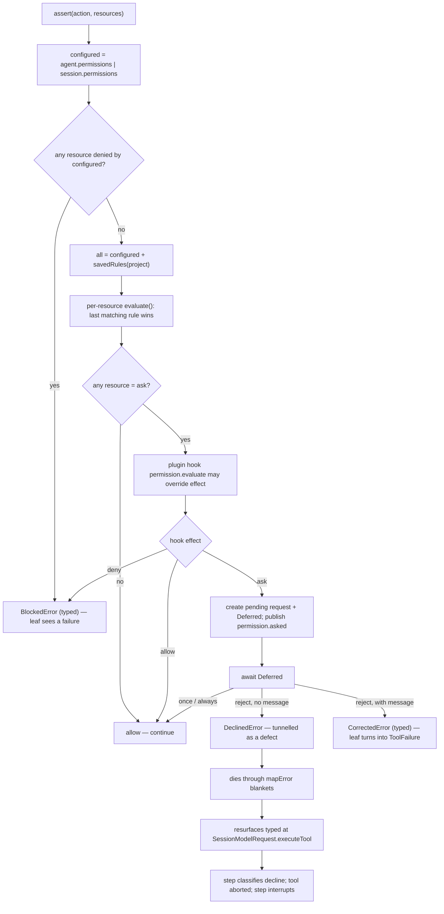
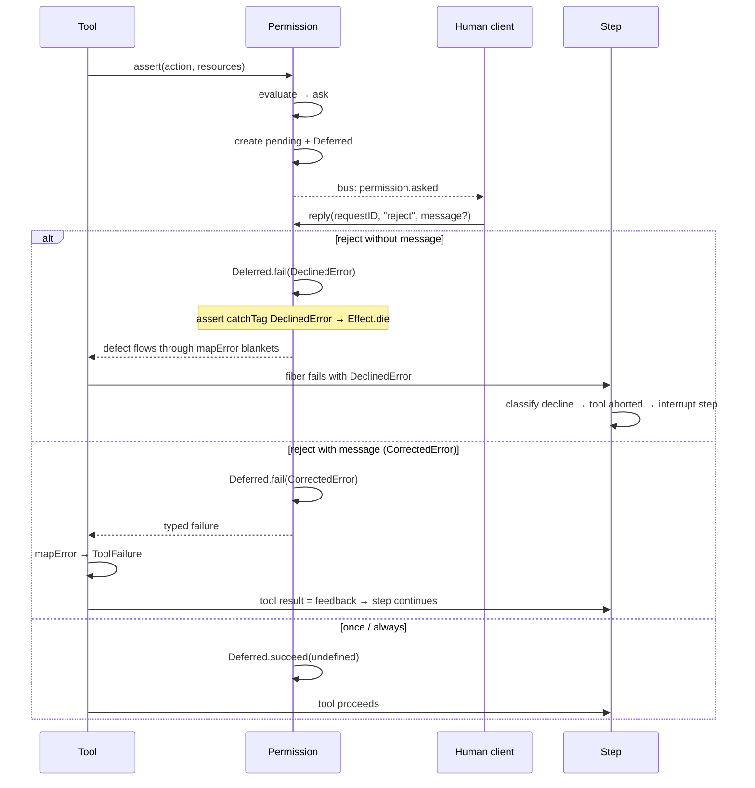
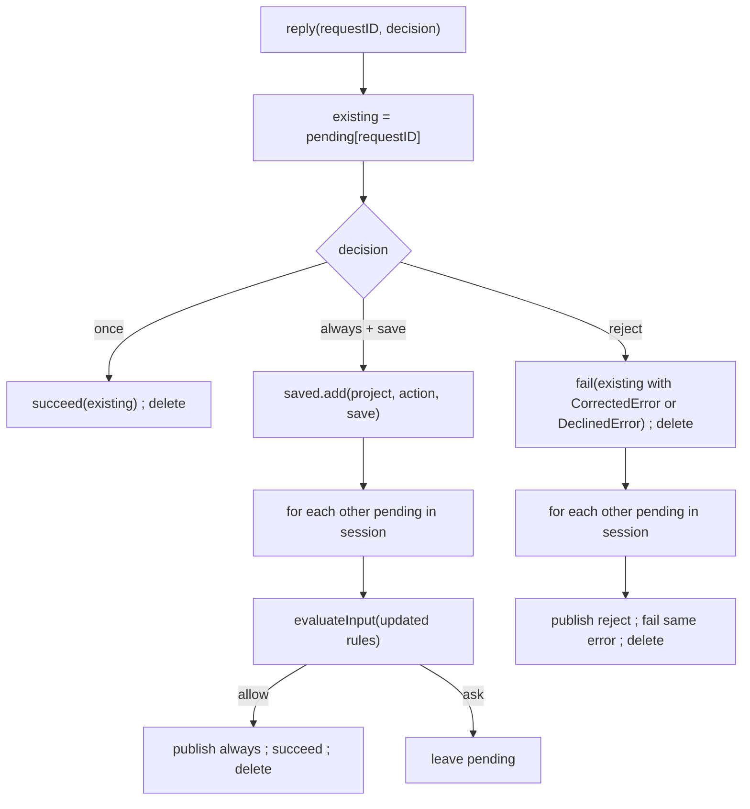
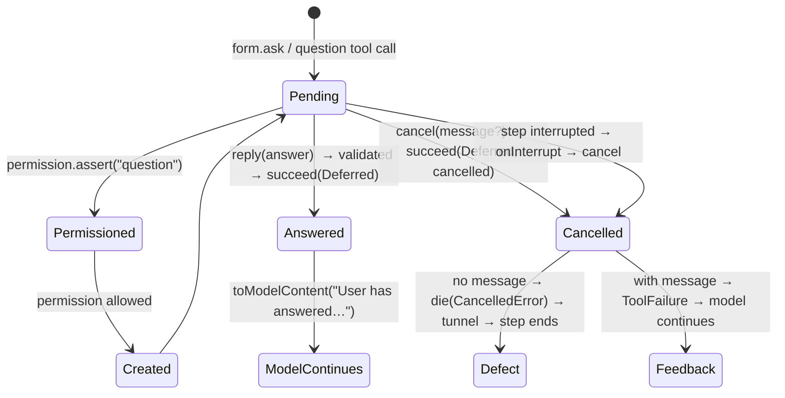

# Part 6 — Permissions and human-in-the-loop

A coding agent runs with your credentials, in your working tree, on a model you did not
write. Before it edits a file, runs a shell command, or fetches a URL, something has to
decide whether that is allowed, and a human often has to be asked. This part is that
decision layer. It covers how a permission decision is computed from ordered rules, how
the three effects (`allow`, `ask`, `deny`) are resolved, and — the subtle part — how a
user's "no" is kept out of the model's context without also breaking step accounting. It
ends with the `question` tool, which is the general mechanism for asking a human anything
mid-execution.

Topics:

- **6.1 Rulesets, wildcard precedence, merge, saved rules.** An ordered rule list, last
  match wins, where "always allow" is a durable project-scoped rule.
- **6.2 ask/allow/deny, deferred replies, the defect tunnel, `CorrectedError`.** A decline
  must not become tool output; it travels as a defect and resurfaces typed at the
  execution boundary.
- **6.3 Batch semantics.** One rejection rejects the whole parallel batch; one `always`
  propagates a saved grant to the other pending asks.
- **6.4 The question tool and forms; interruption as control.** Asking a human a structured
  question, and cancelling by interrupting.

---

## 6.1 Rulesets, wildcard precedence, merge, saved rules

### Thesis

A permission decision is a pure function of an action, a resource, and an ordered list of
rules in which the last matching rule wins.

### Cold open

You add a rule to deny reading `.env` files. A week later a plugin asks to read
`.env.local`, and it sails through. Or you add "allow `git *`" to stop being asked about
every git command, and now `git push --force` is allowed too. You have two rules that both
match one request. Which one applies? "Whatever the code does" is not an answer you want to
discover in production.

### The concept

A **ruleset** is an ordered array of rules. A **rule** has three fields: `action` (a
string, matched as a wildcard pattern against the requested action), `resource` (a
wildcard pattern matched against the requested resource), and `effect` — one of `allow`,
`ask`, `deny`. There is no nesting, no negation, and no priorities. Order is the only
source of precedence: to decide a request, you walk the rules from first to last, keep the
last one whose `action` and `resource` patterns both match, and take its effect. If nothing
matches, the decision is `ask`.

Why last-match-wins rather than first-match-wins? Because rulesets are composed by
appending, not by insertion. A built-in default is broad (`{ "*", "*", allow }`), and
every layer added after it is more specific: an agent disables a tool, a project config
asks about secrets, a session narrows further, and a user's "always allow this exact
command" appends a durable grant. Each later rule is meant to override the earlier ones it
matches, so the natural rule is "the most recent, most specific layer wins". First-match
would force every broad rule to be authored last, which is exactly backwards.

`merge` is therefore trivially "concatenate, preserving order". It is not a set union and
does not deduplicate; two identical rules are both kept, and the later one is the one that
wins.

**Wildcard matching** is a small regex translation, not a glob library. `*` becomes `.*`
(any run of characters) and `?` becomes `.` (exactly one). Every other regex
metacharacter is escaped, so a rule is never accidentally a regex. Backslashes are
normalised to forward slashes first, so a Windows path rule and a POSIX path rule read the
same. One special case: a pattern that ends in ` *` also matches the bare prefix, so a
rule like `git *` matches `git` as well as `git status`. Matching is anchored at both
ends, so a pattern only matches the whole resource.

**Saved rules** are the durable form of "always allow". They are rows in a `permission`
table keyed by project, action, and resource, and they are appended to the configured
ruleset as `allow` rules. They are deliberately the *last* rules, so a durable grant
overrides a project rule that would otherwise ask. They are scoped to the project, not the
session, because "always" means "always, for this project".

### Diagram

D12 — permission evaluation and the defect tunnel.



```text
assert(action, resources)
   │
   ├─ configured = agent.permissions ++ session.permissions
   ├─ denied(configured)? ──yes──▶ BlockedError (typed)
   │
   └─ all = configured ++ savedRules(project)
        │
        ├─ effect per resource = evaluate(action, resource, all)  (last match wins)
        ├─ hook "permission.evaluate" may override effect
        │
        ├─ allow ─▶ continue
        ├─ deny  ─▶ BlockedError (typed)
        └─ ask   ─▶ pending request + Deferred; publish permission.asked
                     │
                     ├─ once / always ─▶ continue
                     ├─ reject, message? ─▶ CorrectedError (typed) ─▶ ToolFailure ─▶ model continues
                     └─ reject, no message ─▶ DeclinedError ─▶ DIE
                                               (defect tunnel through mapError)
                                               ▼
                                     SessionModelRequest.executeTool
                                               ▼
                                     step: tool aborted, step interrupts
```

Narration: evaluation folds an ordered rule list twice. First the configured rules, which
are the agent's and the session's rules concatenated, are checked only for outright denials,
which short-circuit. Then the full list — configured plus the project's saved "always"
grants — is evaluated per resource with last-match-wins, and if any resource wants a human
the request is registered and we wait. A human "no" without feedback is not returned as a
value; it is thrown as a defect that flies past every error handler and is only caught,
deliberately and by type, at the boundary where tool results are produced.

### The real thing

The evaluator itself is `findLast` over the flattened rulesets, with an `ask` default:

```ts
// packages/core/src/permission.ts:87
export function evaluate(action: string, resource: string, ...rulesets: Permission.Ruleset[]): Permission.Rule {
  return (
    rulesets
      .flat()
      .findLast((rule) => Wildcard.match(action, rule.action) && Wildcard.match(resource, rule.resource)) ?? {
      action,
      resource: "*",
      effect: "ask",
    }
  )
}
```

`merge` is just concatenation, and matching is the regex translation:

```ts
// packages/core/src/permission.ts:99
export function merge(...rulesets: Permission.Ruleset[]): Permission.Ruleset {
  return rulesets.flat()
}
```

```ts
// packages/core/src/util/wildcard.ts:3
export function match(input: string, pattern: string) {
  const normalized = input.replaceAll("\\", "/")
  let escaped = pattern
    .replaceAll("\\", "/")
    .replace(/[.+^${}()|[\]\\]/g, "\\$&")
    .replace(/\*/g, ".*")
    .replace(/\?/g, ".")

  if (escaped.endsWith(" .*")) escaped = escaped.slice(0, -3) + "( .*)?"

  return new RegExp("^" + escaped + "$", process.platform === "win32" ? "si" : "s").test(normalized)
}
```

The configured ruleset is the agent's rules (or a deny-everything fallback when the agent is
missing) merged with the session's rules; saved rules are appended separately and always as
`allow`:

```ts
// packages/core/src/permission.ts:148
    const savedRules = Effect.fnUntraced(function* () {
      return (yield* saved.list({ projectID: location.project.id })).map(
        (item): Permission.Rule => ({
          action: item.action,
          resource: item.resource,
          effect: "allow",
        }),
      )
    })

    const configured = Effect.fnUntraced(function* (sessionID: SessionSchema.ID, agentID?: Agent.ID) {
      const session = yield* sessions.get(sessionID)
      if (!session) return yield* new SessionErrors.NotFoundError({ sessionID })
      const agent = yield* agents.resolve(agentID ?? session.agent)
      return merge(agent?.permissions ?? missingAgentPermissions, session.permissions ?? [])
    })
```

The two-phase evaluation — deny short-circuit, then per-resource effects — plus the plugin
hook that can change the outcome:

```ts
// packages/core/src/permission.ts:173
    const evaluateInput = Effect.fnUntraced(function* (input: AssertInput) {
      const rules = yield* configured(input.sessionID, input.agent)
      if (denied(input, rules)) return { effect: "deny" as const, rules }
      const all = [...rules, ...(yield* savedRules())]
      const effects = input.resources.map((resource) => evaluate(input.action, resource, all).effect)
      const effect: Permission.Effect = effects.includes("ask") ? "ask" : "allow"
      const event = yield* hooks.trigger("permission", "evaluate", {
        sessionID: input.sessionID,
        agent: input.agent,
        action: input.action,
        resources: input.resources,
        metadata: input.metadata,
        source: input.source,
        effect,
      })
      return { effect: event.effect, message: event.message, rules: all }
    })
```

The built-in default ruleset shows the layering intent: a broad allow, then narrow asks for
secret files, with the `*.env.example` exception appended last so it wins.

```ts
// packages/schema/src/agent.ts:46
          permissions: [
            { action: "*", resource: "*", effect: "allow" },
            { action: "read", resource: "*.env", effect: "ask" },
            { action: "read", resource: "*.env.*", effect: "ask" },
            { action: "read", resource: "*.env.example", effect: "allow" },
          ],
```

The `explore` subagent shows the same ordering used as a whitelist: deny everything first,
then enable the read-only tools it needs.

```ts
// packages/core/src/plugin/agent.ts:104
        item.permissions.push(
          { action: "*", resource: "*", effect: "deny" },
          { action: "shell", resource: "*", effect: "allow" },
          { action: "grep", resource: "*", effect: "allow" },
          { action: "glob", resource: "*", effect: "allow" },
          { action: "webfetch", resource: "*", effect: "allow" },
          { action: "websearch", resource: "*", effect: "allow" },
          { action: "read", resource: "*", effect: "allow" },
          { action: "read", resource: "*.env", effect: "ask" },
          { action: "read", resource: "*.env.*", effect: "ask" },
          { action: "read", resource: "*.env.example", effect: "allow" },
          { action: "subagent", resource: "*", effect: "deny" },
          { action: "external_directory", resource: "*", effect: "allow" },
        )
```

Saved rules are durable rows with a uniqueness constraint that makes repeated grants
idempotent:

```ts
// packages/core/src/permission/sql.ts:7
export const PermissionTable = sqliteTable(
  "permission",
  {
    id: text().$type<PermissionSaved.ID>().primaryKey(),
    project_id: text()
      .$type<Project.ID>()
      .notNull()
      .references(() => ProjectTable.id, { onDelete: "cascade" }),
    action: text().notNull(),
    resource: text().notNull(),
    ...Timestamps,
  },
  (table) => [uniqueIndex("permission_project_action_resource_idx").on(table.project_id, table.action, table.resource)],
)
```

**What to notice**

- `evaluate` returns a *rule*, not an effect. The caller decides what an unmatched request
  means (`ask`) and how multiple resources combine.
- Saved rules are appended, never merged by value, so an "always" grant is always the last
  word. `merge` preserving order is what makes that work.
- `denied` checks only the configured rules; a saved `allow` can never resurrect an action
  the agent or session outright denies. Deny is the one effect that short-circuits.
- `evaluateInput` takes the *most restrictive* multi-resource answer: if any resource in a
  call would ask, the whole call asks.
- The `wildcard.ts` `" .*"` special case is why `read *.env` does not have to be written
  twice.

### The prompts

No prompts in this topic — the prompts live in Appendix A under **Policy**. This
topic owns no model-facing text; a ruleset is configuration, not a message.

### Build it

```ts
type Effect = "allow" | "ask" | "deny"
type Rule = { action: string; resource: string; effect: Effect }
type Ruleset = Rule[]

function evaluate(action: string, resource: string, rules: Ruleset): Rule {
  // next rule wins; append-only layering means later = more specific
  for (let i = rules.length - 1; i >= 0; i--) {
    const rule = rules[i]
    if (matches(action, rule.action) && matches(resource, rule.resource)) return rule
  }
  return { action, resource: "*", effect: "ask" } // fail closed-ish: ask
}

function matches(input: string, pattern: string) {
  const re = "^" + pattern.replace(/[.+^${}()|[\]\\]/g, "\\$&").replace(/\*/g, ".*").replace(/\?/g, ".") + "$"
  return new RegExp(re, "s").test(input.replaceAll("\\", "/"))
}
```

Decisions and trade-offs:

- **Order is the API.** Document "last match wins" wherever a rule is authored, because the
  whole composition model depends on it. A set-based merge would look tidier and behave
  unpredictably.
- **Default to `ask`, not `allow` and not `deny`.** An unconfigured action should reach a
  human, not fail silently or run unchecked.
- **Store saved rules by `(project, action, resource)` with a unique index** so a repeated
  "always" is a no-op rather than a pile of duplicate rows.
- **Separate the deny pass from the effect pass.** If you fold everything into one pass, a
  saved `allow` can override a hard denial, which is usually the wrong default.

### How it fails

- **Anchoring bug.** If you forget `^…$`, `read *.env.*` also matches `read foo.env.bak/extra`.
  The translation escapes then anchors; do both.
- **Case sensitivity drift.** POSIX matching is case-sensitive by default but Windows is
  not; if the platform changes, a rule that asked starts allowing. Keep one policy.
- **Trailing-arg mismatch.** Without the `" .*"` special case, a rule ending in ` *` only
  matches the command with arguments, so the bare command keeps asking and users add a
  second rule.
- **Deny that is not really deny.** If a later saved `allow` were merged into the deny pass,
  a "no" could be undone by an earlier "always". Keep the deny pass separate.
- **Unbounded ask.** A rule that ends up `ask` on a path a non-interactive client cannot
  answer stalls the step. The answer is a cancellation path (6.2/6.4), not a silent allow.

### How you'd test it

Assert the ordering invariant directly, against the real `evaluate`/`match`:

- Given `[{ "*", "*", allow }, { "read", "*.env", ask }, { "read", "*.env.example", allow }]`,
  `evaluate("read", "a.env")` is `ask`, `evaluate("read", "a.env.example")` is `allow`, and
  `evaluate("read", "a.txt")` is `allow`.
- `evaluate` with no matching rule returns `effect: "ask"`, not `allow`.
- `merge` of two rulesets preserves order: the second ruleset's matching rule is the one
  returned.
- `denied` with a saved `allow` present still reports deny for a hard-denied action.
- Round-trip the wildcard special case: a pattern ending in ` *` matches both the prefix and
  the prefixed-with-args string, and a `?` matches exactly one character.

### Recap

- A ruleset is an ordered list; precedence is position, and the last matching rule wins.
- Composed rulesets are append-only, so later layers (agent, session, saved grants) override
  earlier, broader ones; `denied` is evaluated separately so a saved grant cannot undo a hard
  deny.
- Saved rules are durable, project-scoped `allow` rules written when a user answers "always".

Next: what actually happens when a rule says `ask` — the ask/allow/deny resolution and the
defect tunnel that keeps a "no" out of the model's context.

### Podcast notes

Hook: You write one rule that denies reading a secret file, and a week later the agent reads
it anyway — because two rules matched and you never said which one wins.
Analogy: It is a legal code read top to bottom, where the most recently passed law overrides
the older ones it touches, and "we never passed a law about it" means "ask a judge".
Talking points: order is the entire precedence mechanism; a saved "always" is just another
rule appended last; deny is checked in a separate pass so it cannot be overridden; wildcard
matching is a tiny regex translation, not a glob.
Listeners will ask: "Why not first-match, or a priority number?" — because composition is by
appending increasingly specific layers, and position already encodes specificity.

---

## 6.2 ask/allow/deny, deferred replies, the defect tunnel, `CorrectedError`

### Thesis

A user's outright decline is carried as a *defect*, not as a value or a typed failure, so
that no ordinary error handler can turn a "no" into model-visible tool output.

### Cold open

The agent wants to run a destructive command. The user clicks "Reject". The next thing the
model sees is a tool result that says the command failed with an error. The model, being
helpful, concludes it used the wrong syntax and tries again — this time by a different
route — and the user has to reject it again. A "no" that the model reads as "try again"
is worse than no permission check at all.

### The concept

A permission evaluation ends in one of three effects, and each has to reach a different
audience:

- `allow` — nobody needs to know; the tool runs.
- `deny` — the *model* should be told why, as an ordinary tool error, so it can adjust. This
  is a typed `BlockedError`, converted by the tool leaf into a model-visible failure.
- `ask` — a human is involved. The outcome is not yet known, so the tool suspends.

When a request ends in `ask`, opencode registers a **pending request**: the request record,
plus a `Deferred` — a one-shot, awaitable promise. The pending map is keyed by request id.
The request is published on the bus (`permission.asked`), and `assert` awaits the deferred.
A client answers with `reply`, which either *succeeds* the deferred (allow) or *fails* it.

`ask` and `assert` are two entry points to the same evaluation. `ask` evaluates and
registers but does not wait — it returns an `AskResult` and lets the caller observe the
reply through the bus. `assert` blocks until the decision is known. Tools use `assert`,
because they cannot proceed without an answer.

Now the interesting case: the user rejects. There are two rejections:

- **Reject with no message.** The user simply does not want this. If this were delivered as
  a typed failure, every tool leaf's blanket `mapError` (which wraps the whole body to turn
  any error into a `ToolFailure`) would happily convert it into a tool result the model can
  read. The model would see "permission denied" as an error it can work around. So instead,
  the decline is raised as a **defect** — a non-recoverable error that bypasses typed error
  channels. In Effect terms, it *dies* rather than *fails*. `mapError` only rewrites failures,
  so the defect flies straight through every tool's error handling.
- **Reject with a message** (`CorrectedError`). The user said "no, do it this way instead".
  This *must* reach the model, because the message is information the model should act on.
  So this one stays a typed failure: the leaf's blanket `mapError` converts it into a
  `ToolFailure`, the model sees the feedback, and the step continues.

This split is the **defect tunnel**. The declaration of a decline as a defect is a
deliberate abuse of the defect channel: defects normally mean "a bug, unrecoverable", and
here they mean "do not let this be swallowed". The tunnel has to be closed at exactly one
place, or the whole execution dies. That place is `SessionModelRequest.executeTool`, which
inspects the *cause* of the tool fiber's exit, looks for a die reason whose defect is a
`DeclinedError` or a question dismissal, and re-raises it as a typed failure. From there the
step's classifier sees a decline, marks the tool as aborted, and — critically — interrupts
the step instead of continuing it. So a decline ends the turn; it does not become a message
the model can react to.

Where does the decline resurface? Three named points, in order:

1. `Tool.execute` and every leaf apply `mapError` that ignores defects — this is where the
   tunnel must not leak (see 6.1's `BlockedError` contrast).
2. The step runs each tool in a fiber; a declined fiber fails with a typed
   `DeclinedError | CancelledError`.
3. `SessionStep.attempt`'s `classifyToolExits` collects those, marks the tool aborted with a
   message, and if the location is not shutting down, raises `Effect.interrupt` for the whole
   step.

Note that a *shutdown* decline (the location closed) is treated differently from a user
decline: it completes the step with `needsContinuation: true`, because the work should resume
in a new location rather than be abandoned.

### Diagram

D36 — the permission reply lifecycle and the two exit paths.



```text
  Tool ──assert──▶ Permission ──evaluate──▶ ask
                        │ create pending + Deferred
                        │ publish permission.asked
                        ▼
                    Human client ──reply──▶
     ┌──────────────────────┬────────────────────────┬───────────────┐
     │ reject (no message)  │ reject (message)       │ once / always │
     ▼                      ▼                        ▼
  DeclinedError          CorrectedError           succeed
     │ (fail)                 │ (typed fail)           │
     │ assert catches tag     │ leaf mapError          │
     │ and DIES               │ → ToolFailure          │
     ▼                        ▼                        ▼
  defect through         model sees feedback,     tool runs
  mapError blankets      step continues
     ▼
  tool fiber fails typed
     ▼
  classifyToolExits → tool aborted → step interrupts
```

Narration: a tool suspends on a deferred promise while a client is asked. If the human
rejects plainly, the promise is failed but the awaiting code immediately converts that
failure into a defect, so it passes untouched through every tool's error wrapper and is
recovered typed only at the single boundary that produces tool results; the step then treats
it as an interruption. If the human rejects *with a message*, the failure is left alone, the
tool wrapper turns it into a normal tool failure, and the model reads the feedback and keeps
working.

### The real thing

The `assert` implementation is where the tunnel is opened. The comment states the invariant:

```ts
// packages/core/src/permission.ts:231
    const assert = Effect.fn("Permission.assert")((input: AssertInput) =>
      Effect.gen(function* () {
        if (closed) return yield* Effect.die(new DeclinedError())
        const result = yield* evaluateInput(input)
        return yield* Effect.uninterruptibleMask((restore) =>
          Effect.gen(function* () {
            if (result.effect === "deny") {
              return yield* new BlockedError({
                rules: relevant(input, result.rules),
                permission: input.action,
                resources: input.resources,
                reason: result.message,
              })
            }
            if (result.effect === "allow") return
            const item = yield* create(request(input, result.message), input.agent)
            return yield* restore(Deferred.await(item.deferred)).pipe(
              // Deliberate defect tunnel: leaves wrap execution in blanket `mapError`, which
              // must not convert a user's decline into model-facing tool output. The decline
              // resurfaces as a typed failure at SessionModelRequest.executeTool. A decline
              // WITH feedback (CorrectedError) intentionally stays typed so the leaf can turn
              // it into ToolFailure and the model continues.
              Effect.catchTag("Permission.DeclinedError", (error) => Effect.die(error)),
              Effect.ensuring(
                Effect.sync(() => {
                  pending.delete(item.request.id)
                }),
              ),
            )
          }),
        )
      }),
    )
```

The reply handler decides which of the two paths a rejection takes:

```ts
// packages/core/src/permission.ts:265
    const reply = Effect.fn("Permission.reply")((input: ReplyInput) =>
      Effect.uninterruptible(
        Effect.gen(function* () {
          const existing = pending.get(input.requestID)
          if (!existing) return yield* new NotFoundError({ requestID: input.requestID })
          yield* bus.publish(Permission.Event.Replied, {
            sessionID: existing.request.sessionID,
            requestID: existing.request.id,
            reply: input.reply,
          })

          if (input.reply === "reject") {
            yield* Deferred.fail(
              existing.deferred,
              input.message ? new CorrectedError({ feedback: input.message }) : new DeclinedError(),
            )
```

A tool leaf wraps its body in a blanket `mapError`. Because declines are defects, this
wrapper never sees them; because deny and feedback are typed, it does:

```ts
// packages/core/src/tool/plugin/shell.ts:273
            }).pipe(
              Effect.map(toolResult),
              Effect.mapError(
                (error) => new ToolFailure({ message: `Unable to execute command: ${input.command}`, error }),
              ),
            ),
```

The lower-level tool executor makes the same promise at the untrusted boundary — foreign
failures are coerced, defects are not:

```ts
// packages/core/src/tool/runtime.ts:29
export const execute = (tool: Tool.Info<any, any>, input: unknown, context: Tool.Context) =>
  Effect.gen(function* () {
    const decoded = yield* decodeInput(tool, input)
    // Tool implementations declare `Tool.Error` but plugins can fail with anything at
    // runtime. A foreign typed failure would slip past every `catchTag("Tool.Error")`
    // downstream and leave its call permanently unsettled, so the declared contract is
    // enforced here at the untrusted boundary. Declines tunnel through as defects and
    // interrupts are not errors; neither is touched.
    const result = yield* tool.execute(decoded, context).pipe(
      Effect.mapError((error: unknown) =>
        error instanceof Tool.Error
          ? error
          : new Tool.Error({
              message: error instanceof globalThis.Error ? error.message : String(error),
            }),
      ),
    )
```

The tunnel's single exit is `executeTool`, which scans the cause's reasons for a die reason
holding a decline and turns it back into a typed failure:

```ts
// packages/core/src/session/model-request.ts:59
/** Tool errors, plus the user declining a permission or dismissing a question. */
export type ExecuteError = Tool.Error | Permission.DeclinedError | QuestionTool.CancelledError
```

```ts
// packages/core/src/session/model-request.ts:404
        executeTool: (call: Parameters<Prepared["executeTool"]>[0]) =>
          tools.execute({ ...call, definitions: hooked }).pipe(
            Effect.catchCauseFilter(
              (cause) => {
                const decline = cause.reasons
                  .map((r) => (Cause.isDieReason(r) ? r.defect : Cause.isFailReason(r) ? r.error.error : undefined))
                  .find(
                    (value): value is Permission.DeclinedError | QuestionTool.CancelledError =>
                      value instanceof Permission.DeclinedError || value instanceof QuestionTool.CancelledError,
                  )
                return decline ? Result.succeed(decline) : Result.fail(cause)
              },
              (decline) => Effect.fail(decline),
            ),
          ),
```

The step classifies declines, aborts those tool calls, and interrupts the step:

```ts
// packages/core/src/session/runner/step.ts:207
        for (const decline of tools.declines)
          yield* publisher.failTool(decline.call.id, {
            type: "aborted",
            message: input.isLocationClosed()
              ? "Interaction cancelled because the location shut down"
              : decline.reason._tag === "QuestionTool.CancelledError"
                ? decline.reason.message
                : "The user declined this tool call",
          })
        const interrupted = tools.declines.length > 0 || streamInterrupted || tools.interrupted
```

```ts
// packages/core/src/session/runner/step.ts:274
        if (tools.declines.length > 0) {
          if (input.isLocationClosed()) return Outcome.Completed({ needsContinuation: true })
          return yield* Effect.interrupt
        }
```

**What to notice**

- The exact split is by *information content*: a decline says nothing the model can use, so
  it does not become model text; a decline with feedback says something, so it does.
- The tunnel is opened once (`catchTag(...DeclinedError...) → die`) and closed once
  (`catchCauseFilter` in `executeTool`). Adding error handling between those points is safe
  only because defects bypass it.
- `assert` is wrapped in `uninterruptibleMask` but the `Deferred.await` is `restore`d, so the
  wait itself can be interrupted; only the pending-map cleanup is uninterruptible.
- The plugin host boundary does the same split explicitly: it catches `BlockedError` and
  `CorrectedError` into `Tool.Error` but deliberately does not catch `DeclinedError`.

### The prompts

No prompts in this topic — the prompts live in Appendix A under **Policy**.

Design note: the one model-facing string this topic produces is the tool-error message
written when a decline is settled — `"The user declined this tool call"` and, for a question
dismissal, the dismissal's own message (`step.ts:207`). It is not a prompt; it is what the
model sees *instead of* the decline. A decline with feedback uses the feedback text verbatim
as the tool failure message.

### Build it

```ts
// one-shot promise with a typed failure channel
type Deferred<A, E> = { succeed: (a: A) => void; fail: (e: E) => void; await: () => A }
type Pending = { request: Request; deferred: Deferred<void, DeclinedError | CorrectedError> }
const pending = new Map<string, Pending>()

function assert(input): void {
  const decision = evaluate(input)              // allow | ask | deny
  if (decision === "deny") throw new BlockedError(...)   // typed: model-visible
  if (decision === "allow") return
  const item = create(input)                    // registers, publishes permission.asked
  try {
    item.deferred.await()
  } catch (e) {
    if (e instanceof DeclinedError) throw asDefect(e)     // DIE, not fail
    throw e                                                // CorrectedError stays typed
  } finally {
    pending.delete(item.request.id)
  }
}

// the one place that knows the defect was actually a decline
function executeTool(call) {
  try {
    return tools.execute(call)
  } catch (cause) {
    const decline = findDeclineInCause(cause)   // die reason whose defect is a decline
    if (decline) throw decline                  // re-raise typed
    throw cause
  }
}
```

Decisions and trade-offs:

- **If your runtime has no defect channel**, use a sentinel wrapper type that your tool
  executor is documented never to convert, and unwrap it at the same single boundary. The
  important property is one un-swallowable path, not the specific mechanism.
- **A decline must not carry model-usable content.** If you ever attach "permission denied"
  to the decline, you have re-created the failure you were avoiding.
- **Clean up pending entries in a `finally`/finalizer**, or a cancelled wait leaks a pending
  request the UI keeps showing.

### How it fails

- **The decline is swallowed.** A tool wraps everything, including defects, and turns the
  "no" into an error string. The model retries. This is the failure the tunnel exists to
  prevent; the tell is a tool result mentioning permission after a reject.
- **The decline escapes the tunnel.** If no boundary re-raises it, the whole execution dies
  with a stack trace instead of ending the step. The invariant is: everything below the tool
  boundary may die, and exactly one layer above converts.
- **Feedback is dropped.** A reject with a message that is delivered as a defect loses the
  message; the model never learns why. Feedback must stay typed all the way to `ToolFailure`.
- **A stale pending entry.** Interrupting the wait without removing the pending request
  leaves a prompt on screen for a request nobody is waiting on.
- **Double reply.** Two clients both answer; the second fails the deferred again. Reply is
  uninterruptible and deletes the pending entry on the first success, so the second is a
  `NotFoundError`.

### How you'd test it

Drive the real service and assert the two exit paths:

- With a rule of `ask`, fork `assert`, then `reply` with `{ reply: "reject" }` and no
  message: the fiber must exit with a *defect* whose value is `DeclinedError` (a die, not a
  fail). Assert that a leaf-style `mapError` around the call does not observe it.
- Same setup but `{ reply: "reject", message: "use pnpm" }`: the fiber must *fail* with
  `CorrectedError` carrying the feedback, and a leaf `mapError` must be able to convert it.
- `{ reply: "once" }`: the deferred succeeds and `assert` returns `void`.
- `executeTool` over a tool that dies with `DeclinedError` must yield a typed
  `DeclinedError`, not a defect; over a tool that dies with anything else it must propagate
  the defect.
- After any outcome, `list()`/`get(id)` must not include the settled request.

### Recap

- `allow` is silent, `deny` is a typed `BlockedError` the model reads, `ask` suspends on a
  `Deferred` and publishes a request.
- A plain decline is tunnelled as a defect through every tool's `mapError` and re-raised
  typed at `SessionModelRequest.executeTool`; a decline with feedback stays typed so the
  model gets the message.
- The step then aborts the declined tool and interrupts the step, unless the location is
  shutting down, in which case the step completes for resume.

Next: what happens when several tool calls are awaiting permission at once — a rejection has
to reject them all, and an "always" has to cover them all.

### Podcast notes

Hook: The agent asks "may I run this?", you say no, and it runs it anyway — because a "no"
that reaches the model as text reads like "that did not work, try something else".
Analogy: A decline is a red card thrown onto the field: play stops, but it is not written
into the scoreboard the players are reading.
Talking points: a decline travels as a defect precisely so error handlers cannot see it; a
decline *with feedback* is deliberately ordinary so the model can use the message; the
tunnel is opened in `assert` and closed in exactly one place; a decline ends the step rather
than becoming a tool result.
Listeners will ask: "What if the model needs to know it was denied?" — then the user typed a
message, and the message is the answer.

---

## 6.3 Batch semantics

### Thesis

When several tool calls are pending at once, a single reply is applied to the whole batch: a
reject rejects all of them, and an `always` grant evaluates the others and releases the ones
it now covers.

### Cold open

The model proposes four independent edits in one step. All four ask for permission, so the
user sees four prompts stacked up. They approve the first and reject the second. The third
and fourth are still sitting there. If the reject only ends the second call, the step keeps
running with two prompts pending and a rejected call in the middle — inconsistent state the
user has to clean up by hand.

### The concept

A step can run many tool calls in parallel, and each may raise its own permission request.
The pending requests for a session are therefore plural. opencode's reply handler treats the
answer as applying to the whole batch in the same session:

- On **reject**, it fails the targeted deferred, deletes it, and then walks every other
  pending request **in the same session**, publishes a `permission.replied` with `reject` for
  each, and fails each deferred — with the same `CorrectedError` (if a message was given) or
  `DeclinedError`. The comment makes the reason explicit: feedback applies to the whole
  batch, so parallel asks don't end the step one at a time. Without this, the user would
  have to reject each prompt, and the step would settle incrementally.
- On **`always`**, if the request carried `save` resources, it writes the saved rule, then —
  for every other pending request — re-evaluates that request against the *updated* rules.
  If the re-evaluation now resolves to `allow`, it publishes `always` and succeeds that
  deferred too, releasing the tool. If it still would ask (its action or resource is not
  covered by the saved grant), it is left pending. So one "always allow `git *`" releases
  every other pending `git` call but keeps a pending `rm` call.

The re-evaluation uses `evaluateInput({ ...item.request, agent: item.agent })`, so the saved
rule just written is now part of the ruleset. This is why saved rules are per project: the
grant is what makes the other pending asks resolve to `allow`.

Note the asymmetry: `reject` fails *all* pending asks for the session unconditionally, while
`always` succeeds only the ones its new rule actually covers. A reject says "stop this whole
batch"; an allow says "this rule now covers the rest".

### Diagram

D37 — batch reply propagation.



```text
reply(requestID, decision)
 ├─ once    ▶ succeed(target), delete(target)
 ├─ always  ▶ saved.add(project, action, save)
 │            └─ for each other pending (same session):
 │                 evaluateInput(other, updated rules)
 │                   ├─ allow ▶ publish "always", succeed(other), delete
 │                   └─ ask   ▶ leave pending
 └─ reject  ▶ fail(target, message ? CorrectedError : DeclinedError), delete(target)
              └─ for each other pending (same session):
                   publish "reject", fail(other, same error), delete(other)
```

Narration: a batch reply fans out only to the same session's pending requests. A rejection
rejects them all with the same error, closing every prompt at once. An "always" writes the
grant first and then re-checks each sibling against the new rules, dispensing only the ones
the rule now covers and leaving the rest for the human.

### The real thing

The whole batch logic lives in one uninterruptible handler:

```ts
// packages/core/src/permission.ts:276
          if (input.reply === "reject") {
            yield* Deferred.fail(
              existing.deferred,
              input.message ? new CorrectedError({ feedback: input.message }) : new DeclinedError(),
            )
            pending.delete(input.requestID)
            for (const [id, item] of pending) {
              if (item.request.sessionID !== existing.request.sessionID) continue
              yield* bus.publish(Permission.Event.Replied, {
                sessionID: item.request.sessionID,
                requestID: item.request.id,
                reply: "reject",
              })
              // Feedback applies to the whole batch, so parallel asks don't end the step.
              yield* Deferred.fail(
                item.deferred,
                input.message ? new CorrectedError({ feedback: input.message }) : new DeclinedError(),
              )
              pending.delete(id)
            }
            return
          }

          if (input.reply === "always" && existing.request.save?.length) {
            yield* saved.add({
              projectID: location.project.id,
              action: existing.request.action,
              resources: existing.request.save,
            })
          }
          yield* Deferred.succeed(existing.deferred, undefined)
          pending.delete(input.requestID)
          if (input.reply !== "always" || !existing.request.save?.length) return

          for (const [id, item] of pending) {
            const result = yield* evaluateInput({ ...item.request, agent: item.agent }).pipe(
              Effect.catchTag("Session.NotFoundError", () => Effect.undefined),
            )
            if (result?.effect !== "allow") continue
            yield* bus.publish(Permission.Event.Replied, {
              sessionID: item.request.sessionID,
              requestID: item.request.id,
              reply: "always",
            })
            yield* Deferred.succeed(item.deferred, undefined)
            pending.delete(id)
          }
```

**What to notice**

- The fan-out is filtered by `sessionID`, so a batch in one session never resets another's
  prompts.
- The reject path is why parallel asks "don't end the step" one at a time: every declined
  fiber fails at nearly the same moment, and the step's classifier collects them together.
- The `always` path re-uses the *evaluation* function, not a string comparison, so coverage
  is decided by the same last-match-wins logic that governs everything else.
- If an `always` reply carries no `save` resources, only the targeted request is released;
  there is nothing to propagate.
- All of this is inside `Effect.uninterruptible`, so a client reply cannot be interrupted
  halfway through failing the batch.

### The prompts

No prompts in this topic — the prompts live in Appendix A under **Policy**. The
only strings here are bus events (`permission.replied` with a decision).

### Build it

```ts
function reply(requestID: string, decision: "once" | "always" | "reject", message?: string) {
  const target = pending.get(requestID)
  if (!target) return notFound()

  if (decision === "reject") {
    fail(target, message)                    // CorrectedError | DeclinedError
    pending.delete(requestID)
    for (const [id, item] of sameSession(target)) {
      fail(item, message)
      pending.delete(id)
    }
    return
  }

  if (decision === "always" && target.request.save?.length) {
    saved.add(project, target.request.action, target.request.save)
  }
  target.deferred.succeed()
  pending.delete(requestID)
  if (decision !== "always") return

  for (const [id, item] of sameSession(target)) {
    if (evaluate(item.request).effect !== "allow") continue   // re-evaluate under new rules
    item.deferred.succeed()
    pending.delete(id)
  }
}
```

Decisions and trade-offs:

- **Batch by session, not globally.** Pending asks from different sessions are independent
  user decisions.
- **Reject is total, always is conditional.** A rejection is a statement about the whole
  batch; an "always" is a statement about one rule that may or may not cover the siblings.
- **Write the saved rule before re-evaluating**, or the sibling check uses stale rules and
  releases nothing.

### How it fails

- **Half-rejected batch.** If the reject fan-out is skipped, the step hangs on the remaining
  prompts until the user answers each one, and a partially-decided step is confusing.
- **Over-eager `always`.** If `always` released every sibling without re-evaluating, an
  "always allow git" would also release a pending `rm`. Re-evaluate.
- **Cross-session bleed.** Fanning out by something other than `sessionID` (say, by tool
  name) rejects or grants another session's prompts.
- **Lost feedback in the batch.** The sibling failures pass the same `message`; dropping it
  means the model only learns about one call.

### How you'd test it

- Create two pending asks in one session and one in another; reply `reject` to the first.
  Assert both the first and the second are failed (with the same error) and the third is
  untouched and still in `list()`.
- Create two pending asks for the same action, one with `save` covering the other, and reply
  `always`. Assert the other is released and a rule row now exists for the project; that a
  repeated `always` does not duplicate rows (unique index).
- Reply `always` where the sibling's action is *not* covered: assert the sibling stays
  pending.

### Recap

- Pending asks are plural; a reply is applied to the whole session's batch.
- `reject` fails every pending ask in the session with the same error; `always` writes the
  saved rule and releases only the siblings the new rules now allow.
- The batch boundary is the session, not the step or the process.

Next: the general-purpose way to ask a human anything — the `question` tool — and how
interruption is used as a control signal.

### Podcast notes

Hook: The agent asks four questions at once; you answer the first, and the other three just
sit there while it waits forever.
Analogy: A ballot where a single "no" voids the whole slate, but a single "yes, always" only
waives the questions the new policy actually covers.
Talking points: replies fan out by session; reject is unconditional, always is
re-evaluated; feedback is carried to every sibling so the model sees one coherent message;
the handler is uninterruptible.
Listeners will ask: "Why not let each prompt settle independently?" — because a step with a
rejected call in the middle of it is a state no one can reason about.

---

## 6.4 The question tool and forms; interruption as control

### Thesis

`question` is a general mechanism for the model to ask a human structured questions
mid-execution, built on the same form primitive and the same defect tunnel as permissions.

### Cold open

The agent is about to scaffold a project and it needs to know three things: which package
manager, whether to include tests, and which license. It could guess and be wrong, then do it
again. Instead it should ask — but "ask" has to mean a structured prompt with options, and a
dismissal has to mean something different from an answer.

### The concept

A **form** is the reusable primitive for asking a human for structured input. It has an id, a
session, a title, an optional metadata bag, and a non-empty list of **fields**. A field has a
`key`, a `type` (`string`, `number`, `integer`, `boolean`, `multiselect`, or `external`), and
type-specific constraints (`options`, `minLength`, `pattern`, `format`, `minimum`, `required`,
…). Fields can be conditionally visible via a `when` list of conditions, but conditions may
only reference *earlier* fields, so visibility is a single forward pass and never a cycle.

A form's state is `pending` until it is `answered` (with an answer map) or `cancelled` (with
an optional message). `reply` validates the answer against the schema — including required
fields, option membership, patterns, and active/inactive conditions — and a failed
validation returns an error rather than creating a bad answer. `cancel` settles the form as
cancelled.

Forms live in an in-memory cache with a `Deferred` per form, mirroring the permission
pending map. `Form.ask` creates the form and awaits that deferred. Forms that are answered or
cancelled are retained for ten minutes (`RETENTION`) so a client that polls late still sees
the outcome; the `timeToLive` function keyed on the deferred's state is what expresses
"keep pending forms forever, terminal forms for ten minutes".

The **`question` tool** wraps a form. Its model-facing input is a list of `Question.Prompt`
objects (`question`, `header`, `options`, `multiple`); each becomes a form field, with the
first option set as the field's value space plus `custom: true` so the "type your own answer"
option is always available. The tool description tells the model the conventions (do not add
a free-form option yourself; make a recommended option first and mark it).

The question tool composes two permission-shaped mechanisms:

1. It calls `permission.assert({ action: "question", resources: ["*"] })` first. So asking a
   human is itself permissioned — an agent can be configured to never ask (the `general`
   subagent denies it; the `title` and `summary` agents deny everything).
2. It calls `forms.ask(...)` and then applies the answer, or handles a dismissal.

Dismissal reuses the exact defect-tunnel pattern from 6.2: a dismissal with no message dies
as a `QuestionTool.CancelledError`, which tunnels past the tool's `mapError` and resurfaces
typed at `executeTool`, ending the step. A dismissal *with a message* (for example, from a
non-interactive client explaining why) is an ordinary typed `ToolFailure`, so the model gets
the message and continues. The step's classifier maps a `QuestionTool.CancelledError` decline
to the dismissal's own message in the aborted-tool record.

**Interruption as control.** Two interruptions matter here. First, `Form.ask` is written so
that interrupting the wait cancels the form:
`Effect.onInterrupt(() => Effect.ignore(cancel(form.id)))`. So if the step is interrupted
(the user presses stop, the location closes), the pending form is cancelled — it does not
linger as a zombie prompt. Second, `Permission.assert` similarly lets its wait be
interrupted (the deferred await is `restore`d), then cleans up its pending entry. The
permission reply handler itself is `uninterruptible`, and `Form.reply`/`Form.cancel` are
`uninterruptible`, because settling a form must not be half-done. Interruption is thus a
first-class control: it is how a human says "stop", and both the permission wait and the form
wait are built to react to it by cleaning up, not by leaking.

The `websearch` tool shows a form used for ordinary (non-decline) decisions: when no search
provider is configured, it asks the user whether to allow search, choose a provider, or
disable it, and branches on the answer. A cancellation there becomes a plain error the tool
handles — a reminder that forms are general, and the question tool is one consumer.

### Diagram

D38 — the question tool's lifecycle and its two dismissal meanings.



```text
  question tool called
        │
        ├─ permission.assert(action="question", resources=["*"])
        │      └─ deny ▶ ToolFailure "Permission denied: question"
        │
        ├─ forms.ask(fields = one per question, custom:true)
        │      ├─ answered  ▶ output.answers + "User has answered your questions: …"
        │      ├─ cancelled, message ▶ Effect.fail(ToolFailure(message))  ── model continues
        │      ├─ cancelled, no message ▶ Effect.die(CancelledError) ── defect tunnel ── step ends
        │      └─ interrupted ▶ Form.cancel(id) (onInterrupt) ▶ cancelled
        │
        └─ pending form lives in cache; terminal forms retained 10 min
```

Narration: the tool first clears its own permission gate, then opens a form whose fields are
the questions. The form stays pending until a human answers it, cancels it, or the step is
interrupted — in which case the form is cancelled automatically. An answer becomes model
text; a plain dismissal is thrown as a defect that only the shared boundary recovers, ending
the step; a dismissal carrying a message is ordinary feedback the model reads and acts on.

### The real thing

The model-facing tool description is a prompt; quote it below. The tool body shows the
permission gate, the form, and the three-way dismissal handling:

```ts
// packages/core/src/tool/plugin/question.ts:62
          execute: (input, context) =>
            permission
              .assert({
                action: "question",
                resources: ["*"],
                sessionID: context.sessionID,
                agent: context.agent,
                source: { type: "tool", messageID: context.messageID, id: context.id },
              })
              .pipe(
                Effect.mapError((error) => new ToolFailure({ message: "Permission denied: question", error })),
                Effect.andThen(
                  forms
                    .ask({
                      sessionID: context.sessionID,
                      title: "Questions",
                      metadata: {
                        kind: "question",
                        tool: { messageID: context.messageID, id: context.id },
                      },
                      fields: [
                        toField(input.questions[0], 0),
                        ...input.questions.slice(1).map((question, index) => toField(question, index + 1)),
                      ],
                    })
                    .pipe(Effect.orDie),
                ),
                Effect.flatMap((state) => {
                  // Deliberate defect tunnel (see Permission.assert): a dismissal must dodge
                  // leaf `mapError` blankets so it never becomes model-facing tool output; it
                  // resurfaces as a typed failure at SessionModelRequest.executeTool.
                  // A dismissal with a message (e.g. from a non-interactive client) is ordinary
                  // model-facing feedback: the model continues instead of the step ending.
                  if (state.status === "cancelled" && state.message !== undefined)
                    return Effect.fail(new ToolFailure({ message: state.message }))
                  if (state.status === "cancelled") return Effect.die(new CancelledError())
```

Each question becomes a form field, with the option labels as the value space and free-form
input always enabled:

```ts
// packages/core/src/tool/plugin/question.ts:119
function toField(question: Question.Prompt, index: number): Form.Field {
  return {
    key: `q${index}`,
    title: question.header,
    description: question.question,
    type: question.multiple === true ? "multiselect" : "string",
    options: question.options.map((option) => ({
      value: option.label,
      label: option.label,
      description: option.description,
    })),
    custom: true,
  }
}
```

`Form.ask` makes interruption cancel the form, and `reply`/`cancel` are uninterruptible
settles:

```ts
// packages/core/src/form.ts:152
    const ask = Effect.fn("Form.ask")((input: CreateInput) =>
      Effect.uninterruptibleMask((restore) =>
        Effect.gen(function* () {
          const form = yield* create(input)
          const entry = yield* requireEntry(form.id).pipe(Effect.orDie)
          return yield* restore(Deferred.await(entry.deferred)).pipe(
            Effect.onInterrupt(() => Effect.ignore(cancel(form.id))),
          )
        }),
      ),
    )
```

```ts
// packages/core/src/form.ts:199
    const cancel = Effect.fn("Form.cancel")((id: ID, options?: CancelOptions) =>
      Effect.uninterruptible(
        Effect.gen(function* () {
          const entry = yield* requireEntry(id)
          if (entry.state.status !== "pending") return yield* new AlreadySettledError({ id })
          const next: TerminalState = {
            status: "cancelled",
            ...(options?.message === undefined ? {} : { message: options.message }),
          }
          yield* bus.publish(Form.Event.Cancelled, { id, sessionID: entry.form.sessionID })
          yield* Cache.set(forms, id, { ...entry, state: next })
          yield* Deferred.succeed(entry.deferred, next)
        }),
      ),
    )
```

The form state encodes the two cancellation meanings:

```ts
// packages/schema/src/form.ts:152
export const State = Schema.Union([
  Schema.Struct({ status: Schema.Literal("pending") }),
  Schema.Struct({ status: Schema.Literal("answered"), answer: Answer }),
  // A message tells the asker why nobody answered, e.g. a non-interactive client.
  Schema.Struct({ status: Schema.Literal("cancelled"), message: Schema.String.pipe(optional) }),
])
  .pipe(Schema.toTaggedUnion("status"))
  .annotate({ identifier: "Form.State" })
```

**What to notice**

- Asking is itself permissioned (`action: "question"`); the `general` subagent denies it
  outright, so a delegated child cannot stall on a human prompt.
- The dismissal handling is *the same pattern* as a permission decline, deliberately: one
  tunnel, one recovery point, two producers.
- `custom: true` is always set, which is why the tool description forbids the model from
  adding its own free-form option.
- Retention (`RETENTION`, ten minutes) is keyed on state: pending forms never expire, so a
  long human pause does not cancel the request.
- Interruption is used as control: cancelling the wait cancels the form, and the settle
  operations are uninterruptible.

### The prompts

The `question` tool description is model-facing guidance and is quoted verbatim:

```text
// packages/core/src/tool/plugin/question.ts:12
Use this tool when you need to ask the user questions during execution. This allows you to:
1. Gather user preferences or requirements
2. Clarify ambiguous instructions
3. Get decisions on implementation choices as you work
4. Offer choices to the user about what direction to take.

Usage notes:
- A "Type your own answer" option is added automatically; don't include a separate option for free form answers
- Set `multiple: true` to allow selecting more than one option
- If you recommend a specific option, make that the first option in the list and add "(Recommended)" at the end of the label
```

And the string the model sees as the tool result once the human answers:

```ts
// packages/core/src/tool/plugin/question.ts:38
export const toModelContent = (questions: ReadonlyArray<Question.Prompt>, answers: ReadonlyArray<Question.Answer>) => {
  const formatted = questions
    .map(
      (question, index) =>
        `"${question.question}"="${answers[index]?.length ? answers[index].join(", ") : "Unanswered"}"`,
    )
    .join(", ")
  return `User has answered your questions: ${formatted}. You can now continue with the user's answers in mind.`
}
```

What each buys: "don't include a separate free-form option" prevents the model from
duplicating the automatic one and confusing the client. The `(Recommended)` convention is
how the model expresses a preference without a separate field. The "You can now continue"
clause exists to stop the model from re-asking or hesitating after an answer — a known
failure mode where a model treats the answer as a question back. The full prompt set is in
Appendix A.

### Build it

```ts
type FormState =
  | { status: "pending" }
  | { status: "answered"; answer: Record<string, unknown> }
  | { status: "cancelled"; message?: string }

function askForm(fields): FormState {
  const form = create(fields)                       // publish form.created
  try {
    return form.deferred.await()                    // interruptible
  } on interrupt:
    cancel(form.id)                                 // cleanup; uninterruptible
    rethrow
}

function questionTool(input, context): ToolResult {
  permission.assert({ action: "question", resources: ["*"] })   // asking is permissioned
  const state = askForm(input.questions.map(toField))
  if (state.status === "cancelled" && state.message) throw new ToolFailure(state.message) // feedback
  if (state.status === "cancelled") throw asDefect(new CancelledError())                  // tunnel
  return { content: `User has answered: ${render(state.answer)}` }
}
```

Decisions and trade-offs:

- **Reuse one primitive (form) for permissions and questions.** They differ only in
  presentation; the pending/deferred/settle lifecycle is identical.
- **Make the wait interruptible and the settle uninterruptible.** The wait must be
  cancellable for "stop" to work; the settle must not be half-written.
- **Keep terminal forms for a while.** A client that reconnects should still be able to read
  the answer; pending forms must not expire.
- **Treat "cancelled with a message" as data, not as a hard stop.** It is the escape hatch for
  non-interactive clients.

### How it fails

- **Zombie prompt after stop.** If interrupting the form's wait did not cancel the form, the
  UI shows a question nobody is pending on. The `onInterrupt` cancel prevents this.
- **Free-form duplication.** Without the automatic "type your own answer" option, the model
  invents one and the client shows two.
- **Answer treated as a new question.** Without the "You can now continue" clause, the model
  sometimes asks the same thing again.
- **Unvalidated answer.** `reply` must validate against the field schema, or a client can
  submit an option the form never offered.
- **A dismissed question that reads as an error.** If the dismissal were delivered typed, the
  model would try to work around "the user dismissed this question". The defect tunnel keeps
  it out of context.

### How you'd test it

- Drive `Form.ask`, then `reply` with a valid answer: assert the deferred succeeds with
  `{ status: "answered" }` and `state(id)` returns the answer.
- `reply` with an answer missing a required field or with an unknown option: assert
  `InvalidAnswerError` and that the form is still pending.
- `cancel(id)` with and without a message: assert the deferred succeeds with the cancelled
  state; a second `reply`/`cancel` returns `AlreadySettledError`.
- Interrupt the fiber awaiting `Form.ask`: assert the form transitions to `cancelled` and is
  no longer in `list()`.
- Run the question tool end to end: an answered form yields `User has answered your
  questions: …`; a plain dismissal dies with `QuestionTool.CancelledError`; a dismissal with
  a message fails with a `ToolFailure` carrying it.

### Recap

- `question` is a thin wrapper over the form primitive, gated by its own `question`
  permission.
- A dismissal reuses the permission defect tunnel: plain dismissal ends the step, dismissal
  with a message is feedback the model continues on.
- Interruption is a control signal: the form wait is interruptible and cancels the form on
  interrupt; the settles are uninterruptible.

This closes Part 6. Part 7 turns to the other side of a finite window: what the agent does
when the conversation no longer fits.

### Podcast notes

Hook: The agent needs three decisions before it can start, and rather than guess and redo
the work, it asks — and if you just close the prompt, it stops rather than pretending you
answered.
Analogy: A form at a doctor's office: you can fill it in, write "see notes" in a margin, or
walk out — and walking out is not the same as a "no" on every question.
Talking points: forms are the general primitive; asking is itself permissioned; a plain
dismissal tunnels as a defect and ends the step, while a dismissal with a message is
ordinary feedback; interruption cancels the pending form so nothing is left waiting.
Listeners will ask: "Why not just return the dismissal as a tool error?" — because a model
reads an error as something to fix and would keep trying to ask.
