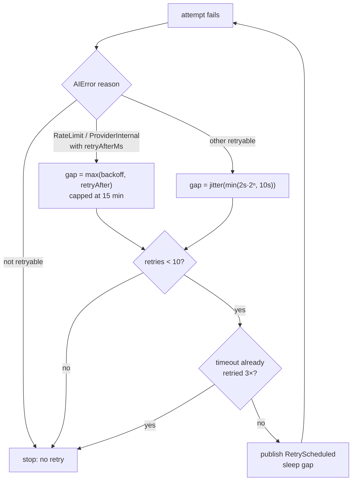
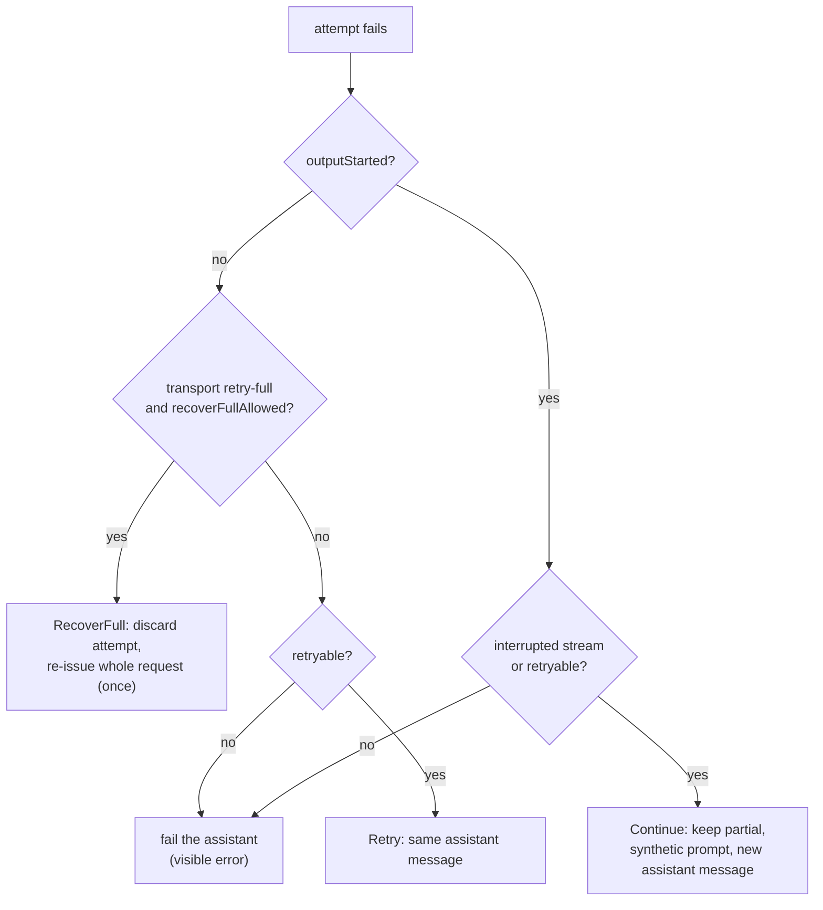
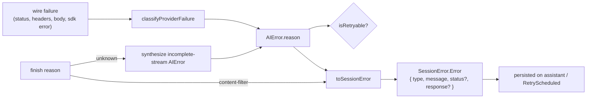
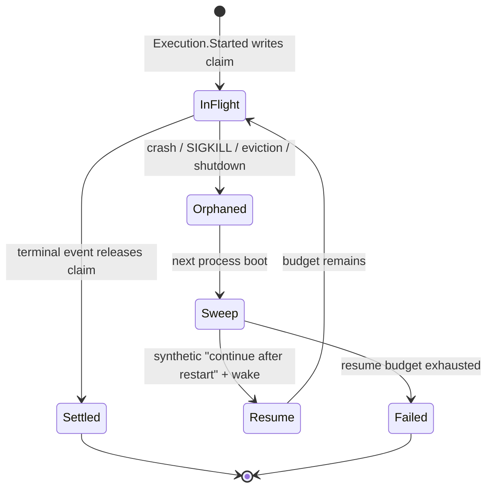

# Part 8 — Reliability

The model call is the least reliable part of a coding agent. Providers rate-limit,
time out, drop streams mid-response, block content, and occasionally return a response
that ends without a reason. A coding agent that treats every failure as fatal is
unusable; one that hides failures behind endless retries is worse. This part covers how
opencode turns a raw provider failure into a decision — retry, continue, recover the whole
request, or surface an error — and how it stays resumable when the process itself dies
mid-step. Everything here is about the boundary between a step and the execution that owns
it.

Topics:

- **8.1** Retry policy.
- **8.2** retry vs continue vs recover-full.
- **8.3** Error taxonomy; content filter; unknown finish; incomplete stream.
- **8.4** Stale settlement after a crash.

---

## 8.1 Retry policy

### Thesis

A retry policy is a bounded, jittered backoff that also honors the provider's own
`Retry-After` and refuses to wait unboundedly, so a broken provider cannot hold a session
hostage.

### Cold open

A provider returns HTTP 429 with `Retry-After: 3600`. The agent sleeps for a full hour.
The user closes the laptop and comes back to a spinner. A retry policy that trusts the
server's number without a ceiling converts one provider hiccup into a stalled session.
The mirror image is just as bad: a policy so timid it gives up after one 500 and makes the
user resend.

### The concept

Provider failures come in two shapes. **Transient** failures succeed if you ask
again: rate limits, 5xx, dropped connections. **Deterministic** failures never succeed
until something changes: a bad API key, an over-long request, a content-policy rejection.
The retry policy only makes sense for the transient shape, so the first job is
classification (8.3), and the second is a schedule.

The schedule has four design decisions, and opencode makes each one explicitly:

- **Growth.** Wait longer after each failure, but not forever. Exponential backoff with a
  per-gap ceiling: the gap doubles from 2 seconds, but is clamped at 10 seconds.
- **Count.** Bound the number of attempts. Ten retries is enough to ride out a short
  outage and small enough that a persistently dead provider fails in about a minute.
- **Jitter.** Randomize each gap so many sessions that fail at the same instant do not
  retry in lockstep and hammer the provider again.
- **Server intent.** If the provider tells you how long to wait (`Retry-After`), wait at
  least that long — but never more than a hard ceiling. The ceiling exists because the
  server's number can be wrong, hostile, or measured in hours.

There is a fifth, less obvious decision: not all retries cost the same. A request that
failed *before* producing output is cheap to repeat. A request that timed out already
burned its full timeout, so retrying it repeatedly multiplies the wait. opencode gives
timeouts their own, smaller budget.

Rejected alternatives: fixed-delay retries (too slow on a burst, too aggressive on a
sustained outage); unlimited retries (a dead provider never terminates); pure
`Retry-After` (one bad header stalls everything); retrying everything (a bad API key gets
retried ten times before the user learns anything).

### Diagram

Diagram **D43** — the retry backoff schedule and its stop conditions.



```text
        attempt fails
             │
   reason retryable? ── no ──▶ stop
             │ yes
   retryAfterMs? ── yes ──▶ gap = min(retryAfter, 15min)
             │ no                    │
   gap = jitter(min(2s·2ⁿ, 10s)) ◀───┘
             │
   retries < 10 and timeouts ≤ 3 ? ── no ──▶ stop
             │ yes
   publish RetryScheduled, sleep gap ──▶ next attempt
```

Narration: a failed attempt enters a decision tree. Most transient failures take a
jittered exponential gap that doubles from two seconds to a ten-second ceiling. A
rate-limit or provider-internal failure that carries a `Retry-After` value instead waits
at least that long, but never more than fifteen minutes. Either way the schedule stops
after ten retries, or earlier if the failure is a timeout that has already consumed its
three-retry budget — because a timeout already spent its wall-clock time once.

### The real thing

The policy is one `Schedule` value with two small constants in front of it.

```ts
// packages/core/src/session/runner/retry.ts:31
/** Bound provider-requested delays so a hostile or buggy retry-after cannot stall a session for hours. */
const RETRY_AFTER_MAX = Duration.toMillis("15 minutes")

const retryAfter = (input: Input) => {
  if (input.cause.reason._tag === "RateLimit" || input.cause.reason._tag === "ProviderInternal")
    return input.cause.reason.retryAfterMs === undefined
      ? undefined
      : Math.min(input.cause.reason.retryAfterMs, RETRY_AFTER_MAX)
  return undefined
}
```

```ts
// packages/core/src/session/runner/retry.ts:42
// Exponential from 2s capped at 10s per gap, for 10 retries: 2, 4, 8, then 10 × 7, about 84s of
// waiting when every attempt fails (67–101s with jitter). `min` takes the faster schedule, so the
// cap applies per gap; `max` with `recurs` bounds the count.
const schedule = Schedule.max([
  Schedule.min([Schedule.exponential("2 seconds"), Schedule.spaced("10 seconds")]),
  Schedule.recurs(10),
]).pipe(
  Schedule.jittered,
  Schedule.setInputType<Input>(),
  Schedule.modifyDelay(({ input, duration: delay }) => {
    const minimum = retryAfter(input)
    const duration = minimum === undefined ? delay : Duration.max(delay, Duration.millis(minimum))
    return Effect.succeed(Duration.millis(Math.ceil(Duration.toMillis(duration))))
  }),
)

// A timed-out attempt already waited minutes before failing, so the general allowance would let a
// dead provider hold a step for most of an hour. Cap those attempts well below it.
const MAX_TIMEOUT_RETRIES = 3

const isTimeout = (error: AIError) => error.reason._tag === "Transport" && error.reason.code === "Timeout"
```

The wrapper turns the schedule into a per-step decision function plus the side effect that
publishes the scheduled retry and sleeps.

```ts
// packages/core/src/session/runner/retry.ts:64
export const policy = (sessionID: SessionSchema.ID) =>
  Effect.gen(function* () {
    const step = yield* Schedule.toStep(schedule)
    let attempt = 1
    let timeouts = 0
    return (input: Input) =>
      Effect.gen(function* () {
        const now = yield* Clock.currentTimeMillis
        const next = yield* step(now, input).pipe(Pull.catchDone(() => Effect.succeed(undefined)))
        if (!next) return { retry: false as const }
        const [, duration] = next
        attempt++
        if (isTimeout(input.cause)) timeouts++
        const delay = Math.ceil(Duration.toMillis(duration))
        const event: PluginHooks.Domains["session"]["retry"] = {
          sessionID,
          agent: input.agent,
          model: input.model,
          error: input.error,
          attempt,
          decision: input.retry && timeouts <= MAX_TIMEOUT_RETRIES ? { retry: true, delay } : { retry: false },
        }
        yield* input.hook(event)
        if (!event.decision.retry) return event.decision
        const normalized =
          Number.isFinite(event.decision.delay) && event.decision.delay >= 0 ? Math.ceil(event.decision.delay) : delay
        return { retry: true as const, attempt, delay: normalized }
      })
  })
```

- What to notice:
  - `Schedule.min` takes the *faster* of exponential and fixed-spaced, so the 10s figure
    is a per-gap ceiling, not a target.
  - `Schedule.max([…, Schedule.recurs(10)])` takes the larger *delay* but the smaller
    *count*, which is how ten retries bounds the loop while the backoff still grows.
  - `retryAfter` only reads the field for `RateLimit` and `ProviderInternal`; other reasons
    ignore it, and every value is clamped to 15 minutes.
  - `MODIFYDELAY`-style customisation lives in `Schedule.modifyDelay`, so the
    provider's floor is applied after jitter, not before.
  - The `retry` boolean returned to the step is the caller's proposed retryability *and*
    the timeout budget; the policy can only refuse a retry, never invent one.
  - The plugin `retry` hook runs after the schedule computes a delay, so a plugin can veto
    the retry or replace the delay — but the delay is re-normalized to a finite,
    non-negative integer.

### The prompts

No prompts in this topic — the retry policy produces no model-facing text. The
continuation prompts it precedes live in §8.4 and Appendix A under **Loop**.

### Build it

```ts
type Decision = { retry: false } | { retry: true; attempt: number; delay: number }

function retryPolicy(maxRetries = 10, base = 2_000, cap = 10_000, retryAfterMax = 15 * 60_000) {
  let retries = 0
  let timeouts = 0
  return (cause: AIError, proposed: boolean): Decision => {
    if (!proposed) return { retry: false }
    if (cause.reason === "Transport" && cause.code === "Timeout") {
      timeouts++
      if (timeouts > 3) return { retry: false }
    }
    if (retries >= maxRetries) return { retry: false }
    retries++
    const exp = Math.min(base * 2 ** (retries - 1), cap)
    const jitter = 0.67 + Math.random() * 0.34            // ±~33%
    const floor = cause.retryAfterMs ?? 0
    return { retry: true, attempt: retries + 1, delay: Math.ceil(Math.max(exp * jitter, Math.min(floor, retryAfterMax))) }
  }
}
```

- The count check is before the increment so "ten retries" means ten, not eleven.
- Clamp `retryAfter` *before* comparing, never after, or a 24-hour header still wins.
- Design note: separate the timeout budget from the general budget only if your provider
  charges wall-clock time per attempt. If timeouts are cheap for you, one budget is fine.
- Design note: publish the scheduled time (`at`) as a durable fact, not just the delay. The
  client then shows a real countdown even if it reconnects mid-wait.

### How it fails

- **Ignoring the header.** Retrying a rate limit at 2 seconds when the server asked for
  60 hammers the provider and gets the key throttled harder.
- **Trusting the header.** A `Retry-After: 86400` stalls the session for a day.
- **No jitter.** A fleet of workers on the same provider retries in synchronized waves.
- **Retrying deterministic failures.** Bad keys, oversized requests, and content
  policy rejections repeat identically; the user waits ten gaps for the same error.
- **Unbounded retry inside an execution.** The run coordinator holds one execution per
  Session (Part 9); a policy that never terminates means the Session never goes idle.

### How you'd test it

Assert the invariant, not the timing: drive the policy with a fake clock and a sequence of
failures, and assert the *delay sequence* and the *stop condition*. In opencode the
schedule is a value; a test feeds it the same failure repeatedly with an incremented clock
and asserts the delays are 2s, 4s, 8s, 10s, 10s… and that the eleventh call returns
`{ retry: false }`. Separately assert that a `Retry-After` of one hour is capped at fifteen
minutes and that four consecutive timeouts stop after the third. Test the real schedule;
do not reimplement the backoff in the test.

### Recap

- One `Schedule` value encodes growth, cap, count, jitter, and the provider floor.
- Rate-limit and provider-internal delays are honored up to a 15-minute ceiling.
- Timeouts get a smaller budget because each already cost the caller wall-clock time.

Next: when retrying is the wrong move, and what to do instead.

### Podcast notes

- Hook: A 429 with `Retry-After: 3600` turned one provider hiccup into a one-hour stall.
- Analogy: A bouncer with a schedule — backs off politely, never waits longer than the
  club's posted limit, and gives up after ten tries.
- Talking points: Transient versus deterministic failures decide *whether* to retry; the
  schedule decides *how*; the server's own number is a floor with a ceiling; timeouts are
  not ordinary retries because they already spent the time.
- Listeners will ask: Why cap `Retry-After` at all instead of trusting the provider?

---

## 8.2 retry vs continue vs recover-full

### Thesis

When a step fails after producing some output, retrying from scratch would duplicate
visible work, so opencode chooses among three recoveries — transparent retry, continuation
from the partial response, and a full re-request — based on what has already been made
durable.

### Cold open

A model streams two paragraphs of an answer, then the connection drops. If the agent
retries the call, the model sees its own half-finished answer gone and writes a different
answer from scratch; the user watches the first two paragraphs appear twice. If the agent
gives up, the user loses a response that was almost done. The right behavior depends on one
fact: was there visible output before the failure?

### The concept

A step can fail at many points, and the point of failure determines the recovery. Three
recoveries cover the space:

- **Retry.** The failure happened before any visible output. The assistant message has
  either not started or is empty. Re-running the same call is transparent: the user sees
  one assistant message, and it eventually fills in. Nothing is duplicated because nothing
  was shown.
- **Continue.** The failure happened after visible output (a dropped stream, an interrupted
  read). The partial output is already durable and worth keeping. Instead of re-asking the
  same question, the agent appends a short instruction to continue and starts a *new*
  assistant message. The model sees its own partial answer and picks up from there.
- **Recover-full.** Some transport failures cannot be resumed at the HTTP/WebSocket layer;
  the only correct action is to discard the attempt and issue the whole request again. This
  is a transport-level property (the provider or transport says "retry-full"), not something
  the session invents. It is allowed once per step: a second full recovery would loop.

The deciding fact — "did output start?" — is not in-memory intent. It is a fold of the
durable events already written for this attempt. That matters because the decision may be
made by a *different process* after a crash (8.4): recovery reads what was recorded, not
what a variable held.

Two supporting decisions live alongside the three recoveries:

- **Output limit.** A response can end because it hit the token ceiling, not because it
  failed. That is a fourth outcome, `OutputLimit`, handled by asking the model to break the
  remaining work into smaller pieces — up to a point, after which it is a real failure.
- **Overflow.** A provider that rejects the whole request as too long is not a retry case at
  all; the context must shrink first. That is compaction's job (Part 7) and it is detected
  separately from retryability.

Rejected alternatives: always retry (duplicate output), always continue (append
continuations for failures that never produced output, confusing the model with an empty
prefix), retry on the transport layer blindly (a WebSocket that must be re-established
cannot continue a partial stream).

### Diagram

Diagram **D10** — the retry / continue / recover-full decision tree.



```text
  attempt fails
       │
  outputStarted? ── no ──▶ retry-full transport and budget? ──▶ RecoverFull (once)
       │                          │ no
       │                   retryable? ── no ──▶ fail the assistant
       │                          │ yes ──▶ Retry (same assistant message)
       │
       └── yes ──▶ interrupted / retryable? ── yes ──▶ Continue
                                      └── no ──▶ fail the assistant

  every Retry/Continue publishes RetryScheduled, then a new attempt follows
```

Narration: the recovery choice pivots on whether the attempt produced visible output.
Before any output, a full-recovery transport failure discards and re-issues the whole
request once; otherwise a retryable failure is retried transparently against the same
assistant message, and anything else fails visibly. After output has begun, the partial
answer is kept: an interrupted or retryable stream becomes a continuation with a synthetic
prompt and a fresh assistant message, while a non-retryable failure is surfaced. Both retry
and continue publish a scheduled-retry event so the client can count down.

### The real thing

The step classifies the failure into an `Outcome` variant; the runner interprets it.

```ts
// packages/core/src/session/runner/step.ts:32
export type Outcome = Data.TaggedEnum<{
  Completed: { readonly needsContinuation: boolean }
  Retry: { readonly error: SessionError.Error; readonly decision: SessionRunnerRetry.Decision }
  Continue: {
    readonly error: SessionError.Error
    readonly decision: SessionRunnerRetry.Decision
  }
  RecoverFull: {}
  Compacted: {}
  OutputLimit: { readonly needsContinuation: boolean }
}>
```

The decision itself, after the stream has ended and tools have settled. Note that
`RecoverFull` is gated on a transport-level `recovery` value and on `recoverContinuation`
(the once-only latch), and `Retry` versus `Continue` is decided by `outputStarted`.

```ts
// packages/core/src/session/runner/step.ts:182
        if (
          input.recoverContinuation &&
          llmFailure?.reason._tag === "Transport" &&
          (llmFailure.reason.recovery === "retry-full" || llmFailure.reason.recovery === "rotate-and-retry-full") &&
          !recorded.outputStarted
        )
          return Outcome.RecoverFull()
        const retry =
          llmFailure && llmError && !isContextOverflowFailure(llmFailure)
            ? yield* restore(
                input.retry(
                  llmFailure,
                  llmError,
                  SessionRunnerRetry.isRetryable(llmFailure) ||
                    (recorded.outputStarted && isInterruptedStream(llmFailure)),
                ),
              )
            : undefined
        if (llmFailure && llmError && retry?.retry && !recorded.outputStarted) {
          // Retry state projects onto the existing assistant, even before it has produced output.
          yield* publisher.startAssistant()
          return Outcome.Retry({ error: llmError, decision: retry })
        }
        if (llmError) yield* publisher.failAssistant(llmError)
```

…and later, once tool results are settled, the same retry decision becomes a `Continue`
when output had started:

```ts
// packages/core/src/session/runner/step.ts:263
        if (
          llmFailure &&
          llmError &&
          retry?.retry &&
          record.outputStarted &&
          tools.declines.length === 0 &&
          !tools.interrupted
        )
          return Outcome.Continue({ error: llmError, decision: retry })
```

The runner consumes the outcome. `Retry` and `Continue` both publish the scheduled retry
and wait; only `Continue` appends the synthetic continuation and rotates the assistant
message ID. `RecoverFull` disables the full-recovery latch for the rest of the step.

```ts
// packages/core/src/session/runner/llm.ts:273
        const completed = yield* SessionStep.Outcome.$match(outcome, {
          Completed: (outcome) => Effect.succeed(outcome.needsContinuation),
          Retry: (outcome) =>
            retry.wait({
              decision: outcome.decision,
              error: outcome.error,
              assistantMessageID,
            }),
          Continue: Effect.fnUntraced(function* (outcome) {
            yield* retry.wait({
              decision: outcome.decision,
              error: outcome.error,
              assistantMessageID,
            })
            yield* bus.publish(SessionEvent.Synthetic, { sessionID, text: CONTINUE_AFTER_INCOMPLETE_STREAM })
            assistantMessageID = SessionMessage.ID.create()
          }),
          …
```

- What to notice:
  - `Retry` does **not** reassign `assistantMessageID`; `Continue` does. That single
    assignment is the whole difference between "same message, filled in later" and "new
    message, resumed".
  - `RecoverFull` requires both a transport `recovery` of `retry-full` /
    `rotate-and-retry-full` and `!recorded.outputStarted`; a partial stream can never be
    full-recovered.
  - The retry proposal is `isRetryable(failure) || (outputStarted && isInterruptedStream(failure))`:
    an interrupted stream is retryable precisely *because* output started, which routes it
    to `Continue` rather than `Retry`.
  - `recoverOverflow` and `recoverContinuation` are local latches, reset per step, so
    neither full recovery nor overflow compaction can repeat indefinitely.

The retry is a durable fact, not just a sleep: the event and its projection give the client a
countdown that survives reconnection.

```ts
// packages/schema/src/session-event.ts:569
export const RetryScheduled = Event.durable({
  type: "session.retry.scheduled",
  ...options,
  schema: {
    ...Base,
    assistantMessageID: SessionMessage.ID,
    attempt: PositiveInt,
    at: NonNegativeInt,
    error: SessionError.Error,
  },
})
export type RetryScheduled = typeof RetryScheduled.Type
```

```ts
// packages/core/src/session/message-updater.ts:404
      "session.retry.scheduled": (event) => {
        return updateOwnedAssistant(event.data.assistantMessageID, (draft) => {
          draft.retry = {
            attempt: event.data.attempt,
            at: DateTime.makeUnsafe(event.data.at),
            error: castDraft(event.data.error),
          }
        })
      },
```

That projects onto the assistant message as a `retry` field.

```ts
// packages/schema/src/session-message.ts:205
export interface AssistantRetry extends Schema.Schema.Type<typeof AssistantRetry> {}
export const AssistantRetry = Schema.Struct({
  attempt: PositiveInt,
  at: DateTimeUtcFromMillis,
  error: SessionError.Error,
}).annotate({ identifier: "Session.Message.Assistant.Retry" })
```

- What to notice (projection):
  - `at` is absolute — the scheduled wall-clock start (`scheduled + delay`, `retry.ts:108`),
    not a relative countdown — so a client that reconnects mid-wait renders the same time.
  - The retry is written to the *existing* assistant message (`Retry` does not rotate the
    ID), so the user sees one message gaining a countdown rather than a second message.
  - Because `RetryScheduled` is a durable event, the marker replays with history; a client
    that reloads the session still shows the retry that was in progress.

### The prompts

The continuation prompt is quoted in full in §8.4; this topic owns only the decision that
chooses it. No separate prompts live here — they appear in Appendix A under **Loop**.

### Build it

```ts
type Recovery =
  | { kind: "retry" }        // transparent: same assistant message
  | { kind: "continue" }     // keep partial, append instruction, new message
  | { kind: "recover-full" } // discard attempt, re-issue request, once
  | { kind: "fail" }

function chooseRecovery(opts: {
  failure: AIError
  outputStarted: boolean
  recoverFullAllowed: boolean
}): Recovery {
  const { failure, outputStarted } = opts
  if (
    opts.recoverFullAllowed &&
    failure.reason === "Transport" &&
    (failure.recovery === "retry-full" || failure.recovery === "rotate-and-retry-full") &&
    !outputStarted
  )
    return { kind: "recover-full" }
  if (!isRetryable(failure) && !(outputStarted && isInterruptedStream(failure))) return { kind: "fail" }
  return outputStarted ? { kind: "continue" } : { kind: "retry" }
}
```

- Read `outputStarted` from durable state, not a variable, if a crash can land between the
  write and the decision. opencode gets this for free because the flag folds recorded
  events.
- Design note: make "recover-full" a latch, not a repeatable branch. Without it, a
  permanently broken transport loops forever discarding and re-issuing.
- Design note: the continue instruction must tell the model *not to repeat* completed
  content; without it models often restate the prefix.

### How it fails

- **Retry after partial output.** The model sees an empty history and writes a second,
  different answer. The user sees duplication or contradiction.
- **Continue before any output.** The model gets "continue from where you left off" with
  nothing to continue from and guesses.
- **Recover-full in a loop.** Each rerun drops the stream at the same place; the step never
  terminates.
- **No output-limit handling.** A response truncated at the token ceiling looks like a
  normal completion; the task silently stops halfway.

### How you'd test it

Assert the routing invariant: for a scripted stream that emits N text deltas and then fails
with a retryable error, `outputStarted === (N > 0)` must select `Retry` when false and
`Continue` when true, and the `Continue` path must publish exactly one synthetic message and
create exactly one new assistant message ID. For a transport failure tagged `retry-full`
with no deltas, assert `RecoverFull` exactly once and `fail`/`retry` on the second
occurrence. Drive the real step with a fake provider stream; never test a copy of the
branching logic.

### Recap

- The point of failure, captured durably as `outputStarted`, selects the recovery.
- Retry reuses the assistant message; continue keeps partial output and starts a new one.
- Full recovery is a transport-level, once-per-step rerun gated on no output.

Next: the vocabulary the failure is classified into.

### Podcast notes

- Hook: The model wrote two good paragraphs, the stream dropped, and the retry wrote a
  different answer on top.
- Analogy: A dropped phone call — if you hadn't said anything, just redial; if you were
  mid-sentence, say "where was I?" instead of starting over.
- Talking points: Retry, continue, and recover-full are three answers to "what is still
  true?"; `outputStarted` is the pivot; the flag is read from durable events so a different
  process can make the same call.
- Listeners will ask: Why not always continue, since continuing never loses work?

---

## 8.3 Error taxonomy and normalization

### Thesis

Every provider failure is classified once, from the wire payload, into a typed reason, and
then normalized into one persisted error shape that both the user-facing message and the
retry decision read from.

### Cold open

Fifty providers report the same idea — "your request is too long" — with fifty different
strings, status codes, and JSON shapes. Some put the message in `error.message`, some in
`detail`, some in an `errors` array. A naive agent string-matches one phrasing and treats
the other forty-nine as unknown, which means it retries a request that will never fit. The
fix is to classify aggressively from evidence and let "unknown" be a category that is, by
design, retry-eligible.

### The concept

There are three layers between the wire and the user:

1. **Classify.** A raw provider failure — HTTP status, headers, body, SDK error object — is
   turned into one typed `AIError` reason: `RateLimit`, `Authentication`, `QuotaExceeded`,
   `ContentPolicy`, `Transport`, `ProviderInternal`, `InvalidProviderOutput`,
   `InvalidRequest`, `UnsupportedOperation`, `NoRoute`, `UnknownProvider`, or `Timeout`.
   Classification is evidence-based and ordered: a 401 is authentication, a 402 is quota, a
   429 that mentions a balance is quota rather than a throttle, and so on. The crucial
   principle is what to do with uncertainty: an unrecognized failure becomes
   `UnknownProvider`, which is *retry-eligible*, because transient failures arrive in shapes
   no classifier anticipates while deterministic rejections almost always carry a status or
   a known code.
2. **Decide.** Retryability is a property of the reason, not the message
   (`isRetryable`, §8.1). A `Transport` failure is retryable only when it did not deliver an
   accepted write, or when the accepted write failed on read. An `InvalidProviderOutput`
   is retryable only when it is an incomplete stream.
3. **Normalize.** A `SessionError.Error` is the single persisted shape: a `type` string, a
   human `message`, an optional HTTP `status`, and an optional raw `response.body`. This is
   what the user sees, what the assistant message stores, and what the retry event carries.

Two finish-reason failures are neither HTTP nor transport, and both are handled at the
finish boundary:

- **Content filter.** The provider finished normally but blocked the response. opencode
  turns the finish reason into a `provider.content-filter` error, folding in the provider's
  policy category and explanation when present.
- **Unknown finish.** The stream ended successfully but the finish reason is `unknown`.
  opencode refuses to treat that as a normal completion; it synthesizes an
  `incomplete-stream` failure so the step goes through the same retry/continue logic.
- **Incomplete stream.** A stream that stops before the provider's end marker is an
  `InvalidProviderOutput` with `classification: "incomplete-stream"`. It is retryable, and
  when output had started it routes to *continue* (8.2).

Rejected alternatives: a free-form error string (no decision can read it), classifying by
message only (misses status codes and codes), treating unknown as fatal (drops genuinely
transient failures), trusting one provider's JSON layout (breaks on the other forty-nine).

### Diagram

Diagram **D44** — from wire failure to persisted error, with the two finish-reason paths.



```text
  wire failure ─▶ classifyProviderFailure ─▶ AIError.reason ─┬─▶ isRetryable? ─▶ retry decision
                                                            └─▶ toSessionError ─▶ SessionError.Error ─▶ message/event

  finish = content-filter ─▶ contentFilterError ─▶ provider.content-filter
  finish = unknown        ─▶ synthesize incomplete-stream AIError ─▶ normal failure path
```

Narration: a raw provider failure is classified once, from all the evidence on the wire,
into one typed reason. That reason feeds two consumers: the retry decision asks whether the
reason is retryable, and normalization maps the reason to the single persisted error shape
the user and the message store see. Two finish-reason cases bypass the wire entirely: a
content-filter finish becomes a content-filter error, and an unknown finish becomes a
synthetic incomplete-stream failure so it cannot masquerade as success.

### The real thing

Classification reads codes and text together, with an explicit ordering, and defaults to
`UnknownProvider`. The closing rules encode the "unknown is retryable" principle.

```ts
// packages/ai/src/provider-error.ts:286
  if (
    input.status === 408 ||
    input.status === 409 ||
    (input.status !== undefined && input.status >= 500) ||
    // Server codes and phrasing only decide when no HTTP status contradicts them:
    // gateways such as OpenCode Zen substitute `server_error` for codes they do
    // not forward, so a 4xx with a server code is still a rejected request.
    ((input.status === undefined || input.status < 400) &&
      ((!codes.some((code) => INVALID_REQUEST_CODES.has(code)) && SERVER_ERROR_TEXT.test(text)) ||
        codes.some((code) => SERVER_CODES.has(code) || code.includes("exhausted") || code.includes("unavailable"))))
  )
    return new ProviderInternalError({
      ...details,
      retryAfterMs: input.retryAfterMs,
    })
  if (codes.some((code) => INVALID_REQUEST_CODES.has(code))) return new InvalidRequestError(details)
  // Any remaining 4xx is a deterministic rejection of this request.
  if (input.status !== undefined && input.status >= 400 && input.status < 500) return new InvalidRequestError(details)
  return new UnknownProviderError(details)
```

Retryability is a pure function of the reason, with an override header as the only escape
hatch.

```ts
// packages/ai/src/provider-error.ts:81
export const isRetryable = (error: AIError) => {
  const override = error.reason.http?.headers["x-should-retry"]
  if (override === "true") return true
  if (override === "false") return false
  switch (error.reason._tag) {
    case "RateLimit":
    case "ProviderInternal":
      return true
    // A WebSocket acknowledgment marks delivery accepted before model output may exist.
    // Read failures can still recover; the caller chooses retry versus continuation from durable output.
    case "Transport":
      return (
        error.reason.delivery !== "rejected" &&
        (error.reason.delivery !== "accepted" || error.reason.operation === "read")
      )
    case "InvalidProviderOutput":
      return error.reason.classification === "incomplete-stream"
    // Unrecognized failures retry: classification records affirmative
    // deterministic evidence, and transient failures are exactly the ones
    // that arrive in shapes no classifier anticipates.
    case "UnknownProvider":
      return true
    case "Authentication":
    case "QuotaExceeded":
    case "ContentPolicy":
    case "InvalidRequest":
    case "UnsupportedOperation":
    case "NoRoute":
    case "Timeout":
      return false
    default: {
      const exhaustive: never = error.reason
      return exhaustive
    }
  }
}
```

Normalization is an exhaustive switch from reason to persisted type, plus the non-provider
sources.

```ts
// packages/core/src/session/to-session-error.ts:28
export function toSessionError(cause: unknown): SessionError.Error {
  if (cause instanceof AIError) {
    switch (cause.reason._tag) {
      case "RateLimit":
        return providerError("provider.rate-limit", cause.reason)
      case "Authentication":
        return providerError("provider.auth", cause.reason)
      case "QuotaExceeded":
        return providerError("provider.quota", cause.reason)
      case "ContentPolicy":
        return providerError("provider.content-filter", cause.reason)
      case "Transport":
        return providerError("provider.transport", cause.reason)
      case "ProviderInternal":
        return providerError("provider.internal", cause.reason)
      case "InvalidProviderOutput":
        return providerError("provider.invalid-output", cause.reason)
      case "InvalidRequest":
        return providerError("provider.invalid-request", cause.reason)
      case "UnsupportedOperation":
        return providerError("provider.unsupported-operation", cause.reason)
      case "NoRoute":
        return providerError("provider.no-route", cause.reason)
      case "UnknownProvider":
        return providerError("provider.unknown", cause.reason)
      case "Timeout":
        return providerError("provider.timeout", cause.reason)
      default: {
        const exhaustive: never = cause.reason
        return exhaustive
      }
    }
  }
  …
```

The persisted shape is small and closed:

```ts
// packages/schema/src/session-error.ts:6
export interface Error extends Schema.Schema.Type<typeof Error> {}
export const Error = Schema.Struct({
  type: Schema.String,
  message: Schema.String,
  status: Schema.Int.check(Schema.isBetween({ minimum: 100, maximum: 599 })).pipe(optional),
  response: Schema.Struct({ body: Schema.String }).pipe(optional),
}).annotate({ identifier: "Session.StructuredError" })
```

The content filter and the unknown finish are the two finish-boundary failures:

```ts
// packages/core/src/session/to-session-error.ts:88
export function contentFilterError(summary: string, reason: FinishReasonDetails): SessionError.Error {
  return {
    type: "provider.content-filter",
    message: [reason.category === undefined ? summary : `${summary} (${reason.category})`, reason.explanation]
      .filter(Boolean)
      .join(": "),
  }
}
```

```ts
// packages/core/src/session/runner/step.ts:171
        const unknownFinish =
          Exit.isSuccess(stream) && recorded.finish?.finish === "unknown"
            ? new AIError({
                reason: new InvalidProviderOutputError({
                  message: "The provider response ended with an unknown finish reason.",
                  classification: "incomplete-stream",
                }),
              })
            : undefined
```

- What to notice:
  - Classification is *ordered evidence*: quota before rate-limit (a 429 balance is not a
    throttle), status before text, and text only when the status does not contradict it.
  - `UnknownProvider` is the fall-through, and `isRetryable` returns `true` for it — the
    design bet that unknown is more often transient than deterministic.
  - `Transport` retryability is about *delivery*: `rejected` never retries, `accepted` only
    retries a `read`, and an ambiguous/not-sent write may retry.
  - Normalization is exhaustive: adding an `AIError` reason without a `toSessionError` case
    fails to compile (`const exhaustive: never`).
  - `SessionError.Error` deliberately keeps `status` (100–599) and `response.body` so the
    UI can show the real HTTP failure and the retry event can carry it durably.

### The prompts

No prompts in this topic — errors are model-visible only through the tool-output and
assistant-message channels described in Parts 5 and 6. Error strings are quoted above where
they are the design.

### Build it

```ts
function classify(input: { status?: number; body?: string; headers?: Record<string, string> }): Reason {
  const codes = extractCodes(input.body)                  // provider-specific shapes
  const text = input.body ?? ""
  if (isContextOverflow(text)) return { tag: "InvalidRequest", classification: "context-overflow" }
  if (input.status === 402 || codes.has("insufficient_quota")) return { tag: "QuotaExceeded" }
  if (input.status === 401 || input.status === 403) return { tag: "Authentication" }
  if (input.status === 429) return { tag: "RateLimit", retryAfterMs: parseRetryAfter(input.headers) }
  if (input.status! >= 500) return { tag: "ProviderInternal" }
  if (input.status! >= 400) return { tag: "InvalidRequest" }
  return { tag: "UnknownProvider" }                       // retry-eligible by design
}

function toError(cause: unknown): SessionError {
  if (cause instanceof AIError) return { type: `provider.${map(cause.reason)}`, message: cause.reason.message, status: cause.reason.http?.status }
  return { type: "unknown", message: cause instanceof Error ? cause.message : String(cause) }
}
```

- Order matters: quota before rate-limit, status before text, text only as a fallback.
- Design note: keep one persisted error shape. If the UI wants the raw body, carry it in
  `response.body` rather than inventing a second error type.
- Design note: treat an unknown finish reason as failure, never as success. Silent
  truncation is the failure mode that looks like success.

### How it fails

- **Message-only classification.** A new provider phrasing sails past the classifier into
  "unknown" and, because unknown retries, the request repeats forever.
- **Unknown treated as fatal.** A transient 5xx with an unrecognized body is shown as a
  hard error and the user resends by hand.
- **Content filter hidden.** A blocked response is stored as an empty assistant message
  with no error, and the session looks stalled.
- **Unknown finish accepted.** A truncated response is recorded as a complete step; the
  loop continues from a half-answer.

### How you'd test it

Feed `classifyProviderFailure` the real recorded bodies (opencode keeps provider cassettes)
and assert the reason tag, especially the ambiguous cases: a 429 with a balance string is
`QuotaExceeded`, a 400 with a context-overflow phrase is
`InvalidRequest{context-overflow}`, an unrecognized 500 is `ProviderInternal`. Separately
assert `isRetryable` for each reason and for the `x-should-retry` override, and assert that
a step whose stream ends with finish `unknown` produces an
`InvalidProviderOutput{classification:"incomplete-stream"}` failure rather than a completion.

### Recap

- Classification turns wire evidence into one typed reason, ordered and evidence-based.
- `UnknownProvider` is retry-eligible by design; deterministic failures are not.
- `toSessionError` normalizes every source into one persisted shape.

Next: what the run loop already wrote when the process died.

### Podcast notes

- Hook: Fifty providers, fifty spellings of "your prompt is too long", and a naive agent
  retries the one that will never fit.
- Analogy: A mailroom that sorts every parcel once, then routes it — instead of re-reading
  the label at every desk.
- Talking points: Classify from evidence, not prose; unknown is a deliberate, retryable
  category; normalize to one shape; two finish reasons — content filter and unknown — are
  failures even though the stream "succeeded".
- Listeners will ask: Isn't "unknown is retryable" just inviting infinite retries?

---

## 8.4 Stale settlement after a crash

### Thesis

A process can die between writing a step's start and writing its terminal, leaving tool
calls and compactions marked in-flight forever; recovery is a database property, and the
next drain settles those orphans and resumes the turn with a continuation notice.

### Cold open

The editor is killed — laptop closed, process SIGKILLed, container evicted — while a
tool call is streaming and a compaction is summarizing. The database still shows the tool
as `running` and the compaction as `running`. When the server restarts, nothing else will
ever touch those rows: the fibers that would have written their terminals were in the dead
process. If the next request proceeds, the model sees a tool call that never ended
and a compaction that never finished, and the conversation is corrupt.

### The concept

Everything the agent persists is written as durable events, and a step is only *settled*
when its terminal events are written. A crash between the start and the terminal leaves a
half-written step. The database is the only reliable witness: a shutdown hook may not run,
but a committed row is already there.

Two facts make recovery possible:

- **The claim.** Starting an execution records a durable marker in the same transaction as
  the started event. A terminal event releases it. A claim that survives with no terminal
  is the signature of a process that died without teardown. It is a recovery marker, not a
  lock: it tells the next boot "this turn was in flight and never finished."
- **The start of the next drain.** Settlement of stale work is not a separate recovery
  service; it is the first thing a fresh drain does, before it considers new input. Any
  drain — after a crash, after a graceful restart, or after a normal reload — settles
  whatever the last process left running. This is why recovery needs no cooperation from
  the dead process.

Settlement has three parts:

1. **Stale compactions.** Any compaction message still marked `running` is failed with a
   `compaction.interrupted` error, so the checkpoint is not half-applied.
2. **Stale tool calls.** Any tool call on any assistant message still in `streaming` or
   `running` state is failed with an `aborted` error. A subagent tool call carries its
   child session ID into the failure metadata, so the crash is visible against the child.
3. **Resume.** The recovery sweep finds sessions whose claim was never released, admits a
   synthetic "continue after restart" notice, and wakes them. A per-turn attempt counter,
   incremented durably *before* the resume runs, bounds repeated crashes: a turn that keeps
   dying is failed rather than crash-looping across restarts.

The graceful-shutdown case is deliberate. A user pressing stop releases the claim; a
*shutdown* interrupt (server going down) keeps it, because the intent was to continue. Both
a clean shutdown and a hard crash therefore leave the same durable signature, and the same
sweep recovers both. Recovery is **at-least-once**: local coordination stops concurrent
drains, but a side effect that ran before the crash may run again.

Rejected alternatives: an in-memory "recovery on shutdown" hook (does not run on SIGKILL);
a cleanup sweep owned by the dying process (it is dead); trusting the model to notice
(pending tool calls confuse it); resuming every orphaned turn forever (a crash-looping turn
never terminates).

### Diagram

Diagram **D45** — a turn's claim across a crash and its recovery on the next boot.



```text
  Execution.Started ──writes claim──▶ [in flight]
     │                                    │
     │ terminal event                     │ crash / SIGKILL / shutdown
     ▼                                    ▼
  [settled, claim released]         [orphaned: claim survives]
                                          │ next drain
                                          ▼
                       settleStaleCompactions + settleStaleToolCalls
                                          │
                       restart sweep: synthetic "continue after restart"
                                          │
                          budget left? ── yes ──▶ resume (claim re-held)
                                 └── no ──▶ Execution.Failed (claim released)
```

Narration: the start of an execution writes a claim alongside its started event, and a
terminal writes the release. If the process dies anywhere in between, the claim survives
with no terminal — a durable fingerprint of a dead process. On the next boot, the first
drain settles any compaction or tool call still marked running, the restart sweep admits a
"continue from where you left off" notice and wakes the session, and a per-turn attempt
budget decides whether it resumes again or is finally failed.

### The real thing

Stale settlement runs at the very top of `drain`, before any input is considered.

```ts
// packages/core/src/session/runner/llm.ts:70
      yield* plugins.awaitActivation
      yield* settleStaleCompactions(sessionID)
      yield* settleStaleToolCalls(sessionID)
```

```ts
// packages/core/src/session/runner/llm.ts:362
    const settleStaleToolCalls = Effect.fn("SessionRunner.settleStaleToolCalls")(function* (
      sessionID: SessionSchema.ID,
    ) {
      for (const message of yield* store.context(sessionID)) {
        if (message.type !== "assistant") continue
        for (const tool of message.content) {
          if (tool.type !== "tool" || (tool.state.status !== "streaming" && tool.state.status !== "running")) continue
          const metadata = tool.state.status === "running" ? tool.state.metadata : undefined
          const childID =
            tool.name === "subagent" && typeof metadata?.sessionID === "string" ? metadata.sessionID : undefined
          yield* bus.publish(SessionEvent.Tool.Failed, {
            sessionID,
            assistantMessageID: message.id,
            id: tool.id,
            error: {
              type: "aborted",
              message: `Tool execution interrupted: ${tool.name}${childID ? ` (sessionID: ${childID})` : ""}`,
            },
            ...(metadata && Object.keys(metadata).length > 0 ? { metadata } : {}),
            executed: tool.executed === true,
          })
        }
      }
    })
```

The claim is written and released through the commit hooks of the execution lifecycle
events.

```ts
// packages/core/src/session/execution.ts:76
    // Write-ahead claim: starting records the durable intent that a turn is in flight, in the same
    // transaction as the started event. Terminals release it — except shutdown interruption, which
    // preserves the claim so the next server start resumes the turn. A claim that survives with no
    // terminal is the signature of a process that died without teardown (crash, SIGKILL, eviction);
    // recovery is a property of the database, never of a shutdown hook that may not run.
    const claimOnCommit = (sessionID: SessionSchema.ID) => ({
      commit: () => store.claim(sessionID),
    })
    const releaseOnCommit = (sessionID: SessionSchema.ID) => ({
      commit: () => store.release(sessionID),
    })
```

```ts
// packages/core/src/session/execution.ts:128
            if (outcome.type === "interrupted") {
              // Deliberate stops release the claim; shutdown keeps it for restart continuity.
              if (outcome.reason !== "shutdown") yield* jobs.cancel(sessionID)
              yield* bus.publish(
                SessionEvent.Execution.Interrupted,
                { sessionID, reason: outcome.reason },
                outcome.reason === "shutdown" ? undefined : releaseOnCommit(sessionID),
              )
              return
            }
```

The restart sweep admits the continuation notice and bounds the number of resumes.

```ts
// packages/core/src/session/execution/restart.ts:15
const CONTINUE_AFTER_SERVER_RESTART =
  "The server restarted while you were working. Continue from where you left off without repeating completed work."

const RESUME_EXHAUSTED = {
  type: "aborted",
  message: "Execution was interrupted repeatedly and will not be resumed automatically.",
} as const
```

```ts
// packages/core/src/session/execution/restart.ts:77
      const prepareResume = Effect.fnUntraced(function* (sessionID: SessionSchema.ID) {
        // Durable before the resume runs, so a crash inside the resumed turn is
        // counted by the next sweep and the budget cannot be dodged.
        const attempts = yield* store.countResume(sessionID)
        if (attempts === undefined) return false
        if (attempts > maxAttempts) {
          // Terminalize instead: the release hook clears the claim and resets the
          // counter atomically with the terminal event.
          yield* bus.publish(
            SessionEvent.Execution.Failed,
            { sessionID, error: RESUME_EXHAUSTED },
            { commit: () => store.release(sessionID) },
          )
          return false
        }
        yield* bus.publish(SessionEvent.Synthetic, {
          sessionID,
          text: CONTINUE_AFTER_SERVER_RESTART,
          description: "Continuing after restart",
          metadata: { notice: "restart" },
        })
        return true
      })
```

The incomplete-stream continuation prompt, written on the live path when output had started,
is the sibling of the restart notice:

```ts
// packages/core/src/session/runner/llm.ts:35
const CONTINUE_AFTER_INCOMPLETE_STREAM =
  "The previous response was interrupted. Continue from where you left off without repeating completed content."
```

- What to notice:
  - Stale settlement is the first work in `drain`, before `nextPromotable`; recovery is not a
    special mode, it is the normal start of a drain.
  - The tool sweep walks *projected* messages, so it sees exactly the durable tool states a
    reader would, and it records the subagent child ID it finds in metadata.
  - Shutdown keeps the claim on purpose (`outcome.reason === "shutdown" ? undefined : releaseOnCommit`),
    which is what makes a graceful restart and a hard crash converge on the same recovery.
  - `countResume` increments durably *before* the resume, so a crash inside the resumed turn
    is still counted; `DEFAULT_MAX_ATTEMPTS` is 10.
  - `store.claim` uses a null guard so re-claiming a still-claimed session is a no-op, and
    `release` resets `resume_attempts` — the budget is per-turn, not per-session.

### The prompts

The interrupted-incomplete-stream continuation is the model-facing artifact this topic
owns.

```ts
// packages/core/src/session/runner/llm.ts:36
  "The previous response was interrupted. Continue from where you left off without repeating completed content."
```

Provenance: `packages/core/src/session/runner/llm.ts:36`, published as a `Synthetic`
message by the `Continue` branch of `runStep` (`llm.ts:287`). The phrase "without repeating
completed content" is the whole point: without it the model tends to restate its own prefix,
which both wastes tokens and can contradict what it already said. The restart notice
(§ above) is the same instruction phrased for a crash, and the continuation prompts in
Appendix A under **Loop** cover the output-limit case. Together the set
is: interrupted stream, output limit, and server restart — all three say "resume, do not
redo".

### Build it

```ts
async function settleStale(sessionID: string) {
  for (const m of await context(sessionID)) {
    if (m.type !== "assistant") continue
    for (const tool of m.content) {
      if (tool.type !== "tool") continue
      if (tool.state.status !== "streaming" && tool.state.status !== "running") continue
      await publish("session.tool.failed", { assistantMessageID: m.id, id: tool.id, error: { type: "aborted", message: `Tool execution interrupted: ${tool.name}` }, executed: tool.executed === true })
    }
  }
}

async function resumeSuspended() {
  for (const sessionID of await listSuspended()) {
    const attempts = await countResume(sessionID)      // durable increment BEFORE resume
    if (attempts > MAX_ATTEMPTS) { await failExecution(sessionID); continue }
    await admitSynthetic(sessionID, "The server restarted… continue…")
    await wake(sessionID)
  }
}
```

- Settle *before* reading new input; otherwise the model sees half-written state.
- Design note: write the resume counter before running the resume, or a crash inside the
  resume escapes the budget.
- Design note: keep the claim on shutdown. Convergence between clean and hard stops is what
  lets one code path recover both.

### How it fails

- **No stale settlement.** The model sees a tool call with no result and either stalls or
  invents a result.
- **Recovering only on graceful shutdown.** SIGKILL and eviction never run the hook; the
  session is stuck forever.
- **Unbounded resume.** A session that crashes every time it starts is resumed forever,
  burning tokens and filling logs.
- **Settling in the wrong order.** Failing a tool call before its step context is loaded can
  publish against a message the projector has not seen.

### How you'd test it

Assert the durable signature, not a mock. Write a step whose tool call is in `running` state
and whose compaction is `running`, then start a fresh `drain` and assert exactly one
`session.tool.failed` (`aborted`) per in-flight call and one `session.compaction.failed`
(`compaction.interrupted`), and that the compaction checkpoint is not treated as applied.
For the resume path, seed a claim with no terminal, run the sweep, and assert one synthetic
notice is admitted and the session is woken; run it `maxAttempts + 1` times and assert the
final outcome is `Execution.Failed` and the claim is released.

### Recap

- Stale settlement is the first work of any drain, reading projected state.
- A surviving claim with no terminal is the durable fingerprint of a dead process.
- The restart sweep admits a continue notice and a per-turn budget bounds re-resumes.

Next: how more than one session, and more than one Location, run at once.

### Podcast notes

- Hook: The editor was killed mid-tool-call, and the next request saw a tool that never
  ended.
- Analogy: A hospital shift handover — the incoming shift checks every chart left open,
  closes the stale ones, and reads the note that says "continue where we left off."
- Talking points: Recovery is a database property, not a shutdown hook; settle first, resume
  second; shutdown keeps the claim on purpose so clean and hard stops recover the same way;
  a durable per-turn counter turns a crash loop into a terminal failure.
- Listeners will ask: Why keep the claim on graceful shutdown instead of releasing it?
