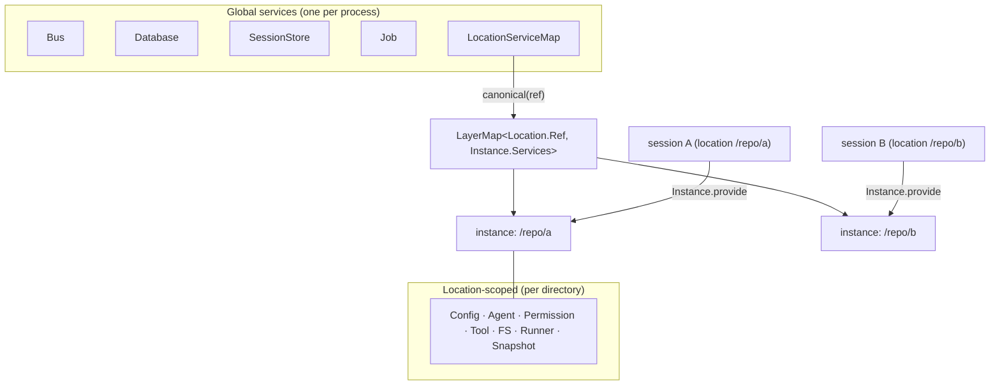
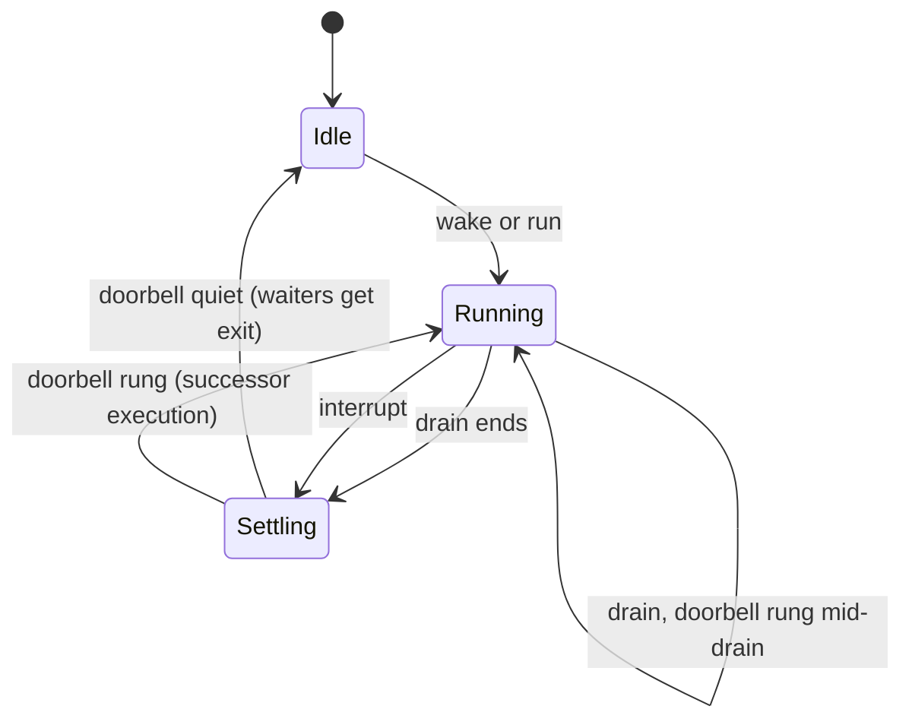
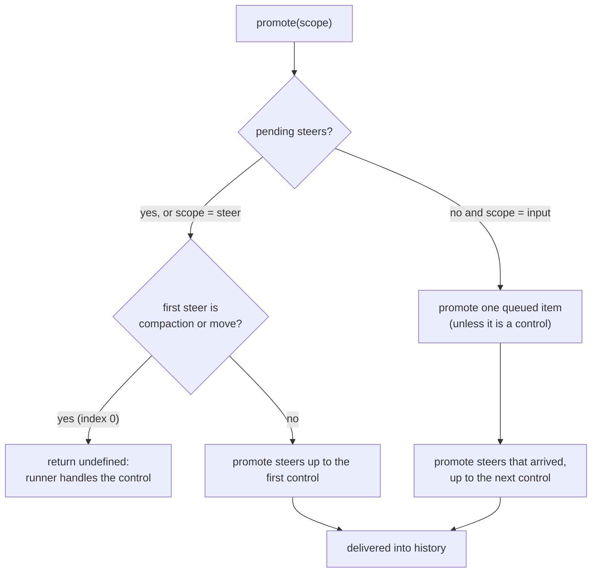
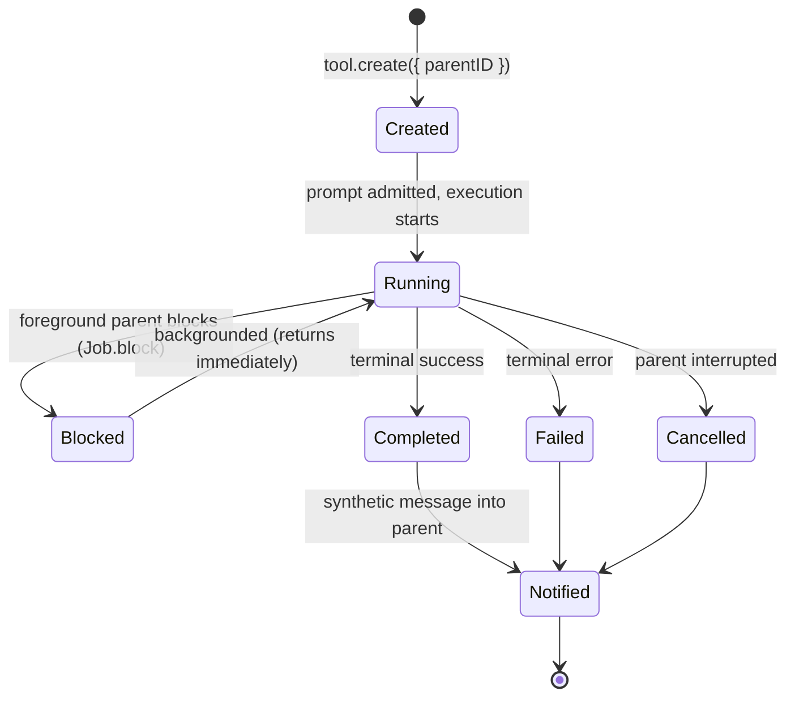
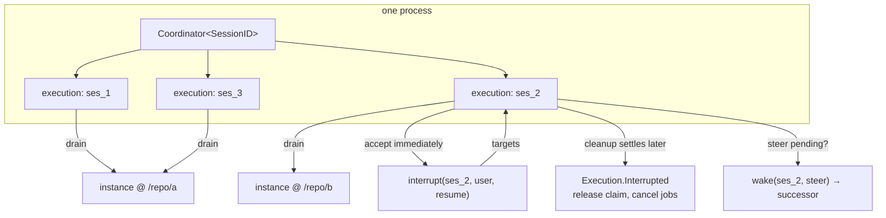

# Part 9 — Concurrency and Sessions

A coding agent is not a single conversation on a single core. Users keep several sessions
open, a session can move between directories, subagents run in child sessions, and input
arrives while a step is already streaming. All of that has to share one process without two
fibers ever driving the same session at once, and without one session's failure or
interruption touching another's. This part covers the scoping that keeps sessions isolated,
the coordinator that keeps each session serialized, the ordering rules for input that
arrives mid-flight, and the lifecycle of subagent sessions. It is where the durability from
Part 2 and the loop from Part 3 meet concurrency.

Topics:

- **9.1** Location scoping, instances, session affinity.
- **9.2** Run coordinator.
- **9.3** Steering.
- **9.4** Subagents.
- **9.5** Multi-session concurrency and interruption.

---

## 9.1 Location scoping, instances, and session affinity

### Thesis

Most agent services are built per working directory (a Location), a Session selects the
Location-scoped service graph (its instance) that runs it, and related Sessions share a
provider-affinity key so their requests route to the same cache.

### Cold open

Two projects are open in one editor. A file read in project A must use project A's config,
permissions, `.gitignore`, and filesystem — never project B's. If both sessions shared one
global tool registry and one working directory, a tool call in one project could read,
write, or get permission-checked against the other. The isolation has to be structural, not
a discipline each tool remembers to follow.

### The concept

opencode's services fall into two groups:

- **Global.** One per process: the event bus, the database, the session store, the job
  registry, and the map of Location graphs. These have no notion of a working directory.
- **Location-scoped.** One per working directory: config, agents, permissions, the tool
  registry, the filesystem, the model transport, snapshots, and — critically — the session
  runner itself. The runner is Location-scoped because a step reads and writes files.

A **Location** is identified by a `Ref`: an absolute `directory` and an optional
`workspaceID`. A **Location** service resolves that directory to a project (id, canonical
directory, VCS info).

An **instance** is one compiled copy of the Location-scoped graph standing on one Location.
Instances are built lazily and retained in a **LayerMap** keyed by the canonicalized
`Ref` — the `LocationServiceMap`. Canonicalization normalizes the path (for example on
Windows) so two spellings of the same directory are one entry. The map retains healthy
graphs indefinitely; only an explicit invalidation or a failed boot evicts one.

Routing a Session to its instance is one call: `Instance.provide(session)` looks up the
map by `session.location` and provides that graph to the effect. The runner, the tools, the
permissions — everything the step needs — come from the Session's own Location. That is
what makes two projects isolated: they resolve to different map entries with different
config and different filesystems.

Finally, **affinity**. Provider caches (prompt caching) are keyed by a routing key. A
subagent that shares its parent's context should share the parent's cache route, and a fork
should share its source's. `SessionAffinity.get` computes that key as the parent session ID,
else the fork source's ID, else the session's own ID.

Rejected alternatives: one process-wide graph (no isolation, cross-project leaks);
per-request graph rebuilds (unusable latency); keying the map by raw path (aliased paths
duplicate graphs); giving every session its own provider route (cache misses for related
work).

### Diagram

Diagram **D46** — global services, the Location→instance map, and affinity routing.



```text
  process
  ├── global: Bus · Database · SessionStore · Job · LocationServiceMap
  │
  └── LocationServiceMap (LayerMap keyed by canonical(Location.Ref))
        ├── "/repo/a" ─▶ instance { Config(A), Permission(A), Tool(A), FS(A), Runner(A) }
        │                    ▲
        │     Instance.provide(sessionA) ── sessionA.location = /repo/a
        │
        └── "/repo/b" ─▶ instance { Config(B), Permission(B), Tool(B), FS(B), Runner(B) }
                             ▲
              Instance.provide(sessionB) ── sessionB.location = /repo/b

  affinity(child) = parentID ?? fork.source ?? id   → provider cache route
```

Narration: global services are built once per process; the Location-scoped graph is built
once per working directory and cached in a map keyed by the canonical path. A session's
Location picks its instance, so the runner and every tool it uses are the ones for that
directory. Separately, related sessions share a provider-affinity key derived from the
parent or fork, so a subagent's requests ride the same provider cache route as its parent's.

### The real thing

A Location is a directory resolved to a project, and the service carries the Location
identity plus that project.

```ts
// packages/core/src/location.ts:11
export interface Interface extends Info {
  readonly vcs?: Project.Vcs
}

export class Service extends Context.Service<Service, Interface>()("@opencode/Location") {}

export const node = LayerNode.unbound(Service, tags.values.location)

const layer = (ref: Ref) =>
  Layer.effect(
    Service,
    Effect.gen(function* () {
      const project = yield* Project.Service
      const resolved = yield* project.resolve(ref.directory)
      return Service.of({
        directory: ref.directory,
        workspaceID: ref.workspaceID,
        project: { id: resolved.id, directory: resolved.directory, canonical: resolved.canonical },
        vcs: resolved.vcs,
      })
    }),
  )
```

The map is a `LayerMap`; lookups are always via the canonical key.

```ts
// packages/core/src/location-service-map.ts:9
export class Service extends Context.Service<
  Service,
  LayerMap.LayerMap<Location.Ref, Instance.Services, Instance.Error>
>()("@opencode/example/LocationServiceMap") {
  static get(ref: Location.Ref) {
    return Layer.unwrap(Effect.map(Service, (locations) => locations.get(ref)))
  }
}
```

```ts
// packages/core/src/location-service-map.ts:38
/** Normalize equivalent placements before they become resource-cache keys. */
export function canonical(ref: Location.Ref) {
  return Location.Ref.make({
    directory: AbsolutePath.make(process.platform === "win32" ? path.normalize(ref.directory) : ref.directory),
    workspaceID: ref.workspaceID,
  })
}
```

The instance binding is what routes a Session's effects to its own graph.

```ts
// packages/core/src/location-services.ts:58
      const map = {
        ...inner,
        get: (ref: Location.Ref) => inner.get(LocationServiceMap.canonical(ref)),
        …
        invalidate: (ref: Location.Ref) =>
          Effect.suspend(() => {
            const key = LocationServiceMap.canonical(ref)
            const build = Option.getOrUndefined(MutableHashMap.get(builds, key))
            MutableHashMap.remove(builds, key)
            // Detach routing first, then cancel interactions and notify clients. Running
            // steps retain their borrowed graph until they can hand off at a boundary.
            // Do not await a boot here: failed/in-flight builds have their own cleanup path.
            return inner.invalidate(key).pipe(Effect.andThen(build?.close ?? Effect.void))
          }).pipe(Effect.uninterruptible),
      }
      // Cached instances borrow their owner instead of retaining its Layer scope.
      const bindings: LayerNode.Replacements = [
        Instance.node.replace(
          Layer.succeed(Instance.Service, {
            provide: (session) => Effect.provide(map.get(session.location)),
          }),
        ),
        ...replacements,
        LocationServiceMap.node.replace(Layer.succeed(LocationServiceMap.Service, map)),
      ]
      return map
```

One instance is one compiled graph; the raw Location binding is one of its replacements.

```ts
// packages/core/src/instance.ts:147
// One instance is one compiled, fresh copy of the graph standing on a directory.
export function layer(ref: Location.Ref, options: Options = {}): Layer.Layer<Services, Error> {
  const startedAt = performance.now()
  // Ordered: vanilla defaults, then caller replacements (which win over the
  // defaults), then instance bindings (which win over everything).
  const replacements: LayerNode.Replacements = [
    ...(options.discovery === false ? vanillaReplacements : []),
    ...(options.replacements ?? []),
    Location.node.replace(Location.boundNode(ref)),
    InstancePlugins.node.replace(InstancePlugins.bound(options.plugins ?? [])),
  ]

  return LayerNode.compile(graph, { replacements, shared: Node.tags.values.global }).pipe(
```

Affinity is one line.

```ts
// packages/core/src/session/affinity.ts:6
/** The Session ID that groups model requests for provider cache routing: children share the parent's, forks the fork source's. */
export const get = (session: Pick<SessionSchema.Info, "id" | "parentID" | "fork">) =>
  session.parentID ?? session.fork?.sessionID ?? session.id
```

- What to notice:
  - `LocationServiceMap.get` is a `static` that unwraps the service into a Layer — the
    `Ref` is the key, and every caller passes through `canonical` first.
  - `Instance.provide` is the *only* thing a Session needs to name: `session.location`
    decides the whole graph.
  - `idleTimeToLive: Duration.infinity` (set at the map's construction, above) retains
    healthy graphs; the map evicts on failed boots, not on idleness.
  - `invalidate` is `uninterruptible` and detaches routing before closing the build, so a
    step that already borrowed the graph finishes on it.
  - `SessionAffinity.get` prefers `parentID`, then the fork source, then the Session's own
    ID — so children and forks cache-route together.

### The prompts

No prompts in this topic — Location scoping is structural and produces no model-facing text.

### Build it

```ts
type Ref = { directory: string; workspaceID?: string }
type Graph = { config: Config; tools: Tools; fs: FS; runner: Runner }

const instances = new Map<string, Graph>()

function provide(key: string, graph: Graph) {
  const canonical = normalize(key)                                  // e.g. case/normalize on win32
  let g = instances.get(canonical)
  if (!g) { g = buildGraph(canonical); instances.set(canonical, g) }
  return g
}

function affinity(session: { id: string; parentID?: string; fork?: { sessionID: string } }) {
  return session.parentID ?? session.fork?.sessionID ?? session.id
}
```

- Design note: make the map key canonical, not raw. Path aliases (`./a`, `/abs/a`, a
  symlink) must collapse to one graph or you get duplicate filesystem watchers and
  permission state.
- Design note: retain graphs with no idle TTL unless memory is the binding constraint;
  rebuilding a graph is expensive and rarely what you want mid-session.
- Design note: detach the map entry before closing the graph so in-flight steps finish
  against the graph they borrowed.

### How it fails

- **Global tool registry.** A tool from project A is advertised in project B and can read
  files outside B's root.
- **Raw path keys.** Two spellings of one directory create two graphs, two watchers, and
  two permission sets that drift.
- **Eager eviction.** A graph evicted between two steps loses in-memory state; the next
  step reboots the world.
- **Ignoring affinity.** Every subagent gets a fresh cache route and the parent's prompt
  cache never hits, inflating cost.

### How you'd test it

Assert isolation as a property: create two Locations with different config values, run the
same tool in each via `Instance.provide`, and assert each saw its own config. Assert that
`canonical` maps two equivalent path spellings to one map entry and that the map returns the
same instance for both. Assert that an in-flight effect that borrowed a graph completes even
after `invalidate` for that ref, and that `SessionAffinity.get` returns
`parent > fork > self` in that order.

### Recap

- Global services live once per process; Location-scoped services live once per directory.
- A Session's Location selects its instance through a canonicalized LayerMap.
- `SessionAffinity.get` is the provider cache-routing key for related sessions.

Next: the coordinator that guarantees one execution per session.

### Podcast notes

- Hook: Two projects open, and a tool read in one must never see the other's files.
- Analogy: One office building (process) with per-tenant suites (Locations) — shared
  utilities, private rooms, and a shared mail routing key for related suites.
- Talking points: Location-scoped versus global; canonical keys prevent duplicate graphs;
  `Instance.provide` is the routing seam; affinity is about provider cache, not isolation.
- Listeners will ask: Why is the runner Location-scoped instead of global?

---

## 9.2 The run coordinator

### Thesis

The run coordinator guarantees at most one execution per key at a time, uses a doorbell to
close the race between a drain deciding it is idle and new work arriving, and lets different
keys run concurrently.

### Cold open

A step is streaming. The user hits enter with a follow-up. The follow-up is durably
admitted, so some fiber must notice it and drain — but there is already a fiber draining
this session. If both loop, two model calls run against the same history and interleave
writes. If the running loop finishes and exits, it might return to idle *just before*
the follow-up was written and miss it entirely.

### The concept

An **execution** is one busy period for a key: a single fiber that drains repeatedly from
the first wake until the key would stay idle. It coalesces many steps and many drains —
a follow-up prompt does not start a second execution, it *rings the doorbell* of the running
one.

The coordinator's job is the small but sharp contract:

- **One execution per key.** `run` starts an execution if idle or joins the active one.
  Different keys never block each other.
- **The doorbell.** The execution struct carries a `pendingWake` field (a scope: `input` or
  `steer`). When work is recorded during an execution, `wake` sets `pendingWake` instead of
  starting a second fiber. After each drain, the loop checks `pendingWake`; if set, it takes
  that scope, clears it, and drains again. This closes the gap between "the drain's last
  eligibility check said there was nothing" and "the session goes idle," which cannot be one
  atomic step.
- **Coalesced scope.** Wakes carry the widest scope needed. If one wake needs `input` and
  another `steer`, the runner sees `input` (which subsumes `steer`), so it never narrows the
  work it is allowed to promote.
- **Successors.** If a wake lands *after* the loop decided to end — or during failure or
  interruption cleanup — `settle` starts a fresh execution for the remaining work. This is
  why a wake is never lost even when it races the idle transition.
- **Joiners.** Every execution carries a `done` deferred; `run` and `isActive` waiters
  resolve with that execution's exit. `awaitIdle` follows successors too.

The coordinator is generic over a key; for sessions the key is the Session ID, and
`SessionExecution` wires the generic coordinator to the runner.

Rejected alternatives: a global lock (needless cross-session serialization); no doorbell
(drop wakes that race the idle transition); a queue of pending work re-read from a database
on every loop (works, but the doorbell is cheaper and the durable inbox already exists);
starting a second fiber per wake (concurrent drains).

### Diagram

Diagram **D5** — the run coordinator: execution, doorbell, successor, and interrupt.

The coordinator's own source comment is the diagram; it is reproduced verbatim.

```text
// packages/core/src/session/run-coordinator.ts:51
 *              wake | run
 *      idle ──────────────▶ execution (one fiber)
 *                             drain ⟲ doorbell rung mid-drain
 *                             │ exit (settled hook runs)
 *      doorbell quiet ◀───────┴───────▶ doorbell rung
 *      idle, waiters get exit          successor execution,
 *                                      waiters get this exit
```



Narration: a key starts idle. A wake or a run starts one execution fiber. Inside the
execution, a drain runs; if work arrives while it runs, the doorbell is rung and the loop
drains again instead of ending. When the drain finally ends, if the doorbell is quiet the
key goes idle and any waiters get the execution's exit; if the doorbell was rung, a successor
execution starts and the waiters still get this exit. An interrupt moves a running execution
into settling, which follows the same quiet-or-sound doorbell rule.

### The real thing

The execution struct and its documentation are the best statement of the design.

```ts
// packages/core/src/session/run-coordinator.ts:32
/**
 * One execution is a busy period for one key: one fiber that drains from the first wake
 * until the key would stay idle. `pendingWake` is the doorbell: work recorded during the
 * execution rings it with the scope that work needs, and the execution loop drains again
 * instead of ending. The doorbell closes the gap between a drain's last eligibility check
 * and the idle transition, since those cannot be one atomic step. `done` resolves joiners
 * with this execution's exit.
 */
type Execution<E, Reason> = {
  readonly done: Deferred.Deferred<void, E>
  owner?: Fiber.Fiber<void>
  scope: Promotable
  pendingWake?: Promotable
  stopping: boolean
  interruptionReason?: Reason
}
```

The loop drains, then re-drains if the doorbell rang.

```ts
// packages/core/src/session/run-coordinator.ts:74
    const loop = (key: Key, execution: Execution<E, Reason>, force: boolean): Effect.Effect<void, E> =>
      Effect.suspend(() => options.drain(key, force, execution.scope)).pipe(
        Effect.andThen(
          Effect.suspend(() => {
            if (execution.stopping || execution.pendingWake === undefined) return Effect.void
            execution.scope = execution.pendingWake
            execution.pendingWake = undefined
            // Trampoline so drains that complete synchronously cannot grow the stack.
            return Effect.yieldNow.pipe(Effect.andThen(loop(key, execution, false)))
          }),
        ),
      )
```

Starting an execution, and settling it into either idle or a successor.

```ts
// packages/core/src/session/run-coordinator.ts:87
    const start = (key: Key, force: boolean, scope: Promotable) => {
      const execution: Execution<E, Reason> = {
        done: Deferred.makeUnsafe<void, E>(),
        scope,
        stopping: false,
      }
      executions.set(key, execution)
      // The leading yield lets `owner` be assigned before the drain can settle, and keeps
      // failing self-waking executions from growing the stack across successor starts.
      // Drains start one tick after wake; callers observe progress through events or run.
      execution.owner = fork(
        Effect.yieldNow.pipe(
          Effect.andThen(Effect.uninterruptible(options.started?.(key) ?? Effect.void)),
          Effect.andThen(loop(key, execution, force)),
          Effect.onExit((exit) =>
            Effect.sync(() => {
              execution.owner = undefined
            }).pipe(Effect.andThen(options.settled?.(key, exit, execution.interruptionReason) ?? Effect.void)),
          ),
          Effect.onExit((exit) => Effect.sync(() => settle(key, execution, exit))),
          Effect.exit,
          Effect.asVoid,
        ),
      )
      return execution
    }

    // A doorbell that survives the execution loop (rung after the loop decided to end, or
    // during failure or interruption cleanup) starts a fresh execution for the remaining work.
    const settle = (key: Key, execution: Execution<E, Reason>, exit: Exit.Exit<void, E>) => {
      if (execution.pendingWake) start(key, false, execution.pendingWake)
      else executions.delete(key)
      Deferred.doneUnsafe(execution.done, exit)
    }
```

`run` joins or starts; `wake` coalesces to the widest scope.

```ts
// packages/core/src/session/run-coordinator.ts:124
    const run = (key: Key): Effect.Effect<void, E> =>
      Effect.suspend(() => {
        const execution = executions.get(key)
        if (execution !== undefined) {
          // A stopping execution refuses joiners: wait out its cleanup, then run fresh.
          if (execution.stopping)
            return Deferred.await(execution.done).pipe(Effect.ignoreCause, Effect.andThen(run(key)))
          return Deferred.await(execution.done)
        }
        return Deferred.await(start(key, true, "input").done)
      })

    const wake = (key: Key, scope: Promotable = "input") =>
      Effect.sync(() => {
        const execution = executions.get(key)
        if (execution !== undefined) {
          // Coalesced wakes keep the widest scope: "input" subsumes "steer".
          execution.pendingWake = execution.pendingWake === "input" ? "input" : scope
          return
        }
        start(key, false, scope)
      })
```

Session execution wires the generic coordinator to Session lifecycle events: `started`
writes the claim, `drain` calls the runner, and `settled` writes the terminal.

```ts
// packages/core/src/session/execution.ts:111
    const coordinator = yield* SessionRunCoordinator.make<SessionSchema.ID, SessionRunner.RunError, InterruptReason>({
      started: (sessionID) =>
        reportLifecycle(
          sessionID,
          bus.publish(SessionEvent.Execution.Started, { sessionID }, claimOnCommit(sessionID)),
        ),
      drain: (sessionID, force, promotable) => drain(sessionID, force, undefined, promotable),
      // One terminal observation per busy period, covering every coalesced drain.
      settled: (sessionID, exit, reason) =>
        reportLifecycle(
          sessionID,
          Effect.gen(function* () {
            const outcome = terminal(exit, reason)
            if (outcome.type === "succeeded") {
              yield* bus.publish(SessionEvent.Execution.Succeeded, { sessionID }, releaseOnCommit(sessionID))
              return
            }
            …
```

- What to notice:
  - The `Execution` struct is tiny: a `done` deferred, an optional owner fiber, a scope, a
    doorbell, and two flags. All the behavior lives in the four functions around it.
  - The leading `Effect.yieldNow` in `start` exists so `owner` is assigned before the drain
    can settle, and so a self-waking failing execution cannot grow the stack across
    successors.
  - `settled` runs in the execution fiber *after* the final drain and *before* `done`
    resolves, so waiters observe a fully settled execution.
  - `run` on a `stopping` execution ignores its cause and starts fresh afterward — a
    stopping execution refuses joiners.
  - `drain`, `started`, and `settled` are injected, which is why the coordinator is reusable
    and why Session execution reads as policy, not plumbing.

### The prompts

No prompts in this topic — the coordinator schedules work; it produces no model-facing text.

### Build it

```ts
type Execution<E> = { done: Promise<void>; owner?: Fiber; scope: Scope; ringing?: Scope; stopping: boolean }

class Coordinator<E> {
  private executions = new Map<string, Execution<E>>()

  wake(key: string, scope: Scope = "input") {
    const e = this.executions.get(key)
    if (!e) return this.start(key, false, scope)
    e.ringing = e.ringing === "input" ? "input" : scope      // widest scope wins
  }

  private start(key: string, force: boolean, scope: Scope) {
    const e: Execution<E> = { done: makePromise(), scope, stopping: false }
    this.executions.set(key, e)
    e.owner = fork(async () => {
      await this.started?.(key)
      try {
        do { await this.drain(key, force, e.scope); force = false } while (e.ringing && !e.stopping && (e.scope = takeRing(e)))
      } finally { e.owner = undefined; await this.settled?.(key) }
    }).then(() => this.settle(key, e))
    return e
  }

  private settle(key: string, e: Execution<E>) {
    if (e.ringing) this.start(key, false, e.ringing)   // successor
    else this.executions.delete(key)
    e.done.resolve()
  }
}
```

- The doorbell is a single field, not a queue. Because the scope is monotonic (`input`
  subsumes `steer`), one field is enough to represent any pending wake.
- Design note: resolve `done` *after* the successor is started and `settled` ran, or
  `awaitIdle` can return while a successor is about to begin.
- Design note: `awaitIdle` must re-check after `done`, because a successor means the key is
  not yet idle.

### How it fails

- **No doorbell.** A prompt admitted microseconds before the loop exits is never drained;
  the session sits idle with pending input.
- **Second fiber per wake.** Two drains interleave and corrupt the history.
- **Narrowing the scope on coalesce.** A `steer` wake overwrites an `input` wake and the
  runner refuses to promote a queued prompt that was legitimately ready.
- **Resolving `done` before settling.** `awaitIdle` returns early; a caller that then reads
  the session sees a half-written terminal.
- **Following successors forever.** `awaitIdle` on a session that keeps re-waking never
  returns; that is usually correct, but a caller that assumed "one execution" is surprised.

### How you'd test it

Assert the contract with a counted drain: wake a key, have `drain` block on a signal, and
assert that a second `wake` during the drain does not start a second execution (the drain
counter is one until the first drain completes, then two). Assert a wake delivered *after*
`drain` returns but before `settle` produces a successor and that `awaitIdle` does not
resolve until the successor is done. Assert two different keys drain concurrently. Use a
real coordinator and a fake `drain`/`settled`; do not reimplement the loop.

### Recap

- One execution per key; different keys run concurrently.
- The doorbell is a single field that closes the idle-transition race.
- A surviving doorbell starts a successor, and `awaitIdle` follows successors.

Next: the ordering rules for the input that rings the doorbell.

### Podcast notes

- Hook: A follow-up prompt arrived a microsecond after the loop checked for work and
  decided to stop.
- Analogy: A shop bell — the clerk checks the door, hears the bell mid-sweep, and serves
  the customer instead of closing.
- Talking points: An execution is a busy period, not a request; the doorbell is one field;
  widen, never narrow, the coalesced scope; a late ring becomes a successor.
- Listeners will ask: Why is one field enough instead of a wake queue?

---

## 9.3 Steering: steer versus queue and promotion order

### Thesis

Promotion follows fixed ordering invariants: steers influence the run in progress, queued
prompts start new work only at the idle boundary, compaction precedes the steers it would
summarize, and nothing is promoted across a move.

### Cold open

The model is three steps into a long task. The user types "actually, use the staging
database". That correction must reach the model at the very next safe step boundary, not
after the task finishes. Meanwhile, a compaction was queued between two steers: if the
compaction is applied first it will summarize the second steer's text into a lossy summary
instead of leaving it verbatim. And if a `move` sits between them, promotion must stop at
the move — the two sides live in different Locations.

### The concept

Input is admitted durably, then **delivered** into visible history by **promotion**. Each
inbox item has a **delivery** mode:

- **Steer** — influence work already in progress. Promoted at the next safe step boundary.
- **Queue** — start new work. Promoted only when the Session would otherwise go idle.

Promotion is scoped. A `Promotable` value of `"steer"` means "this boundary may promote
steers only"; `"input"` means "steers, or exactly one queued item if no steers are waiting."
Steering is the default for a normal prompt.

Ordering is where the interesting rules live, and they are all in one function:

1. **Steers first.** If any steers are pending, they are promoted before any queued item.
2. **Compaction has priority, but only locally.** Among pending steers, a compaction is
   moved to the front so that it summarizes the history *before* the later steers — those
   steers' text then stays verbatim after the checkpoint rather than being buried inside the
   summary.
3. **A control at the boundary blocks promotion.** If the *first* pending steer is a
   control item (compaction or move), promotion returns "nothing promoted" and the runner
   must handle the control first. This is how a control "owns" the boundary.
4. **Never across a move.** A `move` changes the Session's Location; the context changes
   wholesale. Promotion stops at a move and never pulls a compaction or a steer from the
   other side of it.
5. **One queued item at idle.** At an `input` boundary with no steers, exactly one queued
   item is promoted; then any steers that arrived while it was being promoted are promoted
   up to the next control.

A **move** is itself a context switch. It is delivered like a control: the item is consumed
and a `Moved` event is published, the drain returns `Moved`, and the coordinator's drain
loop recurses to pick up the new Location's instance. The interruption and relocation happen
at a safe boundary, so an in-flight step finishes against the graph it borrowed.

Rejected alternatives: promote everything at once (a queued prompt would hijack a running
step); summarize after promoting steers (their text gets summarized away); allow a
compaction to cross a move (summarizing files from a different Location); reorder freely
(breaks the enqueue order users rely on).

### Diagram

Diagram **D47** — promotion ordering, the compaction-ahead-of-steers rule, and the move boundary.



```text
  promote(scope)
    │
    ├─ steers pending (or scope=steer)?
    │      first steer a control (compaction/move)?
    │         yes ─▶ promote nothing; runner handles the control first
    │         no  ─▶ promote steers up to the first control
    │
    └─ no steers and scope=input?
           promote exactly ONE queued item (unless it is a control)
           then promote steers that arrived, up to the next control

  compaction  ── moved ahead of earlier steers (never across a move)
  move        ── boundary: nothing is promoted across it; drain returns Moved
```

Narration: promotion reads the pending input in enqueue order and applies four rules. If any
steers are waiting, they go first, but a control item at the front blocks promotion so the
runner can handle it, and a compaction among steers is moved to the front so the later
steers survive verbatim. If no steers are waiting and this is an idle boundary, exactly one
queued item is promoted, followed by any steers that arrived meanwhile. A move is a hard
boundary: nothing is promoted across it, and the drain hands off to the new Location.

### The real thing

The scope type and its definition.

```ts
// packages/core/src/session/inbox.ts:43
/**
 * Which pending input `promote` may consume: "steer" promotes steers only (a step
 * boundary mid-work), while "input" also allows one queued input when no steers are
 * waiting (the idle boundary, where the Session picks up fresh work).
 */
export type Promotable = "input" | "steer"
```

The promotion function, with the controls-first and one-queued rules.

```ts
// packages/core/src/session/inbox.ts:490
/**
 * Promotes pending input into visible messages and returns the promoted count,
 * or undefined when the runner must first handle a pending control.
 * Steered compaction takes priority over pending prompts, without crossing a move.
 * Only the "input" scope may fall through to one queued input.
 */
export const promote = Effect.fn("SessionInbox.promote")(function* (
  db: DatabaseService,
  bus: Bus.Interface,
  sessionID: SessionSchema.ID,
  scope: Promotable,
) {
  return yield* serialized(
    sessionID,
    Effect.gen(function* () {
      const steers = yield* pendingSteers(db, sessionID)
      if (steers.length > 0 || scope === "steer") {
        const control = steers.findIndex((row) => row.type === "compaction" || row.type === "move")
        if (control === 0) return undefined
        return yield* publish(db, bus, sessionID, control === -1 ? steers : steers.slice(0, control))
      }

      const queued = yield* db
        .select()
        .from(SessionInboxTable)
        .where(and(eq(SessionInboxTable.session_id, sessionID), eq(SessionInboxTable.delivery, "queue")))
        .orderBy(asc(SessionInboxTable.enqueued_seq))
        .limit(1)
        .get()
        .pipe(Effect.orDie)
      if (!queued) return 0
      if (queued.type === "compaction" || queued.type === "move") return undefined
      const promoted = yield* publish(db, bus, sessionID, [queued])
      const arrivedSteers = yield* pendingSteers(db, sessionID)
      const control = arrivedSteers.findIndex((row) => row.type === "compaction" || row.type === "move")
      return (
        promoted +
        (yield* publish(db, bus, sessionID, control === -1 ? arrivedSteers : arrivedSteers.slice(0, control)))
      )
    }),
  )
})
```

The compaction-ahead-of-steers reorder, and its move boundary.

```ts
// packages/core/src/session/inbox.ts:533
const pendingSteers = (db: DatabaseService, sessionID: SessionSchema.ID) =>
  db
    .select()
    .from(SessionInboxTable)
    .where(and(eq(SessionInboxTable.session_id, sessionID), eq(SessionInboxTable.delivery, "steer")))
    .orderBy(asc(SessionInboxTable.enqueued_seq))
    .all()
    .pipe(
      Effect.orDie,
      Effect.map((rows) => {
        // A move changes the context's Location: never pull compaction across it.
        // Within that boundary, compact before promoting even earlier steers so
        // their text stays verbatim after the checkpoint, not inside its summary.
        const control = rows.findIndex((row) => row.type === "compaction" || row.type === "move")
        if (control > 0 && rows[control].type === "compaction") rows.unshift(...rows.splice(control, 1))
        return rows
      }),
    )
```

The move boundary is acted on in the runner's step-advance loop: delivering a move closes
the transport and publishes `Moved`, then the drain returns `Moved`.

```ts
// packages/core/src/session/runner/llm.ts:96
                  if (next?.type === "move")
                    yield* restore(
                      Effect.gen(function* () {
                        yield* modelTransport.close(sessionID)
                        yield* bus.publishAll([
                          [SessionEvent.InboxDelivered, { sessionID, inboxID: next.id }],
                          [SessionEvent.Moved, { sessionID, ...next.payload }],
                        ])
                      }),
                    )
```

- What to notice:
  - `promote` runs inside `serialized(sessionID, …)`, a per-session mutex, so promotion and
    admission do not interleave.
  - The control check is `findIndex`; `control === 0` means the control owns the boundary and
    `undefined` is returned as a signal, not an error.
  - `pendingSteers` reorders only when the control is a *compaction and not the first row*;
    a `move` is left in place, which is the "never across a move" rule.
  - The `"steer"` scope never falls through to the queued branch, so a steer-scoped drain
    (used after an interrupt) cannot start new work.
  - A move closes the model transport before publishing `Moved`, so the new Location's
    transport is built fresh.

### The prompts

No prompts in this topic — steering is an ordering problem over durable inbox items. The
synthetic notices that continuations use are in §8.4.

### Build it

```ts
type Item = { id: string; delivery: "steer" | "queue"; control: boolean }

function promote(items: Item[], scope: "input" | "steer"): Item[] | undefined {
  const steers = reorderSteers(items.filter((i) => i.delivery === "steer"))
  if (steers.length > 0 || scope === "steer") {
    const control = steers.findIndex((i) => i.control)
    if (control === 0) return undefined            // runner must handle the control
    return control === -1 ? steers : steers.slice(0, control)
  }
  const queued = items.find((i) => i.delivery === "queue")
  if (!queued) return []
  if (queued.control) return undefined
  return [queued, ...reorderSteers(items.filter((i) => i.delivery === "steer")).slice(0, firstControl)]
}

function reorderSteers(steers: Item[]): Item[] {
  const control = steers.findIndex((i) => i.control && i.type === "compaction")  // never across a move
  if (control > 0) steers.unshift(...steers.splice(control, 1))
  return steers
}
```

- Design note: represent "the runner must handle a control" as a distinct return
  (`undefined`), not as an empty promotion. The two mean different things.
- Design note: the compaction reorder is a *local* move within the contiguous run of
  steers, stopped by a move. Do not sort globally.
- Design note: take at most one queued item per idle boundary. Batching queued prompts
  changes the model's context shape and surprises users.

### How it fails

- **Queued prompt hijacks a running step.** A long task is interrupted by unrelated queued
  work because promotion allowed `input` scope mid-drain.
- **Compaction after steers.** The later steer's text is summarized away and the model never
  sees it verbatim.
- **Compaction pulled across a move.** The summary mixes files from two Locations.
- **Promoting past a control.** The compaction or move marker is skipped; the checkpoint is
  not applied, or the Location switch never happens.

### How you'd test it

Seed an inbox with a mix — a compaction, two steers, a move, and a queued prompt — and
assert the exact promotion set for each scope and ordering. Specifically: with a compaction
between two steers, assert the compaction promotes first and both steers follow; with a move
between them, assert promotion stops at the move; with `scope:"steer"` and only a queued
prompt, assert nothing is promoted; with `scope:"input"` and no steers, assert exactly one
queued item. Use the real `promote` against a real database.

### Recap

- Steer influences the running turn; queue starts new work at idle.
- Promotion is ordered: steers first, compaction ahead of steers it would summarize, one
  queued item at idle, never across a move.
- A move is a boundary that hands the session to a new Location's instance.

Next: sessions whose whole purpose is to run other sessions.

### Podcast notes

- Hook: The user's mid-task correction arrived, but the compaction summarized it away before
  the model could see it.
- Analogy: Traffic merging — on-ramp cars (steers) join now, parked cars (queued) wait for a
  gap, and a closed lane (move) is never crossed.
- Talking points: Delivery mode decides *when*; promotion order decides *what*; compaction
  moves ahead of steers only within a move's boundary; one queued item per idle.
- Listeners will ask: Why not just process input in the order it arrived?

---

## 9.4 Subagents

### Thesis

A subagent is a child Session executed independently on the same machine, with a depth
limit, inherited model and agent context, a foreground/background job lifecycle, a
completion notification back to the parent, and its own permission check.

### Cold open

An agent is asked to refactor a large codebase. It decides to spawn a helper. The helper
decides to spawn a helper, which spawns a helper. Nothing stops the recursion until the
process exhausts memory or the user's budget. A subagent mechanism without a depth limit is
a fork bomb with extra steps.

### The concept

A subagent is just a Session with a `parentID`, run by the same execution machinery as any
other session. The `subagent` tool creates or continues that child session and decides how
the parent waits for it. The design points:

- **Child session.** `sessions.create({ parentID, agent, model })`. Continuing an existing
  child requires it to be a child of the calling session.
- **Depth limit.** Before creating, the tool walks the `parentID` chain and counts depth.
  The limit is `experimental.subagent_depth`, default 1. This is the anti-recursion guard.
- **Model and agent inheritance.** The child's model is, in order, an explicit `model`
  argument, else the chosen agent's configured model, else the parent's model. Continuing a
  child with a different agent switches the child's agent (and its model, if the agent
  changed and no explicit model was given).
- **Foreground versus background.** Foreground (the default) blocks the parent on the child
  and returns the child's final text. Background registers a durable job and returns
  immediately with an instruction to keep working on something else.
- **Completion notification.** When a subagent finishes, a job observer admits a synthetic
  message into the *parent* session describing the child's outcome, tagged with the child
  session ID. A background parent is woken to read it; a parent that is itself suspended
  gets the notice admitted without a wake.
- **Permission per subagent.** Spawning is gated: `permission.assert({ action: "subagent",
  resources: [agent.id] })`, so a ruleset can allow or deny specific subagent types.

The **job** is the abstraction that makes foreground and background share one lifecycle.
`Job.start` registers a scoped, process-local job with a `done` deferred. `Job.block` races
"finished" against "backgrounded": a foreground caller that is later told to background the
work stops blocking without cancelling the child. `Job.background` converts a running job to
background and creates its durable notification marker. `Job.pendingBackground` and
`Job.completeBackground` are how the restart sweep (8.4) finds and acknowledges orphaned
background work.

Rejected alternatives: unbounded recursion (fork bomb); separate execution machinery for
children (duplicate concurrency bugs); no inheritance (every child reconfigured by hand);
fire-and-forget background work with no notification (the parent never learns the result);
synchronous-only (blocks the parent for the whole sub-task).

### Diagram

Diagram **D11** — the subagent lifecycle and its job.



```text
  parent tool call "subagent"
        │
        ├─ depth = walk(parentID chain)  ── depth ≥ limit? ──▶ ToolFailure
        ├─ permission.assert(action=subagent, resource=agent.id)
        ├─ model = explicit ?? agent.model ?? parent.model
        ├─ create or continue child session (parentID = caller)
        ├─ prompt child  (background ⇒ resume:false)
        └─ Job.start(child)
              │
        background? ── yes ──▶ return immediately, notify on finish
              │ no
        Job.block(child): races finished vs backgrounded
              │
        finished ──▶ return child's final text
        backgrounded ──▶ register observer, return immediately

  on finish: synthetic "<subagent … state=…>" admitted into the parent
```

Narration: a parent tool call first measures how deep the conversation already nests and
refuses if the depth limit is reached, then checks permission for the chosen agent, resolves
the child's model by inheritance, and creates or continues the child session. It starts a
job. In background mode the parent returns immediately and an observer will notify it when
the child finishes; in foreground mode the parent blocks on the job, which races completion
against being backgrounded. On completion the child's outcome is admitted into the parent as
a synthetic message.

### The real thing

The depth guard walks the parent chain.

```ts
// packages/core/src/tool/plugin/subagent.ts:117
              let current = parent
              let depth = 0
              while (current.parentID) {
                depth++
                current = yield* sessions
                  .get(current.parentID)
                  .pipe(
                    Effect.mapError(
                      (error) => new ToolFailure({ message: `Parent session not found: ${current.parentID}`, error }),
                    ),
                  )
              }
              const limit = Config.latest(yield* config.entries(), "experimental")?.subagent_depth ?? 1
              if (depth >= limit)
                return yield* new ToolFailure({
                  message: `Subagent depth limit reached (${limit}). Increase "experimental.subagent_depth" to allow nested subagents.`,
                })
```

Permission, model resolution, and child creation.

```ts
// packages/core/src/tool/plugin/subagent.ts:138
              yield* permission
                .assert({
                  action: name,
                  resources: [agent.id],
                  save: [agent.id],
                  sessionID: context.sessionID,
                  agent: context.agent,
                  source: {
                    type: "tool",
                    messageID: context.messageID,
                    id: context.id,
                  },
                })
                .pipe(Effect.mapError((error) => new ToolFailure({ message: `Subagent denied: ${agent.id}`, error })))
```

```ts
// packages/core/src/tool/plugin/subagent.ts:184
              const model = override ?? agent.model ?? parent.model
              const child =
                existing ??
                (yield* sessions
                  .create({
                    parentID: context.sessionID,
                    title: input.description,
                    agent: Agent.ID.make(input.agent),
                    model,
                  })
                  .pipe(
                    Effect.mapError(
                      (error) => new ToolFailure({ message: `Parent session not found: ${context.sessionID}`, error }),
                    ),
                  ))
```

The prompt admission and the foreground/background split.

```ts
// packages/core/src/tool/plugin/subagent.ts:200
              const background = input.background === true
              yield* context.progress({ sessionID: child.id, status: "running" })

              // Standard prompt admission outside the job: Job.start joining a running child skips
              // its run effect, and the default wake starts an idle child or steers a running one.
              yield* sessions
                .prompt({
                  sessionID: child.id,
                  text:
                    existing === undefined
                      ? ["You are a subagent spawned by another session.", input.prompt].join("\n")
                      : input.prompt,
                  ...(background && existing === undefined ? { resume: false } : {}),
                })
                …
              const recovery = {
                kind: "subagent" as const,
                parentSessionID: context.sessionID,
                childSessionID: child.id,
                agent: agent.name,
                description: input.description,
              }
              yield* subagents.start(recovery)

              if (background) {
                yield* subagents.background(recovery)
                return backgroundResult(child.id)
              }

              const result = yield* jobs.block({ id: child.id, sessionID: context.sessionID }).pipe(
                Effect.onInterrupt(() =>
                  Effect.all([sessions.interrupt(child.id), jobs.cancel(child.id)], {
                    discard: true,
                  }),
                ),
              )
```

The job that runs the child and the observer that notifies the parent.

```ts
// packages/core/src/session/subagent-job.ts:44
  return Service.of({
    start: (recovery: Recovery) =>
      jobs
        .start({
          id: recovery.childSessionID,
          type: "subagent",
          title: recovery.description,
          metadata: {},
          recovery,
          run: Effect.gen(function* () {
            yield* sessions.resume(recovery.childSessionID)
            const messages = yield* sessions.messages({ sessionID: recovery.childSessionID, order: "desc", limit: 20 })
            const assistant = messages.find(
              (message) =>
                message.type === "assistant" && message.time.completed !== undefined && message.error === undefined,
            )
            return SubagentCompletion.text(assistant)
          }),
        })
        .pipe(Effect.setContext(context)),
```

```ts
// packages/core/src/session/subagent-completion.ts:21
export const deliver = Effect.fnUntraced(function* (
  sessions: Pick<Session.Interface, "synthetic">,
  jobs: Pick<Job.Interface, "completeBackground">,
  input: Pick<Job.Info, "status" | "output" | "error" | "notificationID"> & {
    recovery: Extract<Job.Recovery, { kind: "subagent" }>
    resume?: boolean
  },
) {
  if (input.status === "running") return
  const recovery = input.recovery
  const text =
    input.status === "completed"
      ? (input.output ?? NO_TEXT)
      : input.status === "error"
        ? (input.error ?? "Subagent failed")
        : "Subagent cancelled"
  yield* sessions.synthetic({
    ...(input.notificationID ? { id: input.notificationID } : {}),
    sessionID: recovery.parentSessionID,
    ...(input.resume === false ? { resume: false } : {}),
    description: recovery.description,
    text: `<subagent sessionID="${recovery.childSessionID}" state="${input.status}" description="${recovery.description}">\n${text}\n</subagent>`,
    metadata: { source: "subagent", childID: recovery.childSessionID, agent: recovery.agent, state: input.status },
  })
  if (input.notificationID) yield* jobs.completeBackground(input.notificationID)
})
```

The job registry's `block` is the foreground wait.

```ts
// packages/core/src/job.ts:328
  const block: Interface["block"] = Effect.fnUntraced(function* (input) {
    const result = yield* SynchronizedRef.modify(state.jobs, (jobs): readonly [BlockStart, Map<string, Active>] => {
      const job = jobs.get(input.id)
      if (!job) return [{ type: "missing" }, jobs]
      if (job.info.status !== "running") return [{ type: "finished", info: snapshot(job), generation: job.scope }, jobs]
      if (job.isBackgrounded) return [{ type: "backgrounded", info: snapshot(job) }, jobs]
      return [
        { type: "wait", wait: { done: job.done, backgrounded: job.backgrounded, generation: job.scope } },
        new Map(jobs).set(input.id, {
          ...job,
          blockingSessions: incrementSession(job.blockingSessions, input.sessionID),
        }),
      ]
    })
    …
    return yield* Effect.raceFirst(
      Deferred.await(result.wait.done).pipe(Effect.map((info) => ({ type: "finished" as const, info }))),
      Deferred.await(result.wait.backgrounded).pipe(Effect.map((info) => ({ type: "backgrounded" as const, info }))),
    ).pipe(
      Effect.tap((outcome) => (outcome.type === "finished" ? consume(input.id, result.wait.generation) : Effect.void)),
      Effect.ensuring(removeBlock(input)),
    )
  })
```

- What to notice:
  - The depth check is on the *parent chain length*, not a global counter, so depth is a
    property of a conversation, and children of different conversations are independent.
  - `experimental.subagent_depth ?? 1` defaults to one level: a subagent may not itself
    spawn a subagent unless the user raises the limit.
  - Model inheritance is `explicit > agent.model > parent.model`; the same order decides
    whether switching the child's agent also switches its model.
  - The completion notice is a `synthetic` inbox item with `metadata.source: "subagent"`, so
    it is durable and replays; `resume: false` lets a suspended parent store the notice
    without waking.
  - `Job.block` races `done` against `backgrounded`, which is how a foreground wait can be
    released without cancelling the child.
  - `SubagentCompletion.deliver` ends with `jobs.completeBackground`, clearing the durable
    notification marker exactly once.

### The prompts

The subagent tool's model-facing surface is a designed set.

The tool description (`packages/core/src/tool/plugin/subagent.ts:55`):

```text
Spawns an agent in a child session to work on the specified task.
The output includes a sessionID you can pass back later to continue that specific conversation with the subagent.
New child sessions start with fresh context, so include all relevant context and instructions when you don't pass a sessionID.
Foreground (default) runs the subagent to completion and returns its final response.
Background mode (background=true) launches it asynchronously and returns immediately; you are notified when it finishes.
Use background only for independent work that can run while you continue elsewhere.
```

The first line injected into a fresh child (`subagent.ts:210`): `You are a subagent spawned by another session.` It re-tells the child its role, because a fresh child session has none of the parent's framing. The background return text (`subagent.ts:19`) is the strongest prompt here; it exists to stop a known failure mode:

```ts
// packages/core/src/tool/plugin/subagent.ts:22
  output: [
    `The subagent is working in the background (sessionID: ${sessionID}). You will be notified automatically when it finishes.`,
    "DO NOT sleep, poll for progress, ask the subagent for status, or duplicate this subagent's work; avoid working with the same files or topics it is using.",
    "Work on non-overlapping tasks, or briefly tell the user what you launched and end your response.",
  ].join("\n"),
```

Joined with newlines, that is what the parent model reads: the subagent's session ID, an
explicit prohibition on polling, and a fallback action. Without it, models poll, sleep, or
race the subagent on the same files. Finally, the catalog of available subagents is appended
to the tool description per request (`subagent.ts:297`):

```ts
// packages/core/src/tool/plugin/subagent.ts:297
        tool.description = [
          tool.description,
          "",
          "Available subagents:",
          ...available.map(
            (agent) =>
              `- ${agent.id}: ${agent.description ?? "This subagent should only be called when explicitly requested."}`,
          ),
        ].join("\n")
```

The catalog is filtered to non-primary, non-hidden agents the current agent is permitted to
run, so the model cannot even name a forbidden subagent.

### Build it

```ts
async function subagent(parent: Session, input: { agent: string; prompt: string; model?: string; background?: boolean }) {
  const depth = await countAncestors(parent)
  if (depth >= SUBAGENT_DEPTH) throw new ToolFailure(`Subagent depth limit reached (${SUBAGENT_DEPTH}).`)
  await permission.assert({ action: "subagent", resource: input.agent })
  const agent = resolveAgent(input.agent)
  const model = input.model ?? agent.model ?? parent.model
  const child = await createSession({ parentID: parent.id, agent, model })
  await child.prompt([`You are a subagent spawned by another session.`, input.prompt].join("\n"))
  const job = await jobs.start(child.id)
  if (input.background) { await jobs.background(child.id); return workingInBackground(child.id) }
  const result = await jobs.block(child.id)             // races finished vs backgrounded
  return result.info.status === "error"
    ? new ToolFailure(`Subagent failed (sessionID: ${child.id}): ${result.info.error}`)
    : { sessionID: child.id, status: "completed", output: result.info.output }
}
```

- Design note: bound recursion with a *depth* limit, not a count limit. Depth expresses the
  user's intent ("one level of delegation") and is trivial to check.
- Design note: inherit the parent's model as the last resort; a subagent that silently uses
  a different model than the parent is a support nightmare.
- Design note: return the child session ID even on failure so the parent can continue or
  inspect it.

### How it fails

- **No depth limit.** Unbounded recursion; runaway cost and memory.
- **Fire-and-forget with no notification.** The parent finishes without the child's result;
  work is lost.
- **Background result text missing.** The parent polls or sleeps, burning turns waiting.
- **Continuing another session's child.** Without the `parentID` check, one session could
  drive another's child.
- **Child model drift.** Overriding the model without inheritance surprises the user with a
  different quality or cost profile.

### How you'd test it

Assert the limits, not the model. Create a session and attempt to spawn at the depth limit
and assert `Subagent depth limit reached`. Assert a subagent with `background: true` returns
a `sessionID` and `status: "running"` without waiting, and that completing the child admits
exactly one synthetic `<subagent …>` message into the parent. Assert that a foreground
subagent whose backgrounding is requested mid-wait returns `backgrounded` and the child is
not cancelled. Drive the real tool and the real job service.

### Recap

- A subagent is a child Session run by the same execution machinery.
- Depth, permission, and model inheritance are three independent guards.
- Jobs give foreground and background one lifecycle; completion is a synthetic notice to the
  parent.

Next: how many sessions and locations run at once, and what interruption means across them.

### Podcast notes

- Hook: The helper spawned a helper that spawned a helper — a fork bomb with extra steps.
- Analogy: Delegating at work — you can hand off to a teammate, but the org chart sets how
  deep delegation goes and who is allowed to delegate.
- Talking points: A subagent is just a child session; a depth limit stops recursion;
  foreground blocks and background notifies; the notification is a durable synthetic message
  the parent replays.
- Listeners will ask: Why default the depth limit to one instead of three?

---

## 9.5 Multi-session concurrency and interruption

### Thesis

Different Sessions run concurrently, each serialized by its own coordinator key; interruption
targets only the process-local active execution, is acknowledged immediately, and settles —
including any steering resumption — asynchronously.

### Cold open

A user has four sessions running. They press stop on one. If stop interrupted every session,
three unrelated tasks would die. If stop waited for the interrupted session's finalizers to
finish before returning, the UI would freeze on a slow cleanup. And if a follow-up input
arrived during the interrupt's cleanup, it might be silently swallowed. Interruption has to
be narrow, fast to acknowledge, and safe against the wake it races.

### The concept

Because the coordinator is keyed by Session ID, concurrency falls out of the keying: two
Sessions are two keys and run concurrently; one Session is one key and is serialized. This
is why `SessionExecution` is a process-global, Session-ID-based service that discovers each
Session's instance only when a drain starts: the coordinator is global, the work is
Location-scoped.

Interruption has a precise contract:

- **It targets the active execution only.** Interrupting an idle (or locally unowned) session
  is a no-op; there is nothing to stop. It does not touch other sessions or other keys.
- **It is acknowledged, not completed.** `interrupt` resolves when the interruption is
  *accepted* — it returns whether an active execution was interrupted — not when cleanup
  finishes. The execution fiber runs its finalizers and its `settled` hook on its own time.
- **It claims the recorded wakes.** The interrupt clears the doorbell so that `settle` does
  not start a "dead-intent" successor for work that belonged to the interrupted intent.
  Wakes that arrive *during* cleanup are new admissions and restart normally at settle.
- **It distinguishes settlement from idleness.** `awaitSettlement` waits only for the
  interrupted execution; `awaitIdle` follows successors too. A caller that wants "this work
  stopped" uses the former; one that wants "the session is quiet" uses the latter.
- **The terminal is one of three.** Success, interrupt (with a reason), or failure. A *user*
  or *inactivity* stop releases the claim and cancels the job keyed by the session's own id;
  a *shutdown* interrupt keeps the claim so the next boot resumes (8.4).
- **Steering resumes.** When a session is interrupted with `resume`, the session reads its
  inbox: if the next promotable item is a steer, a compaction, or a move, it wakes the
  session with `steer` scope so the interrupted intent's remaining steering input runs as a
  successor — while queued next-turn prompts stay parked.

Child sessions are separate keys. Interrupting a parent execution does not by itself stop a
foreground child execution; the subagent tool wraps its foreground wait in an `onInterrupt`
that interrupts the child and cancels its job (`sessions.interrupt(child.id)` plus
`jobs.cancel(child.id)`). Separately, a non-shutdown interrupt of a session cancels the job
keyed by that session's own id, which is how a session that is itself a subagent tears its
job down when it stops. This is deliberate: a child is its own session, and its lifecycle is
owned by the job that started it.

Rejected alternatives: one global lock (no concurrency at all); interrupt-everything (kills
unrelated work); wait for full cleanup before acknowledging (UI freezes); leaving the
doorbell set during interruption (a zombie successor starts for abandoned work); resuming
queued prompts after a stop (the user asked to stop, not to start the next task).

### Diagram

Diagram **D48** — multiple sessions on one coordinator, and a narrow interrupt.



```text
  coordinator (global, keyed by Session ID)
    ├── ses_1 ─▶ execution ─▶ instance @ /repo/a
    ├── ses_2 ─▶ execution ─▶ instance @ /repo/b     ◀── interrupt(ses_2)
    └── ses_3 ─▶ execution ─▶ instance @ /repo/a
                 │
   interrupt returns "was active?" immediately; cleanup runs later
                 │
   terminal: succeeded | interrupted(reason) | failed
       user/inactivity ─▶ release claim, jobs.cancel
       shutdown        ─▶ keep claim (next boot resumes)
                 │
   if resume and a steer/compaction/move is pending ─▶ wake(ses_2, steer) → successor
```

Narration: the coordinator is one process-global table keyed by Session ID, so three
sessions are three concurrent executions, each draining through its own Location's instance.
An interrupt names one key and returns immediately whether that key was active; its cleanup
and terminal event happen later in the execution fiber. A user or inactivity interrupt
releases the claim and cancels jobs, while a shutdown interrupt keeps the claim for restart.
If resumption is requested and steering work is pending, a steer-scoped wake starts a
successor execution for just that work, leaving queued prompts parked.

### The real thing

Interruption narrows to the active execution, claims the doorbell, and stays fire-and-forget.

```ts
// packages/core/src/session/run-coordinator.ts:147
    const interrupt = (key: Key, reason?: Reason): Effect.Effect<boolean> =>
      Effect.sync(() => {
        const execution = executions.get(key)
        if (execution === undefined || execution.stopping) return false
        if (execution.owner === undefined) {
          // Settlement window: the owner exited but the settled hook has not finished. The
          // terminal outcome is already decided, so no reason attaches — but the interrupt
          // still claims the recorded wakes so settle does not start a dead-intent successor.
          execution.pendingWake = undefined
          return false
        }
        execution.stopping = true
        // Wakes recorded so far belong to the interrupted intent; the interrupt claims them.
        // Wakes arriving during cleanup are new admissions and restart normally at settle.
        execution.pendingWake = undefined
        execution.interruptionReason = reason
        // Fire and forget: nobody benefits from waiting out cleanup here, and callers like
        // the interrupt endpoint must acknowledge immediately even when finalizers are slow.
        fork(Fiber.interrupt(execution.owner))
        return true
      })
```

`awaitIdle` follows successors; the interface separates settlement from idleness.

```ts
// packages/core/src/session/run-coordinator.ts:169
    // One execution's `done` already spans coalesced continuations; re-check after it
    // settles to cover a successor execution started by a late doorbell.
    const awaitIdle = (key: Key): Effect.Effect<void> =>
      Effect.suspend(() => {
        const execution = executions.get(key)
        if (execution === undefined) return Effect.void
        return Deferred.await(execution.done).pipe(Effect.ignoreCause, Effect.andThen(awaitIdle(key)))
      })
```

The Session-facing interrupt resumes steering work, and only steering work.

```ts
// packages/core/src/session/execution.ts:150
    return Service.of({
      active: coordinator.active,
      isActive: coordinator.isActive,
      interrupt: (sessionID, options) =>
        Effect.gen(function* () {
          const interrupted = yield* coordinator.interrupt(sessionID, options?.reason ?? "user", options)
          if (!options?.resume) return interrupted
          // Resume steering input and between-turn control work from the interrupted
          // intent. Queued next-turn prompts stay parked: a steer-scoped drain never
          // promotes them, and a control item behind a queued prompt waits its turn.
          // Interruption acknowledges before cleanup settles, so this wake usually lands
          // on the stopping execution's doorbell and starts the successor at settle.
          // Reading the inbox concurrently with the dying drain is safe: delivery consumes
          // rows inside uninterruptible publications, so a steer row is either still
          // promotable here or was fully delivered and needs no resumption.
          const next = yield* SessionInbox.nextPromotable(db, sessionID, "input")
          if (next === undefined) return interrupted
          if (next.delivery === "steer" || next.type === "compaction" || next.type === "move")
            yield* coordinator.wake(sessionID, "steer")
          return interrupted
        }),
      resume: coordinator.run,
      wake: coordinator.wake,
      awaitIdle: coordinator.awaitIdle,
    })
```

The terminal mapping is three-way and carries the interrupt reason.

```ts
// packages/core/src/session/execution.ts:48
type InterruptReason = "user" | "shutdown" | "inactivity"

export function terminal(exit: Exit.Exit<void, SessionRunner.RunError>, reason?: InterruptReason) {
  if (Exit.isSuccess(exit)) return { type: "succeeded" as const }
  if (Cause.hasInterrupts(exit.cause)) return { type: "interrupted" as const, reason: reason ?? "shutdown" }
  return { type: "failed" as const, error: toSessionError(Cause.squash(exit.cause)) }
}
```

The public Session handle wraps interrupt as an uninterruptible effect.

```ts
// packages/core/src/session/session.ts:315
  const interrupt = Effect.fn("Session.interrupt")(
    (sessionID: SessionSchema.ID, options?: { readonly resume?: boolean }) =>
      Effect.uninterruptible(execution.interrupt(sessionID, options)),
  )
```

- What to notice:
  - The interrupt returns `false` when the key is idle, stopping, or already past its owner —
    three distinct "nothing to interrupt" cases handled without error.
  - `execution.pendingWake = undefined` is the "claim the wakes" step: it stops `settle` from
    starting a successor for work that belonged to the interrupted turn.
  - `fork(Fiber.interrupt(execution.owner))` is deliberately not awaited, so the caller
    acknowledges immediately.
  - The resume path reads the inbox *after* the interrupt and only wakes for steering or
    control work; a queued prompt does not cause a wake.
  - Only user and inactivity interrupts release the claim (and cancel jobs); shutdown keeps
    it, which is the same signature the crash recovery in §8.4 relies on.

### The prompts

No prompts in this topic — interruption is control flow. The synthetic notices that a resumed
or recovered execution emits are in §8.4.

### Build it

```ts
function interrupt(key: string, reason: "user" | "shutdown" | "inactivity", resume: boolean) {
  const execution = executions.get(key)
  if (!execution || execution.stopping) return false
  if (!execution.owner) { execution.ringing = undefined; return false }
  execution.stopping = true
  execution.ringing = undefined                 // claim wakes; new wakes are new admissions
  execution.reason = reason
  fireAndForget(interruptFiber(execution.owner)) // acknowledge now, settle later
  return true
}

async function onSettle(key: string, execution: Execution, outcome: Terminal) {
  if (outcome.kind === "interrupted" && outcome.reason === "shutdown") keepClaim(key)
  else { releaseClaim(key); if (outcome.kind === "interrupted") cancelJobs(key) }
  await publishTerminal(key, outcome)
  if (resume) {
    const next = await nextPromotable(key)
    if (next?.delivery === "steer" || next?.type === "compaction" || next?.type === "move") wake(key, "steer")
  }
}
```

- Design note: make the interrupt idempotent and cheap. Users click stop more than once.
- Design note: never await finalizers inside `interrupt`; expose a separate `awaitSettlement`
  for callers that need it.
- Design note: read the inbox *after* accepting the interrupt. Reading it before the doorbell
  is claimed can race the dying drain.

### How it fails

- **Global interrupt.** One stop kills every session; unrelated work is lost.
- **Blocking interrupt.** The endpoint waits for a slow finalizer and the UI hangs.
- **Zombie successor.** The doorbell survives the interrupt, `settle` starts a successor for
  abandoned work, and the session "restarts" after the user stopped it.
- **Swallowing follow-up input.** A steer admitted during cleanup is neither carried by the
  interrupt nor restarted at settle, and disappears.
- **Resuming queued prompts.** A stop silently starts the next queued task the user had not
  asked for.

### How you'd test it

Assert the interrupt contract directly: start two sessions, interrupt one, and assert the
other's execution is untouched; assert `interrupt` returns `true` while the execution is
active and `false` once idle; assert finalizers do not block the return (time the call while
a slow finalizer runs). For the doorbell: interrupt while a wake is pending and assert
`settle` does **not** start a successor, then admit a wake *after* the interrupt and assert a
successor *does* start. For resumption: interrupt with a pending steer and assert one
`Execution.Interrupted` followed by a steer-scoped successor; with a pending queued prompt,
assert no successor.

### Recap

- Session ID is the coordinator key; different sessions run concurrently, one is serialized.
- Interrupt is narrow (one key), quick to acknowledge, and claims the recorded wakes.
- Settlement is asynchronous and three-way; only user/inactivity stops release the claim.

Next: the file changes each step produced and how to undo them.

### Podcast notes

- Hook: Stop on one session must not stop the other three — but it must not hang the UI
  waiting for cleanup either.
- Analogy: A building with per-tenant circuit breakers — tripping one leaves the others
  powered, and the breaker flips instantly even if a motor spins down slowly.
- Talking points: Concurrency is keying; interruption is narrow, immediate, and claims the
  doorbell; settlement is separate from acknowledgement; resumption is steer-scoped only.
- Listeners will ask: Why does a shutdown interrupt keep the claim while a user stop releases
  it?
