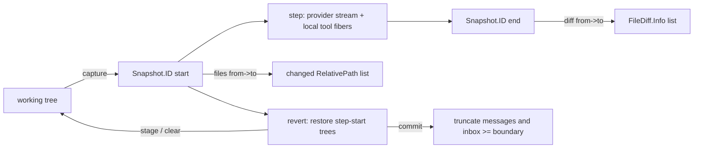
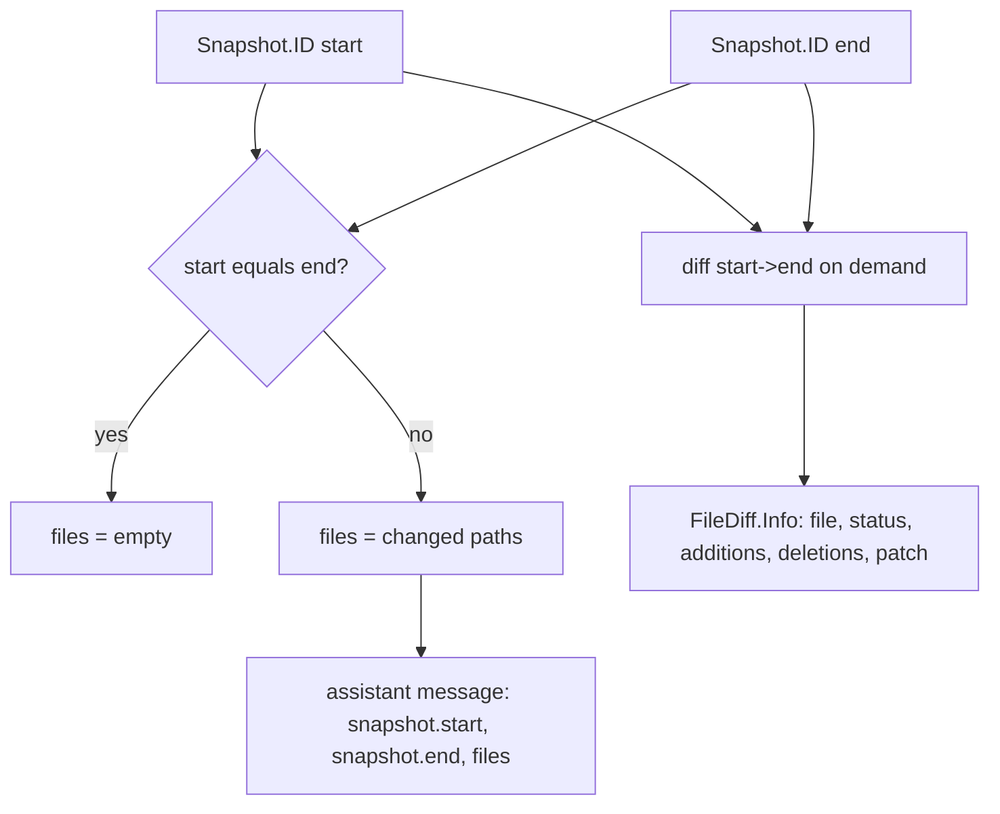
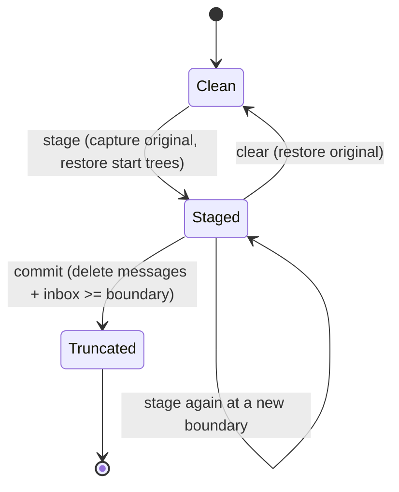

# Part 10 — Snapshots and change tracking

A coding agent's product is change: files edited, files created, files deleted. The durable
record so far has covered the conversation and the tool calls, but not the bytes on disk.
This part adds the missing half — a filesystem capture that brackets every step, the
computation that turns two captures into a diff, and the revert path that puts files back.
The key design choice is that change tracking lives entirely outside the model: the model
never sees a snapshot, never emits a diff, and cannot be trusted to report what it changed.
Everything here is derived from the working tree itself, so it survives a lost provider
response and a crashed process.

The topics:

- **10.1 Snapshots** — capturing a content-addressed tree, and capturing the start tree
  concurrently with the provider request (D15 lives here).
- **10.2 Diffs and per-step files** — comparing two captures and attaching the result to a
  step's durable record.
- **10.3 Revert** — restoring files from captured trees and truncating history, and the
  cases it cannot repair.

---

## 10.1 Snapshots

### Thesis

Each step brackets itself with a content-addressed capture of the working tree — one before
the provider request, one at the end — so that "what did this step change?" is answerable
from the database alone, long after the response stream is gone.

### Cold open

The agent edits three files and then the network drops. The process restarts; the
provider's response was never fully received, so there is nothing to replay and nothing the
model remembers. Later the user asks "what did that last run touch?" and then "put it
back". If the only record of the change were the model's own narration, both questions
would be unanswerable — which is exactly why the agent runs `git` plumbing against its own
working tree on every step.

### The concept

A **snapshot** is a capture of the Location-scoped working tree at one instant. Snapshot
capture is a general capability; this material uses it for change tracking, but the same
service backs the per-step file list and revert.

The representation is a **content-addressed tree**, not a patch. Capture writes the current
contents of the tree into an object store and returns an identifier — in opencode a Git
tree object id. Two consequences follow, and they are the whole reason for the choice:

- **Comparison is cheap and exact.** Two captures can be compared by walking the object
  graph; identical content is literally the same object, so an unchanged file costs nothing
  to prove unchanged. A *patch* would force you to reconstruct a patch format and trust its
  whitespace handling.
- **History is durable and self-contained.** A capture is a hash plus objects, so it can be
  referenced from an event, stored in a database row, and interpreted later without the
  model or the provider.

Alternatives that were rejected: diffing against the raw previous request state (there is
no "previous state" until you define one), a filesystem watcher daemon (racy, not
deterministic, and its state does not survive a restart), and storing full copies of every
file per step (correct but wasteful; content addressing deduplicates for free).

Two boundary conditions matter:

- Capture is **best-effort and optional**. When snapshots are disabled, the Location is not
  a Git repository, or capture fails, `capture` returns `undefined` and the caller proceeds
  without one. Change tracking is an optimization and an audit trail, never a precondition
  for running the agent.
- Capture only covers the **project scope**. Paths outside the project directory, paths the
  source repository ignores, and untracked files above a size limit are not recorded. That
  boundary is what makes revert partial, and Section 10.3 spends its budget on it.

The interesting mechanical detail is *when* the start capture runs. Hashing a large working
tree takes longer than it should be allowed to block a network request, so the start capture
is forked as a fiber and the provider request begins immediately. The start snapshot's only
hard requirement is that it exists before the first *local* tool runs, because a local tool
can mutate the tree; anything published before that can wait on it. That is why the await
sits at the step's first durable publish rather than at the top of the attempt.

### Diagram

D15 — snapshot / diff / revert lifecycle.



```text
 working tree
      | capture
      v
 Snapshot.ID (start) ---> step: provider stream + tool fibers ---> Snapshot.ID (end)
      |                                                                   |
      | files(start -> end)                                               | diff(start -> end)
      v                                                                   v
 changed paths                                                     per-file FileDiff.Info
      |
      | revert: restore the step-start trees
      +-------------------------------> working tree
      |
      | commit: truncate messages and inbox rows at or after the boundary
      v
  shortened history
```

Narration: "Every step takes a fingerprint of the whole working tree before the model is
called and again after it has finished, and stores both fingerprints on the step. The
fingerprints are content hashes, so comparing them is cheap and exact. The difference
between them is the list of files the step changed, and the filesystem diff between them is
the patch. Undoing a step means restoring the files from the earlier fingerprint. Nothing
in this loop consults the model — the model only ever sees the normal tools, and the record
of what changed is derived from the disk."

### The real thing

The snapshot service's public surface is small and self-documenting.

```ts
// packages/core/src/snapshot.ts:43
export interface Interface extends State.Transformable<Editor> {
  /**
   * Capture the current Location-scoped filesystem state as a content-addressed
   * tree. Returns `undefined` when snapshots are disabled, unsupported, or the
   * best-effort capture fails.
   */
  readonly capture: () => Effect.Effect<ID | undefined>
  …
  /**
   * Generate structured per-file diffs between two captured trees. `context`
   * controls unchanged lines around each unified diff hunk.
   */
  readonly diff: (input: DiffInput) => Effect.Effect<readonly FileDiff.Info[], Error>
  …
}
```

Capture is gated by the Location's version-control type and the runtime toggle, then writes
a tree over the project scope with an untracked-file size cap.

```ts
// packages/core/src/snapshot.ts:114
const enabled = () => location.vcs?.type === "git" && state.get().enabled
```

```ts
// packages/core/src/snapshot.ts:128
const capture = Effect.fn("Snapshot.capture")(function* () {
  if (!enabled()) return undefined
  return yield* Effect.gen(function* () {
    const repo = yield* repository
    const tree = yield* git.tree.capture({
      repository: repo.snapshotRepository,
      scopes: [yield* scope(repo.worktree)],
      ignores: repo.source,
      maximumUntrackedFileBytes: 2 * 1024 * 1024,
    })
    yield* packWhenDue(repo.snapshotRepository)
    return ID.make(tree)
  }).pipe(
    Effect.catch((cause) => Effect.logWarning("failed to capture snapshot", { cause }).pipe(Effect.as(undefined))),
  )
})
```

The `ID` a caller receives is the Git tree id. The schema brands it as `Snapshot.ID`, so it
flows through events and database rows as an opaque token.

```ts
// packages/schema/src/snapshot.ts:5
export const ID = Schema.String.pipe(Schema.brand("Snapshot.ID"), Schema.annotate({ identifier: "Snapshot.ID" }))
```

The step captures the start tree in a forked fiber and hands the join into the publisher,
which is where the start snapshot is attached to the step's first durable event.

```ts
// packages/core/src/session/runner/step.ts:73
const attempt = Effect.fn("SessionStep.attempt")(function* (input: Input) {
  // The start snapshot only has to exist before local tools run, which cannot happen before Step.Started,
  // so it is captured while the provider request is in flight instead of delaying it.
  const pendingStartSnapshot = yield* snapshots.capture().pipe(Effect.forkScoped)
  const publisher = createLLMEventPublisher(bus, {
    sessionID: input.sessionID,
    assistantMessageID: input.assistantMessageID,
    agent: input.agent,
    model: input.model.ref,
    providerMetadataKey: input.model.model.route.providerMetadataKey ?? input.model.model.provider,
    pendingSnapshot: Fiber.join(pendingStartSnapshot),
    started: yield* Clock.currentTimeMillis,
  })
```

Inside the publisher, `startAssistant` awaits that join before publishing `Step.Started`, so
the start snapshot id travels with the event that opens the step. The await is placed
deliberately so that cancellation still works at this point.

```ts
// packages/core/src/session/runner/publish-llm-event.ts:129
const startAssistant = Effect.fnUntraced(function* () {
  if (stepStarted) return assistantMessageID
  const snapshot = input.pendingSnapshot ? yield* input.pendingSnapshot : undefined
  // Check again after the await, so the check and the mark below never straddle a yield.
  if (stepStarted) return assistantMessageID
  stepStarted = true
  yield* bus.publish(SessionEvent.Step.Started, {
    sessionID: input.sessionID,
    agent: input.agent,
    model: input.model,
    assistantMessageID,
    snapshot,
    started: input.started,
  })
  return assistantMessageID
})
```

`Step.Started` carries the start snapshot as an optional field, because capture may have
returned `undefined`.

```ts
// packages/schema/src/session-event.ts:328
export namespace Step {
  export const Started = Event.durable({
    type: "session.step.started",
    ...options,
    schema: {
      ...Base,
      assistantMessageID: SessionMessage.ID,
      agent: Agent.ID,
      model: Model.Ref,
      snapshot: Snapshot.ID.pipe(optional),
      /** Request dispatch time, before waiting for provider output. */
      started: NonNegativeInt,
    },
  })
```

The provider loop in the same attempt waits on the pending snapshot before publishing its
first event, so no provider event can be recorded before the start snapshot exists.

```ts
// packages/core/src/session/runner/step.ts:107
const providerStream = llm.stream(input.prepared.request, input.prepared.options).pipe(
  Stream.runForEach((event) =>
    Effect.gen(function* () {
      if (overflowFailure || publisher.hasProviderError()) return
      // Wait here, where cancellation still works, rather than inside the uninterruptible publish.
      if (!publisher.hasStarted()) yield* Fiber.join(pendingStartSnapshot)
      …
      yield* publisher.publish(event)
```

Underneath, `Git.tree.capture` does the real work: it scans the scope against a temporary
index, writes the tree, and compares and installs the index atomically. The comment at the
top of that function states the invariant.

```ts
// packages/core/src/git.ts:677
/**
 * Changes are listed against the temporary index they are written to, never the
 * store's index, which another process may replace at any moment. Each tree is
 * therefore exactly its own index plus the worktree changes against it.
 */
```

What to notice:

- Capture returns `undefined` on any disablement or failure; the caller must treat a missing
  snapshot as normal, not as an error.
- The start capture is forked before the provider request; only the join is deferred.
- The start snapshot is awaited at exactly two boundaries: before `Step.Started` publishes,
  and before any provider event publishes.
- The tree is content-addressed, so the value is a hash, not a copy, and equality of two
  captures is meaningful.
- The scope, ignore rules, and untracked size cap are the reasons the snapshot is not the
  whole filesystem.

### The prompts

No prompts in this topic — the prompts live in Appendix A under **Tools**.

### Build it

```ts
// A snapshot service over a content-addressed store (e.g. git write-tree, or your own CAS).
interface SnapshotService {
  capture(): Promise<TreeID | undefined>          // undefined when disabled/unsupported/failed
  files(from: TreeID, to: TreeID): Promise<Path[]>  // cheap: names only
  diff(from: TreeID, to: TreeID): Promise<FileDiff[]>
  restore(files: Map<Path, TreeID>): Promise<void>
}

async function attemptStep(input) {
  const startFiber = snapshot.capture()                       // fork, do not await
  // … dispatch the provider request immediately …
  const start = await startFiber                             // await only before the first durable publish
  await publish("step.started", { snapshot: start, started: Date.now() })
  // … stream, run local tools, settle …
  const end = await snapshot.capture()
  const files = start && end ? (start === end ? [] : await snapshot.files(start, end)) : undefined
  await publish("step.ended", { snapshot: end, files })
}
```

Decisions and trade-offs:

- **Capture eagerly, await lazily.** The only constraint is that the start tree predates any
  local mutation. Forking the capture hides its cost behind the provider's time-to-first-token.
- **Store ids, not contents, on the step.** The step record must stay small; the object store
  holds the bytes.
- **Make capture optional.** If your store is unavailable, the agent must still run. Model a
  missing snapshot as `undefined`, never as a thrown error that aborts the step.
- **Bound the scope.** Record only the tree you will later need to restore, and enforce a
  size cap so a stray multi-gigabyte untracked file cannot stall a step.

### How it fails

- **Snapshots silently disabled.** A non-Git Location or a disabled toggle makes every
  capture return `undefined`; the diff and revert surfaces then return empty. The failure is
  invisible unless a client distinguishes "no changes" from "no snapshot".
- **A fast first tool.** If capture were awaited only after the request begins but the first
  local tool ran before the start tree existed, the start tree could capture a tree a tool
  had already modified. The await-before-first-publish ordering is what prevents this.
- **Untracked and ignored paths.** Anything the source repository ignores, or an untracked
  file over the cap, is not in the tree and cannot be diffed or reverted later.
- **Concurrent captures.** Two captures can contend for the object store; opencode packs
  loose objects under a cross-process lock and notes that a run outlasting the interval
  never overlaps the next (`packages/core/src/snapshot.ts:116`).
- **Unreadable index.** A crashed writer can leave a bad index; capture rebuilds it from the
  source repository rather than rehashing every tracked file (`packages/core/src/git.ts:737`).

### How you'd test it

Capture a tree, change one file, capture again, and assert `files(from, to)` returns exactly
that path and `start !== end`. Capture twice with no intervening write and assert the two
ids are equal and `files` is empty — equality of content-addressed ids is the invariant that
makes the unchanged case free. Separately, drive one attempt against a stub provider that
never returns, capture the working tree in the middle, and assert the start tree on the
pending `Step.Started` matches the pre-write content: that proves the capture preceded the
request rather than trailing it. For the cap, create an untracked file above the limit and
assert it never appears in a diff.

### Recap

- A snapshot is a content-addressed capture of the working tree; comparison is by object
  identity, not by replaying a patch.
- Each step publishes its start snapshot on `Step.Started` and its end snapshot on
  `Step.Ended`, with a missing snapshot represented as absent, not as failure.
- The start capture is forked and awaited only at the step's first durable publish, so it
  costs latency budget the agent already spends waiting on the provider.

Next, the two captures are only useful once something compares them and attaches the result
to the step.

### Podcast notes

Hook: The agent just rewrote three files and the network died — how do you even know which
files, let alone put them back?
Analogy: A snapshot is a receipt for the whole kitchen, not a list of what you cooked; you
can tell two receipts apart instantly without reading every line.
Talking points: content addressing makes "unchanged" free; the start capture is forked so
it hides behind the provider's latency; the invariant is that the start tree exists before
the first local tool can touch the disk.
Listeners will ask: Why use Git instead of just keeping the old file contents?

---

## 10.2 Diffs and per-step files

### Thesis

The durable record of a step stores two snapshot ids and the list of paths that changed
between them; a later reader reconstructs the exact patch by comparing those two trees, and
never has to rerun the model.

### Cold open

A client wants to show a diff after the fact. It has the transcript and it has the two
snapshot ids on the assistant message, but the ids are just hashes. If the step stored only
"3 files changed", the client could not show *what* changed; if it stored a patch, the
patch could disagree with the tree. The record has to keep both the cheap summary and the
ability to recompute.

### The concept

Two operations sit on top of a pair of trees, and keeping them separate is the point:

- **List changed paths.** Walk the two trees and return the project-relative paths that
  differ, without loading contents or generating patches. This is what the per-step record
  stores, and it is what tells a client how many files to render.
- **Generate structured diffs.** For those paths, produce a per-file record: path, status
  (`added` / `deleted` / `modified`), addition and deletion counts, and the unified patch
  text.

Storing the *paths* on the step and computing the *patch* on demand is the split. The path
list is tiny and answers "did this step change anything?", which a client renders inline.
The patch is derived and can be large, so it is computed from the same two content-addressed
trees whenever a caller asks, with an unchanged-line context parameter. Because the trees are
immutable, the derived patch is deterministic: the same two ids always produce the same
patch.

A **turn** is a range of steps. The turn containing a user message opens at the first prompt
after the previous idle marker and closes at the next idle marker, so prompts steered in
while the session was busy belong to the same turn. The turn diff compares the range's
first recorded start snapshot with its last recorded end snapshot. One special case matters:
if the step is still running in the active session, the "end" is the *working copy*, so a
client polling for a live diff sees partial progress, and once the step settles the durable
end id takes over. A range that spans a Location switch is rejected rather than diffed
wrongly, because the trees live in the repository of the Location that captured them.

### Diagram

D49 — one step's snapshot pair and file list.



```text
 Snapshot.ID start ─┐
                    ├─► equal? ──yes──► files = []
 Snapshot.ID end ───┘        │
                             └─no───► files = [changed paths]
                                          │
                                          ▼
                       assistant message: { start, end, files }
 start ─┐
        ├─► diff(start, end) ──► [ { file, status, additions, deletions, patch } ]
 end ───┘
```

Narration: "A step keeps two fingerprints and the list of paths that differ between them.
The path list is cheap and goes onto the conversation record immediately. The patch itself
is not stored; it is recomputed from the same two immutable trees whenever a client wants
to see the change, which means the summary and the patch can never drift apart."

### The real thing

`Step.Ended` carries the end snapshot and the changed paths, both optional.

```ts
// packages/schema/src/session-event.ts:355
export const Ended = Event.durable({
  type: "session.step.ended",
  ...options,
  schema: {
    ...Base,
    assistantMessageID: SessionMessage.ID,
    finish: FinishReason,
    rawFinish: Schema.String.pipe(optional),
    providerState: SessionMessage.ProviderState.pipe(optional),
    cost: Money.USD,
    tokens: TokenUsage.Info,
    snapshot: Snapshot.ID.pipe(optional),
    files: Schema.Array(RelativePath).pipe(optional),
  },
})
```

The step computes the file list at settlement by comparing the two trees, and treats
"unchanged" as an empty list rather than calling the comparison.

```ts
// packages/core/src/session/runner/step.ts:234
const record = publisher.record()
if (record.finish || record.failure) {
  const startSnapshot = yield* Fiber.join(pendingStartSnapshot)
  const snapshot = yield* snapshots.capture()
  const files =
    startSnapshot && snapshot
      ? startSnapshot === snapshot
        ? []
        : yield* snapshots
            .files({ from: startSnapshot, to: snapshot })
            .pipe(Effect.orElseSucceed(() => undefined))
      : undefined
  …
  if (record.finish && usage && !record.failure)
    yield* bus.publish(SessionEvent.Step.Ended, {
      sessionID: input.sessionID,
      assistantMessageID: yield* publisher.startAssistant(),
      finish: record.finish.finish,
      rawFinish: record.finish.rawFinish,
      providerState: record.finish.providerState,
      ...usage,
      snapshot,
      files,
    })
}
```

The projector folds the start id, the end id, and the file list onto the assistant message,
so a reader never re-derives the summary.

```ts
// packages/core/src/session/message-updater.ts:22
const projectTerminalSnapshot = (draft: DraftAssistant, event: SessionEvent.Step.Ended | SessionEvent.Step.Failed) => {
  if (event.data.snapshot || event.data.files)
    draft.snapshot = {
      ...draft.snapshot,
      end: event.data.snapshot,
      files: event.data.files ? Array.from(event.data.files) : undefined,
    }
}
```

The assistant message schema shows the three fields a reader gets.

```ts
// packages/schema/src/session-message.ts:219
snapshot: Schema.Struct({
  start: Snapshot.ID.pipe(optional),
  end: Snapshot.ID.pipe(optional),
  files: Schema.Array(RelativePath).pipe(optional),
}).pipe(optional),
```

The turn diff resolves the range from the message table, finds the first recorded start and
last recorded end in that range, and — for a running step — substitutes the working copy.

```ts
// packages/core/src/session/diff.ts:106
const first = steps[0]
const final = steps[steps.length - 1]
const from = steps.find((step) => step.start)?.start
if (!first || !final || !from) return []
…
const before = switches.findLast((row) => row.seq < first.seq)?.location
const after = switches.find((row) => row.seq > first.seq)?.previous
const location = before ? decodeLocation(before) : after ? decodeLocation(after) : input.session.location
const recorded = steps.findLast((step) => step.end)?.end
return yield* Effect.gen(function* () {
  const snapshot = yield* Snapshot.Service
  const running = input.active && final.completed === null
  const to = running ? ((yield* snapshot.capture()) ?? recorded) : recorded
  if (!to) return []
  return yield* snapshot.diff({
    from: Snapshot.ID.make(from),
    to: Snapshot.ID.make(to),
    context: input.context ?? PATCH_CONTEXT_LINES,
  })
}).pipe(Effect.provide(locations.get(location)))
```

The chosen `FileDiff.Info` shape is the wire contract for a patch.

```ts
// packages/schema/src/file-diff.ts:6
export const Info = Schema.Struct({
  file: Schema.String,
  patch: Schema.String,
  additions: NonNegativeInt,
  deletions: NonNegativeInt,
  status: Schema.Literals(["added", "deleted", "modified"]),
}).annotate({ identifier: "FileDiff.Info" })
```

The name-only comparison disables rename detection on purpose, and the diff groups paths to
stay inside a patch byte budget.

```ts
// packages/core/src/git.ts:805
const treeFiles = Effect.fn("Git.tree.files")(function* (input: {
  repository: Repository
  from: TreeID
  to: TreeID
}) {
  // Undo needs both paths of a rename, not only its destination.
  return nuls(
    (yield* repositoryOperation("list_files", input.repository, [
      "diff",
      "--name-only",
      "--no-renames",
      "-z",
      input.from,
      input.to,
    ])).text,
  ).map((file) => RelativePath.make(file))
})
```

What to notice:

- The step stores paths, not patches; the patch is recomputed from the two trees.
- `start === end` short-circuits to an empty file list, so the common no-op step costs one
  comparison and no diff.
- A live turn diffs against the working copy until the step settles, then against the
  recorded end id.
- Rename detection is off so both the old and new path appear, which is what revert needs.
- The patch output is bounded by a total byte budget, so a huge diff degrades instead of
  stalling.

### The prompts

No prompts in this topic — the prompts live in Appendix A under **Tools**.

### Build it

```ts
async function stepFiles(start: TreeID | undefined, end: TreeID | undefined): Promise<Path[] | undefined> {
  if (!start || !end) return undefined     // no snapshot: distinguish from "no changes"
  if (start === end) return []             // content-addressed equality
  return store.listChangedPaths(start, end)
}

async function turnDiff(session, from?, to?, context?) {
  const anchor = resolveUserMessage(session, from)
  const [firstStart, lastEnd] = rangeSnapshotIds(session, anchor, to)
  if (!firstStart) return []
  const end = runningNow(session) ? (await store.capture()) ?? lastEnd : lastEnd
  if (!end) return []
  return store.diff(firstStart, end, context)  // [{ file, status, additions, deletions, patch }]
}
```

Decisions and trade-offs:

- **Persist the summary, derive the patch.** It keeps the durable record small and keeps the
  patch consistent with the tree by construction.
- **Compare by identity first.** A content-addressed store lets you answer "unchanged" in
  O(1) before any tree walk.
- **Define "no snapshot" as `undefined` and "no changes" as `[]`.** A client that conflates
  them will show an empty diff for a session where tracking was off.
- **Cap the patch size.** Real diffs of minified or generated files are unbounded; return a
  truncated marker with the counts rather than a gigabyte of text.

### How it fails

- **Missing snapshot treated as empty.** A disabled snapshot and an unchanged step both look
  like "no files"; only `undefined` versus `[]` distinguishes them.
- **Renames collapsed.** If a diff computes renames and reports only the destination, revert
  restores the new path but leaves the old path deleted.
- **A running step with no end.** Before `Step.Ended`, the end id is absent; a client that
  requires it shows nothing rather than the partial working-copy diff.
- **Spanning a location switch.** Trees captured in one Location's repository cannot be
  compared against another's; the range is rejected, not silently mis-diffed.
- **Truncated patches read as complete.** When the byte budget is hit, the patch stops
  mid-hunk; a client must honor the truncation signal instead of assuming the text is whole.

### How you'd test it

Take one step through a stub provider that performs a known file write, then read the
assistant message and assert `snapshot.start`, `snapshot.end`, and `files` exactly. Assert
`files` contains both paths for a rename. Diff the turn and assert the patch reproduces the
written content under the requested context width. Then drive a step whose tools make no
change and assert `files` is `[]`, not `undefined`, and that `start === end`. Finally,
request a turn diff while the step is mid-flight and assert the comparison target is the
working copy, then again after settlement and assert it is the recorded end id.

### Recap

- A step records two snapshot ids and the changed-path list; patches are derived on demand
  from the same immutable trees.
- A turn diff compares the range's first start with its last end, substituting the working
  copy for a still-running step.
- The name-only comparison and the structured `FileDiff.Info` are the contracts a client
  renders from.

Next, the same trees that answer "what changed" can be used to put the files back.

### Podcast notes

Hook: The transcript says three files changed — but a diff has to come from somewhere other
than the model's memory.
Analogy: The step keeps the before-and-after fingerprints and the list of doors that opened;
the actual photo of the room is recomposited from those fingerprints whenever you ask.
Talking points: names go on the record, patches are recomputed; content-addressing makes the
unchanged case free; a live step diffs against the working copy, a settled one against its
recorded end.
Listeners will ask: Why not just store the patch in the database?

---

## 10.3 Revert

### Thesis

Revert restores files to the state recorded in step-start snapshots and, on commit, removes
the conversation at and after a chosen boundary — but only over the region the snapshots
actually captured, and only while the session is idle.

### Cold open

The user points at a message and says "go back to before this". Two things must come undone:
the files must return to how they were, and the conversation must forget everything the
agent did since. But one of those files was created by a shell command the snapshots never
saw, and a background process is still writing to another. Revert has to be honest about
what it can and cannot repair.

### The concept

Revert is three operations, not one, because the user almost always wants to *preview*
before committing.

- **Stage** records a boundary and applies the file restoration, but keeps history intact.
  It captures the current working tree as the **original** — the state to return to if the
  user changes their mind — restores every file to the version it had at the start of the
  first step after the boundary, and stores the boundary plus the original snapshot on the
  session row. Staging is reversible.
- **Clear** undoes a stage: it restores the files back to the original snapshot and drops
  the stored boundary. A stage followed by a clear leaves the working tree as it was.
- **Commit** finalizes: the projector deletes every message at or after the boundary, deletes
  inbox rows enqueued at or after the boundary, clears the revert state, and resets
  instruction state. After commit the conversation truly no longer contains those steps.

The file restoration itself is derived from the same per-step snapshots from Section 10.2.
`plan` walks forward from the boundary, and for each assistant step records, for each file
that step touched, the *earliest* start snapshot seen — the state before that file was first
changed. Restoring a file from that tree either overwrites it with the recorded content or,
if the file did not exist in that tree, deletes it, which is what undoes a creation.

What revert **cannot** undo is the important half of this topic:

- **Files outside the captured scope.** Paths outside the project, paths the source
  repository ignores, and untracked files over the capture size cap were never in any tree,
  so restore cannot touch them. A file an unmanaged process created is invisible.
- **Effects that are not file content.** Network calls, remote systems, and process state are
  not in a tree; revert returns content, not side effects.
- **Runs that were not idle.** Stage, clear, and commit reject an active session; a running
  execution could be mid-write, so applying a restore underneath it is unsafe.
- **History before commit.** Stage restores files but leaves the messages in place. A client
  that shows the reverted history before commit is showing the *un*-committed history.
- **Content versus metadata.** Content-addressed trees restore the bytes; ownership and
  timestamps are not part of the recorded value.

### Diagram

D50 — revert stage / clear / commit.



```text
        stage                     commit
 Clean ────────► Staged ─────────────────► Truncated (messages >= boundary deleted)
   ▲               │  ▲
   │    clear      │  │  stage again (move the boundary, keep the original)
   └───────────────┘  └──┘

 Clean      = no revert staged; working tree is the working tree
 Staged     = files restored to the boundary's step-start trees; history intact; original held
 Truncated  = history and inbox rows at/after the boundary deleted; revert cleared
```

Narration: "Revert has three moves. Staging remembers the current files as the escape hatch,
then rewinds every file that later steps touched to its earliest recorded version, all while
leaving the conversation untouched. Clearing puts the escape hatch back and forgets the
boundary. Committing is the only destructive step: it drops the messages and pending input
at and after the boundary. Anything the snapshots never captured is outside the reach of all
three."

### The real thing

`stage` captures the original, computes the restore plan, applies it, and records the
boundary. Note that a second stage keeps the first stage's original, so the escape hatch is
stable across boundary moves.

```ts
// packages/core/src/session/revert.ts:21
export const stage = Effect.fn("SessionRevert.stage")(function* (input: {
  session: SessionSchema.Info
  messageID: SessionMessage.ID
  files?: boolean
}) {
  …
  return yield* Effect.gen(function* () {
    const snapshot = yield* Snapshot.Service
    const original = input.session.revert?.snapshot
      ? Snapshot.ID.make(input.session.revert.snapshot)
      : yield* snapshot.capture()
    const next = yield* plan(database.db, { sessionID: input.session.id, messageID: input.messageID })
    const restore = new Map<RelativePath, Snapshot.ID>()
    if (original) {
      for (const file of input.session.revert?.files ?? []) restore.set(RelativePath.make(file.file), original)
    }
    if (input.files !== false) for (const [file, tree] of next) restore.set(file, tree)
    if (restore.size) yield* snapshot.restore({ files: restore })
    const paths = input.files === false ? [] : Array.from(next.keys())
    const files = original
      ? yield* snapshot.diff({ from: original, to: (yield* snapshot.capture()) ?? original, paths })
      : []
    const revert = {
      messageID: input.messageID,
      snapshot: original,
      files,
    } satisfies SessionSchema.Info["revert"]
    yield* bus.publish(SessionEvent.RevertEvent.Staged, {
      sessionID: input.session.id,
      revert,
    })
    return revert
  }).pipe(instances.provide(input.session))
})
```

`clear` restores the original and publishes the cleared event.

```ts
// packages/core/src/session/revert.ts:59
export const clear = Effect.fn("SessionRevert.clear")(function* (session: SessionSchema.Info) {
  const instances = yield* Instance.Service
  const bus = yield* Bus.Service
  yield* Effect.gen(function* () {
    const snapshot = yield* Snapshot.Service
    if (!session.revert) return
    const original = session.revert.snapshot ? Snapshot.ID.make(session.revert.snapshot) : undefined
    if (original)
      yield* snapshot.restore({
        files: new Map((session.revert.files ?? []).map((file) => [RelativePath.make(file.file), original])),
      })
    yield* bus.publish(SessionEvent.RevertEvent.Cleared, {
      sessionID: session.id,
    })
  }).pipe(instances.provide(session))
})
```

`commit` only publishes; the projector does the deletion.

```ts
// packages/core/src/session/revert.ts:76
export const commit = Effect.fn("SessionRevert.commit")(function* (bus: Bus.Interface, session: SessionSchema.Info) {
  if (!session.revert) return
  yield* bus.publish(SessionEvent.RevertEvent.Committed, {
    sessionID: session.id,
    to: session.revert.messageID,
  })
})
```

`plan` collects the earliest start snapshot per file across every assistant step after the
boundary.

```ts
// packages/core/src/session/revert.ts:84
const plan = Effect.fn("SessionRevert.plan")(function* (db: Database.Interface["db"], input: BoundaryInput) {
  const boundary = yield* db
    .select({ seq: SessionMessageTable.seq })
    .from(SessionMessageTable)
    .where(and(eq(SessionMessageTable.session_id, input.sessionID), eq(SessionMessageTable.id, input.messageID)))
    .get()
    .pipe(Effect.orDie)
  if (!boundary) return yield* new MessageNotFoundError(input)
  …
  const files = new Map<RelativePath, Snapshot.ID>()
  for (const row of rows) {
    const message = yield* decode({ ...row.data, id: row.id, type: row.type }).pipe(Effect.orDie)
    if (message.type !== "assistant" || !message.snapshot?.start) continue
    for (const file of message.snapshot.files ?? [])
      if (!files.has(file)) files.set(file, Snapshot.ID.make(message.snapshot.start))
  }
  return files
})
```

The commit projection deletes messages and inbox rows at or after the boundary, clears the
revert state, and resets instruction state.

```ts
// packages/core/src/session/projector.ts:759
yield* bus.project(SessionEvent.RevertEvent.Committed, (event) =>
  Effect.gen(function* () {
    const boundary = yield* db
      .select({ seq: SessionMessageTable.seq })
      .from(SessionMessageTable)
      .where(
        and(eq(SessionMessageTable.session_id, event.data.sessionID), eq(SessionMessageTable.id, event.data.to)),
      )
      .get()
      .pipe(Effect.orDie)
    if (!boundary) return yield* Effect.die(new Error(`Revert boundary message not found: ${event.data.to}`))
    yield* db
      .delete(SessionMessageTable)
      .where(
        and(eq(SessionMessageTable.session_id, event.data.sessionID), gte(SessionMessageTable.seq, boundary.seq)),
      )
      .run()
      .pipe(Effect.orDie)
    yield* db
      .delete(SessionInboxTable)
      .where(
        and(
          eq(SessionInboxTable.session_id, event.data.sessionID),
          gte(SessionInboxTable.enqueued_seq, boundary.seq),
        ),
      )
      .run()
      .pipe(Effect.orDie)
    yield* db
      .update(SessionTable)
      .set({ revert: null, time_updated: event.created })
      .where(eq(SessionTable.id, event.data.sessionID))
      .run()
      .pipe(Effect.orDie)
    yield* InstructionState.reset(db, event.data.sessionID)
  }),
)
```

The session-level guard is what makes "cannot undo mid-run" true: all three operations
reject an active execution.

```ts
// packages/core/src/session/session.ts:319
const stage = Effect.fn("Session.revert.stage")(function* (
  sessionID: SessionSchema.ID,
  input: { messageID: SessionMessage.ID; files?: boolean },
) {
  const session = yield* get(sessionID)
  if (yield* execution.isActive(sessionID)) return yield* new BusyError({ sessionID })
  return yield* SessionRevert.stage({ session, messageID: input.messageID, files: input.files }).pipe(…)
})
```

Restore removes a path that is absent from its selected tree, which is how a created file is
undone, and the `Snapshot` interface documents that contract.

```ts
// packages/core/src/git.ts:987
if (!(yield* hasEntry(input.repository, tree, file)))
  return yield* removePath(input.repository, file)
```

What to notice:

- Stage is reversible; only commit deletes history.
- A second stage preserves the first stage's original, so the escape hatch does not move.
- `plan` uses the *earliest* start snapshot per file, so a file touched by several steps
  rewinds to before the first touch.
- Restore deletes paths absent from the tree, undoing creations.
- The active-session guard is why revert cannot run against a live execution.

### The prompts

No prompts in this topic — the prompts live in Appendix A under **Tools**.

### Build it

```ts
async function stageRevert(session, boundaryMessageID, applyFiles = true) {
  if (await isActive(session.id)) throw new BusyError(session.id)
  const original = session.revert?.snapshot ?? await snapshot.capture()   // stable escape hatch
  const plan = await restorePlan(session.id, boundaryMessageID)          // file -> earliest start tree
  const restore = new Map(plan)
  if (original) for (const f of session.revert?.files ?? []) restore.set(f, original)
  if (applyFiles && restore.size) await snapshot.restore(restore)
  const revert = { messageID: boundaryMessageID, snapshot: original, files: diffFiles(original, plan) }
  publish("session.revert.staged", { sessionID: session.id, revert })
  return revert
}

async function commitRevert(session) {
  if (await isActive(session.id)) throw new BusyError(session.id)
  publish("session.revert.committed", { sessionID: session.id, to: session.revert.messageID })
  // projector: delete messages seq >= boundary, inbox admitted_seq >= boundary, clear revert
}
```

Decisions and trade-offs:

- **Split stage from commit.** A preview that restores files is what users actually want;
  making history deletion a separate call keeps a mistaken boundary recoverable.
- **Keep the original across re-stages.** Moving the boundary should not move the escape
  hatch, or "clear" stops meaning "put it back to before I started".
- **Derive the plan from step snapshots, not from a running diff.** Earliest-start-per-file
  is deterministic and needs no live comparison.
- **Design note: define your unsupported set explicitly.** Anything you did not capture — a
  non-tracked directory, an ignored build output, a remote side effect — is outside revert,
  and the UI should say so instead of implying a complete undo.

### How it fails

- **A created file survives.** If the file did not exist in the earliest start tree, restore
  must delete it, not skip it; skipping leaves the agent's creation behind.
- **Revert over a live run.** Applying a restore while a tool is writing can lose the write
  or restore a half-written tree; the active-session guard prevents this, and callers that
  bypass it reintroduce the race.
- **Uncaptured changes.** An ignored path or an oversized untracked file is untouched, so a
  "revert" that still leaves changes in the tree is behaving correctly and looking broken.
- **Clear after a re-stage.** If a re-stage overwrote the original, clear would restore the
  wrong tree; preserving the original is what avoids this.
- **Commit on a missing boundary.** The projector dies if the boundary message is gone,
  which surfaces a projection inconsistency rather than deleting the wrong range.

### How you'd test it

Run a couple of steps that modify a tracked file and create a new one, then stage a revert
at the boundary between them. Assert the modified file's content equals its recorded start
version and the created file is gone. Then clear and assert the working tree is byte-for-byte
the pre-revert state again. Re-stage, commit, and assert every message at or after the
boundary is gone from the read model while the earlier messages remain. Separately, start an
execution, call stage, and assert it fails with a busy error rather than touching the tree.
Finally, make an untracked file over the capture cap, stage a revert, and assert that file
is left untouched — that is the documented boundary, not a bug.

### Recap

- Stage restores files reversibly and holds an escape hatch; clear undoes it; commit deletes
  history and pending input at and after the boundary.
- The restore plan rewinds each file to its earliest recorded start tree and deletes files
  that were not present there.
- Revert is bounded by the capture scope and refused while an execution is active, and it
  returns file content, not side effects.

This is the last of the durable-state mechanics: a session can now be replayed, compacted,
recovered, and rolled back. What remains is watching all of it happen from outside.

### Podcast notes

Hook: "Undo the last few minutes" sounds like one button; it is really three operations, and
two of them cannot touch a file the agent never recorded.
Analogy: Staging is moving furniture back and keeping the receipt for your apartment;
clearing is moving it forward again; committing is shredding the last few pages of the
diary.
Talking points: stage is reversible, commit is destructive; the plan rewinds each file to
its earliest recorded start; anything outside the snapshot scope is honestly out of reach.
Listeners will ask: Why keep the original when you already restored the files?

---
