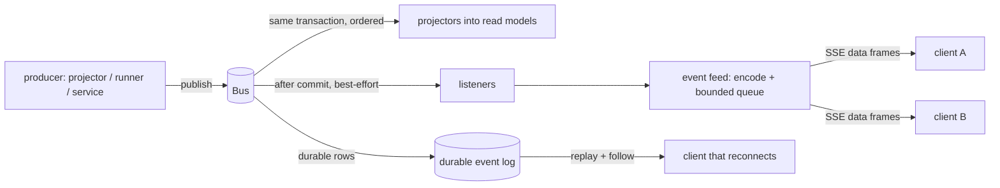
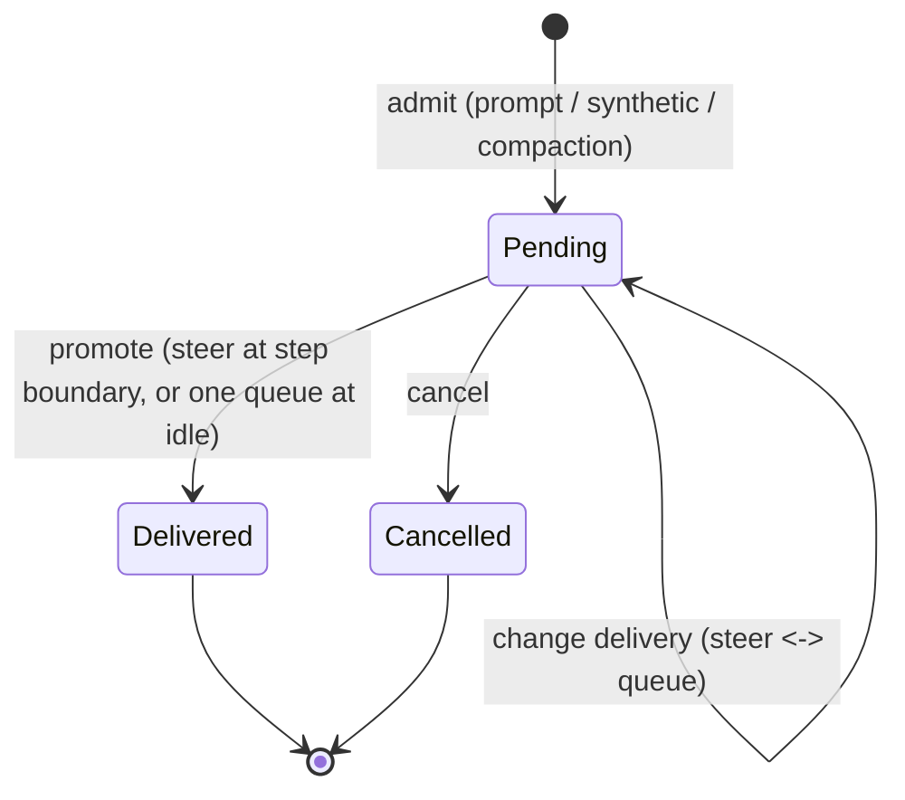
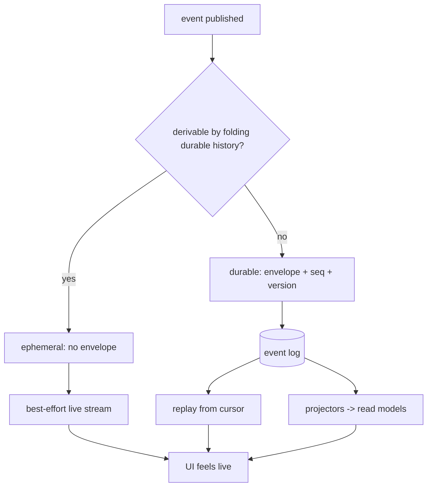

# Part 11 — Observability and API

Everything so far has been inside the agent: durable events, projectors, a drain loop, tools.
A client sees none of it directly. This part is the outside surface — how the durable event
stream fans out to a live feed, what vocabulary a client must consume to render an agent
working, and which operations a client calls to steer it. The guiding constraint is that the
same events serve two very different consumers: the in-process projector, which needs order
and persistence, and a remote client, which needs to feel live and may disconnect at any
moment. Keeping those two contracts separate is what lets the design port to another stack.

The topics:

- **11.1 Bus → server → live stream** — the event vocabulary a client needs to render an
  agent working.
- **11.2 Driving the agent** — prompt admission, permission replies, interrupt, and steer.
- **11.3 What to persist vs stream** — the division that ports to another stack.

---

## 11.1 Bus → server → live stream

### Thesis

The same durable event a projector folds into a read model can be pushed to a client, so a
UI renders work in progress by consuming one stream instead of polling tables.

### Cold open

You open a second client while the agent is mid-step in the first. You want to see text
appear token by token, a tool call start, a permission prompt arrive — without the first
client telling you anything. If the only way to observe the agent were to poll the database,
you would burn the database, and you would never see a streaming delta, because deltas are
gone by the time you ask.

### The concept

Events are the unit of truth throughout the agent. The **bus** is the publish/subscribe
point, and every event has exactly two kinds of consumer:

- **Projectors**, registered in-process, fold the event into read models inside the same
  transaction that records it. They need order, persistence, and exactly-once handling
  because they mutate durable state.
- **Listeners**, the live feed, observe the event after it is recorded. They need to be
  fast and are allowed to miss events, because they are rendering, not deciding.

The same event type can serve both. The difference is the *contract*, not the payload.

Events come in two durability kinds, and this distinction is the heart of the topic:

- **Durable events** carry an envelope with an aggregate id, a sequence number, and a schema
  version. They are the replayable boundary: a client that reconnects can read them back
  from the log and reconstruct state.
- **Ephemeral events** have no envelope and are never replayed. They are hints: a text
  fragment, a streamed delta, a tool progress tick. If a client misses them, it is
  inconvenienced; it is not wrong, because the durable `*Ended` event carries the final
  value.

For a client to render an agent at work it must consume, at minimum:

| Purpose | Events it must handle |
|---|---|
| Session appears / changes | `session.created`, `session.renamed`, `session.agent.selected`, `session.model.selected`, `session.permissions`, `session.moved`, `session.status` / `session.idle` |
| Execution lifecycle | `session.execution.started`, `…succeeded`, `…failed`, `…interrupted` |
| Step lifecycle | `session.step.started`, `…streamed`, `…ended`, `…failed` |
| Assistant output | `session.text.*`, `session.reasoning.*` (deltas are optional; `end` is authoritative) |
| Tool activity | `session.tool.input.*`, `session.tool.called`, `session.tool.progress`, `session.tool.success`, `session.tool.failed` |
| Recovery / context | `session.retry.scheduled`, `session.compaction.*` |
| Change preview | `session.step.ended` (`snapshot`, `files`), `session.revert.*` |
| Blocking questions | permission request events, form events, and the matching reply endpoints |

Two properties of the feed shape how a client renders it:

1. **Deltas are batched.** Stream fragments are coalesced on an interval before they are
   published, so a client must *accumulate* deltas and *reconcile* at the durable end event.
   It must not assume one delta per token, or one delta per block.
2. **The live feed is volatile by contract.** A slow consumer overflows its bounded queue
   and the stream fails; events during a disconnect are simply missed. The recovery path is
   the durable per-aggregate log, not a bigger buffer.

That second property is deliberate. Making the live feed durable would mean every stream
fragment became a persisted fact, which is exactly what the durable/ephemeral split exists
to avoid.

### Diagram

D51 — event fan-out from one bus.



```text
                      ┌────────────────────────────┐
   producer ─publish─►│            Bus             │
                      └───────────────┬────────────┘
                                      │
              same tx, ordered ───────┼─────── after commit, best-effort
                                      │
                              ┌───────▼────────┐        ┌───────────────┐
                              │   projectors   │        │   listeners   │
                              └───────┬────────┘        └───────┬───────┘
                                      │                         │
                                 read models              event feed (encode,
                                 (messages, usage)        bounded queue)
                                      │                         │
                                      │                    SSE data ─► clients
                                      │
                                 durable log ── replay+follow ──► reconnecting client
```

Narration: "One publish goes to two audiences. The projectors run inside the recording
transaction and mutate the tables the agent reads back. The listeners run after the commit
and feed an encoding step that pushes frames to any connected clients. Neither audience is
the only truth: a client that was offline takes the durable log and replays it, while a
client that is online just watches the live frames and treats the durable end events as the
authoritative values."

### The real thing

The bus exposes a typed subscribe function with three shapes: everything, one definition, or
a tuple of definitions. The documentation states the contract precisely.

```ts
// packages/core/src/bus.ts:121
export interface Subscribe {
  /**
   * Volatile live channel: every event published from now on, nothing before or
   * across a disconnect. Consumers that need reliability combine it with `log`.
   * With an ambient Location, delivery is restricted to that Location and global
   * events. Unlocated Session events use the Session's owner at publication time.
   * Session moves reach both the old and new Location, without changing the event.
   */
  (): Stream.Stream<Event.Payload>
  <D extends Event.Definition>(definition: D): Stream.Stream<Event.Payload<D>>
  <const D extends readonly [Event.Definition, ...Event.Definition[]]>(
    definitions: D,
  ): Stream.Stream<SubscribePayload<D>>
}
```

Subscribing is a stream, and `subscribe()` with no argument is the raw live channel.

```ts
// packages/core/src/bus.ts:753
function subscribe(input?: Event.Definition | readonly Event.Definition[]): Stream.Stream<Event.Payload> {
  if (input === undefined) return streamLive()
  if (isDefinition(input)) {
    return local(Stream.unwrap(getOrCreate(input).pipe(Effect.map((pubsub) => Stream.fromPubSub(pubsub)))))
  }
  const types = new Set(input.map((definition) => definition.type))
  return streamLive().pipe(Stream.filter((event) => types.has(event.type)))
}
```

After a durable event commits, the bus notifies listeners and the live pub/sub; a listener
failure is caught and logged rather than breaking the writer.

```ts
// packages/core/src/bus.ts:494
function notify(event: Event.Payload, isolateListeners: boolean) {
  return Effect.gen(function* () {
    yield* Effect.forEach(
      listeners,
      (listener) => (isolateListeners ? observe(event, listener) : listener(event)),
      { discard: true },
    )
    const typed = pubsub.typed.get(event.type)
    if (typed) yield* PubSub.publish(typed, event)
    yield* PubSub.publish(pubsub.live, event)
  })
}
```

The ephemeral/durable split is declared per event type in the session-event union. The
stream fragments are explicitly ephemeral with a comment stating why.

```ts
// packages/schema/src/session-event.ts:403
// Stream fragments are live-only; Text.Ended is the replayable full-value boundary.
export const Delta = Event.ephemeral({
  type: "session.text.delta",
  schema: {
    ...Base,
    assistantMessageID: SessionMessage.ID,
    ordinal: NonNegativeInt,
    delta: Schema.String,
  },
})
```

```ts
// packages/schema/src/session-event.ts:652
export const Definitions = Event.inventory(
  Created,
  AgentSelected,
  …
  Text.Started,
  Text.Delta,
  Text.Ended,
  …
  Tool.Called,
  Tool.Progress,
  Tool.Success,
  Tool.Failed,
  …
)
```

The public manifest a client-schema generator consumes is composed in `EventManifest`, and
the current-session events are the foundation of it.

```ts
// packages/schema/src/event-manifest.ts:41
const coreDefinitions = Event.inventory(...SessionEvent.Definitions)
…
export const ServerDefinitions = Event.inventory(
  ...foundationDefinitions,
  ...featureDefinitions,
  // Current events the TUI consumes from the public stream.
  ...SessionStatusEvent.Definitions,
  …
)
export const Server = Event.latest(ServerDefinitions)
```

The ephemeral status union is what tells a client whether a session is busy, retrying, or
idle, which is the coarsest signal a UI needs.

```ts
// packages/schema/src/session-status-event.ts:9
export const Info = Schema.Union([
  Schema.Struct({
    type: Schema.Literal("idle"),
  }),
  Schema.Struct({
    type: Schema.Literal("retry"),
    attempt: NonNegativeInt,
    message: Schema.String,
    …
  }),
  Schema.Struct({
    type: Schema.Literal("busy"),
  }),
]).annotate({ identifier: "SessionStatus" })
```

The server turns the live bus into an encoded stream. The feed subscribes one bus listener,
fans out to per-subscriber dropping queues, and fails a subscriber that overflows instead of
growing without bound.

```ts
// packages/server/src/event-feed.ts:29
export function frame(event: OpenCodeEvent) {
  return `data: ${JSON.stringify(event)}\n\n`
}
```

```ts
// packages/server/src/event-feed.ts:48
const publish = Effect.fnUntraced(function* (event: Event.Payload) {
  if (!isOpenCodeEvent(event)) return
  if (subscribers.size === 0) return
  const encoded = yield* Effect.try({
    try: () => render(event),
    catch: (cause) => new EncodingError({ eventID: event.id, eventType: event.type, cause }),
  }).pipe(…)
  if (encoded === undefined) return
  for (const subscriber of subscribers) {
    if (Queue.offerUnsafe(subscriber, encoded)) continue
    subscribers.delete(subscriber)
    Queue.failCauseUnsafe(subscriber, Cause.fail(new SubscriberOverflowError({ capacity })))
  }
})
```

The HTTP handler emits a `server.connected` frame, then the feed, with a heartbeat merged in
so intermediaries do not close an idle connection.

```ts
// packages/server/src/handlers/event.ts:8
export const EventHandler = HttpApiBuilder.group(Api, "server.event", (handlers) =>
  Effect.gen(function* () {
    const feed = yield* EventFeed.Service
    return handlers.handleRaw("event.subscribe", () =>
      Effect.gen(function* () {
        const connected = {
          id: Event.ID.create(),
          type: "server.connected",
          data: {},
        } as const
        const output = Stream.unwrap(
          feed.subscribe.pipe(Effect.map((live) => Stream.make(EventFeed.frame(connected)).pipe(Stream.concat(live)))),
        )
        const heartbeat = Stream.tick("15 seconds").pipe(Stream.map(() => ": heartbeat\n\n"))
        return HttpServerResponse.stream(
          output.pipe(Stream.merge(heartbeat, { haltStrategy: "left" }), Stream.encodeText),
          {
            contentType: "text/event-stream",
            headers: { … },
          },
        )
      }),
    )
  }),
)
```

The wire schema a client decodes is built from the public manifest plus a synthetic
`server.connected`, and the endpoint's own description states the volatility contract.

```ts
// packages/protocol/src/groups/event.ts:44
HttpApiEndpoint.get("event.subscribe", "/api/event", {
  success: HttpApiSchema.StreamSse({ data: EventSchema }),
}).annotateMerge(
  OpenApi.annotations({
    identifier: "event.subscribe",
    summary: "Subscribe to events",
    description:
      "Subscribe to native events and plugin RPC events across all server locations. Volatile by contract: a slow consumer overflows and fails the stream, and events during disconnection are missed.",
  }),
),
```

What to notice:

- One publish feeds both the transactional projectors and the volatile listeners.
- The durability kind is declared per event type; stream fragments are ephemeral and the
  matching `*Ended` event is the replayable value.
- The feed's queue is bounded and *dropping*; overflow fails the subscriber rather than
  buffering without limit.
- The subscription endpoint injects `server.connected` and a heartbeat, so the transport
  stays healthy independent of agent activity.
- The endpoint description and the bus comment agree: live delivery is best-effort.

### The prompts

No prompts in this topic — the prompts live in Appendix A under **Harness**.

### Build it

```ts
// One publish, two audiences.
bus.publish(event) {
  if (event.durability === "durable") {
    // 1. record + run projectors inside one transaction
    db.transaction(() => { record(event); for (const p of projectors[event.type]) p(event) })
  }
  // 2. best-effort live fan-out, after commit
  for (const listener of listeners) safest(() => listener(event))
}

// The feed is a bounded, dropping fan-out over one listener.
const subscribers = new Set<DroppingQueue<Uint8Array>>()
subscribeToBus(event => {
  if (!isPublic(event)) return
  const frame = `data: ${JSON.stringify(encode(event))}\n\n`
  for (const q of subscribers) if (!q.offer(frame)) { subscribers.delete(q); q.fail("overflow") }
})

// A client renders from the durable ends, using deltas only to feel live.
on("session.text.delta", d => appendDelta(d))       // optional, batched, may be lost
on("session.text.ended", e => reconcileBlock(e))    // authoritative final value
```

Decisions and trade-offs:

- **Publish after commit, always.** A client should never render an event the database does
  not contain; notifying inside the transaction would risk exactly that.
- **Bound the fan-out.** A client that cannot keep up is a client that is offline; fail its
  stream so it reconnects and replays from the durable log.
- **Give every stream fragment a durable sibling.** If you cannot name the `*Ended` event
  that carries the final value, the fragment is not a hint — it is a fact, and it belongs in
  the durable set.
- **Keep one listener, many subscribers.** One bus listener and a per-subscriber queue
  avoids re-subscribing the bus per client and centralizes encoding.

### How it fails

- **Slow consumer.** The bounded queue overflows and the stream fails. A client that ignores
  the failure silently freezes mid-render, which is why the failure is explicit.
- **Rendering from deltas.** Deltas are batched and may be dropped, so a client that builds
  state only from deltas drifts; it must reconcile at the durable end event.
- **Reconnect gaps.** Events published during a disconnect are gone from the live feed. The
  only correct recovery is a log read from the last seen sequence.
- **Encoding failure.** A single unencodable event fails every subscriber at once
  (`packages/server/src/event-feed.ts:41`), so the encoding boundary must be total over the
  public event union, or one bad event takes down every viewer.
- **Location routing.** A subscription with an ambient Location only receives that Location's
  events plus globals; a client that assumes a global firehose will miss events.

### How you'd test it

Subscribe to the feed, drive one prompt through a stub provider, and assert the client sees
`execution.started`, a `step.started`, text deltas, `step.ended` with a `files` array, and
`execution.succeeded`, in a plausible order with per-source ordering preserved. Then attach a
subscriber that never drains and assert its stream fails with an overflow error while the
other subscribers keep receiving. Disconnect a subscriber, publish an event, reconnect with a
log read from the last durable sequence, and assert the missed event is present in the
replay. Assert no ephemeral event ever appears in the log read.

### Recap

- The bus fans one event out to in-process projectors and to a best-effort live feed; the
  same event type serves both.
- Durable events are the replayable boundary; ephemeral fragments are batched hints whose
  final value arrives in a durable `*Ended` event.
- The live feed is bounded and volatile by contract, and the durable log is the recovery
  path.

Observing is only half of a client; the other half is making the agent do things and
answering the questions it blocks on.

### Podcast notes

Hook: A second window can watch the agent think, token by token — but if it blinks, it has
to be able to catch up from the database, not from the stream.
Analogy: The live feed is a radio broadcast you might miss; the durable log is the podcast
you can replay; a good client listens to both and trusts the recording.
Talking points: one publish, two audiences; fragments are hints, end events are facts; the
feed is deliberately allowed to fail a slow consumer.
Listeners will ask: Why not just persist every delta so nothing is ever missed?

---

## 11.2 Driving the agent

### Thesis

Reading the stream is half the job; a client must also admit work, answer the agent's
blocking questions, and interrupt or steer a running execution through a small set of
operations.

### Cold open

The agent wants to run a shell command and parks on a permission request. Nothing progresses
until some client replies. Meanwhile the user types "actually use the other file". A client
that only subscribes to events can watch the agent wait forever and never unblock it. The
agent is a state machine with inputs, and the inputs live on the same surface as the outputs.

### The concept

Four operations cover almost everything a client does to an agent:

- **Admit a prompt.** Recording new user input. This is not the same as running it: admission
  writes a durable inbox row and returns, and then a wake requests execution. Keeping those
  two steps separate is what makes admission idempotent by message id and lets a client
  submit work while the session is busy.
- **Choose a delivery mode.** Input is *steer* or *queue*. **Steer** means "influence work in
  progress" and is delivered at the next safe step boundary; **queue** means "start new work"
  and is delivered only when the session would otherwise go idle. Prompts steer by default.
  A client can flip a pending item between the two, which is the "steer this correction into
  the running answer" operation.
- **Reply to a blocking question.** A permission request or a form is a parked fiber waiting
  on a one-shot promise. The reply resolves it: the tool continues (allow), or the decline is
  carried past the fault-tolerant boundary so a "no" never becomes model-visible tool output.
- **Interrupt, and optionally resume.** Interruption stops the active execution. Interrupting
  an idle session is a no-op. With resume, the process re-wakes steering input and next-in-line
  control items while leaving queued prompts parked; without resume, it just stops.

The unifying idea is that every one of these is a *durable* write plus an *advisory* wake.
Admission publishes the enqueued event before any execution is scheduled. The reply resolves
an in-memory waiter but its effect (the tool's outcome) is what gets recorded durably. The
interrupt acknowledges before cleanup settles, and cleanup publishes a terminal event. A
client therefore always acts by writing intent and then reconciling from the event stream it
is already consuming.

### Diagram

D4 — inbox delivery state machine (from Part 2), the model a client manipulates by choosing
delivery and by steering.



```text
  admit
    │
    ▼
 Pending ──change delivery──► Pending        (steer  <->  queue)
    │                             │
    │ cancel                      │ promote
    ▼                             ▼
 Cancelled                    Delivered ──► visible message
```

Narration: "A client's input enters a pending queue. Choosing steer or queue only changes how
and when that row promotes: a steer promotes at the next step boundary, a queued item waits
until the session would go idle. Cancelling removes a pending row; promoting turns it into a
visible message. The reply endpoints for permissions and forms are a different shape — they
resolve a waiter rather than enqueue a row — but they are part of the same idea: the client
writes an intent, and progress comes back as events."

### The real thing

The session prompt path reconciles by id, prepares the payload, commits any staged revert,
admits the item, and only then wakes execution — unless the caller asked for admit-only.

```ts
// packages/core/src/session/session.ts:145
const prompt = Effect.fn("Session.prompt")((sessionID: SessionSchema.ID, input: PromptRequest) =>
  Effect.uninterruptibleMask((restore) =>
    Effect.gen(function* () {
      const session = yield* get(sessionID)
      const messageID = input.id ?? SessionMessage.ID.create()
      const admitted = yield* Effect.gen(function* () {
        const existing = yield* admission.reconcile({
          id: messageID,
          sessionID: session.id,
          type: "user",
          delivery: input.delivery ?? "steer",
        })
        if (existing) return existing
        const item = yield* restore(
          SessionPrompt.prepare({ session, messageID, input }).pipe(…),
        )
        // Commit a staged revert only after preparation succeeds, before admitting new work.
        if (session.revert) yield* SessionRevert.commit(bus, session)
        return yield* admission.admit({
          id: messageID,
          sessionID: session.id,
          item,
        })
      }).pipe(…)
      if (input.resume !== false) yield* execution.wake(sessionID)
      return admitted
    }),
  ),
)
```

Changing a pending item's delivery is what a client calls to steer.

```ts
// packages/core/src/session/session.ts:134
const steerInbox = Effect.fn("Session.steerInbox")(function* (
  sessionID: SessionSchema.ID,
  inboxID: SessionMessage.ID,
) {
  yield* mutatePending(sessionID, inboxID, admission.steer)
  yield* execution.wake(sessionID)
}, Effect.uninterruptible)
const queueInbox = Effect.fn("Session.queueInbox")(
  (sessionID: SessionSchema.ID, inboxID: SessionMessage.ID) => mutatePending(sessionID, inboxID, admission.queue),
  Effect.uninterruptible,
)
```

Admission publishes the enqueued event, which is the durable proof that the work exists.

```ts
// packages/core/src/session/inbox.ts:176
const admitted = yield* bus
  .publish(SessionEvent.InboxEnqueued, {
    inboxID: request.id,
    sessionID: request.sessionID,
    item: request.item,
  })
  .pipe(…)
```

Interrupt is the operation that stops a running execution, with the resume semantics spelled
out in the interface.

```ts
// packages/core/src/session/execution.ts:26
/**
 * Interrupt active work owned by this process. Idle interruption is a no-op. Resolves once
 * the interruption is accepted; cleanup settles asynchronously in the execution fiber.
 * Returns whether an active execution was interrupted. Compose with `awaitIdle` when
 * settlement matters. `awaitSettlement` waits only for the interrupted execution,
 * rather than fresh work admitted during its cleanup.
 */
readonly interrupt: (
  sessionID: SessionSchema.ID,
  options?: {
    readonly resume?: boolean
    readonly reason?: "user" | "inactivity"
    readonly awaitSettlement?: boolean
  },
) => Effect.Effect<boolean>
```

The implementation of `resume: true` shows exactly which pending work restarts and which
stays parked.

```ts
// packages/core/src/session/execution.ts:153
interrupt: (sessionID, options) =>
  Effect.gen(function* () {
    const interrupted = yield* coordinator.interrupt(sessionID, options?.reason ?? "user", options)
    if (!options?.resume) return interrupted
    // Resume steering input and between-turn control work from the interrupted
    // intent. Queued next-turn prompts stay parked: a steer-scoped drain never
    // promotes them, and a control item behind a queued prompt waits its turn.
    …
    const next = yield* SessionInbox.nextPromotable(db, sessionID, "input")
    if (next === undefined) return interrupted
    if (next.delivery === "steer" || next.type === "compaction" || next.type === "move")
      yield* coordinator.wake(sessionID, "steer")
    return interrupted
  }),
```

Admission and delivery are two different durable events, which is what separates "work
exists" from "work is visible".

```ts
// packages/core/src/session/inbox.ts:458
const publish = Effect.fn("SessionInbox.publish")(function* (
  db: DatabaseService,
  bus: Bus.Interface,
  sessionID: SessionSchema.ID,
  rows: ReadonlyArray<typeof SessionInboxTable.$inferSelect>,
) {
  yield* Effect.forEach(
    rows,
    (row) => {
      const entry = fromRow(row)
      if (entry.type === "compaction") return Effect.die(new LifecycleConflict({ id: entry.id }))
      return bus
        .publish(SessionEvent.InboxDelivered, {
          sessionID,
          inboxID: entry.id,
        })
        .pipe(…)
    },
    { discard: true },
  )
  return rows.length
})
```

The protocol surface names each operation. A prompt is admitted with an optional delivery and
resume flag.

```ts
// packages/protocol/src/groups/session.ts:395
.add(
  HttpApiEndpoint.post("session.prompt", "/api/session/:sessionID/prompt", {
    params: { sessionID: Session.ID },
    payload: Schema.Struct({
      id: SessionMessage.ID.pipe(Schema.optional),
      ...PromptInput.Prompt.fields,
      metadata: SessionInbox.UserPayload.fields.metadata,
      delivery: SessionInbox.Delivery.pipe(Schema.optional),
      resume: Schema.Boolean.pipe(Schema.optional),
    }),
    success: Schema.Struct({ data: SessionInbox.User }),
    error: [ConflictError, InvalidRequestError, SessionNotFoundError],
  })
    .middleware(sessionLocationMiddleware)
```

Interrupt returns whether an active execution was actually interrupted, so a client can
distinguish a real stop from an idle no-op.

```ts
// packages/protocol/src/groups/session.ts:745
.add(
  HttpApiEndpoint.post("session.interrupt", "/api/session/:sessionID/interrupt", {
    params: { sessionID: Session.ID },
    query: { resume: BooleanFromString.pipe(Schema.optional) },
    success: Schema.Struct({
      interrupted: Schema.Boolean.annotate({
        description: "Whether an active execution owned by this OpenCode process was interrupted.",
      }),
    }).annotate({ identifier: "SessionInterruptResponse" }),
    error: SessionNotFoundError,
  })
    .middleware(sessionLocationMiddleware)
```

Steering a pending item is a delivery change on the inbox.

```ts
// packages/protocol/src/groups/session.ts:633
.add(
  HttpApiEndpoint.patch("session.inbox.update", "/api/session/:sessionID/inbox/:inboxID", {
    params: { sessionID: Session.ID, inboxID: SessionMessage.ID },
    payload: Schema.Struct({ delivery: SessionInbox.Delivery }),
    success: HttpApiSchema.NoContent,
    error: [ConflictError, SessionNotFoundError],
  }).annotateMerge(
    OpenApi.annotations({
      identifier: "session.inbox.update",
      summary: "Update inbox item",
      description: "Change a pending inbox item's delivery mode. Steering wakes session execution.",
    }),
  ),
)
```

Answering a permission request is a sibling endpoint, routed by session and request id.

```ts
// packages/protocol/src/groups/permission.ts:116
.add(
  HttpApiEndpoint.post("session.permission.reply", "/api/session/:sessionID/permission/:requestID/reply", {
    params: { sessionID: Session.ID, requestID: Permission.ID },
    payload: Schema.Struct({
      decision: Permission.Reply,
      message: Schema.String.pipe(Schema.optional),
    }),
    success: HttpApiSchema.NoContent,
    error: [SessionNotFoundError, PermissionNotFoundError],
  })
    .middleware(sessionLocationMiddleware)
```

The server handler for a prompt simply forwards into the session service; the protocol type
and the core operation agree field for field.

```ts
// packages/server/src/handlers/session.ts:307
.handle(
  "session.prompt",
  Effect.fn(function* (ctx) {
    return {
      data: yield* session
        .prompt({
          sessionID: ctx.params.sessionID,
          id: ctx.payload.id,
          text: ctx.payload.text,
          files: ctx.payload.files,
          agents: ctx.payload.agents,
          skills: ctx.payload.skills,
          metadata: ctx.payload.metadata,
          delivery: ctx.payload.delivery,
          resume: ctx.payload.resume,
        })
        .pipe(…),
    }
  }),
)
```

What to notice:

- Admission writes the durable inbox row; the wake is advisory and separate.
- Prompts steer by default; a client flips delivery to queue new-turn work.
- The resume flag on interrupt restarts steering input and control items, not queued prompts.
- The permission reply resolves a parked fiber; the decline path keeps "no" out of model
  context.
- Every operation returns quickly; the client learns the outcome from the event stream.

### The prompts

No prompts in this topic — the prompts live in Appendix A under **Tools**.

### Build it

```ts
// Admission: record intent durably, then ask for a drain.
async function prompt(sessionID, text, opts = {}) {
  const id = opts.id ?? newMessageId()
  const item = await prepare({ sessionID, id, text, ...opts })     // attachments, skills, agents
  await publish("session.inbox.enqueued", { sessionID, inboxID: id, item })  // durable
  if (opts.resume !== false) wake(sessionID)                        // advisory
  return { id, delivery: opts.delivery ?? "steer" }
}

// Steering is just a delivery change on the pending row.
async function steer(sessionID, inboxID) {
  await publish("session.inbox.delivery.changed", { sessionID, inboxID, delivery: "steer" })
  wake(sessionID)
}

// Interrupt: stop the active execution; optionally resume steering work only.
async function interrupt(sessionID, { resume = false } = {}) {
  const interrupted = await coordinator.interrupt(sessionID, "user")
  if (resume) {
    const next = await nextPromotable(sessionID, "input")
    if (next && (next.delivery === "steer" || next.type === "compaction" || next.type === "move"))
      wake(sessionID, "steer")
  }
  return { interrupted }
}

// Replying to a blocked tool resumes the parked fiber.
async function replyPermission(sessionID, requestID, decision, message?) {
  await permission.reply({ requestID, reply: decision, message })  // allow -> tool runs; deny -> tunnelled
}
```

Decisions and trade-offs:

- **Separate admission from execution.** It makes submission idempotent and non-blocking and
  keeps the durable inbox the single source of "work exists".
- **Default to steer.** A user typing mid-answer usually means "adjust this", not "start
  over"; queue is the deliberate choice.
- **Interrupt acknowledges before cleanup.** Clients must reconcile settlement from the
  terminal event, not from the interrupt response, because cleanup can outlive the call.
- **Design note: answer blocking questions out of band.** Permissions and forms are separate
  endpoints because they unblock a running fiber rather than start new work, and because the
  request id is the natural idempotency key.

### How it fails

- **Prompt sent with a reused id.** If the id does not match the existing item's session and
  type, admission returns a conflict; a client must generate fresh ids or match the original.
- **Steer into an idle session.** Steering wakes execution, but a queued prompt is never
  promoted by a steer-scoped drain, so a client that queues and then expects immediate output
  is wrong.
- **Interrupt treated as synchronous.** The call returns before cleanup settles; acting on
  "finished" at that point races the terminal event.
- **Unanswered permission.** The tool fiber stays parked indefinitely; there is no timeout by
  default, so the client owns the decision to reply, dismiss, or interrupt.
- **Interrupt of an unknown session.** The public API rejects a missing session, but an idle
  known session is a no-op that returns `interrupted: false`; conflating the two misleads the
  UI.

### How you'd test it

Admit a prompt while a stub execution is running and assert the enqueued event appears before
any step event, then assert a second admission with the same id is idempotent and returns the
first item. Flip a pending item from queue to steer, wake, and assert it promotes at the next
step boundary rather than at idle. Start an execution, interrupt with resume, and assert the
terminal interrupted event is published and a pending steer is delivered while a pending
queued prompt is not. Create a permission request, reply with a decline, and assert no tool
output content containing the refusal reaches model-visible history.

### Recap

- A client drives the agent by writing durable intent and waking execution, then reconciling
  from the event stream.
- Prompts steer by default; delivery mode and interruption are the levers, and interrupt's
  resume option restarts steering work only.
- Permission and form replies unblock parked fibers; a decline is kept out of model context.

Those operations and the stream are two sides of one contract, and deciding which side owns
which fact is what makes the whole design portable.

### Podcast notes

Hook: The agent stops and waits for a yes or no — who answers, and how do you type a
correction into an answer that is already being written?
Analogy: It is a conversation with a very literal colleague: you can hand them a note for
later (queue), whisper a correction mid-sentence (steer), or tell them to stop — but
"stop" is a request, not an instant.
Talking points: admission is durable, the wake is a hint; steer promotes at the next step
boundary, queue only at idle; answering a permission resumes a parked fiber.
Listeners will ask: What happens if nobody ever answers the permission request?

---

## 11.3 What to persist vs stream

### Thesis

Durable facts and transient hints are different data with different contracts; making that
division explicit is what lets the whole agent be ported to another stack.

### Cold open

You are rebuilding the agent on a new runtime. You keep the event union, the projectors, and
the database; you throw away the SSE endpoint and write your own transport. If the only copy
of some state lived in the stream you deleted, the port silently loses it. The design is only
portable if you can say, up front, which facts are the database and which are the firehose.

### The concept

The division is one rule with a test:

- **Persist a fact if it is irreducible.** A fact is irreducible if it cannot be derived by
  folding the durable history. A completed step, a tool result, a compaction, a delivered
  message, a staged revert — these are facts. They carry an envelope with an aggregate, a
  sequence, and a version, and they are replayed into read models.
- **Stream a hint if it is derivable or transient.** A text delta, a reasoning delta, a tool
  progress tick — these are hints. The final value arrives in a durable event, so the hint
  can be dropped on reconnect with no loss of truth.

The test: *can you rebuild every read model from the durable events alone, with the live
stream turned off entirely?* If yes, the stream is an optimization and the design ports. If
no, something that should be durable was left in the stream.

The same split defines the client contract:

| Client need | Source | Survives reconnect |
|---|---|---|
| Final assistant text, tool results, step outcomes | durable events (`*Ended`, `tool.success`, …) and read models | yes |
| Token-by-token feel, progress spinners | ephemeral deltas and progress | no (re-derive from the end value) |
| Reconstructing a session it did not watch | durable log read from a cursor | yes |
| Current busy/retry status | ephemeral `session.status` | no (re-derive from execution events) |

Porting another stack, the parts you keep are exactly the durable ones: an event log with
per-aggregate ordering, projectors that fold into queryable tables, and a way to read the log
from a cursor. The parts you replace are the transport and the UI. Nothing durable depends on
the transport.

### Diagram

D52 — durable facts versus streamed hints.



```text
                       event published
                             │
             derivable by folding durable history?
                    ┌────────┴────────┐
                   no                 yes
                    │                  │
                    ▼                  ▼
        durable (envelope,        ephemeral (no envelope)
        seq, version)                    │
            │                            ▼
            ├─► projectors -> read models     best-effort live stream
            └─► event log ─► replay from cursor
                    │
                    └──────────► a client that just reconnected
```

Narration: "Every event is asked one question: could a reader reconstruct this by folding
the durable history? If not, it is a fact and it is persisted with an ordering envelope and
a version. If it can be, it is a hint, and it is streamed best-effort to make the interface
feel alive. The database is what survives a reconnect and a port to another runtime; the
stream is what makes it pleasant to watch."

### The real thing

The bus's `persist` option states the purpose of the durable log: retaining payloads for
historical reads and replay.

```ts
// packages/core/src/bus.ts:174
interface Options {
  readonly beforeAggregateRead?: (aggregateID: string) => Effect.Effect<void>
  /** Maximum durable rows read per page while replaying or tailing an aggregate log. */
  readonly logReadPageSize?: number
  /** Retain durable event payloads for historical log reads and replay. */
  readonly persist?: boolean
}
```

The log read replays durable events after a cursor, emits a `Synced` marker at the captured
watermark, and, when following, transitions to live.

```ts
// packages/core/src/bus.ts:828
const log = (input: {
  readonly aggregateID: string
  readonly after?: number
  readonly follow?: boolean
}): Stream.Stream<LogItem> =>
  Stream.unwrap(
    Effect.gen(function* () {
      let sequence = input.after ?? -1
      …
      const marker: EventLog.Synced = {
        type: "log.synced",
        aggregateID: input.aggregateID,
        ...(target >= 0 ? { seq: Event.Seq.make(target) } : {}),
      }
      const replay: Stream.Stream<LogItem> = readThrough(target).pipe(Stream.concat(Stream.make(marker)))
      if (!wakes) return replay
      const live: Stream.Stream<LogItem> = …
      return Stream.concat(replay, live)
    }),
  )
```

The session service exposes that log, filtered to durable session events and the sync marker,
which is the read side a reconnecting client uses.

```ts
// packages/core/src/session.ts:405
log: (input) =>
  Stream.unwrap(
    result
      .get(input.sessionID)
      .pipe(Effect.as(bus.log({ aggregateID: input.sessionID, after: input.after, follow: input.follow }))),
  ).pipe(
    Stream.filter(
      (item): item is SessionEvent.DurableEvent | EventLog.Synced =>
        Bus.isSynced(item) || isDurableSessionEvent(item),
    ),
  ),
```

The state a client reconstructs without watching the stream is the same state the agent reads
back: the active context after the last compaction.

```ts
// packages/core/src/session.ts:386
context: Effect.fn("Session.context")(function* (sessionID) {
  yield* result.get(sessionID)
  return yield* store.context(sessionID)
}),
```

The two read sides are separate protocol shapes: a live stream for watching, and a durable
log for catching up.

```ts
// packages/protocol/src/groups/session.ts:725
.add(
  HttpApiEndpoint.get("session.log", "/api/experimental/session/:sessionID/log", {
    params: { sessionID: Session.ID },
    query: {
      after: Schema.NumberFromString.pipe(Schema.decodeTo(Event.Seq), Schema.optional),
      follow: BooleanFromString.pipe(Schema.optional),
    },
    success: HttpApiSchema.StreamSse({
      data: Schema.Union([SessionEvent.Durable, EventLog.Synced]).annotate({ identifier: "SessionLogItem" }),
    }),
    error: SessionNotFoundError,
  }).annotateMerge(
    OpenApi.annotations({
      identifier: "session.log",
      summary: "Read the session log",
      description:
        "Experimental durable session event log. Reads events after an exclusive aggregate sequence and continues with live events when follow=true.",
    }),
  ),
)
```

And the durable manifest excludes the internal and replay-only events that never belong on a
client's stream, which is the same division enforced at the schema layer.

```ts
// packages/schema/src/session-event.ts:704
// Internal and replay-only events are excluded from the public manifest.
export const DurableDefinitions = Event.inventory(
  ...Definitions.filter((definition) => definition.durability === "durable"),
  UsageRecorded,
  MessageContentUpdated,
)
export const EphemeralDefinitions = Event.inventory(
  ...Definitions.filter((definition) => definition.durability === "ephemeral"),
)
```

What to notice:

- The durable log is read from a cursor and is the only reliable catch-up path.
- The context read reconstructs the live conversation state without the stream.
- The protocol offers live and replay as distinct surfaces, so a client opts into the one it
  needs.
- The manifest filters internal events out of what a client can even decode.
- Everything durable is independent of the transport that carries it.

### The prompts

No prompts in this topic — the prompts live in Appendix A under **Harness**.

### Build it

```ts
// The port checklist.
const PORTABLE = {
  eventSchema: true,        // the union of durable facts, versioned
  eventLog: true,           // per-aggregate ordering + a read-from-cursor
  projectors: true,         // fold durable events into queryable read models
  reads: true,              // message/context reads independent of the stream
}
const REPLACEABLE = {
  transport: "SSE, WebSocket, polling — any of them",
  ui: "your renderer",
  deltas: "derived; regenerate from end values or an onChange hook",
}

// Enforce the division at the boundary:
if (canDeriveFromDurable(event)) classify(event, "ephemeral")
else classify(event, "durable")   // must have aggregate + seq + version
```

Decisions and trade-offs:

- **Write the rule down and enforce it in one place.** opencode enforces it in the event
  definitions (`Event.durable` vs `Event.ephemeral`), so there is exactly one answer per type.
- **Version durable events, never ephemeral ones.** A version is a promise about replay;
  hints are not replayed, so they do not need one.
- **Expose catch-up as a first-class read.** A client should never be forced to keep a
  socket open to stay correct.
- **Design note: treat the transport as disposable.** If a feature only works because the
  socket stayed open, it is a bug in the durable/ephemeral line, not a transport requirement.

### How it fails

- **A fact left in the stream.** If a value only ever arrives as a delta, a reconnecting
  client loses it. The durable `*Ended` sibling must exist for every fragment.
- **A hint persisted as a fact.** Persisting every delta bloats the log and forces every
  projector to handle noise; the write amplification is the symptom, the misclassification
  is the cause.
- **Two sources of truth.** If a client renders partly from the stream and partly from a
  read, it can double-apply or miss an update; it needs a rule for which side wins per field.
- **Replaying internal events.** Events excluded from the public manifest cannot be decoded
  by a client; shipping them anyway produces decode failures, which the manifest filter is
  there to prevent.
- **A cursor that does not advance.** The log read advances a sequence cursor; a client that
  ignores the `Synced` marker can re-request the same range and loop.

### How you'd test it

Turn the live stream off entirely and assert you can still rebuild every read model and
reconstruct a session's visible messages and context from the durable log alone — that is the
portability invariant. Then assert the inverse: every ephemeral event type has a durable
sibling that carries the final value, so a client that never saw the stream produces the same
result as one that did. Replay a session log from a mid-session cursor and assert the
reconstructed messages equal the read-model messages. Publish an ephemeral delta and assert
it never appears in a log read.

### Recap

- Persist irreducible facts with an ordering envelope; stream derivable or transient hints
  best-effort.
- The portability test is that read models and visible state rebuild from durable events
  alone, with the stream off.
- The transport is replaceable; the durable/ephemeral line is the part you must get right.

That closes the observability surface. The final part turns all of this into a build order
and a catalogue of the mistakes worth avoiding.

### Podcast notes

Hook: Delete the streaming syntax, change the transport, run it on a different runtime — what
actually has to survive?
Analogy: The durable log is the ledger; the live feed is the ticker; you can rebuild the
ledger without the ticker, never the reverse.
Talking points: persist irreducible facts, stream derivable hints; every fragment needs a
durable end; version the facts, and let the transport be disposable.
Listeners will ask: How do you tell whether something is a fact or a hint?

---
