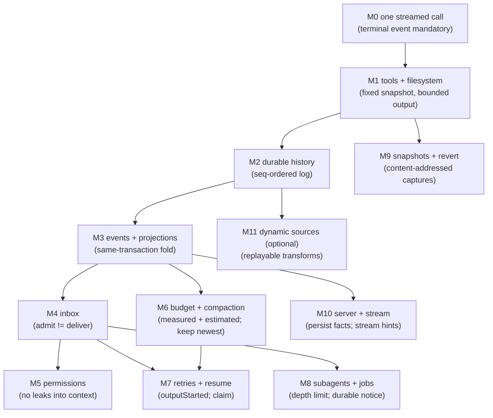
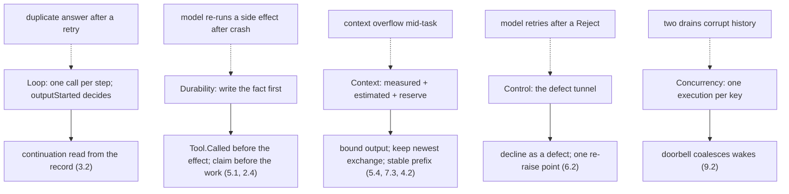

# Part 12 — Build it yourself

This is the synthesis. The eleven parts before it each described one mechanism of the same
machine, and every mechanism exists to make one of a small number of decisions correct. This
part turns that back into a build order: an ordered set of milestones (12.1), each introducing
exactly one invariant, and a catalog of the mistakes that invariant prevents (12.2). The
central claim is that the loop is not the hard part. A `while` loop that calls a model and runs
its tools is an afternoon; the work is *settlement* — deciding, from what has been written
down, whether the last step succeeded, failed, was truncated, or never finished, and doing that
again after the process died. Build in the order below and each milestone is provable on its
own. Build in the exciting order — loop first, persistence later — and you spend the rest of
the project retrofitting records that the earlier code decided it could live without.

The topics:

- **12.1 — The milestone roadmap.** M0 through M11, in order, each with its goal, the invariant
  it introduces, what breaks without it, the smallest test that proves it, and the part of the
  series it draws on. Includes a "what order and why" preamble and a minimum-viable-agent sketch.
- **12.2 — The pitfall catalog.** The failure modes each design in this series was built to
  avoid, with the symptom you will observe, the root cause, and the fix — plus the layered
  structure that explains why the symptom usually appears one layer away from the cause.

---

## 12.1 The milestone roadmap

### Thesis

A coding agent is built in the order that makes every later capability a query over durable
state rather than a new in-memory concern: durability precedes concurrency, and settlement —
not the loop — is where the work is.

### Cold open

You build the loop first because it is the fun part, and it works: call the model, run the
tools it asks for, append the results, call again. Then you add a retry and the model is called
twice in one step. You add steering and the correction arrives a turn late. You close the
laptop and everything the process remembered is gone. None of those are bugs in the features
you added. They are consequences of the order you built in.

### The concept

Two rules fix the order, and everything else follows.

**Durability precedes concurrency.** A concurrent system with no durable record has nothing to
serialize *on*: two fibers racing over an in-memory transcript corrupt it, and "one execution
per session" is a lock over a structure that a crash dissolves. Once every fact is a row — the
message, the tool result, the claim, the inbox item — concurrency becomes a query and a
doorbell (Part 9.2), and steering becomes an ordered promotion over durable rows (Part 4.3,
9.3). So M0–M3 build the record and the projection before M4 onward builds anything concurrent.

**The loop is not the hard part; settlement is.** A step is one model call (Part 3.2). The hard
part is that the call can end in six ways — a clean stop, a tool-call round, a length cut, a
content filter, a dropped stream, an unknown reason (Part 1.2) — and every one of them has to
be recorded before it can be acted on, so that a *different process* can later re-derive the
same decision. M0 already needs the terminal-event rule. M6 and M7 exist almost entirely to
make a decision the loop cannot make from memory: whether the context overflowed, whether
output was already visible, whether a tool ever settled. If you take one thing from this
series, take this: the interesting code is the settlement, not the loop.

The corollary orderings are consequences, not preferences. The model boundary (Part 1) comes
first because a canonical request and a canonical event stream are what make a "step" a thing
you can settle at all. Durable state (Part 2) comes before continuation logic (Part 3.2)
because continuation is a fold of the record. Tools (Part 5) come after M2 because a tool
result is only usable once it is durable, and after the request shape because a tool's
definition is advertised per request. Permissions (Part 6) come after tools because there is
nothing to gate until something can effect. Compaction (Part 7) and reliability (Part 8) come
after the loop because they are recovery from the two ways a step breaks: too long and
incomplete. Concurrency (Part 9) comes after durability. Snapshots (Part 10) come after tools.
The server (Part 11) comes last because it is only a view of facts the earlier milestones
already write.

Design note: treat each milestone as a gate, not a phase. Its test must pass before the next
begins, and it must still pass at the end. The tests below are chosen so that a later milestone
does not have to rewrite an earlier one to pass.

The ladder at a glance:

| # | Goal | Introduces | Draws on |
|---|---|---|---|
| M0 | One streamed model call behind a REPL | A mandatory terminal event; a canonical event union | 1.1, 1.2 |
| M1 | Tools plus filesystem read/write | A registry snapshot and a single call seam | 5.1–5.4 |
| M2 | Durable session history | An append-only log ordered by `seq` | 2.1 |
| M3 | Event sourcing and projections | Event → projector → read model in one transaction | 2.2, 2.5 |
| M4 | The inbox with steering and interrupt | Admission ≠ delivery; `steer` vs `queue` | 2.3, 9.3 |
| M5 | Permissions and questions | `ask`/`allow`/`deny` and the defect tunnel | 6.1–6.4 |
| M6 | Token budgeting and compaction | Measured+estimated budget; summary + verbatim recent window | 1.3, 7.1–7.3 |
| M7 | Retries, overflow recovery, crash resume | `outputStarted`; the write-ahead claim; stale settlement | 8.1–8.4, 2.4 |
| M8 | Subagents and jobs | A child session, a depth limit, a durable completion notice | 9.4 |
| M9 | Snapshots, diffs, revert | Content-addressed per-step captures; stage/clear/commit | 10.1–10.3 |
| M10 | The server and live event stream | Durable facts vs ephemeral hints | 11.1–11.3 |
| M11 | CodeMode, MCP, skills (optional) | Replayable dynamic tool and instruction sources | 4.5, 4.6, 5.7, 5.8 |

Each milestone in detail.

**M0 — a single streamed model call (a REPL).**
- *Goal.* Read a line, send one request, stream the reply to the terminal. Nothing else.
- *Invariant.* A model stream ends in a terminal event; a stream that ends without one is a
  failure, and events after the terminal are a failure (Part 1.2).
- *Without it.* "The `for await` finished" is treated as success, and a half-written tool call
  or a content-filtered reply flows into the next turn as though it were complete.
- *Smallest test.* Feed the assembler a stream with no terminal and assert it fails; feed it
  events after a `finish` and assert it fails.
- *Draws on.* 1.1 canonical request/response; 1.2 streaming events and finish reasons.

**M1 — tools plus filesystem read/write.**
- *Goal.* Register `read` and `write`, let the model call them, and run exactly one model call
  per turn with a continuation loop you can see in one function.
- *Invariant.* The tool set is fixed before the request is sent; a returned call is validated
  once against its schema and its result is normalized and bounded before it becomes content.
- *Without it.* A malformed argument object crashes the executor instead of becoming a
  model-readable error; a command that prints two megabytes is returned verbatim and eats the
  context; a tool registered after a request was built runs a call that was never advertised.
- *Smallest test.* Register a tool, take a snapshot, mutate the registry, and assert the
  snapshot's definitions and executor are unchanged; send a malformed argument object and
  assert the error names the tool, the field path, the JSON sent, and the retry instruction;
  run a producer that exceeds the limit and assert the result is a bounded head plus a marker
  naming the file that holds the rest.
- *Draws on.* 5.1 contract and registration; 5.2 snapshot; 5.3 validation and error
  formatting; 5.4 output normalization and bounding.

**M2 — durable session history.**
- *Goal.* Write every message to storage and read it back on restart.
- *Invariant.* Entries are ordered by a monotonic per-session `seq`, and history is always read
  in `seq` order, never by wall-clock time (Part 2.1).
- *Without it.* Two writes in the same millisecond reorder on read; a replay after a clock
  change diverges from what the model saw; the agent cannot tell "the model never started" from
  "the model finished."
- *Smallest test.* Append a batch of messages and assert strictly increasing `seq` values and
  read-back order independent of `time_created`; insert a duplicate `(session_id, seq)` and
  assert the unique index rejects it.
- *Draws on.* 2.1 sessions, ordered history, and message types.

**M3 — event sourcing and projections.**
- *Goal.* Write facts as events and fold them into queryable tables.
- *Invariant.* Events are minimal, and the projector and the sequence advance run in the *same
  transaction* as the recording (Part 2.2).
- *Without it.* A crash between "work accepted" and "message inserted" leaves the store half
  updated, and no retry can tell which half ran; two writers claim the same `seq`; a read model
  observes a half-written event.
- *Smallest test.* Publish an event and assert the read-model row exists the moment `publish`
  returns; inject a fault in the commit hook and assert neither the read model nor the sequence
  advanced; replay an event with a mutated field at the same `seq` and assert a defect rather
  than a silent overwrite.
- *Draws on.* 2.2 bus → projector → SQLite; 2.5 replay and read models.

**M4 — the inbox with steering and interrupt.**
- *Goal.* Accept input while the agent is busy, and let the user change their mind about when
  it lands. Interrupt a running execution.
- *Invariant.* Admission — recording that work exists — is separate from delivery — turning it
  into a visible message — and the inbox is pending-only; `steer` is delivered at the next safe
  step boundary and `queue` only when the session would otherwise go idle (Part 2.3).
- *Without it.* A message accepted microseconds before a crash vanishes; a queued prompt is
  promoted in the middle of an unrelated answer; a delivered row lingers and is re-delivered.
- *Smallest test.* Admit a `queue` item and assert nothing appears in history until an
  idle-scope promotion; promote with `steer` scope when only a queued item is pending and
  assert nothing is delivered; deliver an item and assert the inbox row is gone and the message
  row exists after the same publish returns.
- *Draws on.* 2.3 the inbox; 9.3 steering and promotion order.

**M5 — permissions and questions.**
- *Goal.* Ask the human before a tool runs, and let the model ask a structured question.
- *Invariant.* A plain decline never becomes model-visible output — it travels past the
  fault-tolerant boundaries and resurfaces typed at exactly one place — while a decline *with
  feedback* stays typed so the model continues (Part 6.2).
- *Without it.* A tool leaf's blanket error handler converts the "no" into a tool result, the
  model reads "denied" as "try another route," and the user rejects the same action twice.
- *Smallest test.* With an `ask` rule, reject with no message and assert the fiber exits with a
  defect that a leaf-level `mapError` cannot observe; reject with a message and assert a typed
  failure carrying the text reaches the model.
- *Draws on.* 6.1 rulesets; 6.2 ask/allow/deny and the defect tunnel; 6.3 batch semantics; 6.4
  the question tool.

**M6 — token budgeting and compaction.**
- *Goal.* Keep the request inside the window and free space when it is not.
- *Invariant.* Context size is *measured* (the provider's own usage from a same-provider
  response) plus *estimated* (characters per token with a margin), compared against a ceiling
  that leaves room for the reply; compaction replaces the oldest history with a summary plus a
  verbatim recent window and never drops the newest exchange (Parts 1.3, 7.1, 7.3).
- *Without it.* The provider rejects the request mid-task with a partial result; a summary that
  swallowed the newest exchange leaves the model working on last week's instruction; a summary
  sized to the whole window comes back as one line.
- *Smallest test.* Assert `measured + ceil(estimated × margin) + outputLimit` fits the window
  when there is room, and the floor applies otherwise; assert the newest exchange is never in
  the summarized part; assert a persisted checkpoint renders as one message at the front.
- *Draws on.* 1.3 output-token budgeting; 7.1 ceiling and reserve; 7.2 triggers and the shrink
  loop; 7.3 summarisation.

**M7 — retries, overflow recovery, and crash resume.**
- *Goal.* Survive a flaky provider, a too-long request, and the process dying mid-step.
- *Invariant.* "Did output start?" is read from the durable record, not memory, and selects
  retry versus continue; a claim written before the work, with no matching terminal, is the
  signature of a process that died (Parts 3.2, 2.4, 8.2).
- *Without it.* A transparent retry after visible output duplicates the answer; a
  rejected-too-long request is retried unchanged forever; a crashed turn is never resumed, or is
  resumed on every boot until it crash-loops.
- *Smallest test.* Script a stream that emits text and then fails retryably and assert the
  `Continue` path publishes exactly one synthetic message and starts exactly one new assistant
  message; seed a tool call left `running`, drain, and assert a `Tool.Failed` is published
  before any model call; seed a claim with no terminal, run recovery, and assert exactly one
  synthetic notice plus a bounded attempt count.
- *Draws on.* 8.1 retry policy; 8.2 retry vs continue vs recover-full; 8.3 error taxonomy; 8.4
  stale settlement; 2.4 the write-ahead claim.

**M8 — subagents and jobs.**
- *Goal.* Let the agent delegate a self-contained task to a child session.
- *Invariant.* A subagent is a child Session run by the same execution machinery, depth is
  bounded by an explicit limit, and completion is a durable notice admitted into the parent
  (Part 9.4).
- *Without it.* Unbounded recursion — a fork bomb with extra steps; fire-and-forget work whose
  result the parent never learns.
- *Smallest test.* Attempt to spawn at the depth limit and assert the limit error; run a
  background subagent and assert exactly one synthetic completion message, tagged with the
  child id, lands in the parent.
- *Draws on.* 9.4 subagents.

**M9 — snapshots, diffs, and revert.**
- *Goal.* Answer "what did this step change?" and put it back.
- *Invariant.* Change tracking is derived from the working tree, never from the model; a step's
  start and end captures are content-addressed, and revert is stage (reversible), clear (undo a
  stage), commit (delete history at the boundary) (Parts 10.1–10.3).
- *Without it.* There is no audit trail and no undo; a revert leaves the files the agent
  created still on disk because they were never in a captured tree.
- *Smallest test.* Capture, change one file, capture again, and assert exactly that path
  differs; stage a revert across a file creation and assert the file is deleted; commit and
  assert every message at or after the boundary is gone from the read model.
- *Draws on.* 10.1 snapshots; 10.2 diffs and per-step files; 10.3 revert.

**M10 — the server and the live event stream.**
- *Goal.* Let a remote client watch the agent work and drive it without polling tables.
- *Invariant.* Persist a fact if it is irreducible; stream a hint if it is derivable or
  transient; the read models rebuild from the durable log with the stream turned off entirely
  (Part 11.3).
- *Without it.* A reconnecting client silently loses facts that only ever arrived as deltas;
  persisting every delta bloats the log and forces every projector to handle noise.
- *Smallest test.* Turn the live stream off and assert every read model and the visible
  transcript rebuild from the durable events alone; assert every ephemeral delta has a durable
  sibling that carries the final value.
- *Draws on.* 11.1 bus → server → live stream; 11.2 driving the agent; 11.3 persist vs stream.

**M11 — optional: CodeMode, MCP, and skills.**
- *Goal.* Let tools and instructions come from outside the core without corrupting precedence
  or the prompt cache.
- *Invariant.* Dynamic tool sources register as replayable transforms captured per snapshot;
  an instruction source is canonicalized, hashed, stored once, and delivered as an initial
  render then a delta (Parts 5.1, 5.7, 4.3).
- *Without it.* Reloading an MCP tool list re-registers at the end of the transform order and
  silently overrides later plugin tools; changing one instruction file re-sends the whole
  baseline and resets the cache.
- *Smallest test.* Reload a tool source and assert registration precedence is preserved and an
  already-issued snapshot is unchanged; change one instruction file and assert the delta
  carries a hash and the baseline is byte-identical.
- *Draws on.* 4.3 instruction sources; 4.5 skills; 4.6 MCP; 5.7 CodeMode; 5.8 plugins as tool
  sources.

### Diagram

**D53 — the milestone dependency ladder.** Each milestone introduces one invariant; later
milestones only add, they do not rewrite.



```text
   M0 single call (terminal event)
       │
       ▼
   M1 tools + fs ────────────────► M9 snapshots + revert
       │
       ▼
   M2 durable history ───────────► M11 dynamic sources (optional)
       │
       ▼
   M3 events + projections ─────► M10 server + live stream
       │
       ├──────────────► M6 budget + compaction
       ▼
   M4 inbox (admit != deliver)
       ├──► M5 permissions ──► (context stays clean)
       ├──► M8 subagents + jobs
       └──► M7 retries + resume ◄── M6
```

**Narration.** The ladder is a chain with four side branches. M0 proves the model boundary and
the terminal-event rule. M1 adds tools on top of that. M2 writes history down, and M3 turns
that history into events and projections. From there the work forks: the inbox (M4) makes
admission separate from delivery, and on top of it sit permissions (M5), subagents (M8), and —
with the budget from M6 — retries and crash resume (M7). Three milestones attach to the
earlier record instead: snapshots and revert read the working tree the tools changed, the
server only streams the events the record already holds, and the optional dynamic sources reuse
the registry pattern from M1. No milestone edits an earlier one; it only reads what the earlier
one wrote.

### The real thing

The roadmap's load-bearing shapes are all in this series as short functions. The outer loop is
four lines; the single model call is one; the settlement decision is a fold.

```
// packages/core/src/session/runner/llm.ts:191
      while (true) {
        const next = yield* advanceToStep()
        if (next._tag !== "Ready") return next
        continuing = yield* runStep(next.context, step)
        step++
        force = false
        entering = false
      }
```

```
// packages/core/src/session/runner/step.ts:106
    // Read to the end, not just the finish event, so the next request can reuse this response.
    const providerStream = llm.stream(input.prepared.request, input.prepared.options).pipe(
```

```
// packages/core/src/session/runner/publish-llm-event.ts:652
    /** Immutable snapshot of everything recorded for this step so far. */
    record: (): StepRecord => ({
      outputStarted,
      providerFailed,
      failure: stepFailure,
      finish: stepSettlement,
      needsContinuation: Iterable.some(
        tools.values(),
        (tool) => !tool.providerExecuted && (tool.called || tool.settled),
      ),
    }),
```

What to notice:

- The whole loop is a `while` over `advanceToStep` and `runStep`. There is no inner loop over
  tool results; `runStep`'s own loop is over *attempts of the same step*, not over new steps
  (Part 3.1).
- `attempt` makes one `llm.stream` call. The comment on it names the roadmap's whole thesis:
  read to the end so the next request can reuse the response.
- `needsContinuation` in the record is *derived* from the tool states, not stored as an
  intention. This single expression is the difference between M7 and a crash-prone loop.
- Every milestone after M3 only reads these durable shapes; none of them adds a second decoder
  for the same fact.

### The prompts

This topic owns no prompts. It names the three the milestones reach for, so a builder wires
them in the right milestone rather than inventing them:

- `CONTINUE_AFTER_INCOMPLETE_STREAM` — M7, at `packages/core/src/session/runner/llm.ts:35`. The
  phrase "without repeating completed content" is load-bearing: without it a model restates the
  truncated answer from the top and doubles the transcript.
- `CONTINUE_AFTER_OUTPUT_LIMIT` — M6/M7, at `packages/core/src/session/runner/llm.ts:38`. It
  names the literal stop reason and forbids the three usual responses (apologize, recap,
  repeat), because those spend the budget that ran out.
- `MAX_STEPS_PROMPT` — the step ceiling, at `packages/core/src/session/runner/max-steps.ts:1`.
  "Tools are disabled until next user input" and "This constraint overrides ALL other
  instructions" exist because a reasoning model's own objective otherwise wins and it emits one
  more tool call.

The full text and design commentary for each live in Appendix A under **loop**.

### Build it

A minimum-viable agent for M1. This is the smallest thing that actually does a coding task:
one streamed model call per turn, two tools, a bounded result, and a continuation loop you can
read. Type it, run it, and then read every comment — each names the milestone that replaces the
shortcut. Roughly ninety lines.

```ts
// minimum-viable-agent.ts — M0 + M1. One model call per step; tools; a REPL.
// Comments mark the shortcuts a later milestone removes.

type Part =
  | { type: "text"; text: string }
  | { type: "tool-call"; id: string; name: string; input: unknown }
  | { type: "tool-result"; id: string; name: string; content: string }
type Message = { role: "system" | "user" | "assistant"; parts: Part[] }

// M1 tool. M5 wraps run() in a permission gate; M11 turns registration into a replayable transform.
type Tool = {
  name: string
  description: string
  run: (input: Record<string, unknown>) => Promise<string>
}
const tools = new Map<string, Tool>()

// Canonical stream event. M0 rule: the stream must end in `finish`.
type Event =
  | { type: "text-delta"; text: string }
  | { type: "tool-call"; id: string; name: string; input: unknown }
  | { type: "finish"; reason: "stop" | "tool-calls" | "length" | "error" | "unknown" }

// One model call per step. M6 computes maxTokens from measured+estimated; M1 lets the provider default.
async function* stream(messages: Message[], toolNames: string[]): AsyncGenerator<Event> {
  throw new Error("wire your provider here; emit deltas, then exactly one finish")
}

// M2 replaces this array with a durable, seq-ordered log. M3 replaces writes with events+projectors.
const history: Message[] = [{ role: "system", parts: [{ type: "text", text: "You are a coding agent." }] }]

// M5 replaces this. M1 runs everything.
async function gate(_name: string, _input: unknown): Promise<"allow" | "deny"> {
  return "allow"
}

// M1 tool execution: model-readable errors and bounded output (Part 5.3, 5.4).
async function runTool(call: { id: string; name: string; input: unknown }): Promise<string> {
  const tool = tools.get(call.name)
  if (!tool) return `No tool named "${call.name}" is currently available.`
  // M1: trust the shape. M5.3 decodes against a real schema and names the bad field.
  const input = (call.input ?? {}) as Record<string, unknown>
  if (await gate(call.name, input) === "deny") return "The user declined this tool call." // WRONG for M5: see 12.2
  let out = await tool.run(input)
  const MAX_LINES = 2000, MAX_BYTES = 50 * 1024 // the real constants live in tool-output.ts
  if (out.length > MAX_BYTES) out = out.slice(0, MAX_BYTES) + `\n[truncated; full output not saved in M1]`
  return out
}

// M1 step: exactly ONE model call. The `while` here is the in-memory tool loop that
// M2/M3 remove — continuation becomes a decision read back from the durable record.
async function turn(userText: string): Promise<void> {
  history.push({ role: "user", parts: [{ type: "text", text: userText }] })
  while (true) {
    const assistant: Message = { role: "assistant", parts: [] }
    history.push(assistant)

    let terminated = false
    let needsContinuation = false
    for await (const event of stream(history, [...tools.keys()])) {
      if (terminated) throw new Error("event after terminal")        // M0 invariant
      if (event.type === "text-delta") {
        assistant.parts.push({ type: "text", text: event.text })
        process.stdout.write(event.text)                              // M10 streams this to a client
      }
      if (event.type === "tool-call") {
        assistant.parts.push({ type: "tool-call", id: event.id, name: event.name, input: event.input })
        // M2 records Tool.Called BEFORE running the tool; M7 recovers an unsettled call after a crash.
        const content = await runTool(event)
        assistant.parts.push({ type: "tool-result", id: event.id, name: event.name, content })
        needsContinuation = true                                      // M3 derives this from the record
      }
      if (event.type === "finish") {
        terminated = true
        if (event.reason === "tool-calls") needsContinuation = true
        if (event.reason === "length") needsContinuation = true       // M6/M7: nudge rather than re-ask
        if (event.reason === "error" || event.reason === "unknown") throw new Error("incomplete stream") // M0/M8
      }
    }
    if (!terminated) throw new Error("incomplete stream")             // M0 invariant
    if (!needsContinuation) return
  }
}

// The REPL. M10 replaces this with a server that admits prompts and streams events.
async function main() {
  tools.set("read", { name: "read", description: "Read a file", run: async (i) => Bun.file(String(i.path)).text() })
  tools.set("write", {
    name: "write", description: "Write a file",
    run: async (i) => { await Bun.write(String(i.path), String(i.content)); return "ok" },
  })
  const lines = repl()                                  // your readline loop
  for await (const line of lines) await turn(line)
}
```

Decisions and trade-offs:

- **Put the terminal-event check in M0, not later.** It is the cheapest invariant in the whole
  series and the one a half-written response violates most often.
- **Bound output in the same milestone that introduces tools.** An unbounded result is a
  context-overflow bug that looks like a provider bug.
- **Accept the in-memory loop in M1, name it, and plan to remove it.** The loop is how a
  beginner gets a working tool call; making it explicit that M2/M3 remove it is the teaching
  move. Do not pretend the M1 loop is durable.
- **Do not add a second place that decides continuation.** When you reach M2, the `while (true)`
  collapses into "reload, advance, run one step, ask the record whether to continue."

### How it fails

- **Built in the exciting order.** The loop works in the demo, then every later milestone is a
  retrofit: retries duplicate calls, steering arrives late, and the crash story has no records
  to recover from. The cost is not one rewrite; it is that each feature needs its own workaround.
- **A milestone skipped as "obvious."** Skipping M3 (projections in the recording transaction)
  reintroduces the crash window between admitting work and inserting the message. Skipping M2's
  `seq` rule reintroduces clock-ordered history.
- **A milestone test that mocks the mechanism.** If the M4 test fakes the inbox, it cannot catch
  the pending-only violation; the whole value of the gate is that it drives the real store.
- **Teaching the loop first because it is narratable.** The loop is easy to explain and easy to
  build, which is exactly why it gets built before the record — and why the record is the
  expensive part to add later.

### How you'd test it

The roadmap is tested by the pipeline, not by a unit test. Assert the build invariant: **each
milestone's test passes on its own, and still passes unmodified after the next milestone
lands.** Concretely, keep the milestone tests in one suite ordered M0…M10 and fail the suite if
any earlier test needs a code change when a later milestone is added. The one deliberate
exception is M1's in-memory loop, whose *test* (a single model call per turn, a bounded result)
survives even as its *implementation* is replaced by the durable drain; assert that the
observable behavior — one call per step, one bounded result per call — is identical before and
after.

### Recap

- Build durability before concurrency and settlement before features; the loop is the cheap part.
- Each milestone introduces exactly one invariant and must not require rewriting an earlier one;
  the ladder is M0–M5 for the core, M6–M9 for survival and change, M10–M11 for the edges.
- The minimum-viable agent for M1 is one streamed call per turn plus two bounded tools, with
  every deferred shortcut named in a comment.

Next: the specific mistakes those invariants exist to prevent, in the order you are most likely
to make them.

### Podcast notes

- **Hook:** The demo loop works perfectly until you add the second feature, and then every
  feature you add makes the first one worse.
- **Analogy:** Building a house from the roof down: the loop is the roof and it looks finished
  first, but nothing above it holds until the foundation (the record) is poured.
- **Talking points:** Durability precedes concurrency because a concurrent system with nothing
  durable has nothing to serialize on. The loop is four lines; the settlement is the product.
  Each milestone is a gate with one invariant and one test, and later milestones only read what
  earlier ones wrote.
- **Listeners will ask:** "Can't I add persistence at the end?" — You can, but every feature
  built before it assumed the state would stay in memory, so the cost is a rewrite of each one.

---

## 12.2 The pitfall catalog

### Thesis

Every pitfall below is a real design mistake that one mechanism in this series was shaped to
avoid; the symptom usually appears one layer away from the cause, which is why the fix is
almost always "make the earlier decision durable" rather than "handle this symptom."

### Cold open

The agent asks "may I run this?", you click Reject, and then it runs the command anyway — by a
different route — so you reject it again. Nothing is broken in the permission check; the
problem is that the "no" reached the model as text. The same shape recurs everywhere: a
symptom that looks like a feature bug is actually a fact that was never written down, or a
decision that was made from memory instead of from the record.

### The concept

A pitfall catalog is only useful if it names the *cause*, because the symptom is where you
notice it and the cause is where you fix it. Read the table as a lookup, then read the layered
explanation below, which is the actual lesson.

| Pitfall | Symptom you observe | Root cause | Fix |
|---|---|---|---|
| **The in-memory tool loop (two loops fighting)** | After you add retries or compaction, the model is called twice in one step, or a tool result lands after the step settled. | Two places decide continuation: a `while` over tool results in the caller, and the runner's own step loop. | One step = one `llm.stream`; continuation is derived from the record (3.2). |
| **Non-durable tool results** | After a restart, a tool call has no result; the next request is malformed, or the model invents a result. | Results appended to an in-memory array; the side effect ran with no recorded call. | Publish `Tool.Called` before executing and `Tool.Success`/`Failed` on settlement (5.1, 8.4). |
| **Retrying after visible output** | The user sees the first half of the answer twice; the transcript contains duplicated content. | A transparent retry is issued after `outputStarted` is already true. | Split retry (no output) from continue (output) using the record; continue appends one synthetic nudge (8.2). |
| **Retrying when the context overflowed** | The same "too long" request is sent repeatedly and rejected identically. | An overflow is treated as an ordinary retryable failure. | Detect a context overflow before output, compact, retry the same step — at most once (3.2, 7.2). |
| **Invalidating the prompt cache every request** | Every request is billed as full-price input; cost jumps with no behavior change. | System prompt reordered, or the date placed first; tool definitions removed on the final step; compaction re-running every step. | Most-shared-first ordering; keep tool definitions on the terminal step; compact once at the threshold (4.2, 3.4, 7.5). |
| **Unbounded tool output** | One command's output fills the window; the model loses the middle of its own work. | Raw result bytes are returned as content. | Bound to a head or tail plus a marker naming a file that holds the rest (5.4). |
| **Converting a user's "no" into model-visible output** | After a Reject, the model retries the same action another way. | The decline is delivered as a typed tool error that a leaf `mapError` converts into a result the model reads. | The defect tunnel: the decline travels past fault-tolerant boundaries and resurfaces typed at exactly one place; feedback stays typed (6.2). |
| **Deciding continuation from memory instead of the record** | After a crash the agent stops early, or re-runs a tool it already ran. | Continuation lives in a local variable of the running fiber. | Derive `needsContinuation` from tool states plus finish reason, read back from the record (3.2). |
| **No step ceiling** | A hard task loops forever; the agent never ends a turn. | No per-turn allowance on model calls. | Per-turn counter, a terminal step with `toolChoice: "none"` and `MAX_STEPS_PROMPT`, `needsContinuation` forced false (3.4). |
| **No write-ahead claim (silent double execution after a crash)** | A step runs twice, or a finished turn is resumed on the next boot. | Recovery depends on a shutdown hook, which does not run on `SIGKILL`. | Write the claim in the same transaction as the started event; a surviving claim with no terminal is the crash signature; bound resumes with attempt accounting (2.4, 8.4). |
| **Two executions for one session** | Two drains interleave; history is corrupted; steps are duplicated. | Each wake starts its own fiber. | One execution per key; a second wake rings the doorbell instead of starting a fiber (9.2). |
| **Compaction that drops the newest exchange** | After compaction the model works on the previous instruction and forgets the current one. | Shrinking to fit drops whole exchanges including the newest. | Keep the newest exchange verbatim; if it alone does not fit, fail rather than drop it (7.2, 7.3). |
| **Compaction that re-summarises its own summary forever** | The summary keeps growing; or a summary of a summary after a model switch; or the cache is invalidated every step. | No initial/update distinction, no re-compaction suppression, no checkpoint provenance. | Initial vs update prompts with reconciliation, a one-time legacy rewrite, `due` refuses a second compaction, native checkpoints are provenance-gated (7.3, 7.4, 7.5). |
| **Tool input arriving truncated at the step limit** | A tool runs with a partial argument object, or executes from a step that was supposed to have tools disabled. | The streaming partial parse is used as input, or a call from a `toolChoice: "none"` request is executed anyway. | The authoritative input is the parsed `tool-call`, or a `tool-input-error`; the terminal step keeps tools advertised but refuses to run them (1.2, 3.4, 5.3). |
| **Image/heavy media blowing the request budget** | The provider rejects a request as payload-too-large; the step stalls. | Inline base64 images and PDFs count against *bytes*, not tokens, and unsupported parts are sent anyway. | Normalize images (resize or omit with a note), bound unsupported parts, and on payload-too-large resend as text (1.3, 5.4, 7.2). |

The layered explanation. Pitfalls cluster by the layer that owns the fact in question, and the
symptom is usually reported one layer up:

- **Durability (M2/M3).** *Non-durable tool results*, *deciding continuation from memory*, and
  the *write-ahead claim* pitfalls are all one mistake: a fact that the system treats as true
  before it is on disk. The fix is never local to the symptom; it is to write the fact first.
- **The loop (M0/M1/M7).** *The in-memory tool loop*, *retrying after visible output*, and
  *retrying when the context overflowed* are all "the loop decided something the record could
  answer." The record is the single source of the decision.
- **Context (M6).** *Unbounded tool output*, *image/heavy media*, *dropping the newest exchange*,
  *re-summarising the summary forever*, and *invalidating the prompt cache* are all the same
  budget question: what is the request's size, what is its stable prefix, and what may be
  discarded. Get the measurement right and these become one mechanism with several triggers.
- **Control (M5).** *Converting a user's "no" into output* and *tool input truncated at the step
  limit* are both "a boundary let a decision leak into the model's context." The fix is a
  boundary that is un-swallowable on one side and explicit on the other.
- **Concurrency (M4/M8).** *Two executions for one session* and *no step ceiling* are both
  "nothing bounds the work." One bounds it per session; the other per turn.

Design note: when you hit one of these symptoms, look one layer *below* where you felt it. A
model that retries after a rejection is a correctness bug in the error channel, not in the
tool; a transcript that duplicates after a crash is a durability bug, not a display bug.

### Diagram

**D54 — symptoms map to layers, and the layer names the fix.** The dashed lines are where the
symptom is observed; the solid lines are where the fix lives.



```text
  symptom (one layer up)                layer (owns the fact)        fix
  ──────────────────────                ─────────────────────        ───
  duplicate answer ───────────────►  Loop            ─────────►  one call/step; outputStarted
  re-run after crash ─────────────►  Durability      ─────────►  write first, act second
  context overflow ───────────────►  Context         ─────────►  budget + keep newest
  retry after "no" ───────────────►  Control         ─────────►  defect tunnel
  two drains corrupt history ─────►  Concurrency     ─────────►  one execution per key
```

**Narration.** Each symptom you will actually notice points at a layer below it. A duplicated
answer is a loop problem, so the fix is to make continuation a fold of the record. A re-run
side effect is a durability problem, so the fix is to record the call before running it. An
overflow is a context problem, so the fix is the budget. A retry after a refusal is a control
problem, so the fix is the defect tunnel. Concurrent corruption is a concurrency problem, so
the fix is one execution per key. Fix the layer, not the symptom.

### The real thing

The code that makes the top pitfalls structurally impossible is small. The settlement fold is
one expression; the coordinator's doorbell is one field.

```
// packages/core/src/session/run-coordinator.ts:32
/**
 * One execution is a busy period for one key: one fiber that drains from the first wake
 * until the key would stay idle. `pendingWake` is the doorbell: work recorded during the
 * execution rings it with the scope that work needs, and the execution loop drains again
 * instead of ending. The doorbell closes the gap between a drain's last eligibility check
 * and the idle transition, since those cannot be one atomic step. `done` resolves joiners
 * with this execution's exit.
 */
```

```
// packages/core/src/session/inbox.ts:490
/**
 * Promotes pending input into visible messages and returns the promoted count,
 * or undefined when the runner must first handle a pending control.
 * Steered compaction takes priority over pending prompts, without crossing a move.
 * Only the "input" scope may fall through to one queued input.
 */
```

```
// packages/core/src/tool-output.ts:90
      const marker = `[showing ${shown} of ${lines.length}; full output saved to ${file}]`
```

What to notice:

- The coordinator comment is the one-sentence fix for "two executions for one session": work
  recorded during an execution *rings a doorbell*, it does not start a second fiber. There is
  no way to express the pitfall without ignoring this field.
- The `promote` comment fixes the ordering pitfalls (queued work hijacking a run, compaction
  swallowing steered text, a control crossed by a move) in one paragraph. This is why the design
  is worth reading: the comment is the specification.
- The tool-output marker is the fix for "unbounded tool output" made visible: the model is told
  it is looking at a partial result and where the rest lives, so the loss is recoverable rather
  than silent.
- None of these three fixes is about the symptom. Each makes the *cause* unrepresentable.

### The prompts

This topic owns no prompts. The model-facing strings the pitfalls involve — the invalid-arguments
message (`packages/core/src/tool/runtime.ts:88`), `MAX_STEPS_PROMPT`
(`packages/core/src/session/runner/max-steps.ts:1`), and the two synthetic continuation
instructions (`packages/core/src/session/runner/llm.ts:35`, `:38`) — are quoted and explained in
the parts that own them (5.3, 3.4, 3.2) and collected in Appendix A under **loop** and
**built-in tools**. A builder should copy them from there rather than invent equivalents; each
non-obvious phrase encodes a specific failure this catalog lists.

### Build it

A catalog is only a tool if it becomes tests. One regression test per pitfall, each written
against the real mechanism:

```text
suite "pitfalls":
  # loop
  test one_call_per_step:              scripted provider; count llm.stream per step == 1
  test retry_only_before_output:       N deltas then retryable fail ⇒ Retry if N==0 else Continue
  test overflow_shrinks_not_retries:   overflow before output ⇒ Compacted, retry same step, once
  # durability
  test tool_result_durable:            crash after Tool.Called ⇒ drain publishes Tool.Failed first
  test continuation_from_record:       kill after stream, restart ⇒ same continuation decision
  test claim_survives_crash:           claim with no terminal ⇒ exactly one resume, bounded
  # context
  test bounded_output:                 2 MB command ⇒ head/tail + marker + outputPath
  test keep_newest_exchange:           over-large newest exchange ⇒ fail, do not drop
  test stable_prefix:                  same inputs twice ⇒ byte-identical system parts
  # control
  test decline_not_in_context:         reject with no message ⇒ defect, no model-visible text
  test terminal_step_refuses_tools:    toolChoice=none + tool call ⇒ error, needsContinuation=false
  # concurrency
  test one_execution_per_key:          wake twice during a drain ⇒ one drain, then a second
```

Design note: write each test against the real service, not a copy of the branch. The whole
point of the catalog is that the *mechanism* prevents the pitfall; a test that reimplements the
branch tests nothing.

### How it fails

- **Fixing the symptom.** Disabling retries entirely "fixes" duplicate output and breaks
  reliability; suppressing the permission error "fixes" the retry-after-a-no and turns a deny
  into a silent allow. Each symptom has a layer that owns it.
- **Testing a copy of the logic.** A test that re-checks `outputStarted > 0` in the test file
  passes while the real step still retries after output. Drive the real step with a scripted
  stream.
- **Assuming `undefined` and `[]` are the same.** "No snapshot" and "no changes" both look like
  nothing; only one is a bug (10.2).
- **Trusting one provider's count.** A budget computed from another provider's token count
  fires compaction at the wrong time or overflows (7.1).
- **A bounded queue that silently drops.** The live feed is allowed to miss events by contract;
  a client that renders only from deltas drifts. Reconcile at the durable end event (11.1).

### How you'd test it

The catalog's own invariant: **for every pitfall, there is exactly one test, it drives the real
mechanism, and it fails when the fix is reverted.** Assert this as a meta-property by mutation:
revert each fix in turn (remove the `outputStarted` guard, stop deleting the inbox row, drop the
`toolChoice` guard) and confirm exactly the expected test goes red and no other test does. If a
revert breaks several tests, the pitfall is not isolated to one layer and the fix is in the
wrong place.

### Recap

- Every pitfall is a fact treated as true before it is recorded, a decision made from memory
  instead of the record, or a boundary that leaked into the model's context.
- The symptom is observed one layer above the cause; fix the layer, not the symptom.
- Each design in this series is best understood as the pitfall it makes unrepresentable, and
  each is provable by one test that drives the real mechanism.

This closes the series. From here, the appendices are the working reference: Appendix A for the
prompts each milestone needs, Appendix C for the anchors behind every excerpt, and Appendix B
for the diagrams.

### Podcast notes

- **Hook:** The agent asked permission, you said no, and it did it anyway — not because the gate
  failed, but because the "no" reached the model as text.
- **Analogy:** A building inspection: the crack is on the fourth floor, but the load that
  caused it sits in the foundation, and that is where the repair goes.
- **Talking points:** Every pitfall is a durable fact written too late, a decision read from
  memory, or a boundary that leaked. The symptom shows up one layer above the cause, so name the
  layer before you name the fix. Each fix in the series is designed to make the mistake
  unrepresentable rather than to handle it.
- **Listeners will ask:** "Which pitfall should I watch for first?" — the in-memory tool loop,
  because it is the easiest to write and it hides every durability bug behind a working demo.
