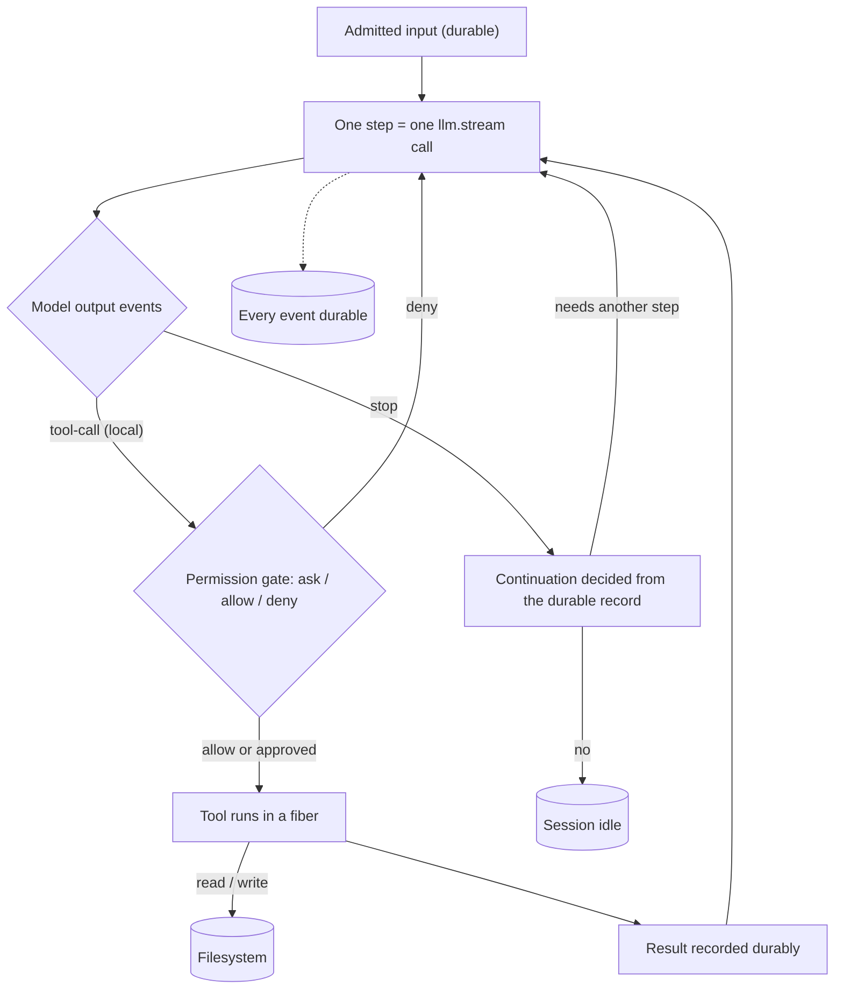
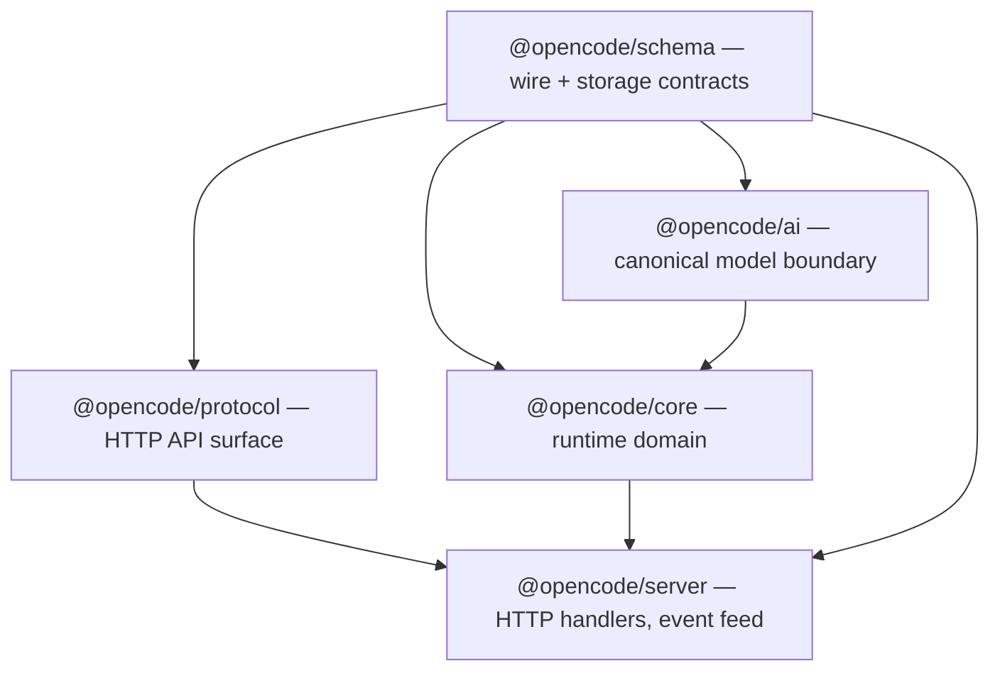

# Episode 1 companion — The loop is the product

Show notes for the episode. This is where the material the audio skips is allowed to live:
code, file paths, and diagrams.

**Topics:** 0.1, 0.2 · **Runtime:** 25 minutes · **Written sources:** Part 0

---

## What the episode claims, and where to check it

| Claim | Source |
|---|---|
| An agent is a loop, tools, a filesystem, persistence, and permission | `00-orientation.md` § 0.1 |
| The naive in-memory loop fails in five structural ways | `00-orientation.md` § 0.1 |
| A step is one model call and one durable record | `00-orientation.md` § 0.1; Appendix D |
| Continuation is decided from the recorded history, not a live closure | `00-orientation.md` § 0.1 |
| `ai` sits beside core, not beneath it | `00-orientation.md` § 0.2 |
| Services are declared global or Location-scoped | `00-orientation.md` § 0.2 |
| A global coordinator routes a session to its Location's runner | `00-orientation.md` § 0.2 |

---

## The rule, exactly as the repository writes it

The episode reads this aloud minus one code identifier. Here is the source line, verbatim.

```
// AGENTS.md:183
- Each step is one explicit `llm.stream` call that continues from reloaded history. Do not add an in-memory tool loop.
```

The spoken version says "model stream call" where the source writes a code identifier. That
substitution is deliberate: the identifier cannot be spoken. The prohibition is unchanged.

---

## The three nested functions

The loop the episode describes is three nested functions. `drain` decides what work exists
and iterates; `advanceToStep` prepares one boundary; `runStep` owns the policy for one step;
`attempt` owns the streaming and the durable settlement of one try.

```
// packages/core/src/session/runner/llm.ts:191
      while (true) {
        const next = yield* advanceToStep()
        if (next._tag !== "Ready") return next
        continuing = yield* runStep(next.context, step)
        step++
        force = false
        entering = false
      }
```

Notice the exit type. `drain` returns a `DrainResult`, whose cases are the only ways out of
the loop. Continuation is data, not control flow.

```
// packages/core/src/session/runner/index.ts:30
/** Runs one local continuation from already-recorded Session history. */
export interface Interface {
  /** Drains eligible durable work, returning transient state when execution must continue at a new Location. */
  readonly drain: (input: {
    readonly sessionID: SessionSchema.ID
    readonly force: boolean
    readonly continuation?: Continuation
    /** "steer" settles the active intent without promoting queued next-turn work. */
    readonly promotable?: Promotable
  }) => Effect.Effect<DrainResult, RunError>
}
```

## One step is one call

`runStep` builds exactly one request per iteration and hands it to exactly one attempt. The
retries and continuations in the loop are new iterations building a new request from reloaded
history, not a tool loop.

```
// packages/core/src/session/runner/llm.ts:227
        const transcript = SessionModelRequest.baseTranscript({
          agent: loaded.agent.info,
          model: loaded.model,
          tools: loaded.tools,
          initial: loaded.initial,
          messages: loaded.messages,
        })
        const prepared = yield* context.request.primary({
          session: loaded.session,
          agent: loaded.agent.id,
          model: loaded.model,
          tools: loaded.tools,
          system: transcript.system,
          messages: stepLimitReached
            ? [...transcript.messages, Message.assistant(MAX_STEPS_PROMPT)]
            : transcript.messages,
          // Keep tool definitions on the final Step to preserve the provider's cached prefix.
          toolChoice: stepLimitReached ? "none" : undefined,
          webSocket: "session",
          inputTokens: SessionCompaction.estimatePrompt(loaded),
        })
        const outcome = yield* steps.attempt({
```

The single model call for the step is the stream at the top of the attempt. Note that a local
tool call starts a fiber; a hosted tool, one the provider runs itself, does not, because its
result arrives inside the same stream.

```
// packages/core/src/session/runner/step.ts:107
    const providerStream = llm.stream(input.prepared.request, input.prepared.options).pipe(
      Stream.runForEach((event) =>
        Effect.gen(function* () {
          if (overflowFailure || publisher.hasProviderError()) return
          // Wait here, where cancellation still works, rather than inside the uninterruptible publish.
          if (!publisher.hasStarted()) yield* Fiber.join(pendingStartSnapshot)
          …
          yield* publisher.publish(event)
          if (event.type !== "tool-call" || event.providerExecuted) return
```

---

## The map

**D16 — What a coding agent is.** The five ingredients and the one-call-per-step rule.



**D1 — Layering and module dependencies.** Contracts point inward.



## Scope, by construction

A node declares its scope by the constructor it uses.

```
// packages/util/src/effect/app-node.ts:3
export const tags = LayerNode.tags({
  location: ["global"],
  global: [],
})

export type GlobalGraph<A, E = never> = LayerNode.Graph<A, E, (typeof tags.values)["global"]>
export type LocationGraph<A, E = never> = LayerNode.Graph<A, E, (typeof tags.values)["location"]>

export const makeGlobalNode = tags.make("global")
export const makeLocationNode = tags.make("location")
```

The seam where the two scopes meet is one line. A process-wide coordinator routes the session
to its Location's services before draining.

```
// packages/core/src/session/execution.ts:93
      const session = yield* store.get(sessionID)
      if (!session) return yield* Effect.die(new Error(`Session not found: ${sessionID}`))
      const result = yield* SessionRunner.Service.use((runner) =>
        runner.drain({ sessionID, force, continuation, promotable }),
      ).pipe(
        instances.provide(session),
```

---

## Vocabulary from this episode

Full definitions in [`../appendices/D-glossary.md`](../appendices/D-glossary.md).

- **Step** — one model call and its durable record.
- **Execution** — one busy period for a session, from the first wake until it would go idle.
- **Drain** — one pass over the work that is eligible to run.
- **Turn** — the stretch from taking new input until the session would go idle; a sequence of
  steps.
- **Inbox** — the durable, pending-only queue of admitted work.
- **Projection** — folding a durable event into a read model inside the event's transaction.

Never call a step a turn.

---

## Next episode

Episode 2, *Talking to a model*: the canonical request and response, the streaming event
union, and which provider details are allowed to leak into correctness. Part 1, topics 1.1,
1.2, and 1.4.
