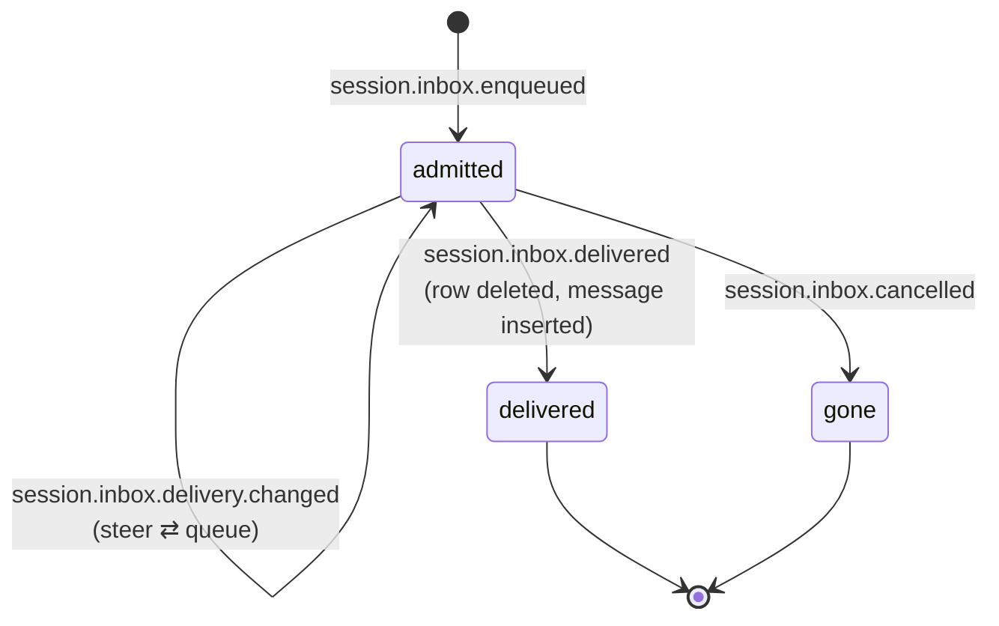

# Episode 4 companion — The inbox

Show notes for the episode. This is where the material the audio skips is allowed to live:
code, file paths, and diagrams.

**Topics:** 2.3 · **Runtime:** 25 minutes · **Written sources:** Part 2, § 2.3

---

## What the episode claims, and where to check it

| Claim | Source |
|---|---|
| Admission records that work exists; delivery inserts the visible message | `02-durable-state.md` § 2.3, "The concept" |
| Admission publishes an enqueued event; its projection inserts one pending row | `02-durable-state.md` § 2.3, "The real thing"; `packages/core/src/session/projector.ts:650` |
| Delivery deletes the pending row and inserts the message in the same transaction | § 2.3; `packages/core/src/session/inbox.ts:319` |
| The table is pending-only, with no delivered status | § 2.3, "The concept" and "Decisions and trade-offs" |
| Admission is idempotent on the caller's item identifier; a retry returns the existing item | § 2.3; `packages/core/src/session/session.ts:145` |
| Admission ends with a separate wake; `resume: false` admits without scheduling | § 2.3; `packages/core/src/session/session.ts:145` |
| Delivery modes are steer and queue, stored on the row, and changeable while pending | § 2.3, "The concept"; `packages/schema/src/session-inbox.ts:37` |
| Prompts steer by default; queued input is the opt-in | § 2.3, "What to notice" |
| `steer` scope never promotes queued input; `input` scope promotes exactly one | § 2.3; `packages/core/src/session/inbox.ts:490` |
| A steered compaction is pulled ahead of earlier steers, and never crosses a move | § 2.3; `packages/core/src/session/inbox.ts:533` |
| A cancel makes later delivery fail with a lifecycle conflict | `packages/core/src/session/inbox.ts:319`; § 2.3, "How you'd test it" |
| There are four item kinds: user, synthetic, compaction, move | `packages/schema/src/session-inbox.ts:37` |

---

## The artifact, exactly as the material writes it

The episode reads these two definitions aloud, with the labels spoken as sentences. Here
they are with their original formatting:

> - **Steer** — input that should influence work already in progress. It is delivered at the
>   next safe step boundary. Prompts steer by default.
> - **Queue** — input that should start new work. It is delivered only when the Session would
>   otherwise go idle.

Source: `02-durable-state.md` § 2.3, "The concept".

The mode is a stored field on the pending row, not a property of the message:

```
// packages/core/src/session/sql.ts:125
export const SessionInboxTable = sqliteTable(
  "session_inbox",
  {
    id: text().$type<SessionMessage.ID>().primaryKey(),
    session_id: text()
      .$type<SessionSchema.ID>()
      .notNull()
      .references(() => SessionTable.id, { onDelete: "cascade" }),
    type: text().$type<SessionInbox.Info["type"]>().notNull(),
    payload: text({ mode: "json" }).$type<UserPayload | SyntheticPayload | CompactionPayload | MovePayload>().notNull(),
    delivery: text().$type<SessionInbox.Delivery>().notNull(),
    enqueued_seq: integer().notNull(),
    time_created: integer()
      .notNull()
      .$default(() => Date.now()),
  },
  (table) => [
    index("session_inbox_session_delivery_seq_idx").on(table.session_id, table.delivery, table.enqueued_seq),
    uniqueIndex("session_inbox_session_enqueued_seq_idx").on(table.session_id, table.enqueued_seq),
  ],
)
```

---

## Four kinds of item

The inbox carries more than user text. A compaction and a move share the same ordered queue:

```
// packages/schema/src/session-inbox.ts:37
const UserItem = Schema.Struct({ type: Schema.tag("user"), payload: UserPayload, delivery: Delivery })
const SyntheticItem = Schema.Struct({ type: Schema.tag("synthetic"), payload: SyntheticPayload, delivery: Delivery })
const CompactionItem = Schema.Struct({
  type: Schema.tag("compaction"),
  payload: CompactionPayload,
  delivery: Delivery,
})
const MoveItem = Schema.Struct({ type: Schema.tag("move"), payload: MovePayload, delivery: Delivery })

export const Item = Schema.Union([UserItem, SyntheticItem, CompactionItem, MoveItem]).pipe(
  Schema.toTaggedUnion("type"),
  Schema.annotate({ identifier: "Session.Inbox.Item" }),
)
```

---

## Delivery consumes the row

The comment states the pending-only rule: the deleted row is what makes the table hold
nothing already shown.

```
// packages/core/src/session/inbox.ts:319
/**
 * Consume one pending row at promotion. The row's content feeds the projected
 * message insert inside the same event transaction; the deleted row is what
 * makes the table pending-only.
 */
export const projectDelivered = Effect.fn("SessionInbox.projectDelivered")(function* (
  db: DatabaseService,
  input: PendingRef,
) {
  const deleted = yield* db
    .delete(SessionInboxTable)
    .where(and(eq(SessionInboxTable.id, input.id), eq(SessionInboxTable.session_id, input.sessionID)))
    .returning()
    .get()
    .pipe(Effect.orDie)
  if (!deleted) return yield* Effect.die(new LifecycleConflict({ id: input.id }))
  return fromRow(deleted)
})
```

---

## Promotion, and the scope that gates the queue

The header comment is the rule the episode calls the boundary rule. Note `undefined` when a
control is at the head, and that only the `input` scope may fall through to one queued item.

```
// packages/core/src/session/inbox.ts:490
/**
 * Promotes pending input into visible messages and returns the promoted count,
 * or undefined when the runner must first handle a pending control.
 * Steered compaction takes priority over pending prompts, without crossing a move.
 * Only the "input" scope may fall through to one queued input.
 */
export const promote = Effect.fn("SessionInbox.promote")(function* (
  db: DatabaseService,
  bus: Bus.Interface,
  sessionID: SessionSchema.ID,
  scope: Promotable,
) {
  return yield* serialized(
    sessionID,
    Effect.gen(function* () {
      const steers = yield* pendingSteers(db, sessionID)
      if (steers.length > 0 || scope === "steer") {
        const control = steers.findIndex((row) => row.type === "compaction" || row.type === "move")
        if (control === 0) return undefined
        return yield* publish(db, bus, sessionID, control === -1 ? steers : steers.slice(0, control))
      }

      const queued = yield* db
        .select()
        .from(SessionInboxTable)
        .where(and(eq(SessionInboxTable.session_id, sessionID), eq(SessionInboxTable.delivery, "queue")))
        .orderBy(asc(SessionInboxTable.enqueued_seq))
        .limit(1)
        .get()
        .pipe(Effect.orDie)
      if (!queued) return 0
      if (queued.type === "compaction" || queued.type === "move") return undefined
      const promoted = yield* publish(db, bus, sessionID, [queued])
      const arrivedSteers = yield* pendingSteers(db, sessionID)
      const control = arrivedSteers.findIndex((row) => row.type === "compaction" || row.type === "move")
      return (
        promoted +
        (yield* publish(db, bus, sessionID, control === -1 ? arrivedSteers : arrivedSteers.slice(0, control)))
      )
    }),
  )
})
```

---

## Why a steered compaction jumps the line

```
// packages/core/src/session/inbox.ts:533
const pendingSteers = (db: DatabaseService, sessionID: SessionSchema.ID) =>
  db
    .select()
    .from(SessionInboxTable)
    .where(and(eq(SessionInboxTable.session_id, sessionID), eq(SessionInboxTable.delivery, "steer")))
    .orderBy(asc(SessionInboxTable.enqueued_seq))
    .all()
    .pipe(
      Effect.orDie,
      Effect.map((rows) => {
        // A move changes the context's Location: never pull compaction across it.
        // Within that boundary, compact before promoting even earlier steers so
        // their text stays verbatim after the checkpoint, not inside its summary.
        const control = rows.findIndex((row) => row.type === "compaction" || row.type === "move")
        if (control > 0 && rows[control].type === "compaction") rows.unshift(...rows.splice(control, 1))
        return rows
      }),
    )
```

---

## The diagram

**D4 — inbox delivery state machine.** A row appears on admission, lives with a delivery
mode that can be flipped either way, and ends by being cancelled or by delivery, which
deletes the row and inserts the message. The full picture and its narration are in
Appendix B, and inline in `02-durable-state.md` § 2.3.



---

## Vocabulary from this episode

Full definitions in [`../appendices/D-glossary.md`](../appendices/D-glossary.md).

- **Admission** — recording that work exists, before any execution is scheduled.
- **Delivery** — consuming an inbox row and inserting the visible message in the same
  transaction.
- **Steer** — input meant to influence work already in progress, delivered at the next safe
  step boundary.
- **Queue** — input meant to start new work, delivered only when the session would otherwise
  go idle.
- **Control item** — an inbox item that is not user text: a compaction or a move.
- **Promote** — consume pending rows and turn them into visible messages.
- **Pending-only** — a row exists only while the work is unconsumed.

Never swap steer and queue. Never call a pending row a message.

---

## Next episode

Episode 5, *The drain and step machine*: the four phases of the loop, the six outcomes of a
step, and why continuation is read from the record. Part 3, topics 3.1 to 3.5.
