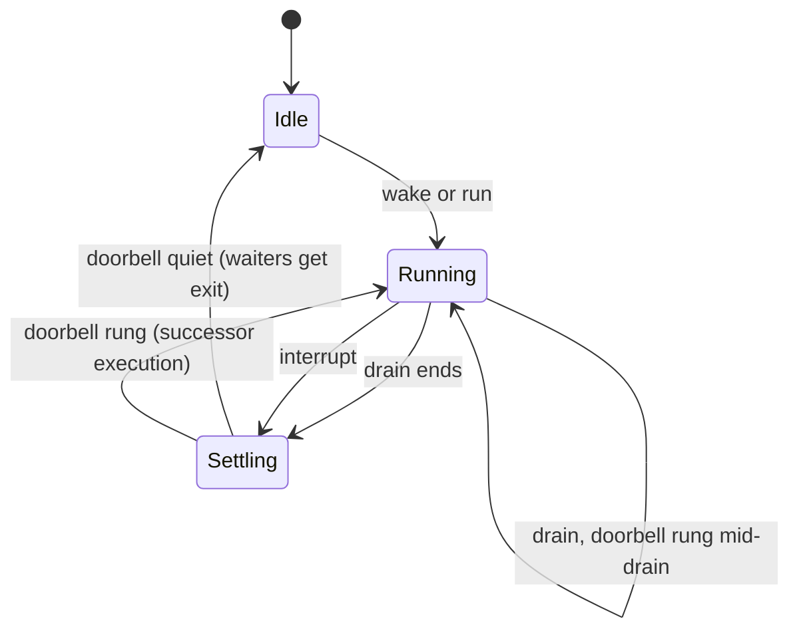

# Episode 16 companion — Concurrency and steering

Show notes for the episode. This is where the material the audio skips is allowed to live:
code, file paths, and diagrams.

**Topics:** 9.1, 9.2, 9.3, 9.5 · **Runtime:** 25 minutes · **Written source:** Part 9

---

## What the episode claims, and where to check it

| Claim | Source |
|---|---|
| Services are either one-per-process or one-per-directory, and the runner is per-directory | `09-concurrency-sessions.md` § 9.1 |
| A Location is a directory plus an optional workspace identity, resolved to a project | § 9.1 |
| Instances are built lazily and retained in a map keyed by the canonical Location | § 9.1 |
| Related sessions share a provider cache route: parent, else fork source, else own id | § 9.1 |
| An execution is one busy period for one key, draining from the first wake until the key would stay idle | § 9.2 |
| The doorbell is a single field on the execution, and it closes the idle-transition race | § 9.2 |
| Coalesced wakes keep the widest scope, because "input" subsumes "steer" | § 9.2 |
| A wake that survives the loop starts a successor at settlement | § 9.2 |
| Steer influences work in progress; a queued prompt starts new work at idle | § 9.3 |
| Among pending steers, a compaction moves ahead of the steers it would summarize | § 9.3 |
| A move is a hard boundary: nothing is promoted across it | § 9.3 |
| At an idle boundary, exactly one queued item is promoted | § 9.3 |
| The coordinator is keyed by session id, so different sessions run concurrently | § 9.5 |
| Interrupt targets the active execution only, and is acknowledged before cleanup finishes | § 9.5 |
| Interrupt claims the recorded wakes so settlement starts no dead-intent successor | § 9.5 |
| User and inactivity stops release the claim; a shutdown interrupt keeps it | § 9.5 |
| Resumption wakes with steer scope; queued next-turn prompts stay parked | § 9.5 |

---

## The doorbell comment, exactly as the repository writes it

The episode reads this aloud with two code field names spoken as "the pending wake field" and
"the done signal". Here is the source, verbatim.

```ts
// packages/core/src/session/run-coordinator.ts:32
/**
 * One execution is a busy period for one key: one fiber that drains from the first wake
 * until the key would stay idle. `pendingWake` is the doorbell: work recorded during the
 * execution rings it with the scope that work needs, and the execution loop drains again
 * instead of ending. The doorbell closes the gap between a drain's last eligibility check
 * and the idle transition, since those cannot be one atomic step. `done` resolves joiners
 * with this execution's exit.
 */
type Execution<E, Reason> = {
  readonly done: Deferred.Deferred<void, E>
  owner?: Fiber.Fiber<void>
  scope: Promotable
  pendingWake?: Promotable
  stopping: boolean
  interruptionReason?: Reason
}
```

The struct is tiny. All the behavior lives in the four functions around it, which is why the
comment can carry the whole idea.

## The loop: drain, then re-drain if the doorbell rang

```ts
// packages/core/src/session/run-coordinator.ts:74
    const loop = (key: Key, execution: Execution<E, Reason>, force: boolean): Effect.Effect<void, E> =>
      Effect.suspend(() => options.drain(key, force, execution.scope)).pipe(
        Effect.andThen(
          Effect.suspend(() => {
            if (execution.stopping || execution.pendingWake === undefined) return Effect.void
            execution.scope = execution.pendingWake
            execution.pendingWake = undefined
            // Trampoline so drains that complete synchronously cannot grow the stack.
            return Effect.yieldNow.pipe(Effect.andThen(loop(key, execution, false)))
          }),
        ),
      )
```

Note what the doorbell is *not*. It is not a queue of pending work and it is not a second
fiber. It is one optional field, read after each drain. Because the scope is monotonic, one
field is enough to represent any pending wake.

## The interrupt: narrow, fire-and-forget, and it claims the wakes

```ts
// packages/core/src/session/run-coordinator.ts:147
    const interrupt = (key: Key, reason?: Reason): Effect.Effect<boolean> =>
      Effect.sync(() => {
        const execution = executions.get(key)
        if (execution === undefined || execution.stopping) return false
        if (execution.owner === undefined) {
          // Settlement window: the owner exited but the settled hook has not finished. The
          // terminal outcome is already decided, so no reason attaches — but the interrupt
          // still claims the recorded wakes so settle does not start a dead-intent successor.
          execution.pendingWake = undefined
          return false
        }
        execution.stopping = true
        // Wakes recorded so far belong to the interrupted intent; the interrupt claims them.
        // Wakes arriving during cleanup are new admissions and restart normally at settle.
        execution.pendingWake = undefined
        execution.interruptionReason = reason
        // Fire and forget: nobody benefits from waiting out cleanup here, and callers like
        // the interrupt endpoint must acknowledge immediately even when finalizers are slow.
        fork(Fiber.interrupt(execution.owner))
        return true
      })
```

The return value answers one question: was an execution active? It is not a report that cleanup
finished, and it never touches another key.

## Affinity is one line, and it is about cost, not isolation

```ts
// packages/core/src/session/affinity.ts:6
/** The Session ID that groups model requests for provider cache routing: children share the parent's, forks the fork source's. */
export const get = (session: Pick<SessionSchema.Info, "id" | "parentID" | "fork">) =>
  session.parentID ?? session.fork?.sessionID ?? session.id
```

## Promotion: steers first, compaction ahead of the steers it would summarize

`promote` promotes pending input into visible messages and returns the promoted count, or
`undefined` when the runner must first handle a pending control. Only the `"input"` scope may
fall through to one queued item; `"steer"` never can. The reorder that makes the compaction rule
work is a local splice inside the contiguous run of steers, stopped by a move.

```ts
// packages/core/src/session/inbox.ts:533
const pendingSteers = (db: DatabaseService, sessionID: SessionSchema.ID) =>
  db
    .select()
    .from(SessionInboxTable)
    .where(and(eq(SessionInboxTable.session_id, sessionID), eq(SessionInboxTable.delivery, "steer")))
    .orderBy(asc(SessionInboxTable.enqueued_seq))
    .all()
    .pipe(
      Effect.orDie,
      Effect.map((rows) => {
        // A move changes the context's Location: never pull compaction across it.
        // Within that boundary, compact before promoting even earlier steers so
        // their text stays verbatim after the checkpoint, not inside its summary.
        const control = rows.findIndex((row) => row.type === "compaction" || row.type === "move")
        if (control > 0 && rows[control].type === "compaction") rows.unshift(...rows.splice(control, 1))
        return rows
      }),
    )
```

---

## The episode's diagram

**D5 — the run coordinator: execution, doorbell, successor, and interrupt.** The state machine
behind the whole episode: idle to running on a wake or a run, a re-drain when the doorbell is
rung mid-drain, and settlement that either goes quiet or starts a successor. Full diagrams and
their sources are collected in Appendix B.

Also relevant, and each one carries a section of this episode:

- **D46** — global services, the Location-to-instance map, and affinity routing (beat 1).
- **D47** — promotion ordering, the compaction-ahead-of-steers rule, and the move boundary
  (beat 3).
- **D48** — multiple sessions on one coordinator, and a narrow interrupt (beat 4).



---

## Vocabulary from this episode

Full definitions in [`../appendices/D-glossary.md`](../appendices/D-glossary.md).

- **Execution** — one process-local busy period: one fiber draining from the first wake until
  the session would stay idle.
- **Location** — an absolute directory plus an optional workspace identity.
- **Instance** — one compiled copy of the Location-scoped service graph standing on one
  Location.
- **Doorbell** — the single field on a running execution that records a wake, with its scope.
- **Successor** — a fresh execution started for a wake that survived the previous execution.
- **Steer** — input meant to influence work already in progress, delivered at the next safe step
  boundary.
- **Queued prompt** — input meant to start new work, delivered only when the session would
  otherwise go idle.
- **Control item** — a compaction or a move; it owns the boundary it sits on.
- **Claim** — the marker a run writes before it acts and releases on a terminal. It is a
  recovery marker, not clustered ownership.

Never call a step a turn. An execution is a busy period, not a step.

---

## Next episode

Episode 17, *Snapshots*: capturing the working tree, deriving the change set from two captures,
and how far an undo can reach. Part 10, topics 10.1, 10.2, and 10.3.
