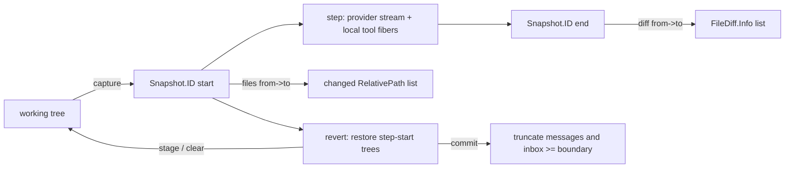

# Episode 17 companion — Snapshots

Show notes for the episode. This is where the material the audio skips is allowed to live:
code, file paths, and diagrams.

**Topics:** 10.1, 10.2, 10.3 · **Runtime:** 25 minutes · **Written source:** Part 10

---

## What the episode claims, and where to check it

| Claim | Source |
|---|---|
| A snapshot is a capture of the Location-scoped working tree at one instant, stored as a content-addressed tree | `10-snapshots-changes.md` § 10.1 |
| Comparison is by object identity, so an unchanged file costs nothing to prove unchanged | § 10.1 |
| Rejected alternatives: diffing against a previous request state, a filesystem watcher, full copies per step | § 10.1 |
| Capture is best-effort and optional; a missing snapshot is `undefined`, not an error | § 10.1 |
| Capture covers the project scope only, with ignore rules and an untracked-file size cap | § 10.1 |
| The start capture is forked as a fiber and awaited at the step's first durable publish | § 10.1 |
| The step stores two snapshot ids and the changed-path list, not the patch | § 10.2 |
| A diff is generated on demand as per-file records: path, status, additions, deletions, patch | § 10.2 |
| Equal start and end short-circuits to an empty file list | § 10.2 |
| "No snapshot" is absent and "no changes" is empty; a client must keep them apart | § 10.2 |
| A turn diff compares the range's first start with its last end, substituting the working copy while running | § 10.2 |
| Rename detection is disabled so both paths appear, which is what revert needs | § 10.2 |
| Stage captures the original, restores the files, and keeps history intact | § 10.3 |
| A second stage keeps the first stage's original, so the escape hatch does not move | § 10.3 |
| The restore plan keeps each file's earliest recorded start snapshot and deletes paths absent from it | § 10.3 |
| Clear restores the original and drops the boundary | § 10.3 |
| Commit deletes messages and inbox rows at or after the boundary, clears revert state, and resets instruction state | § 10.3 |
| Stage, clear, and commit all reject an active session | § 10.3 |
| Revert cannot reach files outside the capture scope, effects that are not file content, or metadata | § 10.3 |

---

## The revert semantics, exactly as the source writes them

The episode reads this aloud with the colons rendered as periods and the dash as a comma. Here
is the passage verbatim from the written material.

```text
// docs/agent-architecture/10-snapshots-changes.md:693
Revert restores files to the state recorded in step-start snapshots and, on commit, removes
the conversation at and after a chosen boundary — but only over the region the snapshots
actually captured, and only while the session is idle.
…
- **Stage** records a boundary and applies the file restoration, but keeps history intact.
  It captures the current working tree as the **original** — the state to return to if the
  user changes their mind — restores every file to the version it had at the start of the
  first step after the boundary, and stores the boundary plus the original snapshot on the
  session row. Staging is reversible.
- **Clear** undoes a stage: it restores the files back to the original snapshot and drops
  the stored boundary. A stage followed by a clear leaves the working tree as it was.
- **Commit** finalizes: the projector deletes every message at or after the boundary, deletes
  inbox rows enqueued at or after the boundary, clears the revert state, and resets
  instruction state. After commit the conversation truly no longer contains those steps.
```

That is the whole contract in one paragraph and three bullets. The preconditions sit in the
same sentence as the promise.

## The snapshot surface

```ts
// packages/core/src/snapshot.ts:43
export interface Interface extends State.Transformable<Editor> {
  /**
   * Capture the current Location-scoped filesystem state as a content-addressed
   * tree. Returns `undefined` when snapshots are disabled, unsupported, or the
   * best-effort capture fails.
   */
  readonly capture: () => Effect.Effect<ID | undefined>
  …
  /**
   * Generate structured per-file diffs between two captured trees. `context`
   * controls unchanged lines around each unified diff hunk.
   */
  readonly diff: (input: DiffInput) => Effect.Effect<readonly FileDiff.Info[], Error>
  …
}
```

The identifier that comes back is a Git tree id, branded so it flows through events and rows as
an opaque value. Capture is gated on the Location being a Git repository and on the runtime
toggle.

## The start capture is forked, not awaited

```ts
// packages/core/src/session/runner/step.ts:73
const attempt = Effect.fn("SessionStep.attempt")(function* (input: Input) {
  // The start snapshot only has to exist before local tools run, which cannot happen before Step.Started,
  // so it is captured while the provider request is in flight instead of delaying it.
  const pendingStartSnapshot = yield* snapshots.capture().pipe(Effect.forkScoped)
  const publisher = createLLMEventPublisher(bus, {
    sessionID: input.sessionID,
    assistantMessageID: input.assistantMessageID,
    agent: input.agent,
    model: input.model.ref,
    providerMetadataKey: input.model.model.route.providerMetadataKey ?? input.model.model.provider,
    pendingSnapshot: Fiber.join(pendingStartSnapshot),
    started: yield* Clock.currentTimeMillis,
  })
```

Only the join is deferred, and it is awaited in two places: before `Step.Started` publishes, and
before any provider event publishes. Both place the await where cancellation still works.

## What the step's end event carries

`Step.Ended` carries the end snapshot and the changed-path list, and both are optional
(`packages/schema/src/session-event.ts:355`). That optionality is the "no snapshot" versus "no
changes" distinction: a step where tracking was off and a step that changed nothing both look
empty from a distance, and only an absent field versus an empty list tells them apart. The
projector folds the start id, the end id, and the paths onto the assistant message, so a reader
never re-derives the summary.

The step computes the file list at settlement by comparing its two trees, and treats "unchanged"
as an empty list rather than calling the comparison. That comparison is three-way in shape: no
start or no end gives nothing, an equal pair gives an empty list, and anything else lists the
changed paths (`packages/core/src/session/runner/step.ts:234`).

## Stage: capture the escape hatch, then build the plan

```ts
// packages/core/src/session/revert.ts:21
export const stage = Effect.fn("SessionRevert.stage")(function* (input: {
  session: SessionSchema.Info
  messageID: SessionMessage.ID
  files?: boolean
}) {
  …
  return yield* Effect.gen(function* () {
    const snapshot = yield* Snapshot.Service
    const original = input.session.revert?.snapshot
      ? Snapshot.ID.make(input.session.revert.snapshot)
      : yield* snapshot.capture()
    const next = yield* plan(database.db, { sessionID: input.session.id, messageID: input.messageID })
    const restore = new Map<RelativePath, Snapshot.ID>()
    if (original) {
      for (const file of input.session.revert?.files ?? []) restore.set(RelativePath.make(file.file), original)
    }
    if (input.files !== false) for (const [file, tree] of next) restore.set(file, tree)
    if (restore.size) yield* snapshot.restore({ files: restore })
```

The expression that computes `original` is the escape hatch rule: reuse the stored original if
there is one, and only capture a new one on the first stage. Moving the boundary must not move
the escape hatch, or "clear" stops meaning "put it back to before I started".

## The plan: earliest start snapshot per file

```ts
// packages/core/src/session/revert.ts:84
const plan = Effect.fn("SessionRevert.plan")(function* (db: Database.Interface["db"], input: BoundaryInput) {
  const boundary = yield* db
    .select({ seq: SessionMessageTable.seq })
    .from(SessionMessageTable)
    .where(and(eq(SessionMessageTable.session_id, input.sessionID), eq(SessionMessageTable.id, input.messageID)))
    .get()
    .pipe(Effect.orDie)
  if (!boundary) return yield* new MessageNotFoundError(input)
  …
  const files = new Map<RelativePath, Snapshot.ID>()
  for (const row of rows) {
    const message = yield* decode({ ...row.data, id: row.id, type: row.type }).pipe(Effect.orDie)
    if (message.type !== "assistant" || !message.snapshot?.start) continue
    for (const file of message.snapshot.files ?? [])
      if (!files.has(file)) files.set(file, Snapshot.ID.make(message.snapshot.start))
  }
  return files
})
```

`if (!files.has(file))` is the whole "earliest" rule. The first step that touched a file sets
its restore tree, and later steps cannot overwrite it.

Two more anchors worth having, since the audio can only describe them:

- Restore removes a path that is absent from its tree, which is how a creation is undone
  (`packages/core/src/git.ts:987`).
- Commit's projection is what actually deletes messages, inbox rows, and the revert state, and
  it dies if the boundary message is gone rather than deleting the wrong range
  (`packages/core/src/session/projector.ts:759`).

---

## The episode's diagram

**D15 — snapshot / diff / revert lifecycle.** One working tree, a start capture, a step that may
write, an end capture, and the two things built from the pair: the changed-path list that goes
on the record and the diff that is derived on demand. Full diagrams and their sources are
collected in Appendix B.

Also relevant:

- **D49** — one step's snapshot pair and file list (beat 2).
- **D50** — revert stage, clear, and commit (beats 3 and 4).



---

## Vocabulary from this episode

Full definitions in [`../appendices/D-glossary.md`](../appendices/D-glossary.md).

- **Snapshot** — the captured state of the working tree at one instant, addressed by content.
- **Content-addressed tree** — a tree whose value is a hash, so identical content is literally
  the same object.
- **Changed paths** — the project-relative names that differ between two captures.
- **Diff** — the per-file patch and counts derived from two captures.
- **Turn** — the range of steps opened by a prompt after the previous idle marker and closed at
  the next idle marker.
- **Stage** — restore the files to the boundary's step-start trees while leaving history intact.
- **Clear** — undo a stage by restoring the original snapshot.
- **Commit** — delete messages and inbox rows at or after the boundary, and clear revert state.
- **Original** — the working tree captured when the first stage began; the escape hatch.

Revert returns content, not side effects. Anything the capture scope did not include is outside
revert, and the interface should say so.

---

## Next episode

Episode 18, *Watching it work*: the path from the event bus, through the server, out to a client,
and the line between what you stream and what you persist. Part 11, topics 11.1 to 11.3.
